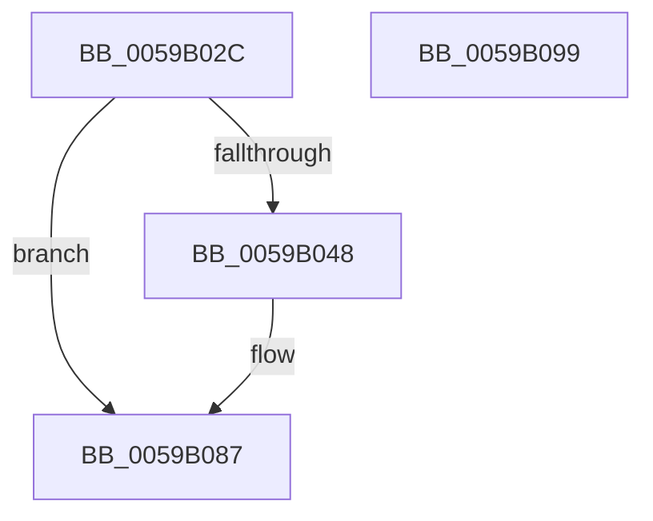

# IopLiveDumpCaptureDumpStart

- RVA: `0x0059B02C`–`0x0059B09A` (길이 `110` bytes)
- VA: `0x000000014059B02C`
- 실행 섹션: `.text`
- PDB 이름 있음: `예`; PDB Function 태그: `아니요`
- unwind 정보 RVA: `0x00060904`
- 디코드: `26`개 명령, `110/110` bytes 표시
- 미해석 바이트: `0` (있으면 어셈블리에 `.byte`로 보존)

> 이 문서는 커널 이미지의 기계어와 PDB 기호를 분석해 생성했습니다. 4번과 5번은 함수 원형과 자료형을 바이너리 사용 방식에서 추정한 C 해석이며 원본 소스 복구 결과는 아닙니다.

## 1. Dependencies

- 직접 호출 지점: **3**; 고유 호출 대상: **3**
- 직접 호출자로 확인된 함수: **1**
- RIP 상대 이미지 참조: **2**

### Outgoing calls
- `0x0059B03F` → [IopLiveDumpIsTracingEnabled](../4F/IopLiveDumpIsTracingEnabled_function_004FC5AC.md) (function, `0x004FC5AC`)
- `0x0059B082` → [IopLiveDumpTrace](../5A/IopLiveDumpTrace_function_005A4070.md) (function, `0x005A4070`)
- `0x0059B08F` → [_security_check_cookie](../6A/_security_check_cookie_function_006AC640.md) (function, `0x006AC640`)

### Direct callers
- [IoCaptureLiveDump](../4E/IoCaptureLiveDump_function_004E085C.md) at `0x004E0945`

### Static image references
- `0x0059B030` → RVA `0x00E0A740` (`.data`; read)
- `0x0059B071` → RVA `0x00021638` (`.rdata`; read)

## 2. Other-region calls and transfers

- 다른 실행 섹션으로 향하는 call: **0**
- 별도 외부 분기/꼬리 이동을 확인하지 못했습니다.

## 3. Assembly (complete function range)

```asm
0059B02C  48 83 EC 58                     sub rsp, 0x58
0059B030  48 8B 05 09 F7 86 00            mov rax, qword ptr [rip + 0x86f709]
0059B037  48 33 C4                        xor rax, rsp
0059B03A  48 89 44 24 40                  mov qword ptr [rsp + 0x40], rax
0059B03F  E8 68 15 F6 FF                  call 0x1404fc5ac
0059B044  84 C0                           test al, al
0059B046  74 3F                           je 0x14059b087
0059B048  83 64 24 2C 00                  and dword ptr [rsp + 0x2c], 0
0059B04D  48 8D 41 18                     lea rax, [rcx + 0x18]
0059B051  83 64 24 3C 00                  and dword ptr [rsp + 0x3c], 0
0059B056  4C 8D 44 24 20                  lea r8, [rsp + 0x20]
0059B05B  BA 04 00 00 00                  mov edx, 4
0059B060  48 89 44 24 20                  mov qword ptr [rsp + 0x20], rax
0059B065  48 8D 41 1C                     lea rax, [rcx + 0x1c]
0059B069  89 54 24 28                     mov dword ptr [rsp + 0x28], edx
0059B06D  89 54 24 38                     mov dword ptr [rsp + 0x38], edx
0059B071  48 8D 0D C0 65 A8 FF            lea rcx, [rip - 0x579a40]
0059B078  BA 02 00 00 00                  mov edx, 2
0059B07D  48 89 44 24 30                  mov qword ptr [rsp + 0x30], rax
0059B082  E8 E9 8F 00 00                  call 0x1405a4070
0059B087  48 8B 4C 24 40                  mov rcx, qword ptr [rsp + 0x40]
0059B08C  48 33 CC                        xor rcx, rsp
0059B08F  E8 AC 15 11 00                  call 0x1406ac640
0059B094  48 83 C4 58                     add rsp, 0x58
0059B098  C3                              ret
0059B099  CC                              int3
```

## 4. C-style interpretation (structured pseudocode)

```c
__int64 __fastcall IopLiveDumpCaptureDumpStart(__int64 a1)
{
    __int64 result;
    __int64 v_rsp;
    unsigned __int64 v_stack_m18;
    unsigned int v_stack_m1C;
    unsigned int v_stack_m20;
    unsigned __int64 v_stack_m28;
    unsigned int v_stack_m2C;
    unsigned int v_stack_m30;
    unsigned __int64 v_stack_m38;

    v_rsp = (v_rsp) - (88);
    result = (*(unsigned __int64 *)(v_rip + 8845065)) ^ (v_rsp);
    v_stack_m18 = result;
    result = IopLiveDumpIsTracingEnabled(a1, a2, a3, a4);
    if ((unsigned __int8)(result) != 0) {
        result = a1 + 24;
        a3 = v_stack_m38;
        a2 = 4;
        v_stack_m38 = result;
        result = a1 + 28;
        v_stack_m30 = (unsigned int)(a2);
        v_stack_m20 = (unsigned int)(a2);
        a1 = v_rip - 5741120;
        a2 = 2;
        v_stack_m28 = result;
        result = IopLiveDumpTrace(a1, a2, a3, a4);
    }
    a1 = (v_stack_m18) ^ (v_rsp);
    result = _security_check_cookie(a1, a2, a3, a4);
    v_rsp = (v_rsp) + (88);
    return result;
}
```

## 5. (Beta) C Style

```c
int64_t IopLiveDumpCaptureDumpStart(int64_t Arg1)
{
    int64_t result;
    int64_t local_rsp;
    uint64_t v_stack_m18;
    uint32_t v_stack_m1C;
    uint32_t v_stack_m20;
    uint64_t v_stack_m28;
    uint32_t v_stack_m2C;
    uint32_t v_stack_m30;
    uint64_t v_stack_m38;

    local_rsp = (local_rsp) - (88);
    result = (*(uint64_t *)(v_rip + 0x86F709)) ^ (local_rsp);
    v_stack_m18 = result;
    result = IopLiveDumpIsTracingEnabled(Arg1, a2, a3, a4);
    if ((uint8_t)(result) != 0) {
        result = Arg1 + 24;
        a3 = v_stack_m38;
        a2 = 4;
        v_stack_m38 = result;
        result = Arg1 + 28;
        v_stack_m30 = (uint32_t)(a2);
        v_stack_m20 = (uint32_t)(a2);
        Arg1 = v_rip - 5741120;
        a2 = 2;
        v_stack_m28 = result;
        result = IopLiveDumpTrace(Arg1, a2, a3, a4);
    }
    Arg1 = (v_stack_m18) ^ (local_rsp);
    result = _security_check_cookie(Arg1, a2, a3, a4);
    local_rsp = (local_rsp) + (88);
    return result;
}
```

## 6. Execution-region graph

[열기: 2D/3D 그래프와 함수 탐색 컨트롤 패널](../../../control-panel.html?section=text&rva=0x0059B02C&view=graph)

- 2D 그래프는 위에서 아래로 흐르고, 3D 그래프는 빈 공간을 드래그해 회전합니다. Shift+드래그는 이동, 휠은 확대·축소, 함수 노드 선택은 대상 보고서 이동입니다.

### Static fallback


