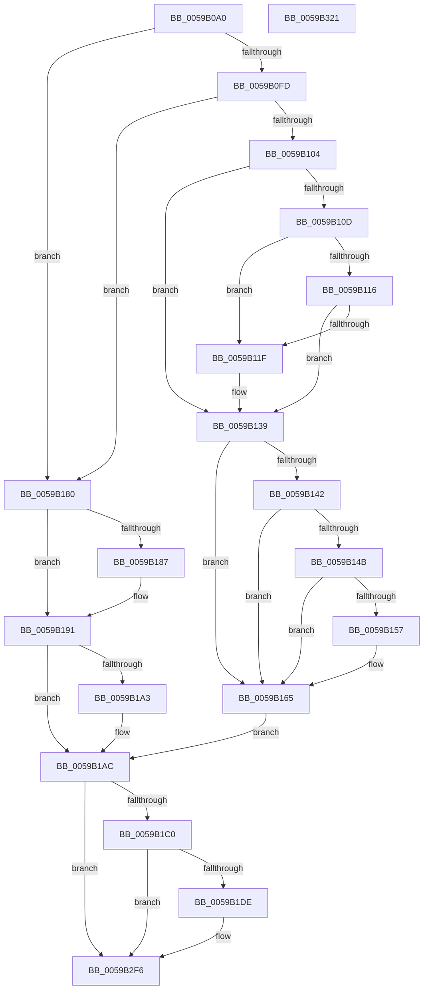

# IopLiveDumpCaptureMemoryPages

- RVA: `0x0059B0A0`–`0x0059B322` (길이 `642` bytes)
- VA: `0x000000014059B0A0`
- 실행 섹션: `.text`
- PDB 이름 있음: `예`; PDB Function 태그: `아니요`
- unwind 정보 RVA: `0x000A2030`
- 디코드: `135`개 명령, `642/642` bytes 표시
- 미해석 바이트: `0` (있으면 어셈블리에 `.byte`로 보존)

> 이 문서는 커널 이미지의 기계어와 PDB 기호를 분석해 생성했습니다. 4번과 5번은 함수 원형과 자료형을 바이너리 사용 방식에서 추정한 C 해석이며 원본 소스 복구 결과는 아닙니다.

## 1. Dependencies

- 직접 호출 지점: **11**; 고유 호출 대상: **10**
- 직접 호출자로 확인된 함수: **1**
- RIP 상대 이미지 참조: **9**

### Outgoing calls
- `0x0059B0D2` → [IopLiveDumpGetMillisecondCounter](../3F/IopLiveDumpGetMillisecondCounter_function_003F5964.md) (function, `0x003F5964`)
- `0x0059B0EB` → [IopLiveDumpCapture](IopLiveDumpCapture_function_0059AF88.md) (function, `0x0059AF88`)
- `0x0059B134` → [VslFinalizeLiveDumpInSk](../58/VslFinalizeLiveDumpInSk_function_0058E16C.md) (function, `0x0058E16C`)
- `0x0059B160` → [memset](../6C/memset_function_006C6C40.md) (function, `0x006C6C40`)
- `0x0059B167` → [IopLiveDumpGetMillisecondCounter](../3F/IopLiveDumpGetMillisecondCounter_function_003F5964.md) (function, `0x003F5964`)
- `0x0059B179` → [IopLiveDumpTraceCaptureMemoryPages](IopLiveDumpTraceCaptureMemoryPages_function_0059E638.md) (function, `0x0059E638`)
- `0x0059B18C` → [IopLiveDumpUncorralProcessors](IopLiveDumpUncorralProcessors_function_0059F4E0.md) (function, `0x0059F4E0`)
- `0x0059B196` → [IopLiveDumpTraceMmDuplicateMemoryFailure](IopLiveDumpTraceMmDuplicateMemoryFailure_function_0059F0BC.md) (function, `0x0059F0BC`)
- `0x0059B1D1` → [tlgKeywordOn](../42/tlgKeywordOn_function_0042EAA0.md) (function, `0x0042EAA0`)
- `0x0059B2F1` → [tlgWriteTransfer_EtwWriteTransfer](../42/tlgWriteTransfer_EtwWriteTransfer_function_004260E0.md) (function, `0x004260E0`)
- `0x0059B2FF` → [_security_check_cookie](../6A/_security_check_cookie_function_006AC640.md) (function, `0x006AC640`)

### Direct callers
- [IoCaptureLiveDump](../4E/IoCaptureLiveDump_function_004E085C.md) at `0x004E0C80`

### Static image references
- `0x0059B0BF` → RVA `0x00E0A740` (`.data`; read)
- `0x0059B0DA` → RVA `0x00E66180` (`.data`; write)
- `0x0059B104` → RVA `0x00FC6A84` (`ALMOSTRO`; read)
- `0x0059B139` → RVA `0x00F8ECAC` (`.data`; read)
- `0x0059B142` → RVA `0x00F8EDA0` (`.data`; read)
- `0x0059B14B` → RVA `0x00F8ECB0` (`.data`; read)
- `0x0059B157` → RVA `0x00F8ECB8` (`.data`; read)
- `0x0059B1AC` → RVA `0x00E06EA0` (`.data`; read)
- `0x0059B20A` → RVA `0x000467F2` (`.rdata`; read)

## 2. Other-region calls and transfers

- 다른 실행 섹션으로 향하는 call: **0**
- 별도 외부 분기/꼬리 이동을 확인하지 못했습니다.

## 3. Assembly (complete function range)

```asm
0059B0A0  48 8B C4                        mov rax, rsp
0059B0A3  48 89 58 10                     mov qword ptr [rax + 0x10], rbx
0059B0A7  48 89 70 18                     mov qword ptr [rax + 0x18], rsi
0059B0AB  48 89 78 20                     mov qword ptr [rax + 0x20], rdi
0059B0AF  55                              push rbp
0059B0B0  41 56                           push r14
0059B0B2  41 57                           push r15
0059B0B4  48 8D 68 C8                     lea rbp, [rax - 0x38]
0059B0B8  48 81 EC 20 01 00 00            sub rsp, 0x120
0059B0BF  48 8B 05 7A F6 86 00            mov rax, qword ptr [rip + 0x86f67a]
0059B0C6  48 33 C4                        xor rax, rsp
0059B0C9  48 89 45 10                     mov qword ptr [rbp + 0x10], rax
0059B0CD  48 8B D9                        mov rbx, rcx
0059B0D0  33 C9                           xor ecx, ecx
0059B0D2  E8 8D A8 E5 FF                  call 0x1403f5964
0059B0D7  48 8B CB                        mov rcx, rbx
0059B0DA  C6 05 9F B0 8C 00 01            mov byte ptr [rip + 0x8cb09f], 1
0059B0E1  4C 8B F0                        mov r14, rax
0059B0E4  48 8D B3 38 01 00 00            lea rsi, [rbx + 0x138]
0059B0EB  E8 98 FE FF FF                  call 0x14059af88
0059B0F0  45 33 FF                        xor r15d, r15d
0059B0F3  8B F8                           mov edi, eax
0059B0F5  85 C0                           test eax, eax
0059B0F7  0F 88 83 00 00 00               js 0x14059b180
0059B0FD  3D 02 01 00 00                  cmp eax, 0x102
0059B102  74 7C                           je 0x14059b180
0059B104  44 38 3D 79 B9 A2 00            cmp byte ptr [rip + 0xa2b979], r15b
0059B10B  74 2C                           je 0x14059b139
0059B10D  4C 39 BB B8 02 00 00            cmp qword ptr [rbx + 0x2b8], r15
0059B114  75 09                           jne 0x14059b11f
0059B116  4C 39 BB C0 02 00 00            cmp qword ptr [rbx + 0x2c0], r15
0059B11D  74 1A                           je 0x14059b139
0059B11F  4C 8D 83 90 00 00 00            lea r8, [rbx + 0x90]
0059B126  48 8D 93 C8 00 00 00            lea rdx, [rbx + 0xc8]
0059B12D  48 8D 8B C0 00 00 00            lea rcx, [rbx + 0xc0]
0059B134  E8 33 30 FF FF                  call 0x14058e16c
0059B139  44 38 3D 6C 3B 9F 00            cmp byte ptr [rip + 0x9f3b6c], r15b
0059B140  74 23                           je 0x14059b165
0059B142  4C 39 3D 57 3C 9F 00            cmp qword ptr [rip + 0x9f3c57], r15
0059B149  74 1A                           je 0x14059b165
0059B14B  48 8B 0D 5E 3B 9F 00            mov rcx, qword ptr [rip + 0x9f3b5e]
0059B152  48 85 C9                        test rcx, rcx
0059B155  74 0E                           je 0x14059b165
0059B157  44 8B 05 5A 3B 9F 00            mov r8d, dword ptr [rip + 0x9f3b5a]
0059B15E  33 D2                           xor edx, edx
0059B160  E8 DB BA 12 00                  call 0x1406c6c40
0059B165  33 C9                           xor ecx, ecx
0059B167  E8 F8 A7 E5 FF                  call 0x1403f5964
0059B16C  49 2B C6                        sub rax, r14
0059B16F  48 8B CB                        mov rcx, rbx
0059B172  48 89 83 E0 01 00 00            mov qword ptr [rbx + 0x1e0], rax
0059B179  E8 BA 34 00 00                  call 0x14059e638
0059B17E  EB 2C                           jmp 0x14059b1ac
0059B180  8B 46 08                        mov eax, dword ptr [rsi + 8]
0059B183  A8 01                           test al, 1
0059B185  74 0A                           je 0x14059b191
0059B187  B2 01                           mov dl, 1
0059B189  48 8B CE                        mov rcx, rsi
0059B18C  E8 4F 43 00 00                  call 0x14059f4e0
0059B191  8B D7                           mov edx, edi
0059B193  48 8B CB                        mov rcx, rbx
0059B196  E8 21 3F 00 00                  call 0x14059f0bc
0059B19B  81 FF 02 01 00 00               cmp edi, 0x102
0059B1A1  75 09                           jne 0x14059b1ac
0059B1A3  83 4B 50 40                     or dword ptr [rbx + 0x50], 0x40
0059B1A7  BF 76 04 00 C0                  mov edi, 0xc0000476
0059B1AC  83 3D ED BC 86 00 05            cmp dword ptr [rip + 0x86bced], 5
0059B1B3  44 88 3D C6 AF 8C 00            mov byte ptr [rip + 0x8cafc6], r15b
0059B1BA  0F 86 36 01 00 00               jbe 0x14059b2f6
0059B1C0  48 BA 00 00 00 00 00 40 00 00   movabs rdx, 0x400000000000
0059B1CA  48 8D 0D CF BC 86 00            lea rcx, [rip + 0x86bccf]
0059B1D1  E8 CA 38 E9 FF                  call 0x14042eaa0
0059B1D6  84 C0                           test al, al
0059B1D8  0F 84 18 01 00 00               je 0x14059b2f6
0059B1DE  48 8D 44 24 30                  lea rax, [rsp + 0x30]
0059B1E3  48 C7 44 24 30 00 00 00 01      mov qword ptr [rsp + 0x30], 0x1000000
0059B1EC  48 89 45 90                     mov qword ptr [rbp - 0x70], rax
0059B1F0  4C 8D 8B B8 03 00 00            lea r9, [rbx + 0x3b8]
0059B1F7  48 8B 83 E0 01 00 00            mov rax, qword ptr [rbx + 0x1e0]
0059B1FE  4C 8D 83 C8 03 00 00            lea r8, [rbx + 0x3c8]
0059B205  48 89 44 24 38                  mov qword ptr [rsp + 0x38], rax
0059B20A  48 8D 15 E1 B5 AA FF            lea rdx, [rip - 0x554a1f]
0059B211  48 8D 44 24 38                  lea rax, [rsp + 0x38]
0059B216  48 C7 45 98 08 00 00 00         mov qword ptr [rbp - 0x68], 8
0059B21E  48 89 45 A0                     mov qword ptr [rbp - 0x60], rax
0059B222  48 8D 0D 77 BC 86 00            lea rcx, [rip + 0x86bc77]
0059B229  48 8B 83 E8 01 00 00            mov rax, qword ptr [rbx + 0x1e8]
0059B230  48 89 44 24 40                  mov qword ptr [rsp + 0x40], rax
0059B235  48 8D 44 24 40                  lea rax, [rsp + 0x40]
0059B23A  48 89 45 B0                     mov qword ptr [rbp - 0x50], rax
0059B23E  48 8B 83 F0 01 00 00            mov rax, qword ptr [rbx + 0x1f0]
0059B245  48 89 44 24 48                  mov qword ptr [rsp + 0x48], rax
0059B24A  48 8D 44 24 48                  lea rax, [rsp + 0x48]
0059B24F  48 89 45 C0                     mov qword ptr [rbp - 0x40], rax
0059B253  48 8B 83 F8 01 00 00            mov rax, qword ptr [rbx + 0x1f8]
0059B25A  48 89 44 24 50                  mov qword ptr [rsp + 0x50], rax
0059B25F  48 8D 44 24 50                  lea rax, [rsp + 0x50]
0059B264  48 89 45 D0                     mov qword ptr [rbp - 0x30], rax
0059B268  48 8B 83 00 02 00 00            mov rax, qword ptr [rbx + 0x200]
0059B26F  48 89 44 24 58                  mov qword ptr [rsp + 0x58], rax
0059B274  48 8D 44 24 58                  lea rax, [rsp + 0x58]
0059B279  48 89 45 E0                     mov qword ptr [rbp - 0x20], rax
0059B27D  48 8B 83 08 02 00 00            mov rax, qword ptr [rbx + 0x208]
0059B284  48 89 44 24 60                  mov qword ptr [rsp + 0x60], rax
0059B289  48 8D 44 24 60                  lea rax, [rsp + 0x60]
0059B28E  48 89 45 F0                     mov qword ptr [rbp - 0x10], rax
0059B292  48 8B 83 10 02 00 00            mov rax, qword ptr [rbx + 0x210]
0059B299  48 89 44 24 68                  mov qword ptr [rsp + 0x68], rax
0059B29E  48 8D 44 24 68                  lea rax, [rsp + 0x68]
0059B2A3  48 89 45 00                     mov qword ptr [rbp], rax
0059B2A7  48 8D 44 24 70                  lea rax, [rsp + 0x70]
0059B2AC  48 89 44 24 28                  mov qword ptr [rsp + 0x28], rax
0059B2B1  C7 44 24 20 0A 00 00 00         mov dword ptr [rsp + 0x20], 0xa
0059B2B9  48 C7 45 A8 08 00 00 00         mov qword ptr [rbp - 0x58], 8
0059B2C1  48 C7 45 B8 08 00 00 00         mov qword ptr [rbp - 0x48], 8
0059B2C9  48 C7 45 C8 08 00 00 00         mov qword ptr [rbp - 0x38], 8
0059B2D1  48 C7 45 D8 08 00 00 00         mov qword ptr [rbp - 0x28], 8
0059B2D9  48 C7 45 E8 08 00 00 00         mov qword ptr [rbp - 0x18], 8
0059B2E1  48 C7 45 F8 08 00 00 00         mov qword ptr [rbp - 8], 8
0059B2E9  48 C7 45 08 08 00 00 00         mov qword ptr [rbp + 8], 8
0059B2F1  E8 EA AD E8 FF                  call 0x1404260e0
0059B2F6  8B C7                           mov eax, edi
0059B2F8  48 8B 4D 10                     mov rcx, qword ptr [rbp + 0x10]
0059B2FC  48 33 CC                        xor rcx, rsp
0059B2FF  E8 3C 13 11 00                  call 0x1406ac640
0059B304  4C 8D 9C 24 20 01 00 00         lea r11, [rsp + 0x120]
0059B30C  49 8B 5B 28                     mov rbx, qword ptr [r11 + 0x28]
0059B310  49 8B 73 30                     mov rsi, qword ptr [r11 + 0x30]
0059B314  49 8B 7B 38                     mov rdi, qword ptr [r11 + 0x38]
0059B318  49 8B E3                        mov rsp, r11
0059B31B  41 5F                           pop r15
0059B31D  41 5E                           pop r14
0059B31F  5D                              pop rbp
0059B320  C3                              ret
0059B321  CC                              int3
```

## 4. C-style interpretation (structured pseudocode)

```c
__int64 __fastcall IopLiveDumpCaptureMemoryPages(__int64 a1)
{
    __int64 result;
    __int64 v_r15;
    __int64 v_rdi;
    __int64 v_rsp;
    unsigned __int64 v_stack_m100;
    unsigned __int64 v_stack_m108;
    unsigned __int64 v_stack_m110;
    unsigned int v_stack_m118;
    unsigned __int64 v_stack_m18;
    unsigned __int64 v_stack_mC8;
    unsigned __int64 v_stack_mD0;
    unsigned __int64 v_stack_mD8;
    unsigned __int64 v_stack_mE0;
    unsigned __int64 v_stack_mE8;
    unsigned __int64 v_stack_mF0;
    unsigned __int64 v_stack_mF8;

    *(unsigned __int64 *)(v_rsp + 16) = v_rbx;
    *(unsigned __int64 *)(v_rsp + 24) = v_rsi;
    *(unsigned __int64 *)(v_rsp + 32) = v_rdi;
    v_rsp = (v_rsp) - (288);
    result = (*(unsigned __int64 *)(v_rip + 8844922)) ^ (v_rsp);
    *(unsigned __int64 *)(v_rsp - 56 + 16) = result;
    a1 = 0;
    result = IopLiveDumpGetMillisecondCounter(a1, a2, a3, a4);
    *(unsigned __int8 *)(v_rip + 9220255) = 1;
    result = IopLiveDumpCapture(0, a2, a3, a4);
    v_r15 = 0;
    if (sign_flag) goto loc_0059B180;
    if (((unsigned int)(result)) == 258) goto loc_0059B180;
    if ((*(unsigned __int8 *)(v_rip + 10664313)) == 0) goto loc_0059B139;
    if ((*(unsigned __int64 *)(a1 + 696)) != 0) goto loc_0059B11F;
    if ((*(unsigned __int64 *)(a1 + 704)) != 0) {
        a3 = a1 + 144;
        a2 = a1 + 200;
        a1 = a1 + 192;
        result = VslFinalizeLiveDumpInSk(a1, a2, a3, a4);
    }
    if ((*(unsigned __int8 *)(v_rip + 10435436)) == 0) goto loc_0059B165;
    if ((*(unsigned __int64 *)(v_rip + 10435671)) == 0) goto loc_0059B165;
    if (*(unsigned __int64 *)(v_rip + 10435422) != 0) {
        a3 = *(unsigned int *)(v_rip + 10435418);
        a2 = 0;
        result = memset(*(unsigned __int64 *)(v_rip + 10435422), a2, a3, a4);
    }
    a1 = 0;
    result = IopLiveDumpGetMillisecondCounter(a1, a2, a3, a4);
    result = (result) - (result);
    *(unsigned __int64 *)(a1 + 480) = result;
    result = IopLiveDumpTraceCaptureMemoryPages(0, a2, a3, a4);
    goto loc_0059B1AC;
loc_0059B180:
    result = (unsigned int)(*(unsigned int *)(a1 + 312 + 8));
    if ((((unsigned __int8)((unsigned int)(*(unsigned int *)(a1 + 312 + 8)))) & (1)) != 0) {
        a2 = 1;
        a1 = a1 + 312;
        result = IopLiveDumpUncorralProcessors(a1, a2, a3, a4);
    }
    result = IopLiveDumpTraceMmDuplicateMemoryFailure(a1, (unsigned int)((unsigned int)((unsigned int)((unsigned int)(result)))), a3, a4);
    v_rdi = (unsigned int)((unsigned int)(result));
    if (((unsigned int)((unsigned int)((unsigned int)(result)))) == 258) {
        v_rdi = 0xC0000476ULL;
    }
    *(unsigned __int8 *)(v_rip + 9220038) = 0;
    if ((*(unsigned int *)(v_rip + 8830189)) <= 5) goto loc_0059B2F6;
    result = tlgKeywordOn(v_rip + 8830159, (unsigned int)((unsigned int)((unsigned int)((unsigned int)(result)))), a3, a4);
    if ((unsigned __int8)(result) != 0) {
        result = v_stack_m108;
        v_stack_m108 = 0x1000000ULL;
        *(unsigned __int64 *)(v_rsp - 56 - 112) = result;
        a4 = a1 + 952;
        result = *(unsigned __int64 *)(a1 + 480);
        a3 = a1 + 968;
        v_stack_m100 = result;
        a2 = v_rip - 5589535;
        result = v_stack_m100;
        *(unsigned __int64 *)(v_rsp - 56 - 104) = 8;
        *(unsigned __int64 *)(v_rsp - 56 - 96) = result;
        a1 = v_rip + 8830071;
        result = *(unsigned __int64 *)(a1 + 488);
        v_stack_mF8 = result;
        result = v_stack_mF8;
        *(unsigned __int64 *)(v_rsp - 56 - 80) = result;
        result = *(unsigned __int64 *)(a1 + 496);
        v_stack_mF0 = result;
        result = v_stack_mF0;
        *(unsigned __int64 *)(v_rsp - 56 - 64) = result;
        result = *(unsigned __int64 *)(a1 + 504);
        v_stack_mE8 = result;
        result = v_stack_mE8;
        *(unsigned __int64 *)(v_rsp - 56 - 48) = result;
        result = *(unsigned __int64 *)(a1 + 512);
        v_stack_mE0 = result;
        result = v_stack_mE0;
        *(unsigned __int64 *)(v_rsp - 56 - 32) = result;
        result = *(unsigned __int64 *)(a1 + 520);
        v_stack_mD8 = result;
        result = v_stack_mD8;
        *(unsigned __int64 *)(v_rsp - 56 - 16) = result;
        result = *(unsigned __int64 *)(a1 + 528);
        v_stack_mD0 = result;
        result = v_stack_mD0;
        *(unsigned __int64 *)(v_rsp - 56) = result;
        result = v_stack_mC8;
        v_stack_m110 = result;
        v_stack_m118 = 10;
        *(unsigned __int64 *)(v_rsp - 56 - 88) = 8;
        *(unsigned __int64 *)(v_rsp - 56 - 72) = 8;
        *(unsigned __int64 *)(v_rsp - 56 - 56) = 8;
        *(unsigned __int64 *)(v_rsp - 56 - 40) = 8;
        *(unsigned __int64 *)(v_rsp - 56 - 24) = 8;
        *(unsigned __int64 *)(v_rsp - 56 - 8) = 8;
        *(unsigned __int64 *)(v_rsp - 56 + 8) = 8;
        result = tlgWriteTransfer_EtwWriteTransfer(a1, a2, a3, a4);
    }
    a1 = (*(unsigned __int64 *)(v_rsp - 56 + 16)) ^ (v_rsp);
    result = _security_check_cookie(a1, a2, a3, a4);
    return result;
}
```

## 5. (Beta) C Style

```c
int64_t IopLiveDumpCaptureMemoryPages(void *Arg1)
{
    uint8_t *arg1 = (uint8_t *)Arg1;

    int64_t result;
    int64_t local_r15;
    int64_t local_rdi;
    int64_t local_rsp;
    uint64_t v_stack_m100;
    uint64_t v_stack_m108;
    uint64_t v_stack_m110;
    uint32_t v_stack_m118;
    uint64_t v_stack_m18;
    uint64_t v_stack_mC8;
    uint64_t v_stack_mD0;
    uint64_t v_stack_mD8;
    uint64_t v_stack_mE0;
    uint64_t v_stack_mE8;
    uint64_t v_stack_mF0;
    uint64_t v_stack_mF8;

    *(uint64_t *)(local_rsp + 0x10) = local_rbx;
    *(uint64_t *)(local_rsp + 0x18) = local_rsi;
    *(uint64_t *)(local_rsp + 0x20) = local_rdi;
    local_rsp = (local_rsp) - (288);
    result = (*(uint64_t *)(v_rip + 0x86F67A)) ^ (local_rsp);
    *(uint64_t *)(local_rsp - 0x38 + 0x10) = result;
    Arg1 = 0;
    result = IopLiveDumpGetMillisecondCounter(Arg1, a2, a3, a4);
    *(uint8_t *)(v_rip + 0x8CB09F) = 1;
    result = IopLiveDumpCapture(0, a2, a3, a4);
    local_r15 = 0;
    if (sign_flag) goto loc_0059B180;
    if (((uint32_t)(result)) == 258) goto loc_0059B180;
    if ((*(uint8_t *)(v_rip + 0xA2B979)) == 0) goto loc_0059B139;
    if ((*(uint64_t *)(arg1 + 0x2B8)) != 0) goto loc_0059B11F;
    if ((*(uint64_t *)(arg1 + 0x2C0)) != 0) {
        a3 = Arg1 + 144;
        a2 = Arg1 + 200;
        Arg1 = Arg1 + 192;
        result = VslFinalizeLiveDumpInSk(Arg1, a2, a3, a4);
    }
    if ((*(uint8_t *)(v_rip + 0x9F3B6C)) == 0) goto loc_0059B165;
    if ((*(uint64_t *)(v_rip + 0x9F3C57)) == 0) goto loc_0059B165;
    if (*(uint64_t *)(v_rip + 0x9F3B5E) != 0) {
        a3 = *(uint32_t *)(v_rip + 0x9F3B5A);
        a2 = 0;
        result = memset(*(uint64_t *)(v_rip + 0x9F3B5E), a2, a3, a4);
    }
    Arg1 = 0;
    result = IopLiveDumpGetMillisecondCounter(Arg1, a2, a3, a4);
    result = (result) - (result);
    *(uint64_t *)(arg1 + 0x1E0) = result;
    result = IopLiveDumpTraceCaptureMemoryPages(0, a2, a3, a4);
    goto loc_0059B1AC;
loc_0059B180:
    result = (uint32_t)(*(uint32_t *)(arg1 + 0x138 + 0x8));
    if ((((uint8_t)((uint32_t)(*(uint32_t *)(arg1 + 0x138 + 0x8)))) & (1)) != 0) {
        a2 = 1;
        Arg1 = Arg1 + 312;
        result = IopLiveDumpUncorralProcessors(Arg1, a2, a3, a4);
    }
    result = IopLiveDumpTraceMmDuplicateMemoryFailure(Arg1, (uint32_t)((uint32_t)((uint32_t)((uint32_t)(result)))), a3, a4);
    local_rdi = (uint32_t)((uint32_t)(result));
    if (((uint32_t)((uint32_t)((uint32_t)(result)))) == 258) {
        local_rdi = 0xC0000476ULL;
    }
    *(uint8_t *)(v_rip + 0x8CAFC6) = 0;
    if ((*(uint32_t *)(v_rip + 0x86BCED)) <= 5) goto loc_0059B2F6;
    result = tlgKeywordOn(v_rip + 8830159, (uint32_t)((uint32_t)((uint32_t)((uint32_t)(result)))), a3, a4);
    if ((uint8_t)(result) != 0) {
        result = v_stack_m108;
        v_stack_m108 = 0x1000000ULL;
        *(uint64_t *)(local_rsp - 0x38 - 0x70) = result;
        a4 = Arg1 + 952;
        result = *(uint64_t *)(arg1 + 0x1E0);
        a3 = Arg1 + 968;
        v_stack_m100 = result;
        a2 = v_rip - 5589535;
        result = v_stack_m100;
        *(uint64_t *)(local_rsp - 0x38 - 0x68) = 8;
        *(uint64_t *)(local_rsp - 0x38 - 0x60) = result;
        Arg1 = v_rip + 8830071;
        result = *(uint64_t *)(arg1 + 0x1E8);
        v_stack_mF8 = result;
        result = v_stack_mF8;
        *(uint64_t *)(local_rsp - 0x38 - 0x50) = result;
        result = *(uint64_t *)(arg1 + 0x1F0);
        v_stack_mF0 = result;
        result = v_stack_mF0;
        *(uint64_t *)(local_rsp - 0x38 - 0x40) = result;
        result = *(uint64_t *)(arg1 + 0x1F8);
        v_stack_mE8 = result;
        result = v_stack_mE8;
        *(uint64_t *)(local_rsp - 0x38 - 0x30) = result;
        result = *(uint64_t *)(arg1 + 0x200);
        v_stack_mE0 = result;
        result = v_stack_mE0;
        *(uint64_t *)(local_rsp - 0x38 - 0x20) = result;
        result = *(uint64_t *)(arg1 + 0x208);
        v_stack_mD8 = result;
        result = v_stack_mD8;
        *(uint64_t *)(local_rsp - 0x38 - 0x10) = result;
        result = *(uint64_t *)(arg1 + 0x210);
        v_stack_mD0 = result;
        result = v_stack_mD0;
        *(uint64_t *)(local_rsp - 0x38) = result;
        result = v_stack_mC8;
        v_stack_m110 = result;
        v_stack_m118 = 10;
        *(uint64_t *)(local_rsp - 0x38 - 0x58) = 8;
        *(uint64_t *)(local_rsp - 0x38 - 0x48) = 8;
        *(uint64_t *)(local_rsp - 0x38 - 0x38) = 8;
        *(uint64_t *)(local_rsp - 0x38 - 0x28) = 8;
        *(uint64_t *)(local_rsp - 0x38 - 0x18) = 8;
        *(uint64_t *)(local_rsp - 0x38 - 0x8) = 8;
        *(uint64_t *)(local_rsp - 0x38 + 0x8) = 8;
        result = tlgWriteTransfer_EtwWriteTransfer(Arg1, a2, a3, a4);
    }
    Arg1 = (*(uint64_t *)(local_rsp - 0x38 + 0x10)) ^ (local_rsp);
    result = _security_check_cookie(Arg1, a2, a3, a4);
    return result;
}
```

### 관측된 메모리 오프셋

구조체 형식이 확인되지 않은 접근은 인자 기준의 오프셋으로만 기록했습니다.

| 기준 인자 | 오프셋 표현 | 폭 (bit) | 접근 |
|---|---:|---:|---|
| `Arg1` | `+ 0x8` | `32` | `R` |
| `Arg1` | `+ 0x50` | `32` | `R/W` |
| `Arg1` | `+ 0x90` | `64` | `R` |
| `Arg1` | `+ 0xC0` | `64` | `R` |
| `Arg1` | `+ 0xC8` | `64` | `R` |
| `Arg1` | `+ 0x138` | `64` | `R` |
| `Arg1` | `+ 0x1E0` | `64` | `R` |
| `Arg1` | `+ 0x1E0` | `64` | `W` |
| `Arg1` | `+ 0x1E8` | `64` | `R` |
| `Arg1` | `+ 0x1F0` | `64` | `R` |
| `Arg1` | `+ 0x1F8` | `64` | `R` |
| `Arg1` | `+ 0x200` | `64` | `R` |
| `Arg1` | `+ 0x208` | `64` | `R` |
| `Arg1` | `+ 0x210` | `64` | `R` |
| `Arg1` | `+ 0x2B8` | `64` | `R` |
| `Arg1` | `+ 0x2C0` | `64` | `R` |
| `Arg1` | `+ 0x3B8` | `64` | `R` |
| `Arg1` | `+ 0x3C8` | `64` | `R` |

## 6. Execution-region graph

[열기: 2D/3D 그래프와 함수 탐색 컨트롤 패널](../../../control-panel.html?section=text&rva=0x0059B0A0&view=graph)

- 2D 그래프는 위에서 아래로 흐르고, 3D 그래프는 빈 공간을 드래그해 회전합니다. Shift+드래그는 이동, 휠은 확대·축소, 함수 노드 선택은 대상 보고서 이동입니다.

### Static fallback


