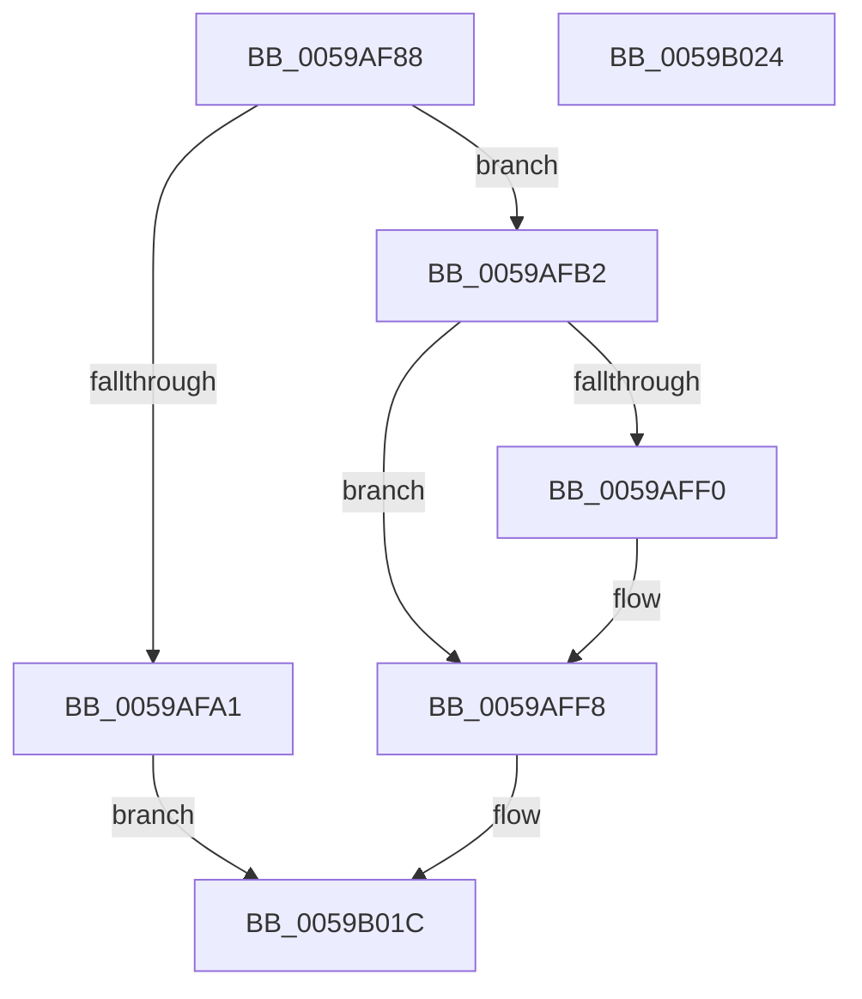

# IopLiveDumpCapture

- RVA: `0x0059AF88`–`0x0059B025` (길이 `157` bytes)
- VA: `0x000000014059AF88`
- 실행 섹션: `.text`
- PDB 이름 있음: `예`; PDB Function 태그: `아니요`
- unwind 정보 RVA: `0x00071A74`
- 디코드: `42`개 명령, `157/157` bytes 표시
- 미해석 바이트: `0` (있으면 어셈블리에 `.byte`로 보존)

> 이 문서는 커널 이미지의 기계어와 PDB 기호를 분석해 생성했습니다. 4번과 5번은 함수 원형과 자료형을 바이너리 사용 방식에서 추정한 C 해석이며 원본 소스 복구 결과는 아닙니다.

## 1. Dependencies

- 직접 호출 지점: **5**; 고유 호출 대상: **5**
- 직접 호출자로 확인된 함수: **2**
- RIP 상대 이미지 참조: **4**

### Outgoing calls
- `0x0059AFA1` → [IopLiveDumpEnterCorralledState](IopLiveDumpEnterCorralledState_function_0059BA40.md) (function, `0x0059BA40`)
- `0x0059AFA9` → [IopLiveDumpCollectPages](IopLiveDumpCollectPages_function_0059B328.md) (function, `0x0059B328`)
- `0x0059AFFF` → [MmLockPagableSectionByHandle](../../page/A4/MmLockPagableSectionByHandle_function_00A4D1E0.md) (function, `0x00A4D1E0`)
- `0x0059B009` → [MmDuplicateMemory](../../pagelk/B7/MmDuplicateMemory_function_00B74158.md) (function, `0x00B74158`)
- `0x0059B017` → [MmUnlockPagableImageSection](../2A/MmUnlockPagableImageSection_function_002A39F0.md) (function, `0x002A39F0`)

### Direct callers
- [IopLiveDumpCaptureMemoryPages](IopLiveDumpCaptureMemoryPages_function_0059B0A0.md) at `0x0059B0EB`
- [IopLiveDumpEstimateMemoryPages](IopLiveDumpEstimateMemoryPages_function_0059BA80.md) at `0x0059BAE1`

### Static image references
- `0x0059AFB4` → RVA `0x0059E250` (`IopLiveDumpStartMirroringCallback`; read)
- `0x0059AFC5` → RVA `0x0059B990` (`IopLiveDumpEndMirroringCallback`; read)
- `0x0059AFD1` → RVA `0x0059D260` (`IopLiveDumpMirrorPhysicalMemoryCallback`; read)
- `0x0059AFF8` → RVA `0x00FC6C00` (`ALMOSTRO`; read)

## 2. Other-region calls and transfers

- 다른 실행 섹션으로 향하는 call: **2**
  - `0x0059AFFF` → [MmLockPagableSectionByHandle](../../page/A4/MmLockPagableSectionByHandle_function_00A4D1E0.md) (`.text` → `PAGE`)
  - `0x0059B009` → [MmDuplicateMemory](../../pagelk/B7/MmDuplicateMemory_function_00B74158.md) (`.text` → `PAGELK`)
- 별도 외부 분기/꼬리 이동을 확인하지 못했습니다.

## 3. Assembly (complete function range)

```asm
0059AF88  40 53                           push rbx
0059AF8A  48 83 EC 50                     sub rsp, 0x50
0059AF8E  8B 41 28                        mov eax, dword ptr [rcx + 0x28]
0059AF91  0F 57 C0                        xorps xmm0, xmm0
0059AF94  48 8B D9                        mov rbx, rcx
0059AF97  F3 0F 7F 44 24 38               movdqu xmmword ptr [rsp + 0x38], xmm0
0059AF9D  A8 20                           test al, 0x20
0059AF9F  74 11                           je 0x14059afb2
0059AFA1  E8 9A 0A 00 00                  call 0x14059ba40
0059AFA6  48 8B CB                        mov rcx, rbx
0059AFA9  E8 7A 03 00 00                  call 0x14059b328
0059AFAE  8B D8                           mov ebx, eax
0059AFB0  EB 6A                           jmp 0x14059b01c
0059AFB2  24 04                           and al, 4
0059AFB4  48 8D 0D 95 32 00 00            lea rcx, [rip + 0x3295]
0059AFBB  48 89 4C 24 20                  mov qword ptr [rsp + 0x20], rcx
0059AFC0  F6 D8                           neg al
0059AFC2  8B 43 50                        mov eax, dword ptr [rbx + 0x50]
0059AFC5  48 8D 0D C4 09 00 00            lea rcx, [rip + 0x9c4]
0059AFCC  48 89 4C 24 28                  mov qword ptr [rsp + 0x28], rcx
0059AFD1  48 8D 0D 88 22 00 00            lea rcx, [rip + 0x2288]
0059AFD8  48 89 4C 24 30                  mov qword ptr [rsp + 0x30], rcx
0059AFDD  1B C9                           sbb ecx, ecx
0059AFDF  83 E1 40                        and ecx, 0x40
0059AFE2  81 C1 51 02 00 00               add ecx, 0x251
0059AFE8  89 4C 24 40                     mov dword ptr [rsp + 0x40], ecx
0059AFEC  A8 20                           test al, 0x20
0059AFEE  74 08                           je 0x14059aff8
0059AFF0  0F BA E9 08                     bts ecx, 8
0059AFF4  89 4C 24 40                     mov dword ptr [rsp + 0x40], ecx
0059AFF8  48 8B 0D 01 BC A2 00            mov rcx, qword ptr [rip + 0xa2bc01]
0059AFFF  E8 DC 21 4B 00                  call 0x140a4d1e0
0059B004  48 8D 4C 24 20                  lea rcx, [rsp + 0x20]
0059B009  E8 4A 91 5D 00                  call 0x140b74158
0059B00E  48 8B 0D EB BB A2 00            mov rcx, qword ptr [rip + 0xa2bbeb]
0059B015  8B D8                           mov ebx, eax
0059B017  E8 D4 89 D0 FF                  call 0x1402a39f0
0059B01C  8B C3                           mov eax, ebx
0059B01E  48 83 C4 50                     add rsp, 0x50
0059B022  5B                              pop rbx
0059B023  C3                              ret
0059B024  CC                              int3
```

## 4. C-style interpretation (structured pseudocode)

```c
__int64 __fastcall IopLiveDumpCapture(__int64 a1)
{
    __int64 result;
    __int64 v_rsp;
    unsigned int v_stack_m18;
    unsigned __int64 v_stack_m20;
    unsigned __int64 v_stack_m28;
    unsigned __int64 v_stack_m30;
    unsigned __int64 v_stack_m38;

    v_rsp = (v_rsp) - (80);
    v_stack_m20 = v_xmm0;
    if ((((unsigned __int8)((unsigned int)(*(unsigned int *)(a1 + 40)))) & (32)) == 0) goto loc_0059AFB2;
    result = IopLiveDumpEnterCorralledState(a1, a2, a3, a4);
    result = IopLiveDumpCollectPages(a1, a2, a3, a4);
    goto loc_0059B01C;
loc_0059AFB2:
    result = (unsigned __int8)((result) & (4));
    v_stack_m38 = v_rip + 12949;
    result = (unsigned __int8)(-(result));
    v_stack_m30 = v_rip + 2500;
    v_stack_m28 = v_rip + 8840;
    a1 = (unsigned int)((v_rip + 8840) & (64));
    a1 = (unsigned int)((a1) + (593));
    v_stack_m18 = (unsigned int)(a1);
    if ((((unsigned __int8)((unsigned int)(*(unsigned int *)((unsigned int)((unsigned int)(result)) + 80)))) & (32)) != 0) {
        v_stack_m18 = (unsigned int)(a1);
    }
    result = MmLockPagableSectionByHandle(*(unsigned __int64 *)(v_rip + 10664961), a2, a3, a4);
    result = MmDuplicateMemory(v_stack_m38, a2, a3, a4);
    result = MmUnlockPagableImageSection(*(unsigned __int64 *)(v_rip + 10664939), a2, a3, a4);
loc_0059B01C:
    v_rsp = (v_rsp) + (80);
    return (unsigned int)((unsigned int)((unsigned int)((unsigned int)(result))));
}
```

## 5. (Beta) C Style

```c
int64_t IopLiveDumpCapture(void *Arg1)
{
    uint8_t *arg1 = (uint8_t *)Arg1;

    int64_t result;
    int64_t local_rsp;
    uint32_t v_stack_m18;
    uint64_t v_stack_m20;
    uint64_t v_stack_m28;
    uint64_t v_stack_m30;
    uint64_t v_stack_m38;

    local_rsp = (local_rsp) - (80);
    v_stack_m20 = v_xmm0;
    if ((((uint8_t)((uint32_t)(*(uint32_t *)(arg1 + 0x28)))) & (32)) == 0) goto loc_0059AFB2;
    result = IopLiveDumpEnterCorralledState(Arg1, a2, a3, a4);
    result = IopLiveDumpCollectPages(Arg1, a2, a3, a4);
    goto loc_0059B01C;
loc_0059AFB2:
    result = (uint8_t)((result) & (4));
    v_stack_m38 = v_rip + 12949;
    result = (uint8_t)(-(result));
    v_stack_m30 = v_rip + 2500;
    v_stack_m28 = v_rip + 8840;
    Arg1 = (uint32_t)((v_rip + 8840) & (64));
    Arg1 = (uint32_t)((Arg1) + (593));
    v_stack_m18 = (uint32_t)(Arg1);
    if ((((uint8_t)((uint32_t)(*(uint32_t *)((uint32_t)((uint32_t)(result)) + 0x50)))) & (32)) != 0) {
        v_stack_m18 = (uint32_t)(Arg1);
    }
    result = MmLockPagableSectionByHandle(*(uint64_t *)(v_rip + 0xA2BC01), a2, a3, a4);
    result = MmDuplicateMemory(v_stack_m38, a2, a3, a4);
    result = MmUnlockPagableImageSection(*(uint64_t *)(v_rip + 0xA2BBEB), a2, a3, a4);
loc_0059B01C:
    local_rsp = (local_rsp) + (80);
    return (uint32_t)((uint32_t)((uint32_t)((uint32_t)(result))));
}
```

### 관측된 메모리 오프셋

구조체 형식이 확인되지 않은 접근은 인자 기준의 오프셋으로만 기록했습니다.

| 기준 인자 | 오프셋 표현 | 폭 (bit) | 접근 |
|---|---:|---:|---|
| `Arg1` | `+ 0x28` | `32` | `R` |
| `Arg1` | `+ 0x50` | `32` | `R` |

## 6. Execution-region graph

[열기: 2D/3D 그래프와 함수 탐색 컨트롤 패널](../../../control-panel.html?section=text&rva=0x0059AF88&view=graph)

- 2D 그래프는 위에서 아래로 흐르고, 3D 그래프는 빈 공간을 드래그해 회전합니다. Shift+드래그는 이동, 휠은 확대·축소, 함수 노드 선택은 대상 보고서 이동입니다.

### Static fallback


