# IopLiveDumpCollectPages

- RVA: `0x0059B328`–`0x0059B6A1` (길이 `889` bytes)
- VA: `0x000000014059B328`
- 실행 섹션: `.text`
- PDB 이름 있음: `예`; PDB Function 태그: `아니요`
- unwind 정보 RVA: `0x000C7B58`
- 디코드: `206`개 명령, `889/889` bytes 표시
- 미해석 바이트: `0` (있으면 어셈블리에 `.byte`로 보존)

> 이 문서는 커널 이미지의 기계어와 PDB 기호를 분석해 생성했습니다. 4번과 5번은 함수 원형과 자료형을 바이너리 사용 방식에서 추정한 C 해석이며 원본 소스 복구 결과는 아닙니다.

## 1. Dependencies

- 직접 호출 지점: **26**; 고유 호출 대상: **18**
- 직접 호출자로 확인된 함수: **2**
- RIP 상대 이미지 참조: **3**

### Outgoing calls
- `0x0059B34A` → [IopLiveDumpGetMillisecondCounter](../3F/IopLiveDumpGetMillisecondCounter_function_003F5964.md) (function, `0x003F5964`)
- `0x0059B3B3` → [IoFillDumpHeader](IoFillDumpHeader_function_00591ECC.md) (function, `0x00591ECC`)
- `0x0059B3CF` → [RtlCaptureContext](../4F/RtlCaptureContext_function_004FE570.md) (function, `0x004FE570`)
- `0x0059B3DB` → [KiSaveProcessorControlState](../6B/KiSaveProcessorControlState_function_006B0EF0.md) (function, `0x006B0EF0`)
- `0x0059B3FC` → [RtlCaptureContext](../4F/RtlCaptureContext_function_004FE570.md) (function, `0x004FE570`)
- `0x0059B408` → [KiSaveProcessorControlState](../6B/KiSaveProcessorControlState_function_006B0EF0.md) (function, `0x006B0EF0`)
- `0x0059B425` → [memset](../6C/memset_function_006C6C40.md) (function, `0x006C6C40`)
- `0x0059B4D9` → [KeSaveSupervisorState](../5B/KeSaveSupervisorState_function_005B9CB4.md) (function, `0x005B9CB4`)
- `0x0059B4EE` → [IopLiveDumpGetMillisecondCounter](../3F/IopLiveDumpGetMillisecondCounter_function_003F5964.md) (function, `0x003F5964`)
- `0x0059B4FC` → [IopLiveDumpTraceCaptureProcessorContextDuration](IopLiveDumpTraceCaptureProcessorContextDuration_function_0059E718.md) (function, `0x0059E718`)
- `0x0059B51C` → [IopLiveDumpMarkRequiredDumpData](IopLiveDumpMarkRequiredDumpData_function_0059D070.md) (function, `0x0059D070`)
- `0x0059B539` → [RtlNumberOfSetBitsEx](../41/RtlNumberOfSetBitsEx_function_00418CA0.md) (function, `0x00418CA0`)
- `0x0059B588` → [IopLiveDumpMarkImportantDumpData](IopLiveDumpMarkImportantDumpData_function_0059CCA4.md) (function, `0x0059CCA4`)
- `0x0059B5A1` → [IopLiveDumpPopulateBitmapForDump](IopLiveDumpPopulateBitmapForDump_function_0059D9B0.md) (function, `0x0059D9B0`)
- `0x0059B5C4` → [IopLiveDumpGetMillisecondCounter](../3F/IopLiveDumpGetMillisecondCounter_function_003F5964.md) (function, `0x003F5964`)
- `0x0059B5E6` → [HvlCollectLivedump](../58/HvlCollectLivedump_function_0058B460.md) (function, `0x0058B460`)
- `0x0059B5ED` → [IopLiveDumpGetMillisecondCounter](../3F/IopLiveDumpGetMillisecondCounter_function_003F5964.md) (function, `0x003F5964`)
- `0x0059B5FC` → [IopLiveDumpGenerateIptSecondaryData](IopLiveDumpGenerateIptSecondaryData_function_0059C074.md) (function, `0x0059C074`)
- `0x0059B604` → [IopLiveDumpPopulateBitmapForDump](IopLiveDumpPopulateBitmapForDump_function_0059D9B0.md) (function, `0x0059D9B0`)
- `0x0059B60F` → [KdDecodeDataBlock](../5B/KdDecodeDataBlock_function_005B05A8.md) (function, `0x005B05A8`)
- `0x0059B61B` → [IopLiveDumpTraceNoArgs](../5A/IopLiveDumpTraceNoArgs_function_005A43C0.md) (function, `0x005A43C0`)
- `0x0059B631` → [IopLiveDumpInitiateCorralStateChange](IopLiveDumpInitiateCorralStateChange_function_0059CA5C.md) (function, `0x0059CA5C`)
- `0x0059B63D` → [IopLiveDumpTraceNoArgs](../5A/IopLiveDumpTraceNoArgs_function_005A43C0.md) (function, `0x005A43C0`)
- `0x0059B642` → [KdEncodeDataBlock](../5B/KdEncodeDataBlock_function_005B06B0.md) (function, `0x005B06B0`)
- `0x0059B65E` → [IopLiveDumpUncorralProcessors](IopLiveDumpUncorralProcessors_function_0059F4E0.md) (function, `0x0059F4E0`)
- `0x0059B665` → [IopLiveDumpGetMillisecondCounter](../3F/IopLiveDumpGetMillisecondCounter_function_003F5964.md) (function, `0x003F5964`)

### Direct callers
- [IopLiveDumpCapture](IopLiveDumpCapture_function_0059AF88.md) at `0x0059AFA9`
- [IopLiveDumpEndMirroringCallback](IopLiveDumpEndMirroringCallback_function_0059B990.md) at `0x0059B9E0`

### Static image references
- `0x0059B4AE` → RVA `0x00E66180` (`.data`; read)
- `0x0059B614` → RVA `0x00021068` (`.rdata`; read)
- `0x0059B636` → RVA `0x00023010` (`.rdata`; read)

## 2. Other-region calls and transfers

- 다른 실행 섹션으로 향하는 call: **0**
- 별도 외부 분기/꼬리 이동을 확인하지 못했습니다.

## 3. Assembly (complete function range)

```asm
0059B328  48 89 5C 24 10                  mov qword ptr [rsp + 0x10], rbx
0059B32D  48 89 6C 24 18                  mov qword ptr [rsp + 0x18], rbp
0059B332  48 89 74 24 20                  mov qword ptr [rsp + 0x20], rsi
0059B337  57                              push rdi
0059B338  48 83 EC 40                     sub rsp, 0x40
0059B33C  8B 41 50                        mov eax, dword ptr [rcx + 0x50]
0059B33F  33 ED                           xor ebp, ebp
0059B341  48 8B F1                        mov rsi, rcx
0059B344  84 C0                           test al, al
0059B346  79 2B                           jns 0x14059b373
0059B348  33 C9                           xor ecx, ecx
0059B34A  E8 15 A6 E5 FF                  call 0x1403f5964
0059B34F  48 8B E8                        mov rbp, rax
0059B352  8B 46 50                        mov eax, dword ptr [rsi + 0x50]
0059B355  48 8B CD                        mov rcx, rbp
0059B358  48 2B 8E 18 02 00 00            sub rcx, qword ptr [rsi + 0x218]
0059B35F  A8 01                           test al, 1
0059B361  74 09                           je 0x14059b36c
0059B363  48 89 8E C8 01 00 00            mov qword ptr [rsi + 0x1c8], rcx
0059B36A  EB 07                           jmp 0x14059b373
0059B36C  48 89 8E F0 01 00 00            mov qword ptr [rsi + 0x1f0], rcx
0059B373  A8 01                           test al, 1
0059B375  75 41                           jne 0x14059b3b8
0059B377  65 48 8B 04 25 88 01 00 00      mov rax, qword ptr gs:[0x188]
0059B380  BA 06 00 00 00                  mov edx, 6
0059B385  4C 8B 4E 08                     mov r9, qword ptr [rsi + 8]
0059B389  44 8B 06                        mov r8d, dword ptr [rsi]
0059B38C  48 8B 8E 30 02 00 00            mov rcx, qword ptr [rsi + 0x230]
0059B393  48 89 44 24 38                  mov qword ptr [rsp + 0x38], rax
0059B398  48 8B 46 20                     mov rax, qword ptr [rsi + 0x20]
0059B39C  48 89 44 24 30                  mov qword ptr [rsp + 0x30], rax
0059B3A1  48 8B 46 18                     mov rax, qword ptr [rsi + 0x18]
0059B3A5  48 89 44 24 28                  mov qword ptr [rsp + 0x28], rax
0059B3AA  48 8B 46 10                     mov rax, qword ptr [rsi + 0x10]
0059B3AE  48 89 44 24 20                  mov qword ptr [rsp + 0x20], rax
0059B3B3  E8 14 6B FF FF                  call 0x140591ecc
0059B3B8  8B 46 50                        mov eax, dword ptr [rsi + 0x50]
0059B3BB  A8 01                           test al, 1
0059B3BD  74 26                           je 0x14059b3e5
0059B3BF  65 48 8B 1C 25 20 00 00 00      mov rbx, qword ptr gs:[0x20]
0059B3C8  48 8B 8B C0 8F 00 00            mov rcx, qword ptr [rbx + 0x8fc0]
0059B3CF  E8 9C 31 F6 FF                  call 0x1404fe570
0059B3D4  48 8D 8B 00 01 00 00            lea rcx, [rbx + 0x100]
0059B3DB  E8 10 5B 11 00                  call 0x1406b0ef0
0059B3E0  E9 00 01 00 00                  jmp 0x14059b4e5
0059B3E5  65 48 8B 3C 25 20 00 00 00      mov rdi, qword ptr gs:[0x20]
0059B3EE  48 8B 9E 30 02 00 00            mov rbx, qword ptr [rsi + 0x230]
0059B3F5  48 8B 8F C0 8F 00 00            mov rcx, qword ptr [rdi + 0x8fc0]
0059B3FC  E8 6F 31 F6 FF                  call 0x1404fe570
0059B401  48 8D 8F 00 01 00 00            lea rcx, [rdi + 0x100]
0059B408  E8 E3 5A 11 00                  call 0x1406b0ef0
0059B40D  48 81 C3 48 03 00 00            add rbx, 0x348
0059B414  0F 84 94 00 00 00               je 0x14059b4ae
0059B41A  33 D2                           xor edx, edx
0059B41C  41 B8 B8 0B 00 00               mov r8d, 0xbb8
0059B422  48 8B CB                        mov rcx, rbx
0059B425  E8 16 B8 12 00                  call 0x1406c6c40
0059B42A  48 8B 87 C0 8F 00 00            mov rax, qword ptr [rdi + 0x8fc0]
0059B431  B9 09 00 00 00                  mov ecx, 9
0059B436  0F 10 00                        movups xmm0, xmmword ptr [rax]
0059B439  48 8D 80 80 00 00 00            lea rax, [rax + 0x80]
0059B440  0F 11 03                        movups xmmword ptr [rbx], xmm0
0059B443  48 8D 9B 80 00 00 00            lea rbx, [rbx + 0x80]
0059B44A  0F 10 48 90                     movups xmm1, xmmword ptr [rax - 0x70]
0059B44E  0F 11 4B 90                     movups xmmword ptr [rbx - 0x70], xmm1
0059B452  0F 10 40 A0                     movups xmm0, xmmword ptr [rax - 0x60]
0059B456  0F 11 43 A0                     movups xmmword ptr [rbx - 0x60], xmm0
0059B45A  0F 10 48 B0                     movups xmm1, xmmword ptr [rax - 0x50]
0059B45E  0F 11 4B B0                     movups xmmword ptr [rbx - 0x50], xmm1
0059B462  0F 10 40 C0                     movups xmm0, xmmword ptr [rax - 0x40]
0059B466  0F 11 43 C0                     movups xmmword ptr [rbx - 0x40], xmm0
0059B46A  0F 10 48 D0                     movups xmm1, xmmword ptr [rax - 0x30]
0059B46E  0F 11 4B D0                     movups xmmword ptr [rbx - 0x30], xmm1
0059B472  0F 10 40 E0                     movups xmm0, xmmword ptr [rax - 0x20]
0059B476  0F 11 43 E0                     movups xmmword ptr [rbx - 0x20], xmm0
0059B47A  0F 10 48 F0                     movups xmm1, xmmword ptr [rax - 0x10]
0059B47E  0F 11 4B F0                     movups xmmword ptr [rbx - 0x10], xmm1
0059B482  48 83 E9 01                     sub rcx, 1
0059B486  75 AE                           jne 0x14059b436
0059B488  0F 10 00                        movups xmm0, xmmword ptr [rax]
0059B48B  0F 11 03                        movups xmmword ptr [rbx], xmm0
0059B48E  0F 10 48 10                     movups xmm1, xmmword ptr [rax + 0x10]
0059B492  0F 11 4B 10                     movups xmmword ptr [rbx + 0x10], xmm1
0059B496  0F 10 40 20                     movups xmm0, xmmword ptr [rax + 0x20]
0059B49A  0F 11 43 20                     movups xmmword ptr [rbx + 0x20], xmm0
0059B49E  0F 10 48 30                     movups xmm1, xmmword ptr [rax + 0x30]
0059B4A2  0F 11 4B 30                     movups xmmword ptr [rbx + 0x30], xmm1
0059B4A6  0F 10 40 40                     movups xmm0, xmmword ptr [rax + 0x40]
0059B4AA  0F 11 43 40                     movups xmmword ptr [rbx + 0x40], xmm0
0059B4AE  80 3D CB AC 8C 00 00            cmp byte ptr [rip + 0x8caccb], 0
0059B4B5  74 2E                           je 0x14059b4e5
0059B4B7  65 48 8B 0C 25 20 00 00 00      mov rcx, qword ptr gs:[0x20]
0059B4C0  48 BA F0 05 00 00 80 F7 FF FF   movabs rdx, 0xfffff780000005f0
0059B4CA  48 8B 12                        mov rdx, qword ptr [rdx]
0059B4CD  48 8B 89 C0 06 00 00            mov rcx, qword ptr [rcx + 0x6c0]
0059B4D4  48 0F BA EA 08                  bts rdx, 8
0059B4D9  E8 D6 E7 01 00                  call 0x1405b9cb4
0059B4DE  C6 86 B1 01 00 00 01            mov byte ptr [rsi + 0x1b1], 1
0059B4E5  8B 46 50                        mov eax, dword ptr [rsi + 0x50]
0059B4E8  84 C0                           test al, al
0059B4EA  79 15                           jns 0x14059b501
0059B4EC  33 C9                           xor ecx, ecx
0059B4EE  E8 71 A4 E5 FF                  call 0x1403f5964
0059B4F3  48 2B C5                        sub rax, rbp
0059B4F6  48 8B CE                        mov rcx, rsi
0059B4F9  48 8B D0                        mov rdx, rax
0059B4FC  E8 17 32 00 00                  call 0x14059e718
0059B501  8B 46 50                        mov eax, dword ptr [rsi + 0x50]
0059B504  BF 00 00 00 00                  mov edi, 0
0059B509  A8 01                           test al, 1
0059B50B  48 8B CE                        mov rcx, rsi
0059B50E  48 8D 86 B0 02 00 00            lea rax, [rsi + 0x2b0]
0059B515  48 0F 44 F8                     cmove rdi, rax
0059B519  48 8B D7                        mov rdx, rdi
0059B51C  E8 4F 1B 00 00                  call 0x14059d070
0059B521  8B D8                           mov ebx, eax
0059B523  85 C0                           test eax, eax
0059B525  0F 88 2A 01 00 00               js 0x14059b655
0059B52B  8B 46 50                        mov eax, dword ptr [rsi + 0x50]
0059B52E  A8 01                           test al, 1
0059B530  74 50                           je 0x14059b582
0059B532  48 8D 8E 20 02 00 00            lea rcx, [rsi + 0x220]
0059B539  E8 62 D7 E7 FF                  call 0x140418ca0
0059B53E  44 8B 46 50                     mov r8d, dword ptr [rsi + 0x50]
0059B542  48 89 46 68                     mov qword ptr [rsi + 0x68], rax
0059B546  41 0F BA E0 09                  bt r8d, 9
0059B54B  73 35                           jae 0x14059b582
0059B54D  48 8B 96 78 04 00 00            mov rdx, qword ptr [rsi + 0x478]
0059B554  B9 00 00 00 00                  mov ecx, 0
0059B559  48 F7 C2 FF 0F 00 00            test rdx, 0xfff
0059B560  0F 95 C1                        setne cl
0059B563  48 C1 EA 0C                     shr rdx, 0xc
0059B567  48 03 CA                        add rcx, rdx
0059B56A  48 3B C1                        cmp rax, rcx
0059B56D  76 13                           jbe 0x14059b582
0059B56F  41 0F BA E8 0A                  bts r8d, 0xa
0059B574  BB 9A 00 00 C0                  mov ebx, 0xc000009a
0059B579  44 89 46 50                     mov dword ptr [rsi + 0x50], r8d
0059B57D  E9 D3 00 00 00                  jmp 0x14059b655
0059B582  48 8B D7                        mov rdx, rdi
0059B585  48 8B CE                        mov rcx, rsi
0059B588  E8 17 17 00 00                  call 0x14059cca4
0059B58D  8B D8                           mov ebx, eax
0059B58F  85 C0                           test eax, eax
0059B591  0F 88 BE 00 00 00               js 0x14059b655
0059B597  8B 46 50                        mov eax, dword ptr [rsi + 0x50]
0059B59A  A8 01                           test al, 1
0059B59C  74 0D                           je 0x14059b5ab
0059B59E  48 8B CE                        mov rcx, rsi
0059B5A1  E8 0A 24 00 00                  call 0x14059d9b0
0059B5A6  E9 A8 00 00 00                  jmp 0x14059b653
0059B5AB  48 83 BE B8 02 00 00 00         cmp qword ptr [rsi + 0x2b8], 0
0059B5B3  75 0A                           jne 0x14059b5bf
0059B5B5  48 83 BE C0 02 00 00 00         cmp qword ptr [rsi + 0x2c0], 0
0059B5BD  74 3D                           je 0x14059b5fc
0059B5BF  8B 5E 2C                        mov ebx, dword ptr [rsi + 0x2c]
0059B5C2  33 C9                           xor ecx, ecx
0059B5C4  E8 9B A3 E5 FF                  call 0x1403f5964
0059B5C9  48 8B 96 D0 00 00 00            mov rdx, qword ptr [rsi + 0xd0]
0059B5D0  4C 8D 8E 90 00 00 00            lea r9, [rsi + 0x90]
0059B5D7  83 E3 02                        and ebx, 2
0059B5DA  4C 8D 86 C0 00 00 00            lea r8, [rsi + 0xc0]
0059B5E1  8B CB                           mov ecx, ebx
0059B5E3  48 8B F8                        mov rdi, rax
0059B5E6  E8 75 FE FE FF                  call 0x14058b460
0059B5EB  33 C9                           xor ecx, ecx
0059B5ED  E8 72 A3 E5 FF                  call 0x1403f5964
0059B5F2  48 2B C7                        sub rax, rdi
0059B5F5  48 89 86 08 02 00 00            mov qword ptr [rsi + 0x208], rax
0059B5FC  E8 73 0A 00 00                  call 0x14059c074
0059B601  48 8B CE                        mov rcx, rsi
0059B604  E8 A7 23 00 00                  call 0x14059d9b0
0059B609  48 83 64 24 50 00               and qword ptr [rsp + 0x50], 0
0059B60F  E8 94 4F 01 00                  call 0x1405b05a8
0059B614  48 8D 0D 4D 5A A8 FF            lea rcx, [rip - 0x57a5b3]
0059B61B  E8 A0 8D 00 00                  call 0x1405a43c0
0059B620  48 8D 8E 38 01 00 00            lea rcx, [rsi + 0x138]
0059B627  BA 04 00 00 00                  mov edx, 4
0059B62C  4C 8D 44 24 50                  lea r8, [rsp + 0x50]
0059B631  E8 26 14 00 00                  call 0x14059ca5c
0059B636  48 8D 0D D3 79 A8 FF            lea rcx, [rip - 0x57862d]
0059B63D  E8 7E 8D 00 00                  call 0x1405a43c0
0059B642  E8 69 50 01 00                  call 0x1405b06b0
0059B647  4C 8B 54 24 50                  mov r10, qword ptr [rsp + 0x50]
0059B64C  4C 89 96 10 02 00 00            mov qword ptr [rsi + 0x210], r10
0059B653  33 DB                           xor ebx, ebx
0059B655  48 8D 8E 38 01 00 00            lea rcx, [rsi + 0x138]
0059B65C  33 D2                           xor edx, edx
0059B65E  E8 7D 3E 00 00                  call 0x14059f4e0
0059B663  33 C9                           xor ecx, ecx
0059B665  E8 FA A2 E5 FF                  call 0x1403f5964
0059B66A  48 2B 86 18 02 00 00            sub rax, qword ptr [rsi + 0x218]
0059B671  8B 4E 50                        mov ecx, dword ptr [rsi + 0x50]
0059B674  F6 C1 01                        test cl, 1
0059B677  74 09                           je 0x14059b682
0059B679  48 89 86 C0 01 00 00            mov qword ptr [rsi + 0x1c0], rax
0059B680  EB 07                           jmp 0x14059b689
0059B682  48 89 86 E8 01 00 00            mov qword ptr [rsi + 0x1e8], rax
0059B689  48 8B 6C 24 60                  mov rbp, qword ptr [rsp + 0x60]
0059B68E  8B C3                           mov eax, ebx
0059B690  48 8B 5C 24 58                  mov rbx, qword ptr [rsp + 0x58]
0059B695  48 8B 74 24 68                  mov rsi, qword ptr [rsp + 0x68]
0059B69A  48 83 C4 40                     add rsp, 0x40
0059B69E  5F                              pop rdi
0059B69F  C3                              ret
0059B6A0  CC                              int3
```

## 4. C-style interpretation (structured pseudocode)

```c
__int64 __fastcall IopLiveDumpCollectPages(__int64 a1)
{
    __int64 result;
    __int64 v_rbp;
    __int64 v_rbx;
    __int64 v_rdi;
    __int64 v_rsp;
    unsigned __int64 v_stack_m10;
    unsigned __int64 v_stack_m18;
    unsigned __int64 v_stack_m20;
    unsigned __int64 v_stack_m28;
    unsigned __int64 v_stack_p10;
    unsigned __int64 v_stack_p18;
    unsigned __int64 v_stack_p20;
    unsigned __int64 v_stack_p8;

    v_stack_p10 = v_rbx;
    v_stack_p18 = v_rbp;
    v_stack_p20 = v_rsi;
    v_rsp = (v_rsp) - (64);
    v_rbp = 0;
    if (!sign_flag) goto loc_0059B373;
    a1 = 0;
    result = IopLiveDumpGetMillisecondCounter(a1, a2, a3, a4);
    a1 = (result) - (*(unsigned __int64 *)(a1 + 536));
    if ((((unsigned __int8)((unsigned int)(*(unsigned int *)(a1 + 80)))) & (1)) == 0) goto loc_0059B36C;
    *(unsigned __int64 *)(a1 + 456) = a1;
    goto loc_0059B373;
loc_0059B36C:
    *(unsigned __int64 *)(a1 + 496) = a1;
loc_0059B373:
    result = (unsigned int)(*(unsigned int *)(a1 + 80));
    if ((((unsigned __int8)((unsigned int)(*(unsigned int *)(a1 + 80)))) & (1)) == 0) {
        result = *(unsigned __int64 *)(gs_base + (0 + 392));
        a2 = 6;
        a4 = *(unsigned __int64 *)(a1 + 8);
        a3 = *(unsigned int *)(a1);
        a1 = *(unsigned __int64 *)(a1 + 560);
        v_stack_m10 = result;
        result = *(unsigned __int64 *)(a1 + 32);
        v_stack_m18 = result;
        result = *(unsigned __int64 *)(a1 + 24);
        v_stack_m20 = result;
        result = *(unsigned __int64 *)(a1 + 16);
        v_stack_m28 = result;
        result = IoFillDumpHeader(a1, a2, a3, a4);
    }
    if ((((unsigned __int8)((unsigned int)(*(unsigned int *)(a1 + 80)))) & (1)) == 0) goto loc_0059B3E5;
    result = RtlCaptureContext(*(unsigned __int64 *)(*(unsigned __int64 *)(gs_base + (0 + 32)) + 36800), a2, a3, a4);
    result = KiSaveProcessorControlState(*(unsigned __int64 *)(gs_base + (0 + 32)) + 256, a2, a3, a4);
    goto loc_0059B4E5;
loc_0059B3E5:
    result = RtlCaptureContext(*(unsigned __int64 *)(*(unsigned __int64 *)(gs_base + (0 + 32)) + 36800), a2, a3, a4);
    result = KiSaveProcessorControlState(*(unsigned __int64 *)(gs_base + (0 + 32)) + 256, a2, a3, a4);
    v_rbx = (*(unsigned __int64 *)(a1 + 560)) + (840);
    if (condition_is_equal) goto loc_0059B4AE;
    a2 = 0;
    result = memset(v_rbx, a2, (unsigned int)(0xBB8ULL), a4);
loc_0059B436:
    *(unsigned __int64 *)(v_rbx) = v_xmm0;
    *(unsigned __int64 *)(v_rbx + 128 - 112) = v_xmm1;
    *(unsigned __int64 *)(v_rbx + 128 - 96) = v_xmm0;
    *(unsigned __int64 *)(v_rbx + 128 - 80) = v_xmm1;
    *(unsigned __int64 *)(v_rbx + 128 - 64) = v_xmm0;
    *(unsigned __int64 *)(v_rbx + 128 - 48) = v_xmm1;
    *(unsigned __int64 *)(v_rbx + 128 - 32) = v_xmm0;
    *(unsigned __int64 *)(v_rbx + 128 - 16) = v_xmm1;
    a1 = (9) - (1);
    if (condition_is_not_equal) goto loc_0059B436;
    *(unsigned __int64 *)(v_rbx + 128) = v_xmm0;
    *(unsigned __int64 *)(v_rbx + 128 + 16) = v_xmm1;
    *(unsigned __int64 *)(v_rbx + 128 + 32) = v_xmm0;
    *(unsigned __int64 *)(v_rbx + 128 + 48) = v_xmm1;
    *(unsigned __int64 *)(v_rbx + 128 + 64) = v_xmm0;
loc_0059B4AE:
    result = *(unsigned __int64 *)(*(unsigned __int64 *)(gs_base + (0 + 32)) + 36800) + 128;
    if ((*(unsigned __int8 *)(v_rip + 9219275)) != 0) {
        a1 = *(unsigned __int64 *)(gs_base + (0 + 32));
        a2 = *(unsigned __int64 *)(a2);
        a1 = *(unsigned __int64 *)(a1 + 1728);
        result = KeSaveSupervisorState(a1, a2, (unsigned int)(0xBB8ULL), a4);
        *(unsigned __int8 *)(a1 + 433) = 1;
    }
    result = (unsigned int)(*(unsigned int *)(a1 + 80));
    if (sign_flag) {
        a1 = 0;
        result = IopLiveDumpGetMillisecondCounter(a1, a2, (unsigned int)(0xBB8ULL), a4);
        result = (result) - (result);
        a1 = 0;
        a2 = result;
        result = IopLiveDumpTraceCaptureProcessorContextDuration(a1, a2, (unsigned int)(0xBB8ULL), a4);
    }
    v_rdi = 0;
    if ((((unsigned __int8)((unsigned int)(*(unsigned int *)(a1 + 80)))) & (1)) == 0) { v_rdi = a1 + 688; }
    result = IopLiveDumpMarkRequiredDumpData(a1, v_rdi, (unsigned int)(0xBB8ULL), a4);
    if (sign_flag) goto loc_0059B655;
    if ((((unsigned __int8)((unsigned int)(*(unsigned int *)(a1 + 80)))) & (1)) == 0) goto loc_0059B582;
    result = RtlNumberOfSetBitsEx(a1 + 544, v_rdi, (unsigned int)(0xBB8ULL), a4);
    *(unsigned __int64 *)(a1 + 104) = result;
    if (condition_is_above_or_equal) goto loc_0059B582;
    a1 = (((*(unsigned __int64 *)(a1 + 1144)) & (0xFFFULL)) != 0) ? 1 : 0;
    a2 = (*(unsigned __int64 *)(a1 + 1144)) >> (12);
    a1 = (a1) + (a2);
    if (result <= a1) goto loc_0059B582;
    *(unsigned int *)(a1 + 80) = (unsigned int)((unsigned int)(*(unsigned int *)(a1 + 80)));
    goto loc_0059B655;
loc_0059B582:
    result = IopLiveDumpMarkImportantDumpData(a1, v_rdi, (unsigned int)(*(unsigned int *)(a1 + 80)), a4);
    if (sign_flag) goto loc_0059B655;
    if ((((unsigned __int8)((unsigned int)(*(unsigned int *)(a1 + 80)))) & (1)) == 0) goto loc_0059B5AB;
    result = IopLiveDumpPopulateBitmapForDump(a1, v_rdi, (unsigned int)(*(unsigned int *)(a1 + 80)), a4);
    goto loc_0059B653;
loc_0059B5AB:
    if ((*(unsigned __int64 *)(a1 + 696)) != 0) goto loc_0059B5BF;
    v_rbx = (unsigned int)((unsigned int)(result));
    if ((*(unsigned __int64 *)(a1 + 704)) != 0) {
        v_rbx = *(unsigned int *)(a1 + 44);
        a1 = 0;
        result = IopLiveDumpGetMillisecondCounter(a1, v_rdi, (unsigned int)(*(unsigned int *)(a1 + 80)), a4);
        a2 = *(unsigned __int64 *)(a1 + 208);
        a4 = a1 + 144;
        v_rbx = (unsigned int)((v_rbx) & (2));
        a3 = a1 + 192;
        a1 = (unsigned int)(v_rbx);
        v_rdi = result;
        result = HvlCollectLivedump(a1, a2, a3, a4);
        a1 = 0;
        result = IopLiveDumpGetMillisecondCounter(a1, a2, a3, a4);
        result = (result) - (v_rdi);
        *(unsigned __int64 *)(a1 + 520) = result;
    }
    result = IopLiveDumpGenerateIptSecondaryData(a1, a2, a3, a4);
    result = IopLiveDumpPopulateBitmapForDump(0, a2, a3, a4);
    result = KdDecodeDataBlock(0, a2, a3, a4);
    result = IopLiveDumpTraceNoArgs(v_rip - 5744051, a2, a3, a4);
    result = IopLiveDumpInitiateCorralStateChange(a1 + 312, 4, v_stack_p8, a4);
    result = IopLiveDumpTraceNoArgs(v_rip - 5735981, 4, v_stack_p8, a4);
    result = KdEncodeDataBlock(v_rip - 5735981, 4, v_stack_p8, a4);
    *(unsigned __int64 *)(a1 + 528) = v_stack_p8;
loc_0059B653:
    v_rbx = 0;
loc_0059B655:
    a2 = 0;
    result = IopLiveDumpUncorralProcessors(a1 + 312, a2, v_stack_p8, a4);
    a1 = 0;
    result = IopLiveDumpGetMillisecondCounter(a1, a2, v_stack_p8, a4);
    result = (result) - (*(unsigned __int64 *)(a1 + 536));
    if ((((unsigned __int8)((unsigned int)(*(unsigned int *)(a1 + 80)))) & (1)) == 0) goto loc_0059B682;
    *(unsigned __int64 *)(a1 + 448) = result;
    goto loc_0059B689;
loc_0059B682:
    *(unsigned __int64 *)(a1 + 488) = result;
loc_0059B689:
    v_rsp = (v_rsp) + (64);
    return 0;
}
```

## 5. (Beta) C Style

```c
int64_t IopLiveDumpCollectPages(void *Arg1)
{
    uint8_t *arg1 = (uint8_t *)Arg1;

    int64_t result;
    int64_t local_rbp;
    int64_t local_rbx;
    int64_t local_rdi;
    int64_t local_rsp;
    uint64_t v_stack_m10;
    uint64_t v_stack_m18;
    uint64_t v_stack_m20;
    uint64_t v_stack_m28;
    uint64_t v_stack_p10;
    uint64_t v_stack_p18;
    uint64_t v_stack_p20;
    uint64_t v_stack_p8;

    v_stack_p10 = local_rbx;
    v_stack_p18 = local_rbp;
    v_stack_p20 = local_rsi;
    local_rsp = (local_rsp) - (64);
    local_rbp = 0;
    if (!sign_flag) goto loc_0059B373;
    Arg1 = 0;
    result = IopLiveDumpGetMillisecondCounter(Arg1, a2, a3, a4);
    Arg1 = (result) - (*(uint64_t *)(arg1 + 0x218));
    if ((((uint8_t)((uint32_t)(*(uint32_t *)(arg1 + 0x50)))) & (1)) == 0) goto loc_0059B36C;
    *(void **)(arg1 + 0x1C8) = Arg1;
    goto loc_0059B373;
loc_0059B36C:
    *(void **)(arg1 + 0x1F0) = Arg1;
loc_0059B373:
    result = (uint32_t)(*(uint32_t *)(arg1 + 0x50));
    if ((((uint8_t)((uint32_t)(*(uint32_t *)(arg1 + 0x50)))) & (1)) == 0) {
        result = *(uint64_t *)(gs_base + (0 + 0x188));
        a2 = 6;
        a4 = *(uint64_t *)(arg1 + 0x8);
        a3 = *(uint32_t *)(arg1);
        Arg1 = *(uint64_t *)(arg1 + 0x230);
        v_stack_m10 = result;
        result = *(uint64_t *)(arg1 + 0x20);
        v_stack_m18 = result;
        result = *(uint64_t *)(arg1 + 0x18);
        v_stack_m20 = result;
        result = *(uint64_t *)(arg1 + 0x10);
        v_stack_m28 = result;
        result = IoFillDumpHeader(Arg1, a2, a3, a4);
    }
    if ((((uint8_t)((uint32_t)(*(uint32_t *)(arg1 + 0x50)))) & (1)) == 0) goto loc_0059B3E5;
    result = RtlCaptureContext(*(uint64_t *)(*(uint64_t *)(gs_base + (0 + 0x20)) + 0x8FC0), a2, a3, a4);
    result = KiSaveProcessorControlState(*(uint64_t *)(gs_base + (0 + 0x20)) + 256, a2, a3, a4);
    goto loc_0059B4E5;
loc_0059B3E5:
    result = RtlCaptureContext(*(uint64_t *)(*(uint64_t *)(gs_base + (0 + 0x20)) + 0x8FC0), a2, a3, a4);
    result = KiSaveProcessorControlState(*(uint64_t *)(gs_base + (0 + 0x20)) + 256, a2, a3, a4);
    local_rbx = (*(uint64_t *)(arg1 + 0x230)) + (840);
    if (condition_is_equal) goto loc_0059B4AE;
    a2 = 0;
    result = memset(local_rbx, a2, (uint32_t)(0xBB8ULL), a4);
loc_0059B436:
    *(uint64_t *)(local_rbx) = v_xmm0;
    *(uint64_t *)(local_rbx + 0x80 - 0x70) = v_xmm1;
    *(uint64_t *)(local_rbx + 0x80 - 0x60) = v_xmm0;
    *(uint64_t *)(local_rbx + 0x80 - 0x50) = v_xmm1;
    *(uint64_t *)(local_rbx + 0x80 - 0x40) = v_xmm0;
    *(uint64_t *)(local_rbx + 0x80 - 0x30) = v_xmm1;
    *(uint64_t *)(local_rbx + 0x80 - 0x20) = v_xmm0;
    *(uint64_t *)(local_rbx + 0x80 - 0x10) = v_xmm1;
    Arg1 = (9) - (1);
    if (condition_is_not_equal) goto loc_0059B436;
    *(uint64_t *)(local_rbx + 0x80) = v_xmm0;
    *(uint64_t *)(local_rbx + 0x80 + 0x10) = v_xmm1;
    *(uint64_t *)(local_rbx + 0x80 + 0x20) = v_xmm0;
    *(uint64_t *)(local_rbx + 0x80 + 0x30) = v_xmm1;
    *(uint64_t *)(local_rbx + 0x80 + 0x40) = v_xmm0;
loc_0059B4AE:
    result = *(uint64_t *)(*(uint64_t *)(gs_base + (0 + 0x20)) + 0x8FC0) + 128;
    if ((*(uint8_t *)(v_rip + 0x8CACCB)) != 0) {
        Arg1 = *(uint64_t *)(gs_base + (0 + 0x20));
        a2 = *(uint64_t *)(a2);
        Arg1 = *(uint64_t *)(arg1 + 0x6C0);
        result = KeSaveSupervisorState(Arg1, a2, (uint32_t)(0xBB8ULL), a4);
        *(uint8_t *)(arg1 + 0x1B1) = 1;
    }
    result = (uint32_t)(*(uint32_t *)(arg1 + 0x50));
    if (sign_flag) {
        Arg1 = 0;
        result = IopLiveDumpGetMillisecondCounter(Arg1, a2, (uint32_t)(0xBB8ULL), a4);
        result = (result) - (result);
        Arg1 = 0;
        a2 = result;
        result = IopLiveDumpTraceCaptureProcessorContextDuration(Arg1, a2, (uint32_t)(0xBB8ULL), a4);
    }
    local_rdi = 0;
    if ((((uint8_t)((uint32_t)(*(uint32_t *)(arg1 + 0x50)))) & (1)) == 0) { local_rdi = Arg1 + 688; }
    result = IopLiveDumpMarkRequiredDumpData(Arg1, local_rdi, (uint32_t)(0xBB8ULL), a4);
    if (sign_flag) goto loc_0059B655;
    if ((((uint8_t)((uint32_t)(*(uint32_t *)(arg1 + 0x50)))) & (1)) == 0) goto loc_0059B582;
    result = RtlNumberOfSetBitsEx(Arg1 + 544, local_rdi, (uint32_t)(0xBB8ULL), a4);
    *(uint64_t *)(arg1 + 0x68) = result;
    if (condition_is_above_or_equal) goto loc_0059B582;
    Arg1 = (((*(uint64_t *)(arg1 + 0x478)) & (0xFFFULL)) != 0) ? 1 : 0;
    a2 = (*(uint64_t *)(arg1 + 0x478)) >> (12);
    Arg1 = (Arg1) + (a2);
    if (result <= Arg1) goto loc_0059B582;
    *(uint32_t *)(arg1 + 0x50) = (uint32_t)((uint32_t)(*(uint32_t *)(arg1 + 0x50)));
    goto loc_0059B655;
loc_0059B582:
    result = IopLiveDumpMarkImportantDumpData(Arg1, local_rdi, (uint32_t)(*(uint32_t *)(arg1 + 0x50)), a4);
    if (sign_flag) goto loc_0059B655;
    if ((((uint8_t)((uint32_t)(*(uint32_t *)(arg1 + 0x50)))) & (1)) == 0) goto loc_0059B5AB;
    result = IopLiveDumpPopulateBitmapForDump(Arg1, local_rdi, (uint32_t)(*(uint32_t *)(arg1 + 0x50)), a4);
    goto loc_0059B653;
loc_0059B5AB:
    if ((*(uint64_t *)(arg1 + 0x2B8)) != 0) goto loc_0059B5BF;
    local_rbx = (uint32_t)((uint32_t)(result));
    if ((*(uint64_t *)(arg1 + 0x2C0)) != 0) {
        local_rbx = *(uint32_t *)(arg1 + 0x2C);
        Arg1 = 0;
        result = IopLiveDumpGetMillisecondCounter(Arg1, local_rdi, (uint32_t)(*(uint32_t *)(arg1 + 0x50)), a4);
        a2 = *(uint64_t *)(arg1 + 0xD0);
        a4 = Arg1 + 144;
        local_rbx = (uint32_t)((local_rbx) & (2));
        a3 = Arg1 + 192;
        Arg1 = (uint32_t)(local_rbx);
        local_rdi = result;
        result = HvlCollectLivedump(Arg1, a2, a3, a4);
        Arg1 = 0;
        result = IopLiveDumpGetMillisecondCounter(Arg1, a2, a3, a4);
        result = (result) - (local_rdi);
        *(uint64_t *)(arg1 + 0x208) = result;
    }
    result = IopLiveDumpGenerateIptSecondaryData(Arg1, a2, a3, a4);
    result = IopLiveDumpPopulateBitmapForDump(0, a2, a3, a4);
    result = KdDecodeDataBlock(0, a2, a3, a4);
    result = IopLiveDumpTraceNoArgs(v_rip - 5744051, a2, a3, a4);
    result = IopLiveDumpInitiateCorralStateChange(Arg1 + 312, 4, v_stack_p8, a4);
    result = IopLiveDumpTraceNoArgs(v_rip - 5735981, 4, v_stack_p8, a4);
    result = KdEncodeDataBlock(v_rip - 5735981, 4, v_stack_p8, a4);
    *(uint64_t *)(arg1 + 0x210) = v_stack_p8;
loc_0059B653:
    local_rbx = 0;
loc_0059B655:
    a2 = 0;
    result = IopLiveDumpUncorralProcessors(Arg1 + 312, a2, v_stack_p8, a4);
    Arg1 = 0;
    result = IopLiveDumpGetMillisecondCounter(Arg1, a2, v_stack_p8, a4);
    result = (result) - (*(uint64_t *)(arg1 + 0x218));
    if ((((uint8_t)((uint32_t)(*(uint32_t *)(arg1 + 0x50)))) & (1)) == 0) goto loc_0059B682;
    *(uint64_t *)(arg1 + 0x1C0) = result;
    goto loc_0059B689;
loc_0059B682:
    *(uint64_t *)(arg1 + 0x1E8) = result;
loc_0059B689:
    local_rsp = (local_rsp) + (64);
    return 0;
}
```

### 관측된 메모리 오프셋

구조체 형식이 확인되지 않은 접근은 인자 기준의 오프셋으로만 기록했습니다.

| 기준 인자 | 오프셋 표현 | 폭 (bit) | 접근 |
|---|---:|---:|---|
| `Arg1` | `+ 0x0` | `32` | `R` |
| `Arg1` | `+ 0x8` | `64` | `R` |
| `Arg1` | `+ 0x10` | `64` | `R` |
| `Arg1` | `+ 0x18` | `64` | `R` |
| `Arg1` | `+ 0x20` | `64` | `R` |
| `Arg1` | `+ 0x2C` | `32` | `R` |
| `Arg1` | `+ 0x50` | `32` | `R` |
| `Arg1` | `+ 0x50` | `32` | `W` |
| `Arg1` | `+ 0x68` | `64` | `W` |
| `Arg1` | `+ 0x90` | `64` | `R` |
| `Arg1` | `+ 0xC0` | `64` | `R` |
| `Arg1` | `+ 0xD0` | `64` | `R` |
| `Arg1` | `+ 0x138` | `64` | `R` |
| `Arg1` | `+ 0x1B1` | `8` | `W` |
| `Arg1` | `+ 0x1C0` | `64` | `W` |
| `Arg1` | `+ 0x1C8` | `64` | `W` |
| `Arg1` | `+ 0x1E8` | `64` | `W` |
| `Arg1` | `+ 0x1F0` | `64` | `W` |
| `Arg1` | `+ 0x208` | `64` | `W` |
| `Arg1` | `+ 0x210` | `64` | `W` |
| `Arg1` | `+ 0x218` | `64` | `R` |
| `Arg1` | `+ 0x220` | `64` | `R` |
| `Arg1` | `+ 0x230` | `64` | `R` |
| `Arg1` | `+ 0x2B0` | `64` | `R` |
| `Arg1` | `+ 0x2B8` | `64` | `R` |
| `Arg1` | `+ 0x2C0` | `64` | `R` |
| `Arg1` | `+ 0x478` | `64` | `R` |

## 6. Execution-region graph

[열기: 2D/3D 그래프와 함수 탐색 컨트롤 패널](../../../control-panel.html?section=text&rva=0x0059B328&view=graph)

- 2D 그래프는 위에서 아래로 흐르고, 3D 그래프는 빈 공간을 드래그해 회전합니다. Shift+드래그는 이동, 휠은 확대·축소, 함수 노드 선택은 대상 보고서 이동입니다.

### Static fallback

```mermaid
flowchart TD
  bb_0059B328[BB_0059B328]
  bb_0059B348[BB_0059B348]
  bb_0059B363[BB_0059B363]
  bb_0059B36C[BB_0059B36C]
  bb_0059B373[BB_0059B373]
  bb_0059B377[BB_0059B377]
  bb_0059B3B8[BB_0059B3B8]
  bb_0059B3BF[BB_0059B3BF]
  bb_0059B3E5[BB_0059B3E5]
  bb_0059B41A[BB_0059B41A]
  bb_0059B436[BB_0059B436]
  bb_0059B488[BB_0059B488]
  bb_0059B4AE[BB_0059B4AE]
  bb_0059B4B7[BB_0059B4B7]
  bb_0059B4E5[BB_0059B4E5]
  bb_0059B4EC[BB_0059B4EC]
  bb_0059B501[BB_0059B501]
  bb_0059B52B[BB_0059B52B]
  bb_0059B532[BB_0059B532]
  bb_0059B54D[BB_0059B54D]
  bb_0059B56F[BB_0059B56F]
  bb_0059B582[BB_0059B582]
  bb_0059B597[BB_0059B597]
  bb_0059B59E[BB_0059B59E]
  bb_0059B5AB[BB_0059B5AB]
  bb_0059B5B5[BB_0059B5B5]
  bb_0059B5BF[BB_0059B5BF]
  bb_0059B5FC[BB_0059B5FC]
  bb_0059B653[BB_0059B653]
  bb_0059B655[BB_0059B655]
  bb_0059B679[BB_0059B679]
  bb_0059B682[BB_0059B682]
  bb_0059B689[BB_0059B689]
  bb_0059B6A0[BB_0059B6A0]
  bb_0059B328 -->|branch| bb_0059B373
  bb_0059B328 -->|fallthrough| bb_0059B348
  bb_0059B348 -->|branch| bb_0059B36C
  bb_0059B348 -->|fallthrough| bb_0059B363
  bb_0059B363 -->|branch| bb_0059B373
  bb_0059B36C -->|flow| bb_0059B373
  bb_0059B373 -->|branch| bb_0059B3B8
  bb_0059B373 -->|fallthrough| bb_0059B377
  bb_0059B377 -->|flow| bb_0059B3B8
  bb_0059B3B8 -->|branch| bb_0059B3E5
  bb_0059B3B8 -->|fallthrough| bb_0059B3BF
  bb_0059B3BF -->|branch| bb_0059B4E5
  bb_0059B3E5 -->|branch| bb_0059B4AE
  bb_0059B3E5 -->|fallthrough| bb_0059B41A
  bb_0059B41A -->|flow| bb_0059B436
  bb_0059B436 -->|branch| bb_0059B436
  bb_0059B436 -->|fallthrough| bb_0059B488
  bb_0059B488 -->|flow| bb_0059B4AE
  bb_0059B4AE -->|branch| bb_0059B4E5
  bb_0059B4AE -->|fallthrough| bb_0059B4B7
  bb_0059B4B7 -->|flow| bb_0059B4E5
  bb_0059B4E5 -->|branch| bb_0059B501
  bb_0059B4E5 -->|fallthrough| bb_0059B4EC
  bb_0059B4EC -->|flow| bb_0059B501
  bb_0059B501 -->|branch| bb_0059B655
  bb_0059B501 -->|fallthrough| bb_0059B52B
  bb_0059B52B -->|branch| bb_0059B582
  bb_0059B52B -->|fallthrough| bb_0059B532
  bb_0059B532 -->|branch| bb_0059B582
  bb_0059B532 -->|fallthrough| bb_0059B54D
  bb_0059B54D -->|branch| bb_0059B582
  bb_0059B54D -->|fallthrough| bb_0059B56F
  bb_0059B56F -->|branch| bb_0059B655
  bb_0059B582 -->|branch| bb_0059B655
  bb_0059B582 -->|fallthrough| bb_0059B597
  bb_0059B597 -->|branch| bb_0059B5AB
  bb_0059B597 -->|fallthrough| bb_0059B59E
  bb_0059B59E -->|branch| bb_0059B653
  bb_0059B5AB -->|branch| bb_0059B5BF
  bb_0059B5AB -->|fallthrough| bb_0059B5B5
  bb_0059B5B5 -->|branch| bb_0059B5FC
  bb_0059B5B5 -->|fallthrough| bb_0059B5BF
  bb_0059B5BF -->|flow| bb_0059B5FC
  bb_0059B5FC -->|flow| bb_0059B653
  bb_0059B653 -->|flow| bb_0059B655
  bb_0059B655 -->|branch| bb_0059B682
  bb_0059B655 -->|fallthrough| bb_0059B679
  bb_0059B679 -->|branch| bb_0059B689
  bb_0059B682 -->|flow| bb_0059B689
```


