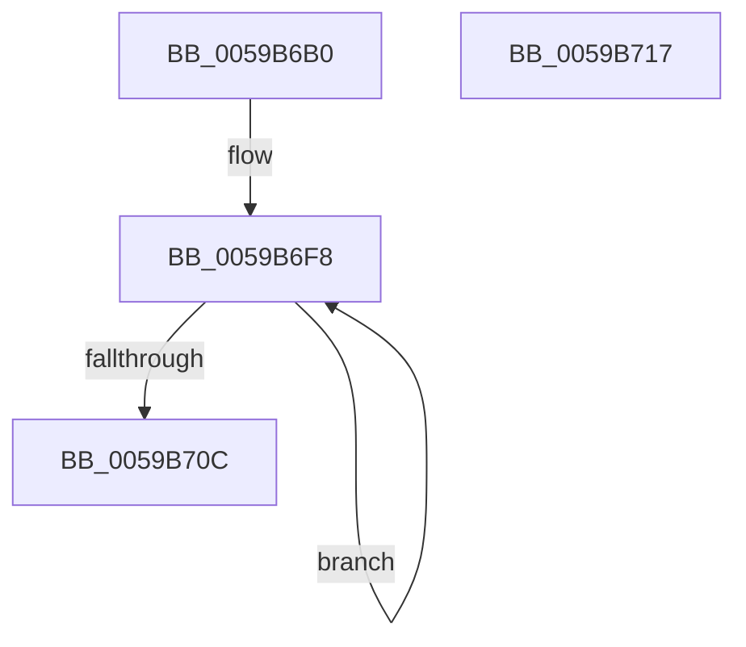

# IopLiveDumpCorralDpc

- RVA: `0x0059B6B0`–`0x0059B718` (길이 `104` bytes)
- VA: `0x000000014059B6B0`
- 실행 섹션: `.text`
- PDB 이름 있음: `예`; PDB Function 태그: `아니요`
- unwind 정보 RVA: `0x0006E5F8`
- 디코드: `24`개 명령, `104/104` bytes 표시
- 미해석 바이트: `0` (있으면 어셈블리에 `.byte`로 보존)

> 이 문서는 커널 이미지의 기계어와 PDB 기호를 분석해 생성했습니다. 4번과 5번은 함수 원형과 자료형을 바이너리 사용 방식에서 추정한 C 해석이며 원본 소스 복구 결과는 아닙니다.

## 1. Dependencies

- 직접 호출 지점: **3**; 고유 호출 대상: **3**
- 직접 호출자로 확인된 함수: **0**
- RIP 상대 이미지 참조: **0**

### Outgoing calls
- `0x0059B6E7` → [RtlCaptureContext](../4F/RtlCaptureContext_function_004FE570.md) (function, `0x004FE570`)
- `0x0059B6F3` → [KiSaveProcessorControlState](../6B/KiSaveProcessorControlState_function_006B0EF0.md) (function, `0x006B0EF0`)
- `0x0059B700` → [IopLiveDumpProcessCorralStateChange](../47/IopLiveDumpProcessCorralStateChange_function_00471C7C.md) (function, `0x00471C7C`)

### Direct callers
- 이 함수 시작 RVA로 연결되는 직접 call은 확인되지 않았습니다. 간접 호출은 완전히 역산할 수 없습니다.

### Static image references
- 디코드된 RIP-relative 메모리 참조가 없습니다.

## 2. Other-region calls and transfers

- 다른 실행 섹션으로 향하는 call: **0**
- 별도 외부 분기/꼬리 이동을 확인하지 못했습니다.

## 3. Assembly (complete function range)

```asm
0059B6B0  48 89 5C 24 08                  mov qword ptr [rsp + 8], rbx
0059B6B5  57                              push rdi
0059B6B6  48 83 EC 30                     sub rsp, 0x30
0059B6BA  65 48 8B 04 25 20 00 00 00      mov rax, qword ptr gs:[0x20]
0059B6C3  48 8B FA                        mov rdi, rdx
0059B6C6  65 48 8B 1C 25 20 00 00 00      mov rbx, qword ptr gs:[0x20]
0059B6CF  83 64 24 28 00                  and dword ptr [rsp + 0x28], 0
0059B6D4  83 64 24 24 00                  and dword ptr [rsp + 0x24], 0
0059B6D9  8B 48 24                        mov ecx, dword ptr [rax + 0x24]
0059B6DC  89 4C 24 20                     mov dword ptr [rsp + 0x20], ecx
0059B6E0  48 8B 8B C0 8F 00 00            mov rcx, qword ptr [rbx + 0x8fc0]
0059B6E7  E8 84 2E F6 FF                  call 0x1404fe570
0059B6EC  48 8D 8B 00 01 00 00            lea rcx, [rbx + 0x100]
0059B6F3  E8 F8 57 11 00                  call 0x1406b0ef0
0059B6F8  48 8D 54 24 20                  lea rdx, [rsp + 0x20]
0059B6FD  48 8B CF                        mov rcx, rdi
0059B700  E8 77 65 ED FF                  call 0x140471c7c
0059B705  83 7C 24 24 FF                  cmp dword ptr [rsp + 0x24], -1
0059B70A  75 EC                           jne 0x14059b6f8
0059B70C  48 8B 5C 24 40                  mov rbx, qword ptr [rsp + 0x40]
0059B711  48 83 C4 30                     add rsp, 0x30
0059B715  5F                              pop rdi
0059B716  C3                              ret
0059B717  CC                              int3
```

## 4. C-style interpretation (structured pseudocode)

```c
__int64 __fastcall IopLiveDumpCorralDpc(__int64 a1, __int64 a2)
{
    __int64 result;
    __int64 v_rsp;
    unsigned int v_stack_m10;
    unsigned int v_stack_m14;
    unsigned int v_stack_m18;
    unsigned __int64 v_stack_p8;

    v_stack_p8 = v_rbx;
    v_rsp = (v_rsp) - (48);
    v_stack_m18 = (unsigned int)((unsigned int)(*(unsigned int *)(*(unsigned __int64 *)(gs_base + (0 + 32)) + 36)));
    result = RtlCaptureContext(*(unsigned __int64 *)(*(unsigned __int64 *)(gs_base + (0 + 32)) + 36800), a2, a3, a4);
    result = KiSaveProcessorControlState(*(unsigned __int64 *)(gs_base + (0 + 32)) + 256, a2, a3, a4);
loc_0059B6F8:
    result = IopLiveDumpProcessCorralStateChange(a2, v_stack_m18, a3, a4);
    if (v_stack_m14 != -1) goto loc_0059B6F8;
    v_rsp = (v_rsp) + (48);
    return result;
}
```

## 5. (Beta) C Style

```c
int64_t IopLiveDumpCorralDpc(int64_t Arg1, int64_t Arg2)
{
    int64_t result;
    int64_t local_rsp;
    uint32_t v_stack_m10;
    uint32_t v_stack_m14;
    uint32_t v_stack_m18;
    uint64_t v_stack_p8;

    v_stack_p8 = local_rbx;
    local_rsp = (local_rsp) - (48);
    v_stack_m18 = (uint32_t)((uint32_t)(*(uint32_t *)(*(uint64_t *)(gs_base + (0 + 0x20)) + 0x24)));
    result = RtlCaptureContext(*(uint64_t *)(*(uint64_t *)(gs_base + (0 + 0x20)) + 0x8FC0), Arg2, a3, a4);
    result = KiSaveProcessorControlState(*(uint64_t *)(gs_base + (0 + 0x20)) + 256, Arg2, a3, a4);
loc_0059B6F8:
    result = IopLiveDumpProcessCorralStateChange(Arg2, v_stack_m18, a3, a4);
    if (v_stack_m14 != -1) goto loc_0059B6F8;
    local_rsp = (local_rsp) + (48);
    return result;
}
```

## 6. Execution-region graph

[열기: 2D/3D 그래프와 함수 탐색 컨트롤 패널](../../../control-panel.html?section=text&rva=0x0059B6B0&view=graph)

- 2D 그래프는 위에서 아래로 흐르고, 3D 그래프는 빈 공간을 드래그해 회전합니다. Shift+드래그는 이동, 휠은 확대·축소, 함수 노드 선택은 대상 보고서 이동입니다.

### Static fallback


