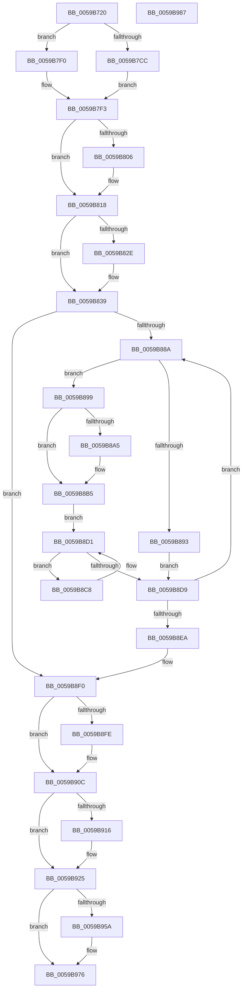

# IopLiveDumpCorralProcessors

- RVA: `0x0059B720`–`0x0059B988` (길이 `616` bytes)
- VA: `0x000000014059B720`
- 실행 섹션: `.text`
- PDB 이름 있음: `예`; PDB Function 태그: `아니요`
- unwind 정보 RVA: `0x000C7C30`
- 디코드: `176`개 명령, `616/616` bytes 표시
- 미해석 바이트: `0` (있으면 어셈블리에 `.byte`로 보존)

> 이 문서는 커널 이미지의 기계어와 PDB 기호를 분석해 생성했습니다. 4번과 5번은 함수 원형과 자료형을 바이너리 사용 방식에서 추정한 C 해석이며 원본 소스 복구 결과는 아닙니다.

## 1. Dependencies

- 직접 호출 지점: **14**; 고유 호출 대상: **10**
- 직접 호출자로 확인된 함수: **1**
- RIP 상대 이미지 참조: **8**

### Outgoing calls
- `0x0059B7B3` → [KeSetSystemGroupAffinityThread](../39/KeSetSystemGroupAffinityThread_function_00399140.md) (function, `0x00399140`)
- `0x0059B7C3` → [IopLiveDumpIsTracingEnabled](../4F/IopLiveDumpIsTracingEnabled_function_004FC5AC.md) (function, `0x004FC5AC`)
- `0x0059B7E5` → [IopLiveDumpTraceNoArgs](../5A/IopLiveDumpTraceNoArgs_function_005A43C0.md) (function, `0x005A43C0`)
- `0x0059B808` → [IopLiveDumpGetMillisecondCounter](../3F/IopLiveDumpGetMillisecondCounter_function_003F5964.md) (function, `0x003F5964`)
- `0x0059B834` → [KiRaiseIrqlProcessIrqlFlags](../4F/KiRaiseIrqlProcessIrqlFlags_function_004F56FC.md) (function, `0x004F56FC`)
- `0x0059B881` → [KeEnumerateNextProcessor](../41/KeEnumerateNextProcessor_function_00415480.md) (function, `0x00415480`)
- `0x0059B8BE` → [KeInsertQueueDpc](../20/KeInsertQueueDpc_function_00207C50.md) (function, `0x00207C50`)
- `0x0059B8CC` → [KeYieldProcessorEx](../3F/KeYieldProcessorEx_function_003FBD00.md) (function, `0x003FBD00`)
- `0x0059B8E1` → [KeEnumerateNextProcessor](../41/KeEnumerateNextProcessor_function_00415480.md) (function, `0x00415480`)
- `0x0059B900` → [IopLiveDumpGetMillisecondCounter](../3F/IopLiveDumpGetMillisecondCounter_function_003F5964.md) (function, `0x003F5964`)
- `0x0059B920` → [IopLiveDumpInitiateCorralStateChange](IopLiveDumpInitiateCorralStateChange_function_0059CA5C.md) (function, `0x0059CA5C`)
- `0x0059B938` → [IopLiveDumpInitiateCorralStateChange](IopLiveDumpInitiateCorralStateChange_function_0059CA5C.md) (function, `0x0059CA5C`)
- `0x0059B949` → [IopLiveDumpInitiateCorralStateChange](IopLiveDumpInitiateCorralStateChange_function_0059CA5C.md) (function, `0x0059CA5C`)
- `0x0059B971` → [IopLiveDumpTraceCorralProcessorsDuration](IopLiveDumpTraceCorralProcessorsDuration_function_0059E854.md) (function, `0x0059E854`)

### Direct callers
- [IopLiveDumpEnterCorralledState](IopLiveDumpEnterCorralledState_function_0059BA40.md) at `0x0059BA60`

### Static image references
- `0x0059B783` → RVA `0x00F231B0` (`.data`; read)
- `0x0059B7D0` → RVA `0x000229F8` (`.rdata`; read)
- `0x0059B7DA` → RVA `0x000228E0` (`.rdata`; read)
- `0x0059B826` → RVA `0x00FC6D20` (`ALMOSTRO`; read)
- `0x0059B83D` → RVA `0x0059B6B0` (`IopLiveDumpCorralDpc`; read)
- `0x0059B867` → RVA `0x00FC7128` (`ALMOSTRO`; read)
- `0x0059B872` → RVA `0x00FC7120` (`ALMOSTRO`; read)
- `0x0059B929` → RVA `0x00F0BD23` (`.data`; write)

## 2. Other-region calls and transfers

- 다른 실행 섹션으로 향하는 call: **0**
- 별도 외부 분기/꼬리 이동을 확인하지 못했습니다.

## 3. Assembly (complete function range)

```asm
0059B720  40 55                           push rbp
0059B722  53                              push rbx
0059B723  56                              push rsi
0059B724  57                              push rdi
0059B725  41 54                           push r12
0059B727  41 55                           push r13
0059B729  41 56                           push r14
0059B72B  41 57                           push r15
0059B72D  48 8B EC                        mov rbp, rsp
0059B730  48 83 EC 78                     sub rsp, 0x78
0059B734  4C 8B 29                        mov r13, qword ptr [rcx]
0059B737  4C 8D 61 70                     lea r12, [rcx + 0x70]
0059B73B  33 FF                           xor edi, edi
0059B73D  4C 8D 71 10                     lea r14, [rcx + 0x10]
0059B741  89 79 08                        mov dword ptr [rcx + 8], edi
0059B744  33 C0                           xor eax, eax
0059B746  48 8B D9                        mov rbx, rcx
0059B749  89 7D F2                        mov dword ptr [rbp - 0xe], edi
0059B74C  66 89 7D F6                     mov word ptr [rbp - 0xa], di
0059B750  0F 57 C0                        xorps xmm0, xmm0
0059B753  0F 11 45 D0                     movups xmmword ptr [rbp - 0x30], xmm0
0059B757  89 7D 48                        mov dword ptr [rbp + 0x48], edi
0059B75A  44 8D 7F 01                     lea r15d, [rdi + 1]
0059B75E  89 7D 50                        mov dword ptr [rbp + 0x50], edi
0059B761  48 8D 53 60                     lea rdx, [rbx + 0x60]
0059B765  48 89 7D C0                     mov qword ptr [rbp - 0x40], rdi
0059B769  48 89 7D B8                     mov qword ptr [rbp - 0x48], rdi
0059B76D  48 89 7D 60                     mov qword ptr [rbp + 0x60], rdi
0059B771  89 79 0C                        mov dword ptr [rcx + 0xc], edi
0059B774  41 89 3E                        mov dword ptr [r14], edi
0059B777  89 79 14                        mov dword ptr [rcx + 0x14], edi
0059B77A  49 89 04 24                     mov qword ptr [r12], rax
0059B77E  41 89 44 24 08                  mov dword ptr [r12 + 8], eax
0059B783  48 8B 05 26 7A 98 00            mov rax, qword ptr [rip + 0x987a26]
0059B78A  48 89 7D 58                     mov qword ptr [rbp + 0x58], rdi
0059B78E  8B 08                           mov ecx, dword ptr [rax]
0059B790  33 C0                           xor eax, eax
0059B792  89 45 DA                        mov dword ptr [rbp - 0x26], eax
0059B795  66 89 45 DE                     mov word ptr [rbp - 0x22], ax
0059B799  8B C1                           mov eax, ecx
0059B79B  C1 E8 06                        shr eax, 6
0059B79E  83 E1 3F                        and ecx, 0x3f
0059B7A1  66 89 45 D8                     mov word ptr [rbp - 0x28], ax
0059B7A5  41 8B C7                        mov eax, r15d
0059B7A8  48 D3 E0                        shl rax, cl
0059B7AB  48 8D 4D D0                     lea rcx, [rbp - 0x30]
0059B7AF  48 89 45 D0                     mov qword ptr [rbp - 0x30], rax
0059B7B3  E8 88 D9 DF FF                  call 0x140399140
0059B7B8  89 7B 74                        mov dword ptr [rbx + 0x74], edi
0059B7BB  41 89 3C 24                     mov dword ptr [r12], edi
0059B7BF  44 89 7B 0C                     mov dword ptr [rbx + 0xc], r15d
0059B7C3  E8 E4 0D F6 FF                  call 0x1404fc5ac
0059B7C8  84 C0                           test al, al
0059B7CA  74 24                           je 0x14059b7f0
0059B7CC  41 8B 45 50                     mov eax, dword ptr [r13 + 0x50]
0059B7D0  48 8D 0D 21 72 A8 FF            lea rcx, [rip - 0x578ddf]
0059B7D7  41 84 C7                        test r15b, al
0059B7DA  48 8D 05 FF 70 A8 FF            lea rax, [rip - 0x578f01]
0059B7E1  48 0F 44 C8                     cmove rcx, rax
0059B7E5  E8 D6 8B 00 00                  call 0x1405a43c0
0059B7EA  4C 8D 7B 70                     lea r15, [rbx + 0x70]
0059B7EE  EB 03                           jmp 0x14059b7f3
0059B7F0  4D 8B FC                        mov r15, r12
0059B7F3  48 8B C3                        mov rax, rbx
0059B7F6  48 83 C0 10                     add rax, 0x10
0059B7FA  48 89 45 C8                     mov qword ptr [rbp - 0x38], rax
0059B7FE  41 8B 45 50                     mov eax, dword ptr [r13 + 0x50]
0059B802  84 C0                           test al, al
0059B804  79 12                           jns 0x14059b818
0059B806  33 C9                           xor ecx, ecx
0059B808  E8 57 A1 E5 FF                  call 0x1403f5964
0059B80D  4C 8B 75 C8                     mov r14, qword ptr [rbp - 0x38]
0059B811  4D 8B E7                        mov r12, r15
0059B814  48 89 45 58                     mov qword ptr [rbp + 0x58], rax
0059B818  44 0F 20 C6                     mov rsi, cr8
0059B81C  41 BF 02 00 00 00               mov r15d, 2
0059B822  45 0F 22 C7                     mov cr8, r15
0059B826  39 3D F4 B4 A2 00               cmp dword ptr [rip + 0xa2b4f4], edi
0059B82C  74 0B                           je 0x14059b839
0059B82E  41 8A D7                        mov dl, r15b
0059B831  40 8A CE                        mov cl, sil
0059B834  E8 C3 9E F5 FF                  call 0x1404f56fc
0059B839  40 88 73 58                     mov byte ptr [rbx + 0x58], sil
0059B83D  48 8D 05 6C FE FF FF            lea rax, [rip - 0x194]
0059B844  48 89 43 30                     mov qword ptr [rbx + 0x30], rax
0059B848  48 8D 55 E0                     lea rdx, [rbp - 0x20]
0059B84C  C7 43 18 13 01 00 00            mov dword ptr [rbx + 0x18], 0x113
0059B853  48 8D 4D 48                     lea rcx, [rbp + 0x48]
0059B857  48 89 5B 38                     mov qword ptr [rbx + 0x38], rbx
0059B85B  48 89 7B 50                     mov qword ptr [rbx + 0x50], rdi
0059B85F  48 89 7B 28                     mov qword ptr [rbx + 0x28], rdi
0059B863  44 88 7B 19                     mov byte ptr [rbx + 0x19], r15b
0059B867  48 8B 05 BA B8 A2 00            mov rax, qword ptr [rip + 0xa2b8ba]
0059B86E  48 89 45 E8                     mov qword ptr [rbp - 0x18], rax
0059B872  48 8D 05 A7 B8 A2 00            lea rax, [rip + 0xa2b8a7]
0059B879  48 89 45 E0                     mov qword ptr [rbp - 0x20], rax
0059B87D  66 89 7D F0                     mov word ptr [rbp - 0x10], di
0059B881  E8 FA 9B E7 FF                  call 0x140415480
0059B886  85 C0                           test eax, eax
0059B888  75 66                           jne 0x14059b8f0
0059B88A  41 8B 04 24                     mov eax, dword ptr [r12]
0059B88E  39 45 48                        cmp dword ptr [rbp + 0x48], eax
0059B891  75 06                           jne 0x14059b899
0059B893  F0 41 FF 06                     lock inc dword ptr [r14]
0059B897  EB 40                           jmp 0x14059b8d9
0059B899  45 8B 3E                        mov r15d, dword ptr [r14]
0059B89C  48 8B 43 50                     mov rax, qword ptr [rbx + 0x50]
0059B8A0  48 85 C0                        test rax, rax
0059B8A3  75 10                           jne 0x14059b8b5
0059B8A5  0F B7 45 48                     movzx eax, word ptr [rbp + 0x48]
0059B8A9  B9 00 08 00 00                  mov ecx, 0x800
0059B8AE  66 03 C1                        add ax, cx
0059B8B1  66 89 43 1A                     mov word ptr [rbx + 0x1a], ax
0059B8B5  45 33 C0                        xor r8d, r8d
0059B8B8  48 8D 4B 18                     lea rcx, [rbx + 0x18]
0059B8BC  33 D2                           xor edx, edx
0059B8BE  E8 8D C3 C6 FF                  call 0x140207c50
0059B8C3  89 7D 50                        mov dword ptr [rbp + 0x50], edi
0059B8C6  EB 09                           jmp 0x14059b8d1
0059B8C8  48 8D 4D 50                     lea rcx, [rbp + 0x50]
0059B8CC  E8 2F 04 E6 FF                  call 0x1403fbd00
0059B8D1  41 8B 06                        mov eax, dword ptr [r14]
0059B8D4  44 3B F8                        cmp r15d, eax
0059B8D7  74 EF                           je 0x14059b8c8
0059B8D9  48 8D 55 E0                     lea rdx, [rbp - 0x20]
0059B8DD  48 8D 4D 48                     lea rcx, [rbp + 0x48]
0059B8E1  E8 9A 9B E7 FF                  call 0x140415480
0059B8E6  85 C0                           test eax, eax
0059B8E8  74 A0                           je 0x14059b88a
0059B8EA  41 BF 02 00 00 00               mov r15d, 2
0059B8F0  8B 43 10                        mov eax, dword ptr [rbx + 0x10]
0059B8F3  89 43 14                        mov dword ptr [rbx + 0x14], eax
0059B8F6  41 8B 45 50                     mov eax, dword ptr [r13 + 0x50]
0059B8FA  84 C0                           test al, al
0059B8FC  79 0E                           jns 0x14059b90c
0059B8FE  33 C9                           xor ecx, ecx
0059B900  E8 5F A0 E5 FF                  call 0x1403f5964
0059B905  48 8B F8                        mov rdi, rax
0059B908  48 2B 7D 58                     sub rdi, qword ptr [rbp + 0x58]
0059B90C  41 F7 45 50 00 01 00 00         test dword ptr [r13 + 0x50], 0x100
0059B914  75 0F                           jne 0x14059b925
0059B916  4C 8D 45 C0                     lea r8, [rbp - 0x40]
0059B91A  41 8B D7                        mov edx, r15d
0059B91D  48 8B CB                        mov rcx, rbx
0059B920  E8 37 11 00 00                  call 0x14059ca5c
0059B925  4C 8D 45 B8                     lea r8, [rbp - 0x48]
0059B929  C6 05 F3 03 97 00 01            mov byte ptr [rip + 0x9703f3], 1
0059B930  BA 07 00 00 00                  mov edx, 7
0059B935  48 8B CB                        mov rcx, rbx
0059B938  E8 1F 11 00 00                  call 0x14059ca5c
0059B93D  4C 8D 45 60                     lea r8, [rbp + 0x60]
0059B941  BA 03 00 00 00                  mov edx, 3
0059B946  48 8B CB                        mov rcx, rbx
0059B949  E8 0E 11 00 00                  call 0x14059ca5c
0059B94E  83 4B 08 01                     or dword ptr [rbx + 8], 1
0059B952  41 8B 45 50                     mov eax, dword ptr [r13 + 0x50]
0059B956  84 C0                           test al, al
0059B958  79 1C                           jns 0x14059b976
0059B95A  48 8B 45 60                     mov rax, qword ptr [rbp + 0x60]
0059B95E  48 8B D7                        mov rdx, rdi
0059B961  4C 8B 4D B8                     mov r9, qword ptr [rbp - 0x48]
0059B965  4C 8B 45 C0                     mov r8, qword ptr [rbp - 0x40]
0059B969  48 8B 0B                        mov rcx, qword ptr [rbx]
0059B96C  48 89 44 24 20                  mov qword ptr [rsp + 0x20], rax
0059B971  E8 DE 2E 00 00                  call 0x14059e854
0059B976  48 83 C4 78                     add rsp, 0x78
0059B97A  41 5F                           pop r15
0059B97C  41 5E                           pop r14
0059B97E  41 5D                           pop r13
0059B980  41 5C                           pop r12
0059B982  5F                              pop rdi
0059B983  5E                              pop rsi
0059B984  5B                              pop rbx
0059B985  5D                              pop rbp
0059B986  C3                              ret
0059B987  CC                              int3
```

## 4. C-style interpretation (structured pseudocode)

```c
__int64 __fastcall IopLiveDumpCorralProcessors(__int64 a1, __int64 a2, int a3)
{
    __int64 result;
    __int64 v_r12;
    __int64 v_r14;
    __int64 v_rdi;
    __int64 v_rsp;
    unsigned __int16 v_stack_m4A;
    unsigned int v_stack_m4E;
    unsigned __int16 v_stack_m50;
    unsigned __int64 v_stack_m58;
    unsigned __int64 v_stack_m60;
    unsigned __int16 v_stack_m62;
    unsigned int v_stack_m66;
    unsigned __int16 v_stack_m68;
    unsigned __int64 v_stack_m70;
    unsigned __int64 v_stack_m78;
    unsigned __int64 v_stack_m80;
    unsigned __int64 v_stack_m88;
    unsigned __int64 v_stack_m98;
    unsigned int v_stack_p10;
    unsigned __int64 v_stack_p18;
    unsigned __int64 v_stack_p20;
    unsigned int v_stack_p8;

    v_rsp = (v_rsp) - (120);
    v_rdi = 0;
    *(unsigned int *)(a1 + 8) = 0;
    result = 0;
    v_stack_m4E = 0;
    v_stack_m4A = 0;
    v_stack_m70 = v_xmm0;
    v_stack_p8 = 0;
    v_stack_p10 = 0;
    v_stack_m80 = 0;
    v_stack_m88 = 0;
    v_stack_p20 = 0;
    *(unsigned int *)(a1 + 12) = 0;
    *(unsigned int *)(a1 + 16) = 0;
    *(unsigned int *)(a1 + 20) = 0;
    *(unsigned __int64 *)(a1 + 112) = 0;
    *(unsigned int *)(a1 + 112 + 8) = 0;
    v_stack_p18 = 0;
    result = 0;
    v_stack_m66 = 0;
    v_stack_m62 = 0;
    result = (unsigned int)(((unsigned int)((unsigned int)((unsigned int)(*(unsigned int *)(*(unsigned __int64 *)(v_rip + 9992742)))))) >> (6));
    a1 = (unsigned int)(((unsigned int)(*(unsigned int *)(*(unsigned __int64 *)(v_rip + 9992742)))) & (63));
    v_stack_m68 = (unsigned __int16)(result);
    result = ((unsigned int)((unsigned int)(v_rdi + 1))) << ((unsigned __int8)(a1));
    v_stack_m70 = result;
    result = KeSetSystemGroupAffinityThread(v_stack_m70, a1 + 96, a3, a4);
    *(unsigned int *)(a1 + 116) = 0;
    *(unsigned int *)(a1 + 112) = 0;
    *(unsigned int *)(a1 + 12) = (unsigned int)(v_rdi + 1);
    result = IopLiveDumpIsTracingEnabled(v_stack_m70, a1 + 96, a3, a4);
    if ((unsigned __int8)(result) == 0) goto loc_0059B7F0;
    a1 = v_rip - 5737951;
    if ((((unsigned __int8)(v_rdi + 1)) & ((unsigned __int8)((unsigned int)(*(unsigned int *)(*(unsigned __int64 *)(a1) + 80))))) == 0) { a1 = v_rip - 5738241; }
    result = IopLiveDumpTraceNoArgs(a1, a1 + 96, a3, a4);
    goto loc_0059B7F3;
loc_0059B7F0:
loc_0059B7F3:
    result = (a1) + (16);
    v_stack_m78 = result;
    result = (unsigned int)(*(unsigned int *)(*(unsigned __int64 *)(a1) + 80));
    v_r12 = a1 + 112;
    v_r14 = a1 + 16;
    if (sign_flag) {
        a1 = 0;
        result = IopLiveDumpGetMillisecondCounter(a1, a1 + 96, a3, a4);
        v_r14 = v_stack_m78;
        v_r12 = a1 + 112;
        v_stack_p18 = result;
    }
    if ((*(unsigned int *)(v_rip + 10663156)) != 0) {
        a2 = 2;
        a1 = (unsigned __int8)(v_cr8);
        result = KiRaiseIrqlProcessIrqlFlags(a1, a2, a3, a4);
    }
    *(unsigned __int8 *)(a1 + 88) = (unsigned __int8)(v_cr8);
    *(unsigned __int64 *)(a1 + 48) = v_rip - 404;
    *(unsigned int *)(a1 + 24) = 275;
    *(unsigned __int64 *)(a1 + 56) = a1;
    *(unsigned __int64 *)(a1 + 80) = 0;
    *(unsigned __int64 *)(a1 + 40) = 0;
    *(unsigned __int8 *)(a1 + 25) = 2;
    v_stack_m58 = *(unsigned __int64 *)(v_rip + 10664122);
    v_stack_m60 = v_rip + 10664103;
    v_stack_m50 = 0;
    result = KeEnumerateNextProcessor(v_stack_p8, v_stack_m60, a3, a4);
    if ((unsigned int)(result) != 0) goto loc_0059B8F0;
loc_0059B88A:
    if (v_stack_p8 != ((unsigned int)((unsigned int)(*(unsigned int *)(v_r12))))) goto loc_0059B899;
    goto loc_0059B8D9;
loc_0059B899:
    result = *(unsigned __int64 *)(a1 + 80);
    if (*(unsigned __int64 *)(a1 + 80) == 0) {
        result = v_stack_p8;
        a1 = 0x800ULL;
        result = (unsigned __int16)((result) + ((unsigned __int16)(a1)));
        *(unsigned __int16 *)(a1 + 26) = (unsigned __int16)(result);
    }
    a3 = 0;
    a2 = 0;
    result = KeInsertQueueDpc(a1 + 24, a2, a3, a4);
    v_stack_p10 = 0;
    goto loc_0059B8D1;
loc_0059B8C8:
    result = KeYieldProcessorEx(v_stack_p10, a2, a3, a4);
loc_0059B8D1:
    if (((unsigned int)((unsigned int)(*(unsigned int *)(v_r14)))) == ((unsigned int)((unsigned int)(*(unsigned int *)(v_r14))))) goto loc_0059B8C8;
loc_0059B8D9:
    result = KeEnumerateNextProcessor(v_stack_p8, v_stack_m60, a3, a4);
    if ((unsigned int)(result) == 0) goto loc_0059B88A;
loc_0059B8F0:
    *(unsigned int *)(a1 + 20) = (unsigned int)((unsigned int)(*(unsigned int *)(a1 + 16)));
    result = (unsigned int)(*(unsigned int *)(*(unsigned __int64 *)(a1) + 80));
    if (sign_flag) {
        a1 = 0;
        result = IopLiveDumpGetMillisecondCounter(a1, v_stack_m60, a3, a4);
        v_rdi = result;
        v_rdi = (v_rdi) - (v_stack_p18);
    }
    if (((*(unsigned int *)(*(unsigned __int64 *)(a1) + 80)) & (256)) == 0) {
        a3 = v_stack_m80;
        a2 = 2;
        a1 = 0;
        result = IopLiveDumpInitiateCorralStateChange(a1, a2, a3, a4);
    }
    *(unsigned __int8 *)(v_rip + 9896947) = 1;
    result = IopLiveDumpInitiateCorralStateChange(a1, 7, v_stack_m88, a4);
    result = IopLiveDumpInitiateCorralStateChange(a1, 3, v_stack_p20, a4);
    result = (unsigned int)(*(unsigned int *)(*(unsigned __int64 *)(a1) + 80));
    if (sign_flag) {
        result = v_stack_p20;
        a2 = v_rdi;
        a4 = v_stack_m88;
        a3 = v_stack_m80;
        a1 = *(unsigned __int64 *)(a1);
        v_stack_m98 = result;
        result = IopLiveDumpTraceCorralProcessorsDuration(a1, a2, a3, a4);
    }
    v_rsp = (v_rsp) + (120);
    return result;
}
```

## 5. (Beta) C Style

```c
int64_t IopLiveDumpCorralProcessors(void *Arg1, int64_t Arg2, int32_t Arg3)
{
    uint8_t *arg1 = (uint8_t *)Arg1;

    int64_t result;
    int64_t local_r12;
    int64_t local_r14;
    int64_t local_rdi;
    int64_t local_rsp;
    uint16_t v_stack_m4A;
    uint32_t v_stack_m4E;
    uint16_t v_stack_m50;
    uint64_t v_stack_m58;
    uint64_t v_stack_m60;
    uint16_t v_stack_m62;
    uint32_t v_stack_m66;
    uint16_t v_stack_m68;
    uint64_t v_stack_m70;
    uint64_t v_stack_m78;
    uint64_t v_stack_m80;
    uint64_t v_stack_m88;
    uint64_t v_stack_m98;
    uint32_t v_stack_p10;
    uint64_t v_stack_p18;
    uint64_t v_stack_p20;
    uint32_t v_stack_p8;

    local_rsp = (local_rsp) - (120);
    local_rdi = 0;
    *(uint32_t *)(arg1 + 0x8) = 0;
    result = 0;
    v_stack_m4E = 0;
    v_stack_m4A = 0;
    v_stack_m70 = v_xmm0;
    v_stack_p8 = 0;
    v_stack_p10 = 0;
    v_stack_m80 = 0;
    v_stack_m88 = 0;
    v_stack_p20 = 0;
    *(uint32_t *)(arg1 + 0xC) = 0;
    *(uint32_t *)(arg1 + 0x10) = 0;
    *(uint32_t *)(arg1 + 0x14) = 0;
    *(uint64_t *)(arg1 + 0x70) = 0;
    *(uint32_t *)(arg1 + 0x70 + 0x8) = 0;
    v_stack_p18 = 0;
    result = 0;
    v_stack_m66 = 0;
    v_stack_m62 = 0;
    result = (uint32_t)(((uint32_t)((uint32_t)((uint32_t)(*(uint32_t *)(*(uint64_t *)(v_rip + 0x987A26)))))) >> (6));
    Arg1 = (uint32_t)(((uint32_t)(*(uint32_t *)(*(uint64_t *)(v_rip + 0x987A26)))) & (63));
    v_stack_m68 = (uint16_t)(result);
    result = ((uint32_t)((uint32_t)(local_rdi + 1))) << ((uint8_t)(Arg1));
    v_stack_m70 = result;
    result = KeSetSystemGroupAffinityThread(v_stack_m70, Arg1 + 96, Arg3, a4);
    *(uint32_t *)(arg1 + 0x74) = 0;
    *(uint32_t *)(arg1 + 0x70) = 0;
    *(uint32_t *)(arg1 + 0xC) = (uint32_t)(local_rdi + 1);
    result = IopLiveDumpIsTracingEnabled(v_stack_m70, Arg1 + 96, Arg3, a4);
    if ((uint8_t)(result) == 0) goto loc_0059B7F0;
    Arg1 = v_rip - 5737951;
    if ((((uint8_t)(local_rdi + 1)) & ((uint8_t)((uint32_t)(*(uint32_t *)(*(uint64_t *)(arg1) + 0x50))))) == 0) { Arg1 = v_rip - 5738241; }
    result = IopLiveDumpTraceNoArgs(Arg1, Arg1 + 96, Arg3, a4);
    goto loc_0059B7F3;
loc_0059B7F0:
loc_0059B7F3:
    result = (Arg1) + (16);
    v_stack_m78 = result;
    result = (uint32_t)(*(uint32_t *)(*(uint64_t *)(arg1) + 0x50));
    local_r12 = Arg1 + 112;
    local_r14 = Arg1 + 16;
    if (sign_flag) {
        Arg1 = 0;
        result = IopLiveDumpGetMillisecondCounter(Arg1, Arg1 + 96, Arg3, a4);
        local_r14 = v_stack_m78;
        local_r12 = Arg1 + 112;
        v_stack_p18 = result;
    }
    if ((*(uint32_t *)(v_rip + 0xA2B4F4)) != 0) {
        Arg2 = 2;
        Arg1 = (uint8_t)(v_cr8);
        result = KiRaiseIrqlProcessIrqlFlags(Arg1, Arg2, Arg3, a4);
    }
    *(uint8_t *)(arg1 + 0x58) = (uint8_t)(v_cr8);
    *(uint64_t *)(arg1 + 0x30) = v_rip - 404;
    *(uint32_t *)(arg1 + 0x18) = 275;
    *(void **)(arg1 + 0x38) = Arg1;
    *(uint64_t *)(arg1 + 0x50) = 0;
    *(uint64_t *)(arg1 + 0x28) = 0;
    *(uint8_t *)(arg1 + 0x19) = 2;
    v_stack_m58 = *(uint64_t *)(v_rip + 0xA2B8BA);
    v_stack_m60 = v_rip + 10664103;
    v_stack_m50 = 0;
    result = KeEnumerateNextProcessor(v_stack_p8, v_stack_m60, Arg3, a4);
    if ((uint32_t)(result) != 0) goto loc_0059B8F0;
loc_0059B88A:
    if (v_stack_p8 != ((uint32_t)((uint32_t)(*(uint32_t *)(local_r12))))) goto loc_0059B899;
    goto loc_0059B8D9;
loc_0059B899:
    result = *(uint64_t *)(arg1 + 0x50);
    if (*(uint64_t *)(arg1 + 0x50) == 0) {
        result = v_stack_p8;
        Arg1 = 0x800ULL;
        result = (uint16_t)((result) + ((uint16_t)(Arg1)));
        *(uint16_t *)(arg1 + 0x1A) = (uint16_t)(result);
    }
    Arg3 = 0;
    Arg2 = 0;
    result = KeInsertQueueDpc(Arg1 + 24, Arg2, Arg3, a4);
    v_stack_p10 = 0;
    goto loc_0059B8D1;
loc_0059B8C8:
    result = KeYieldProcessorEx(v_stack_p10, Arg2, Arg3, a4);
loc_0059B8D1:
    if (((uint32_t)((uint32_t)(*(uint32_t *)(local_r14)))) == ((uint32_t)((uint32_t)(*(uint32_t *)(local_r14))))) goto loc_0059B8C8;
loc_0059B8D9:
    result = KeEnumerateNextProcessor(v_stack_p8, v_stack_m60, Arg3, a4);
    if ((uint32_t)(result) == 0) goto loc_0059B88A;
loc_0059B8F0:
    *(uint32_t *)(arg1 + 0x14) = (uint32_t)((uint32_t)(*(uint32_t *)(arg1 + 0x10)));
    result = (uint32_t)(*(uint32_t *)(*(uint64_t *)(arg1) + 0x50));
    if (sign_flag) {
        Arg1 = 0;
        result = IopLiveDumpGetMillisecondCounter(Arg1, v_stack_m60, Arg3, a4);
        local_rdi = result;
        local_rdi = (local_rdi) - (v_stack_p18);
    }
    if (((*(uint32_t *)(*(uint64_t *)(arg1) + 0x50)) & (256)) == 0) {
        Arg3 = v_stack_m80;
        Arg2 = 2;
        Arg1 = 0;
        result = IopLiveDumpInitiateCorralStateChange(Arg1, Arg2, Arg3, a4);
    }
    *(uint8_t *)(v_rip + 0x9703F3) = 1;
    result = IopLiveDumpInitiateCorralStateChange(Arg1, 7, v_stack_m88, a4);
    result = IopLiveDumpInitiateCorralStateChange(Arg1, 3, v_stack_p20, a4);
    result = (uint32_t)(*(uint32_t *)(*(uint64_t *)(arg1) + 0x50));
    if (sign_flag) {
        result = v_stack_p20;
        Arg2 = local_rdi;
        a4 = v_stack_m88;
        Arg3 = v_stack_m80;
        Arg1 = *(uint64_t *)(arg1);
        v_stack_m98 = result;
        result = IopLiveDumpTraceCorralProcessorsDuration(Arg1, Arg2, Arg3, a4);
    }
    local_rsp = (local_rsp) + (120);
    return result;
}
```

### 관측된 메모리 오프셋

구조체 형식이 확인되지 않은 접근은 인자 기준의 오프셋으로만 기록했습니다.

| 기준 인자 | 오프셋 표현 | 폭 (bit) | 접근 |
|---|---:|---:|---|
| `Arg1` | `+ 0x0` | `32` | `R` |
| `Arg1` | `+ 0x0` | `32` | `W` |
| `Arg1` | `+ 0x0` | `64` | `R` |
| `Arg1` | `+ 0x0` | `64` | `W` |
| `Arg1` | `+ 0x8` | `32` | `R/W` |
| `Arg1` | `+ 0x8` | `32` | `W` |
| `Arg1` | `+ 0xC` | `32` | `W` |
| `Arg1` | `+ 0x10` | `32` | `R` |
| `Arg1` | `+ 0x10` | `64` | `R` |
| `Arg1` | `+ 0x14` | `32` | `W` |
| `Arg1` | `+ 0x18` | `32` | `W` |
| `Arg1` | `+ 0x18` | `64` | `R` |
| `Arg1` | `+ 0x19` | `8` | `W` |
| `Arg1` | `+ 0x1A` | `16` | `W` |
| `Arg1` | `+ 0x28` | `64` | `W` |
| `Arg1` | `+ 0x30` | `64` | `W` |
| `Arg1` | `+ 0x38` | `64` | `W` |
| `Arg1` | `+ 0x50` | `64` | `R` |
| `Arg1` | `+ 0x50` | `64` | `W` |
| `Arg1` | `+ 0x58` | `8` | `W` |
| `Arg1` | `+ 0x60` | `64` | `R` |
| `Arg1` | `+ 0x70` | `64` | `R` |
| `Arg1` | `+ 0x74` | `32` | `W` |

## 6. Execution-region graph

[열기: 2D/3D 그래프와 함수 탐색 컨트롤 패널](../../../control-panel.html?section=text&rva=0x0059B720&view=graph)

- 2D 그래프는 위에서 아래로 흐르고, 3D 그래프는 빈 공간을 드래그해 회전합니다. Shift+드래그는 이동, 휠은 확대·축소, 함수 노드 선택은 대상 보고서 이동입니다.

### Static fallback


