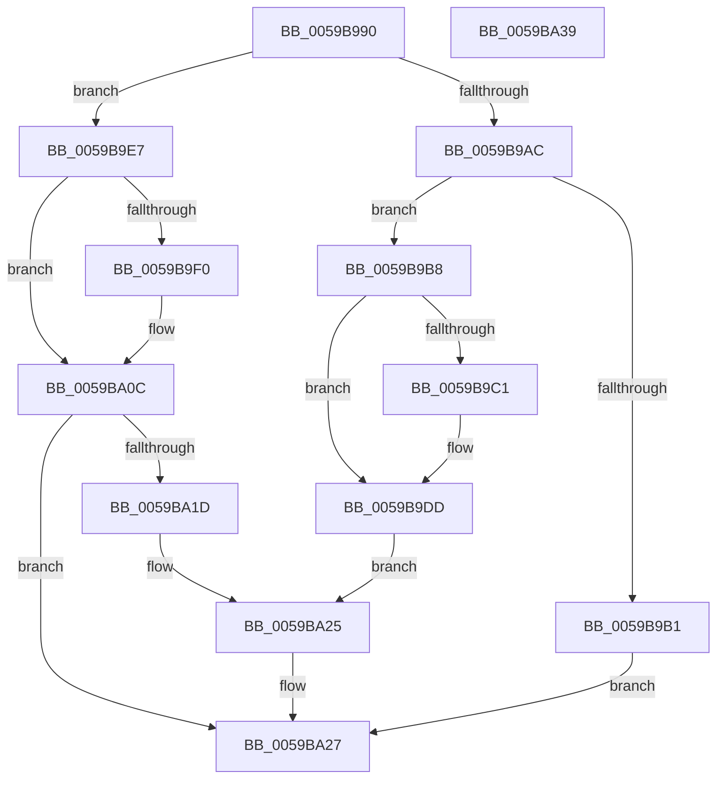

# IopLiveDumpEndMirroringCallback

- RVA: `0x0059B990`–`0x0059BA3A` (길이 `170` bytes)
- VA: `0x000000014059B990`
- 실행 섹션: `.text`
- PDB 이름 있음: `예`; PDB Function 태그: `아니요`
- unwind 정보 RVA: `0x00060BC4`
- 디코드: `47`개 명령, `170/170` bytes 표시
- 미해석 바이트: `0` (있으면 어셈블리에 `.byte`로 보존)

> 이 문서는 커널 이미지의 기계어와 PDB 기호를 분석해 생성했습니다. 4번과 5번은 함수 원형과 자료형을 바이너리 사용 방식에서 추정한 C 해석이며 원본 소스 복구 결과는 아닙니다.

## 1. Dependencies

- 직접 호출 지점: **7**; 고유 호출 대상: **5**
- 직접 호출자로 확인된 함수: **0**
- RIP 상대 이미지 참조: **5**

### Outgoing calls
- `0x0059B9B8` → [IopLiveDumpIsTracingEnabled](../4F/IopLiveDumpIsTracingEnabled_function_004FC5AC.md) (function, `0x004FC5AC`)
- `0x0059B9D8` → [IopLiveDumpTraceNoArgs](../5A/IopLiveDumpTraceNoArgs_function_005A43C0.md) (function, `0x005A43C0`)
- `0x0059B9E0` → [IopLiveDumpCollectPages](IopLiveDumpCollectPages_function_0059B328.md) (function, `0x0059B328`)
- `0x0059B9E7` → [IopLiveDumpIsTracingEnabled](../4F/IopLiveDumpIsTracingEnabled_function_004FC5AC.md) (function, `0x004FC5AC`)
- `0x0059BA07` → [IopLiveDumpTraceNoArgs](../5A/IopLiveDumpTraceNoArgs_function_005A43C0.md) (function, `0x005A43C0`)
- `0x0059BA0F` → [IopLiveDumpEnterCorralledState](IopLiveDumpEnterCorralledState_function_0059BA40.md) (function, `0x0059BA40`)
- `0x0059BA20` → [IopLiveDumpValidateProtectedProcessExclusions](IopLiveDumpValidateProtectedProcessExclusions_function_0059F830.md) (function, `0x0059F830`)

### Direct callers
- 이 함수 시작 RVA로 연결되는 직접 call은 확인되지 않았습니다. 간접 호출은 완전히 역산할 수 없습니다.

### Static image references
- `0x0059B99F` → RVA `0x00E66188` (`.data`; read)
- `0x0059B9C4` → RVA `0x00023038` (`.rdata`; read)
- `0x0059B9CD` → RVA `0x00021678` (`.rdata`; read)
- `0x0059B9F3` → RVA `0x00022170` (`.rdata`; read)
- `0x0059B9FC` → RVA `0x000214A8` (`.rdata`; read)

## 2. Other-region calls and transfers

- 다른 실행 섹션으로 향하는 call: **0**
- 별도 외부 분기/꼬리 이동을 확인하지 못했습니다.

## 3. Assembly (complete function range)

```asm
0059B990  48 89 5C 24 08                  mov qword ptr [rsp + 8], rbx
0059B995  48 89 74 24 10                  mov qword ptr [rsp + 0x10], rsi
0059B99A  57                              push rdi
0059B99B  48 83 EC 20                     sub rsp, 0x20
0059B99F  48 8B 3D E2 A7 8C 00            mov rdi, qword ptr [rip + 0x8ca7e2]
0059B9A6  33 DB                           xor ebx, ebx
0059B9A8  85 C9                           test ecx, ecx
0059B9AA  74 3B                           je 0x14059b9e7
0059B9AC  83 F9 01                        cmp ecx, 1
0059B9AF  74 07                           je 0x14059b9b8
0059B9B1  BB E5 00 00 C0                  mov ebx, 0xc00000e5
0059B9B6  EB 6F                           jmp 0x14059ba27
0059B9B8  E8 EF 0B F6 FF                  call 0x1404fc5ac
0059B9BD  84 C0                           test al, al
0059B9BF  74 1C                           je 0x14059b9dd
0059B9C1  8B 47 50                        mov eax, dword ptr [rdi + 0x50]
0059B9C4  48 8D 0D 6D 76 A8 FF            lea rcx, [rip - 0x578993]
0059B9CB  A8 01                           test al, 1
0059B9CD  48 8D 05 A4 5C A8 FF            lea rax, [rip - 0x57a35c]
0059B9D4  48 0F 44 C8                     cmove rcx, rax
0059B9D8  E8 E3 89 00 00                  call 0x1405a43c0
0059B9DD  48 8B CF                        mov rcx, rdi
0059B9E0  E8 43 F9 FF FF                  call 0x14059b328
0059B9E5  EB 3E                           jmp 0x14059ba25
0059B9E7  E8 C0 0B F6 FF                  call 0x1404fc5ac
0059B9EC  84 C0                           test al, al
0059B9EE  74 1C                           je 0x14059ba0c
0059B9F0  8B 47 50                        mov eax, dword ptr [rdi + 0x50]
0059B9F3  48 8D 0D 76 67 A8 FF            lea rcx, [rip - 0x57988a]
0059B9FA  A8 01                           test al, 1
0059B9FC  48 8D 05 A5 5A A8 FF            lea rax, [rip - 0x57a55b]
0059BA03  48 0F 44 C8                     cmove rcx, rax
0059BA07  E8 B4 89 00 00                  call 0x1405a43c0
0059BA0C  48 8B CF                        mov rcx, rdi
0059BA0F  E8 2C 00 00 00                  call 0x14059ba40
0059BA14  F7 47 50 00 80 00 00            test dword ptr [rdi + 0x50], 0x8000
0059BA1B  74 0A                           je 0x14059ba27
0059BA1D  48 8B CF                        mov rcx, rdi
0059BA20  E8 0B 3E 00 00                  call 0x14059f830
0059BA25  8B D8                           mov ebx, eax
0059BA27  48 8B 74 24 38                  mov rsi, qword ptr [rsp + 0x38]
0059BA2C  8B C3                           mov eax, ebx
0059BA2E  48 8B 5C 24 30                  mov rbx, qword ptr [rsp + 0x30]
0059BA33  48 83 C4 20                     add rsp, 0x20
0059BA37  5F                              pop rdi
0059BA38  C3                              ret
0059BA39  CC                              int3
```

## 4. C-style interpretation (structured pseudocode)

```c
__int64 __fastcall IopLiveDumpEndMirroringCallback(int a1)
{
    __int64 result;
    __int64 v_rbx;
    __int64 v_rsp;
    unsigned __int64 v_stack_p10;
    unsigned __int64 v_stack_p8;

    v_stack_p8 = v_rbx;
    v_stack_p10 = v_rsi;
    v_rsp = (v_rsp) - (32);
    v_rbx = 0;
    if (a1 == 0) goto loc_0059B9E7;
    if (a1 == 1) goto loc_0059B9B8;
    goto loc_0059BA27;
loc_0059B9B8:
    result = IopLiveDumpIsTracingEnabled(a1, a2, a3, a4);
    if ((unsigned __int8)(result) != 0) {
        result = *(unsigned int *)(*(unsigned __int64 *)(v_rip + 9218018) + 80);
        a1 = v_rip - 5736851;
        result = v_rip - 5743452;
        if ((((unsigned __int8)(result)) & (1)) == 0) { a1 = result; }
        result = IopLiveDumpTraceNoArgs(a1, a2, a3, a4);
    }
    result = IopLiveDumpCollectPages(*(unsigned __int64 *)(v_rip + 9218018), a2, a3, a4);
    goto loc_0059BA25;
loc_0059B9E7:
    result = IopLiveDumpIsTracingEnabled(*(unsigned __int64 *)(v_rip + 9218018), a2, a3, a4);
    if ((unsigned __int8)(result) != 0) {
        result = *(unsigned int *)(*(unsigned __int64 *)(v_rip + 9218018) + 80);
        a1 = v_rip - 5740682;
        result = v_rip - 5743963;
        if ((((unsigned __int8)(result)) & (1)) == 0) { a1 = result; }
        result = IopLiveDumpTraceNoArgs(a1, a2, a3, a4);
    }
    result = IopLiveDumpEnterCorralledState(*(unsigned __int64 *)(v_rip + 9218018), a2, a3, a4);
    if (((*(unsigned int *)(*(unsigned __int64 *)(v_rip + 9218018) + 80)) & (0x8000ULL)) == 0) goto loc_0059BA27;
    result = IopLiveDumpValidateProtectedProcessExclusions(*(unsigned __int64 *)(v_rip + 9218018), a2, a3, a4);
loc_0059BA25:
loc_0059BA27:
    v_rsp = (v_rsp) + (32);
    return (unsigned int)((unsigned int)((unsigned int)((unsigned int)(result))));
}
```

## 5. (Beta) C Style

```c
int64_t IopLiveDumpEndMirroringCallback(int32_t Arg1)
{
    int64_t result;
    int64_t local_rbx;
    int64_t local_rsp;
    uint64_t v_stack_p10;
    uint64_t v_stack_p8;

    v_stack_p8 = local_rbx;
    v_stack_p10 = local_rsi;
    local_rsp = (local_rsp) - (32);
    local_rbx = 0;
    if (Arg1 == 0) goto loc_0059B9E7;
    if (Arg1 == 1) goto loc_0059B9B8;
    goto loc_0059BA27;
loc_0059B9B8:
    result = IopLiveDumpIsTracingEnabled(Arg1, a2, a3, a4);
    if ((uint8_t)(result) != 0) {
        result = *(uint32_t *)(*(uint64_t *)(v_rip + 0x8CA7E2) + 0x50);
        Arg1 = v_rip - 5736851;
        result = v_rip - 5743452;
        if ((((uint8_t)(result)) & (1)) == 0) { Arg1 = result; }
        result = IopLiveDumpTraceNoArgs(Arg1, a2, a3, a4);
    }
    result = IopLiveDumpCollectPages(*(uint64_t *)(v_rip + 0x8CA7E2), a2, a3, a4);
    goto loc_0059BA25;
loc_0059B9E7:
    result = IopLiveDumpIsTracingEnabled(*(uint64_t *)(v_rip + 0x8CA7E2), a2, a3, a4);
    if ((uint8_t)(result) != 0) {
        result = *(uint32_t *)(*(uint64_t *)(v_rip + 0x8CA7E2) + 0x50);
        Arg1 = v_rip - 5740682;
        result = v_rip - 5743963;
        if ((((uint8_t)(result)) & (1)) == 0) { Arg1 = result; }
        result = IopLiveDumpTraceNoArgs(Arg1, a2, a3, a4);
    }
    result = IopLiveDumpEnterCorralledState(*(uint64_t *)(v_rip + 0x8CA7E2), a2, a3, a4);
    if (((*(uint32_t *)(*(uint64_t *)(v_rip + 0x8CA7E2) + 0x50)) & (0x8000ULL)) == 0) goto loc_0059BA27;
    result = IopLiveDumpValidateProtectedProcessExclusions(*(uint64_t *)(v_rip + 0x8CA7E2), a2, a3, a4);
loc_0059BA25:
loc_0059BA27:
    local_rsp = (local_rsp) + (32);
    return (uint32_t)((uint32_t)((uint32_t)((uint32_t)(result))));
}
```

## 6. Execution-region graph

[열기: 2D/3D 그래프와 함수 탐색 컨트롤 패널](../../../control-panel.html?section=text&rva=0x0059B990&view=graph)

- 2D 그래프는 위에서 아래로 흐르고, 3D 그래프는 빈 공간을 드래그해 회전합니다. Shift+드래그는 이동, 휠은 확대·축소, 함수 노드 선택은 대상 보고서 이동입니다.

### Static fallback


