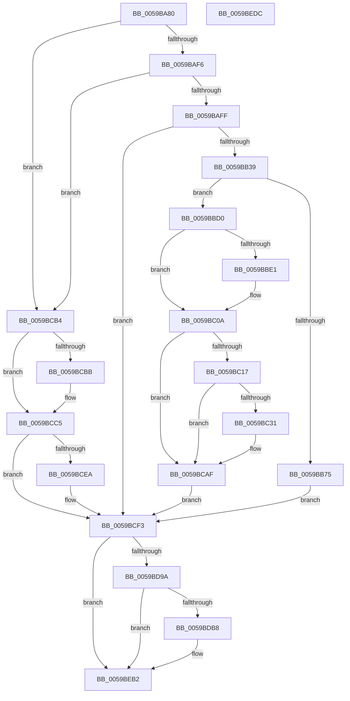

# IopLiveDumpEstimateMemoryPages

- RVA: `0x0059BA80`–`0x0059BEDD` (길이 `1,117` bytes)
- VA: `0x000000014059BA80`
- 실행 섹션: `.text`
- PDB 이름 있음: `예`; PDB Function 태그: `아니요`
- unwind 정보 RVA: `0x000C7AD8`
- 디코드: `247`개 명령, `1,117/1,117` bytes 표시
- 미해석 바이트: `0` (있으면 어셈블리에 `.byte`로 보존)

> 이 문서는 커널 이미지의 기계어와 PDB 기호를 분석해 생성했습니다. 4번과 5번은 함수 원형과 자료형을 바이너리 사용 방식에서 추정한 C 해석이며 원본 소스 복구 결과는 아닙니다.

## 1. Dependencies

- 직접 호출 지점: **21**; 고유 호출 대상: **14**
- 직접 호출자로 확인된 함수: **1**
- RIP 상대 이미지 참조: **5**

### Outgoing calls
- `0x0059BAB1` → [IopLiveDumpGetMillisecondCounter](../3F/IopLiveDumpGetMillisecondCounter_function_003F5964.md) (function, `0x003F5964`)
- `0x0059BAD9` → [IopLiveDumpCallRemovePagesCallbacks](IopLiveDumpCallRemovePagesCallbacks_function_0059AC28.md) (function, `0x0059AC28`)
- `0x0059BAE1` → [IopLiveDumpCapture](IopLiveDumpCapture_function_0059AF88.md) (function, `0x0059AF88`)
- `0x0059BB06` → [RtlNumberOfSetBitsEx](../41/RtlNumberOfSetBitsEx_function_00418CA0.md) (function, `0x00418CA0`)
- `0x0059BB3B` → [IopLiveDumpGetMillisecondCounter](../3F/IopLiveDumpGetMillisecondCounter_function_003F5964.md) (function, `0x003F5964`)
- `0x0059BB59` → [HvlCalculateLivedumpSize](../58/HvlCalculateLivedumpSize_function_0058B380.md) (function, `0x0058B380`)
- `0x0059BB62` → [IopLiveDumpGetMillisecondCounter](../3F/IopLiveDumpGetMillisecondCounter_function_003F5964.md) (function, `0x003F5964`)
- `0x0059BBD8` → [IopLiveDumpIsTracingEnabled](../4F/IopLiveDumpIsTracingEnabled_function_004FC5AC.md) (function, `0x004FC5AC`)
- `0x0059BC05` → [IopLiveDumpTrace](../5A/IopLiveDumpTrace_function_005A4070.md) (function, `0x005A4070`)
- `0x0059BC28` → [tlgKeywordOn](../42/tlgKeywordOn_function_0042EAA0.md) (function, `0x0042EAA0`)
- `0x0059BCAA` → [tlgWriteTransfer_EtwWriteTransfer](../42/tlgWriteTransfer_EtwWriteTransfer_function_004260E0.md) (function, `0x004260E0`)
- `0x0059BCC0` → [IopLiveDumpUncorralProcessors](IopLiveDumpUncorralProcessors_function_0059F4E0.md) (function, `0x0059F4E0`)
- `0x0059BCE0` → [IopLiveDumpTraceMmDuplicateMemoryFailure](IopLiveDumpTraceMmDuplicateMemoryFailure_function_0059F0BC.md) (function, `0x0059F0BC`)
- `0x0059BCF5` → [IopLiveDumpGetMillisecondCounter](../3F/IopLiveDumpGetMillisecondCounter_function_003F5964.md) (function, `0x003F5964`)
- `0x0059BD07` → [IopLiveDumpTraceBufferEstimation](IopLiveDumpTraceBufferEstimation_function_0059E39C.md) (function, `0x0059E39C`)
- `0x0059BD32` → [memset](../6C/memset_function_006C6C40.md) (function, `0x006C6C40`)
- `0x0059BD5B` → [memset](../6C/memset_function_006C6C40.md) (function, `0x006C6C40`)
- `0x0059BD84` → [memset](../6C/memset_function_006C6C40.md) (function, `0x006C6C40`)
- `0x0059BDAB` → [tlgKeywordOn](../42/tlgKeywordOn_function_0042EAA0.md) (function, `0x0042EAA0`)
- `0x0059BEAD` → [tlgWriteTransfer_EtwWriteTransfer](../42/tlgWriteTransfer_EtwWriteTransfer_function_004260E0.md) (function, `0x004260E0`)
- `0x0059BEBB` → [_security_check_cookie](../6A/_security_check_cookie_function_006AC640.md) (function, `0x006AC640`)

### Direct callers
- [IopLiveDumpAllocAndInitResources](IopLiveDumpAllocAndInitResources_function_005993B0.md) at `0x00599752`

### Static image references
- `0x0059BA9E` → RVA `0x00E0A740` (`.data`; read)
- `0x0059BBFE` → RVA `0x00021658` (`.rdata`; read)
- `0x0059BC0A` → RVA `0x00E06EA0` (`.data`; read)
- `0x0059BC57` → RVA `0x00046910` (`.rdata`; read)
- `0x0059BDE4` → RVA `0x0004696C` (`.rdata`; read)

## 2. Other-region calls and transfers

- 다른 실행 섹션으로 향하는 call: **0**
- 별도 외부 분기/꼬리 이동을 확인하지 못했습니다.

## 3. Assembly (complete function range)

```asm
0059BA80  48 89 5C 24 10                  mov qword ptr [rsp + 0x10], rbx
0059BA85  48 89 74 24 18                  mov qword ptr [rsp + 0x18], rsi
0059BA8A  55                              push rbp
0059BA8B  57                              push rdi
0059BA8C  41 54                           push r12
0059BA8E  41 56                           push r14
0059BA90  41 57                           push r15
0059BA92  48 8D 6C 24 E0                  lea rbp, [rsp - 0x20]
0059BA97  48 81 EC 20 01 00 00            sub rsp, 0x120
0059BA9E  48 8B 05 9B EC 86 00            mov rax, qword ptr [rip + 0x86ec9b]
0059BAA5  48 33 C4                        xor rax, rsp
0059BAA8  48 89 45 10                     mov qword ptr [rbp + 0x10], rax
0059BAAC  48 8B F9                        mov rdi, rcx
0059BAAF  33 C9                           xor ecx, ecx
0059BAB1  E8 AE 9E E5 FF                  call 0x1403f5964
0059BAB6  83 4F 50 01                     or dword ptr [rdi + 0x50], 1
0059BABA  48 8D 9F 38 01 00 00            lea rbx, [rdi + 0x138]
0059BAC1  45 33 E4                        xor r12d, r12d
0059BAC4  48 8B CF                        mov rcx, rdi
0059BAC7  4C 89 64 24 38                  mov qword ptr [rsp + 0x38], r12
0059BACC  4C 8B F8                        mov r15, rax
0059BACF  4C 89 64 24 48                  mov qword ptr [rsp + 0x48], r12
0059BAD4  4C 89 64 24 40                  mov qword ptr [rsp + 0x40], r12
0059BAD9  E8 4A F1 FF FF                  call 0x14059ac28
0059BADE  48 8B CF                        mov rcx, rdi
0059BAE1  E8 A2 F4 FF FF                  call 0x14059af88
0059BAE6  8B F0                           mov esi, eax
0059BAE8  41 BE 02 01 00 00               mov r14d, 0x102
0059BAEE  85 C0                           test eax, eax
0059BAF0  0F 88 BE 01 00 00               js 0x14059bcb4
0059BAF6  41 3B C6                        cmp eax, r14d
0059BAF9  0F 84 B5 01 00 00               je 0x14059bcb4
0059BAFF  48 8D 8F 20 02 00 00            lea rcx, [rdi + 0x220]
0059BB06  E8 95 D1 E7 FF                  call 0x140418ca0
0059BB0B  48 8B C8                        mov rcx, rax
0059BB0E  4C 89 67 78                     mov qword ptr [rdi + 0x78], r12
0059BB12  48 C1 E9 04                     shr rcx, 4
0059BB16  48 03 C8                        add rcx, rax
0059BB19  4C 89 A7 80 00 00 00            mov qword ptr [rdi + 0x80], r12
0059BB20  8B 47 2C                        mov eax, dword ptr [rdi + 0x2c]
0059BB23  44 8B F0                        mov r14d, eax
0059BB26  48 89 4F 60                     mov qword ptr [rdi + 0x60], rcx
0059BB2A  4C 89 A7 88 00 00 00            mov qword ptr [rdi + 0x88], r12
0059BB31  A8 01                           test al, 1
0059BB33  0F 84 BA 01 00 00               je 0x14059bcf3
0059BB39  33 C9                           xor ecx, ecx
0059BB3B  E8 24 9E E5 FF                  call 0x1403f5964
0059BB40  41 83 E6 02                     and r14d, 2
0059BB44  4C 8D 4C 24 40                  lea r9, [rsp + 0x40]
0059BB49  41 8B CE                        mov ecx, r14d
0059BB4C  4C 8D 44 24 48                  lea r8, [rsp + 0x48]
0059BB51  48 8D 54 24 38                  lea rdx, [rsp + 0x38]
0059BB56  48 8B D8                        mov rbx, rax
0059BB59  E8 22 F8 FE FF                  call 0x14058b380
0059BB5E  33 C9                           xor ecx, ecx
0059BB60  8B F0                           mov esi, eax
0059BB62  E8 FD 9D E5 FF                  call 0x1403f5964
0059BB67  48 2B C3                        sub rax, rbx
0059BB6A  48 89 87 20 01 00 00            mov qword ptr [rdi + 0x120], rax
0059BB71  85 F6                           test esi, esi
0059BB73  78 5B                           js 0x14059bbd0
0059BB75  48 8B 4C 24 38                  mov rcx, qword ptr [rsp + 0x38]
0059BB7A  BA FF 0F 00 00                  mov edx, 0xfff
0059BB7F  48 85 CA                        test rdx, rcx
0059BB82  41 8B C4                        mov eax, r12d
0059BB85  0F 95 C0                        setne al
0059BB88  48 C1 E9 0C                     shr rcx, 0xc
0059BB8C  48 03 C1                        add rax, rcx
0059BB8F  48 8B 4C 24 48                  mov rcx, qword ptr [rsp + 0x48]
0059BB94  48 85 CA                        test rdx, rcx
0059BB97  48 89 47 78                     mov qword ptr [rdi + 0x78], rax
0059BB9B  41 8B C4                        mov eax, r12d
0059BB9E  0F 95 C0                        setne al
0059BBA1  48 C1 E9 0C                     shr rcx, 0xc
0059BBA5  48 03 C1                        add rax, rcx
0059BBA8  48 8B 4C 24 40                  mov rcx, qword ptr [rsp + 0x40]
0059BBAD  48 85 CA                        test rdx, rcx
0059BBB0  48 89 87 80 00 00 00            mov qword ptr [rdi + 0x80], rax
0059BBB7  41 8B C4                        mov eax, r12d
0059BBBA  0F 95 C0                        setne al
0059BBBD  48 C1 E9 0C                     shr rcx, 0xc
0059BBC1  48 03 C1                        add rax, rcx
0059BBC4  48 89 87 88 00 00 00            mov qword ptr [rdi + 0x88], rax
0059BBCB  E9 23 01 00 00                  jmp 0x14059bcf3
0059BBD0  83 4F 50 10                     or dword ptr [rdi + 0x50], 0x10
0059BBD4  89 74 24 38                     mov dword ptr [rsp + 0x38], esi
0059BBD8  E8 CF 09 F6 FF                  call 0x1404fc5ac
0059BBDD  84 C0                           test al, al
0059BBDF  74 29                           je 0x14059bc0a
0059BBE1  48 8D 44 24 38                  lea rax, [rsp + 0x38]
0059BBE6  48 C7 44 24 70 04 00 00 00      mov qword ptr [rsp + 0x70], 4
0059BBEF  4C 8D 44 24 68                  lea r8, [rsp + 0x68]
0059BBF4  48 89 44 24 68                  mov qword ptr [rsp + 0x68], rax
0059BBF9  BA 01 00 00 00                  mov edx, 1
0059BBFE  48 8D 0D 53 5A A8 FF            lea rcx, [rip - 0x57a5ad]
0059BC05  E8 66 84 00 00                  call 0x1405a4070
0059BC0A  83 3D 8F B2 86 00 05            cmp dword ptr [rip + 0x86b28f], 5
0059BC11  0F 86 98 00 00 00               jbe 0x14059bcaf
0059BC17  48 BA 00 00 00 00 00 40 00 00   movabs rdx, 0x400000000000
0059BC21  48 8D 0D 78 B2 86 00            lea rcx, [rip + 0x86b278]
0059BC28  E8 73 2E E9 FF                  call 0x14042eaa0
0059BC2D  84 C0                           test al, al
0059BC2F  74 7E                           je 0x14059bcaf
0059BC31  48 8D 44 24 40                  lea rax, [rsp + 0x40]
0059BC36  48 C7 44 24 40 00 00 00 01      mov qword ptr [rsp + 0x40], 0x1000000
0059BC3F  48 89 45 A0                     mov qword ptr [rbp - 0x60], rax
0059BC43  4C 8D 8F B8 03 00 00            lea r9, [rdi + 0x3b8]
0059BC4A  8B 47 50                        mov eax, dword ptr [rdi + 0x50]
0059BC4D  4C 8D 87 C8 03 00 00            lea r8, [rdi + 0x3c8]
0059BC54  C1 E8 04                        shr eax, 4
0059BC57  48 8D 15 B2 AC AA FF            lea rdx, [rip - 0x55534e]
0059BC5E  24 01                           and al, 1
0059BC60  48 C7 45 A8 08 00 00 00         mov qword ptr [rbp - 0x58], 8
0059BC68  88 44 24 30                     mov byte ptr [rsp + 0x30], al
0059BC6C  48 8D 0D 2D B2 86 00            lea rcx, [rip + 0x86b22d]
0059BC73  48 8D 44 24 30                  lea rax, [rsp + 0x30]
0059BC78  48 C7 45 B8 01 00 00 00         mov qword ptr [rbp - 0x48], 1
0059BC80  48 89 45 B0                     mov qword ptr [rbp - 0x50], rax
0059BC84  48 8D 44 24 38                  lea rax, [rsp + 0x38]
0059BC89  48 89 45 C0                     mov qword ptr [rbp - 0x40], rax
0059BC8D  48 8D 45 80                     lea rax, [rbp - 0x80]
0059BC91  48 89 44 24 28                  mov qword ptr [rsp + 0x28], rax
0059BC96  C7 44 24 20 05 00 00 00         mov dword ptr [rsp + 0x20], 5
0059BC9E  89 74 24 38                     mov dword ptr [rsp + 0x38], esi
0059BCA2  48 C7 45 C8 04 00 00 00         mov qword ptr [rbp - 0x38], 4
0059BCAA  E8 31 A4 E8 FF                  call 0x1404260e0
0059BCAF  41 8B F4                        mov esi, r12d
0059BCB2  EB 3F                           jmp 0x14059bcf3
0059BCB4  8B 43 08                        mov eax, dword ptr [rbx + 8]
0059BCB7  A8 01                           test al, 1
0059BCB9  74 0A                           je 0x14059bcc5
0059BCBB  B2 01                           mov dl, 1
0059BCBD  48 8B CB                        mov rcx, rbx
0059BCC0  E8 1B 38 00 00                  call 0x14059f4e0
0059BCC5  8B D6                           mov edx, esi
0059BCC7  4C 89 67 60                     mov qword ptr [rdi + 0x60], r12
0059BCCB  48 8B CF                        mov rcx, rdi
0059BCCE  4C 89 67 78                     mov qword ptr [rdi + 0x78], r12
0059BCD2  4C 89 A7 80 00 00 00            mov qword ptr [rdi + 0x80], r12
0059BCD9  4C 89 A7 88 00 00 00            mov qword ptr [rdi + 0x88], r12
0059BCE0  E8 D7 33 00 00                  call 0x14059f0bc
0059BCE5  41 3B F6                        cmp esi, r14d
0059BCE8  75 09                           jne 0x14059bcf3
0059BCEA  83 4F 50 40                     or dword ptr [rdi + 0x50], 0x40
0059BCEE  BE 76 04 00 C0                  mov esi, 0xc0000476
0059BCF3  33 C9                           xor ecx, ecx
0059BCF5  E8 6A 9C E5 FF                  call 0x1403f5964
0059BCFA  49 2B C7                        sub rax, r15
0059BCFD  48 8B CF                        mov rcx, rdi
0059BD00  48 89 87 B8 01 00 00            mov qword ptr [rdi + 0x1b8], rax
0059BD07  E8 90 26 00 00                  call 0x14059e39c
0059BD0C  48 8B 87 20 02 00 00            mov rax, qword ptr [rdi + 0x220]
0059BD13  4D 8B C4                        mov r8, r12
0059BD16  48 8B 8F 28 02 00 00            mov rcx, qword ptr [rdi + 0x228]
0059BD1D  B3 1F                           mov bl, 0x1f
0059BD1F  84 C3                           test bl, al
0059BD21  41 0F 95 C0                     setne r8b
0059BD25  48 C1 E8 05                     shr rax, 5
0059BD29  4C 03 C0                        add r8, rax
0059BD2C  33 D2                           xor edx, edx
0059BD2E  49 C1 E0 02                     shl r8, 2
0059BD32  E8 09 AF 12 00                  call 0x1406c6c40
0059BD37  48 8B 87 58 02 00 00            mov rax, qword ptr [rdi + 0x258]
0059BD3E  4D 8B C4                        mov r8, r12
0059BD41  48 8B 8F 60 02 00 00            mov rcx, qword ptr [rdi + 0x260]
0059BD48  84 C3                           test bl, al
0059BD4A  41 0F 95 C0                     setne r8b
0059BD4E  48 C1 E8 05                     shr rax, 5
0059BD52  4C 03 C0                        add r8, rax
0059BD55  33 D2                           xor edx, edx
0059BD57  49 C1 E0 02                     shl r8, 2
0059BD5B  E8 E0 AE 12 00                  call 0x1406c6c40
0059BD60  48 8B 87 90 02 00 00            mov rax, qword ptr [rdi + 0x290]
0059BD67  4D 8B C4                        mov r8, r12
0059BD6A  48 8B 8F 98 02 00 00            mov rcx, qword ptr [rdi + 0x298]
0059BD71  84 C3                           test bl, al
0059BD73  41 0F 95 C0                     setne r8b
0059BD77  48 C1 E8 05                     shr rax, 5
0059BD7B  4C 03 C0                        add r8, rax
0059BD7E  33 D2                           xor edx, edx
0059BD80  49 C1 E0 02                     shl r8, 2
0059BD84  E8 B7 AE 12 00                  call 0x1406c6c40
0059BD89  83 67 50 FE                     and dword ptr [rdi + 0x50], 0xfffffffe
0059BD8D  83 3D 0C B1 86 00 05            cmp dword ptr [rip + 0x86b10c], 5
0059BD94  0F 86 18 01 00 00               jbe 0x14059beb2
0059BD9A  48 BA 00 00 00 00 00 40 00 00   movabs rdx, 0x400000000000
0059BDA4  48 8D 0D F5 B0 86 00            lea rcx, [rip + 0x86b0f5]
0059BDAB  E8 F0 2C E9 FF                  call 0x14042eaa0
0059BDB0  84 C0                           test al, al
0059BDB2  0F 84 FA 00 00 00               je 0x14059beb2
0059BDB8  48 8D 44 24 40                  lea rax, [rsp + 0x40]
0059BDBD  48 C7 44 24 40 00 00 00 01      mov qword ptr [rsp + 0x40], 0x1000000
0059BDC6  48 89 45 A0                     mov qword ptr [rbp - 0x60], rax
0059BDCA  4C 8D 8F B8 03 00 00            lea r9, [rdi + 0x3b8]
0059BDD1  48 8B 87 B8 01 00 00            mov rax, qword ptr [rdi + 0x1b8]
0059BDD8  4C 8D 87 C8 03 00 00            lea r8, [rdi + 0x3c8]
0059BDDF  48 89 44 24 48                  mov qword ptr [rsp + 0x48], rax
0059BDE4  48 8D 15 81 AB AA FF            lea rdx, [rip - 0x55547f]
0059BDEB  48 8D 44 24 48                  lea rax, [rsp + 0x48]
0059BDF0  48 C7 45 A8 08 00 00 00         mov qword ptr [rbp - 0x58], 8
0059BDF8  48 89 45 B0                     mov qword ptr [rbp - 0x50], rax
0059BDFC  48 8D 0D 9D B0 86 00            lea rcx, [rip + 0x86b09d]
0059BE03  48 8B 87 C0 01 00 00            mov rax, qword ptr [rdi + 0x1c0]
0059BE0A  48 89 44 24 38                  mov qword ptr [rsp + 0x38], rax
0059BE0F  48 8D 44 24 38                  lea rax, [rsp + 0x38]
0059BE14  48 89 45 C0                     mov qword ptr [rbp - 0x40], rax
0059BE18  48 8B 87 C8 01 00 00            mov rax, qword ptr [rdi + 0x1c8]
0059BE1F  48 89 44 24 50                  mov qword ptr [rsp + 0x50], rax
0059BE24  48 8D 44 24 50                  lea rax, [rsp + 0x50]
0059BE29  48 89 45 D0                     mov qword ptr [rbp - 0x30], rax
0059BE2D  48 8B 87 D0 01 00 00            mov rax, qword ptr [rdi + 0x1d0]
0059BE34  48 89 44 24 58                  mov qword ptr [rsp + 0x58], rax
0059BE39  48 8D 44 24 58                  lea rax, [rsp + 0x58]
0059BE3E  48 89 45 E0                     mov qword ptr [rbp - 0x20], rax
0059BE42  48 8B 87 D8 01 00 00            mov rax, qword ptr [rdi + 0x1d8]
0059BE49  48 89 44 24 60                  mov qword ptr [rsp + 0x60], rax
0059BE4E  48 8D 44 24 60                  lea rax, [rsp + 0x60]
0059BE53  48 89 45 F0                     mov qword ptr [rbp - 0x10], rax
0059BE57  48 8B 87 20 01 00 00            mov rax, qword ptr [rdi + 0x120]
0059BE5E  48 89 44 24 68                  mov qword ptr [rsp + 0x68], rax
0059BE63  48 8D 44 24 68                  lea rax, [rsp + 0x68]
0059BE68  48 89 45 00                     mov qword ptr [rbp], rax
0059BE6C  48 8D 45 80                     lea rax, [rbp - 0x80]
0059BE70  48 89 44 24 28                  mov qword ptr [rsp + 0x28], rax
0059BE75  C7 44 24 20 09 00 00 00         mov dword ptr [rsp + 0x20], 9
0059BE7D  48 C7 45 B8 08 00 00 00         mov qword ptr [rbp - 0x48], 8
0059BE85  48 C7 45 C8 08 00 00 00         mov qword ptr [rbp - 0x38], 8
0059BE8D  48 C7 45 D8 08 00 00 00         mov qword ptr [rbp - 0x28], 8
0059BE95  48 C7 45 E8 08 00 00 00         mov qword ptr [rbp - 0x18], 8
0059BE9D  48 C7 45 F8 08 00 00 00         mov qword ptr [rbp - 8], 8
0059BEA5  48 C7 45 08 08 00 00 00         mov qword ptr [rbp + 8], 8
0059BEAD  E8 2E A2 E8 FF                  call 0x1404260e0
0059BEB2  8B C6                           mov eax, esi
0059BEB4  48 8B 4D 10                     mov rcx, qword ptr [rbp + 0x10]
0059BEB8  48 33 CC                        xor rcx, rsp
0059BEBB  E8 80 07 11 00                  call 0x1406ac640
0059BEC0  4C 8D 9C 24 20 01 00 00         lea r11, [rsp + 0x120]
0059BEC8  49 8B 5B 38                     mov rbx, qword ptr [r11 + 0x38]
0059BECC  49 8B 73 40                     mov rsi, qword ptr [r11 + 0x40]
0059BED0  49 8B E3                        mov rsp, r11
0059BED3  41 5F                           pop r15
0059BED5  41 5E                           pop r14
0059BED7  41 5C                           pop r12
0059BED9  5F                              pop rdi
0059BEDA  5D                              pop rbp
0059BEDB  C3                              ret
0059BEDC  CC                              int3
```

## 4. C-style interpretation (structured pseudocode)

```c
__int64 __fastcall IopLiveDumpEstimateMemoryPages(__int64 a1)
{
    __int64 result;
    __int64 v_r12;
    __int64 v_r14;
    __int64 v_rsi;
    __int64 v_rsp;
    unsigned __int64 v_stack_m100;
    unsigned __int64 v_stack_m108;
    unsigned __int64 v_stack_m110;
    unsigned __int8 v_stack_m118;
    unsigned __int64 v_stack_m120;
    unsigned int v_stack_m128;
    unsigned __int64 v_stack_m28;
    unsigned __int64 v_stack_m38;
    unsigned __int64 v_stack_m40;
    unsigned __int64 v_stack_m48;
    unsigned __int64 v_stack_m50;
    unsigned __int64 v_stack_m58;
    unsigned __int64 v_stack_m60;
    unsigned __int64 v_stack_m68;
    unsigned __int64 v_stack_m70;
    unsigned __int64 v_stack_m78;
    unsigned __int64 v_stack_m80;
    unsigned __int64 v_stack_m88;
    unsigned __int64 v_stack_m90;
    unsigned __int64 v_stack_m98;
    unsigned __int64 v_stack_mA0;
    unsigned __int64 v_stack_mA8;
    unsigned __int64 v_stack_mC8;
    unsigned __int64 v_stack_mD8;
    unsigned __int64 v_stack_mE0;
    unsigned __int64 v_stack_mE8;
    unsigned __int64 v_stack_mF0;
    unsigned __int64 v_stack_mF8;
    unsigned __int64 v_stack_p10;
    unsigned __int64 v_stack_p18;

    v_stack_p10 = v_rbx;
    v_stack_p18 = v_rsi;
    v_rsp = (v_rsp) - (288);
    result = (*(unsigned __int64 *)(v_rip + 8842395)) ^ (v_rsp);
    v_stack_m38 = result;
    a1 = 0;
    result = IopLiveDumpGetMillisecondCounter(a1, a2, a3, a4);
    v_r12 = 0;
    v_stack_m110 = 0;
    v_stack_m100 = 0;
    v_stack_m108 = 0;
    result = IopLiveDumpCallRemovePagesCallbacks(0, a2, a3, a4);
    result = IopLiveDumpCapture(0, a2, a3, a4);
    if (sign_flag) goto loc_0059BCB4;
    if (((unsigned int)(result)) == 258) goto loc_0059BCB4;
    result = RtlNumberOfSetBitsEx(a1 + 544, a2, a3, a4);
    *(unsigned __int64 *)(a1 + 120) = 0;
    a1 = (result) >> (4);
    a1 = (a1) + (result);
    *(unsigned __int64 *)(a1 + 128) = 0;
    *(unsigned __int64 *)(a1 + 96) = a1;
    *(unsigned __int64 *)(a1 + 136) = 0;
    if ((((unsigned __int8)((unsigned int)(*(unsigned int *)(a1 + 44)))) & (1)) == 0) goto loc_0059BCF3;
    a1 = 0;
    result = IopLiveDumpGetMillisecondCounter(a1, a2, a3, a4);
    v_r14 = (unsigned int)(((unsigned int)((unsigned int)((unsigned int)(*(unsigned int *)(a1 + 44))))) & (2));
    result = HvlCalculateLivedumpSize((unsigned int)((unsigned int)(v_r14)), v_stack_m110, v_stack_m100, v_stack_m108);
    a1 = 0;
    result = IopLiveDumpGetMillisecondCounter(a1, v_stack_m110, v_stack_m100, v_stack_m108);
    result = (result) - (result);
    *(unsigned __int64 *)(a1 + 288) = result;
    if (sign_flag) goto loc_0059BBD0;
    result = ((((unsigned int)(0xFFFULL)) & (v_stack_m110)) != 0) ? 1 : 0;
    a1 = (v_stack_m110) >> (12);
    result = (result) + (a1);
    *(unsigned __int64 *)(a1 + 120) = result;
    result = ((((unsigned int)(0xFFFULL)) & (v_stack_m100)) != 0) ? 1 : 0;
    a1 = (v_stack_m100) >> (12);
    result = (result) + (a1);
    *(unsigned __int64 *)(a1 + 128) = result;
    result = ((((unsigned int)(0xFFFULL)) & (v_stack_m108)) != 0) ? 1 : 0;
    a1 = (v_stack_m108) >> (12);
    result = (result) + (a1);
    *(unsigned __int64 *)(a1 + 136) = result;
    goto loc_0059BCF3;
loc_0059BBD0:
    v_stack_m110 = (unsigned int)((unsigned int)((unsigned int)(result)));
    result = IopLiveDumpIsTracingEnabled(a1, (unsigned int)(0xFFFULL), v_stack_m100, v_stack_m108);
    if ((unsigned __int8)(result) != 0) {
        result = v_stack_m110;
        v_stack_mD8 = 4;
        a3 = v_stack_mE0;
        v_stack_mE0 = result;
        a2 = 1;
        a1 = v_rip - 5744045;
        result = IopLiveDumpTrace(a1, a2, a3, v_stack_m108);
    }
    if ((*(unsigned int *)(v_rip + 8827535)) <= 5) goto loc_0059BCAF;
    result = tlgKeywordOn(v_rip + 8827512, a2, a3, v_stack_m108);
    if ((unsigned __int8)(result) != 0) {
        result = v_stack_m108;
        v_stack_m108 = 0x1000000ULL;
        v_stack_mA8 = result;
        a4 = a1 + 952;
        result = *(unsigned int *)(a1 + 80);
        a3 = a1 + 968;
        result = (unsigned int)((result) >> (4));
        a2 = v_rip - 5591886;
        result = (unsigned __int8)((result) & (1));
        v_stack_mA0 = 8;
        v_stack_m118 = (unsigned __int8)(result);
        a1 = v_rip + 8827437;
        result = v_stack_m118;
        v_stack_m90 = 1;
        v_stack_m98 = result;
        result = v_stack_m110;
        v_stack_m88 = result;
        result = v_stack_mC8;
        v_stack_m120 = result;
        v_stack_m128 = 5;
        v_stack_m110 = (unsigned int)((unsigned int)((unsigned int)(result)));
        v_stack_m80 = 4;
        result = tlgWriteTransfer_EtwWriteTransfer(a1, a2, a3, a4);
    }
    goto loc_0059BCF3;
loc_0059BCB4:
    result = (unsigned int)(*(unsigned int *)(result + 8));
    if ((((unsigned __int8)((unsigned int)(*(unsigned int *)(result + 8)))) & (1)) != 0) {
        a2 = 1;
        a1 = result;
        result = IopLiveDumpUncorralProcessors(a1, a2, a3, a4);
    }
    *(unsigned __int64 *)(a1 + 96) = 0;
    *(unsigned __int64 *)(a1 + 120) = 0;
    *(unsigned __int64 *)(a1 + 128) = 0;
    *(unsigned __int64 *)(a1 + 136) = 0;
    result = IopLiveDumpTraceMmDuplicateMemoryFailure(a1, 0, a3, a4);
    v_rsi = 0;
    if (0 == ((unsigned int)(v_r14))) {
        v_rsi = 0xC0000476ULL;
    }
    a1 = 0;
    result = IopLiveDumpGetMillisecondCounter(a1, 0, a3, a4);
    result = (result) - (result);
    *(unsigned __int64 *)(a1 + 440) = result;
    result = IopLiveDumpTraceBufferEstimation(0, 0, a3, a4);
    a3 = (((31) & ((unsigned __int8)(*(unsigned __int64 *)(a1 + 544)))) != 0) ? 1 : 0;
    result = (*(unsigned __int64 *)(a1 + 544)) >> (5);
    a3 = (a3) + (result);
    a2 = 0;
    a3 = (a3) << (2);
    result = memset(*(unsigned __int64 *)(a1 + 552), a2, a3, a4);
    a3 = (((31) & ((unsigned __int8)(*(unsigned __int64 *)(a1 + 600)))) != 0) ? 1 : 0;
    result = (*(unsigned __int64 *)(a1 + 600)) >> (5);
    a3 = (a3) + (result);
    a2 = 0;
    a3 = (a3) << (2);
    result = memset(*(unsigned __int64 *)(a1 + 608), a2, a3, a4);
    a3 = (((31) & ((unsigned __int8)(*(unsigned __int64 *)(a1 + 656)))) != 0) ? 1 : 0;
    result = (*(unsigned __int64 *)(a1 + 656)) >> (5);
    a3 = (a3) + (result);
    a2 = 0;
    a3 = (a3) << (2);
    result = memset(*(unsigned __int64 *)(a1 + 664), a2, a3, a4);
    if ((*(unsigned int *)(v_rip + 8827148)) <= 5) goto loc_0059BEB2;
    result = tlgKeywordOn(v_rip + 8827125, a2, a3, a4);
    if ((unsigned __int8)(result) != 0) {
        result = v_stack_m108;
        v_stack_m108 = 0x1000000ULL;
        v_stack_mA8 = result;
        a4 = a1 + 952;
        result = *(unsigned __int64 *)(a1 + 440);
        a3 = a1 + 968;
        v_stack_m100 = result;
        a2 = v_rip - 5592191;
        result = v_stack_m100;
        v_stack_mA0 = 8;
        v_stack_m98 = result;
        a1 = v_rip + 8827037;
        result = *(unsigned __int64 *)(a1 + 448);
        v_stack_m110 = result;
        result = v_stack_m110;
        v_stack_m88 = result;
        result = *(unsigned __int64 *)(a1 + 456);
        v_stack_mF8 = result;
        result = v_stack_mF8;
        v_stack_m78 = result;
        result = *(unsigned __int64 *)(a1 + 464);
        v_stack_mF0 = result;
        result = v_stack_mF0;
        v_stack_m68 = result;
        result = *(unsigned __int64 *)(a1 + 472);
        v_stack_mE8 = result;
        result = v_stack_mE8;
        v_stack_m58 = result;
        result = *(unsigned __int64 *)(a1 + 288);
        v_stack_mE0 = result;
        result = v_stack_mE0;
        v_stack_m48 = result;
        result = v_stack_mC8;
        v_stack_m120 = result;
        v_stack_m128 = 9;
        v_stack_m90 = 8;
        v_stack_m80 = 8;
        v_stack_m70 = 8;
        v_stack_m60 = 8;
        v_stack_m50 = 8;
        v_stack_m40 = 8;
        result = tlgWriteTransfer_EtwWriteTransfer(a1, a2, a3, a4);
    }
    a1 = (v_stack_m38) ^ (v_rsp);
    result = _security_check_cookie(a1, a2, a3, a4);
    return result;
}
```

## 5. (Beta) C Style

```c
int64_t IopLiveDumpEstimateMemoryPages(void *Arg1)
{
    uint8_t *arg1 = (uint8_t *)Arg1;

    int64_t result;
    int64_t local_r12;
    int64_t local_r14;
    int64_t local_rsi;
    int64_t local_rsp;
    uint64_t v_stack_m100;
    uint64_t v_stack_m108;
    uint64_t v_stack_m110;
    uint8_t v_stack_m118;
    uint64_t v_stack_m120;
    uint32_t v_stack_m128;
    uint64_t v_stack_m28;
    uint64_t v_stack_m38;
    uint64_t v_stack_m40;
    uint64_t v_stack_m48;
    uint64_t v_stack_m50;
    uint64_t v_stack_m58;
    uint64_t v_stack_m60;
    uint64_t v_stack_m68;
    uint64_t v_stack_m70;
    uint64_t v_stack_m78;
    uint64_t v_stack_m80;
    uint64_t v_stack_m88;
    uint64_t v_stack_m90;
    uint64_t v_stack_m98;
    uint64_t v_stack_mA0;
    uint64_t v_stack_mA8;
    uint64_t v_stack_mC8;
    uint64_t v_stack_mD8;
    uint64_t v_stack_mE0;
    uint64_t v_stack_mE8;
    uint64_t v_stack_mF0;
    uint64_t v_stack_mF8;
    uint64_t v_stack_p10;
    uint64_t v_stack_p18;

    v_stack_p10 = local_rbx;
    v_stack_p18 = local_rsi;
    local_rsp = (local_rsp) - (288);
    result = (*(uint64_t *)(v_rip + 0x86EC9B)) ^ (local_rsp);
    v_stack_m38 = result;
    Arg1 = 0;
    result = IopLiveDumpGetMillisecondCounter(Arg1, a2, a3, a4);
    local_r12 = 0;
    v_stack_m110 = 0;
    v_stack_m100 = 0;
    v_stack_m108 = 0;
    result = IopLiveDumpCallRemovePagesCallbacks(0, a2, a3, a4);
    result = IopLiveDumpCapture(0, a2, a3, a4);
    if (sign_flag) goto loc_0059BCB4;
    if (((uint32_t)(result)) == 258) goto loc_0059BCB4;
    result = RtlNumberOfSetBitsEx(Arg1 + 544, a2, a3, a4);
    *(uint64_t *)(arg1 + 0x78) = 0;
    Arg1 = (result) >> (4);
    Arg1 = (Arg1) + (result);
    *(uint64_t *)(arg1 + 0x80) = 0;
    *(void **)(arg1 + 0x60) = Arg1;
    *(uint64_t *)(arg1 + 0x88) = 0;
    if ((((uint8_t)((uint32_t)(*(uint32_t *)(arg1 + 0x2C)))) & (1)) == 0) goto loc_0059BCF3;
    Arg1 = 0;
    result = IopLiveDumpGetMillisecondCounter(Arg1, a2, a3, a4);
    local_r14 = (uint32_t)(((uint32_t)((uint32_t)((uint32_t)(*(uint32_t *)(arg1 + 0x2C))))) & (2));
    result = HvlCalculateLivedumpSize((uint32_t)((uint32_t)(local_r14)), v_stack_m110, v_stack_m100, v_stack_m108);
    Arg1 = 0;
    result = IopLiveDumpGetMillisecondCounter(Arg1, v_stack_m110, v_stack_m100, v_stack_m108);
    result = (result) - (result);
    *(uint64_t *)(arg1 + 0x120) = result;
    if (sign_flag) goto loc_0059BBD0;
    result = ((((uint32_t)(0xFFFULL)) & (v_stack_m110)) != 0) ? 1 : 0;
    Arg1 = (v_stack_m110) >> (12);
    result = (result) + (Arg1);
    *(uint64_t *)(arg1 + 0x78) = result;
    result = ((((uint32_t)(0xFFFULL)) & (v_stack_m100)) != 0) ? 1 : 0;
    Arg1 = (v_stack_m100) >> (12);
    result = (result) + (Arg1);
    *(uint64_t *)(arg1 + 0x80) = result;
    result = ((((uint32_t)(0xFFFULL)) & (v_stack_m108)) != 0) ? 1 : 0;
    Arg1 = (v_stack_m108) >> (12);
    result = (result) + (Arg1);
    *(uint64_t *)(arg1 + 0x88) = result;
    goto loc_0059BCF3;
loc_0059BBD0:
    v_stack_m110 = (uint32_t)((uint32_t)((uint32_t)(result)));
    result = IopLiveDumpIsTracingEnabled(Arg1, (uint32_t)(0xFFFULL), v_stack_m100, v_stack_m108);
    if ((uint8_t)(result) != 0) {
        result = v_stack_m110;
        v_stack_mD8 = 4;
        a3 = v_stack_mE0;
        v_stack_mE0 = result;
        a2 = 1;
        Arg1 = v_rip - 5744045;
        result = IopLiveDumpTrace(Arg1, a2, a3, v_stack_m108);
    }
    if ((*(uint32_t *)(v_rip + 0x86B28F)) <= 5) goto loc_0059BCAF;
    result = tlgKeywordOn(v_rip + 8827512, a2, a3, v_stack_m108);
    if ((uint8_t)(result) != 0) {
        result = v_stack_m108;
        v_stack_m108 = 0x1000000ULL;
        v_stack_mA8 = result;
        a4 = Arg1 + 952;
        result = *(uint32_t *)(arg1 + 0x50);
        a3 = Arg1 + 968;
        result = (uint32_t)((result) >> (4));
        a2 = v_rip - 5591886;
        result = (uint8_t)((result) & (1));
        v_stack_mA0 = 8;
        v_stack_m118 = (uint8_t)(result);
        Arg1 = v_rip + 8827437;
        result = v_stack_m118;
        v_stack_m90 = 1;
        v_stack_m98 = result;
        result = v_stack_m110;
        v_stack_m88 = result;
        result = v_stack_mC8;
        v_stack_m120 = result;
        v_stack_m128 = 5;
        v_stack_m110 = (uint32_t)((uint32_t)((uint32_t)(result)));
        v_stack_m80 = 4;
        result = tlgWriteTransfer_EtwWriteTransfer(Arg1, a2, a3, a4);
    }
    goto loc_0059BCF3;
loc_0059BCB4:
    result = (uint32_t)(*(uint32_t *)(result + 0x8));
    if ((((uint8_t)((uint32_t)(*(uint32_t *)(result + 0x8)))) & (1)) != 0) {
        a2 = 1;
        Arg1 = result;
        result = IopLiveDumpUncorralProcessors(Arg1, a2, a3, a4);
    }
    *(uint64_t *)(arg1 + 0x60) = 0;
    *(uint64_t *)(arg1 + 0x78) = 0;
    *(uint64_t *)(arg1 + 0x80) = 0;
    *(uint64_t *)(arg1 + 0x88) = 0;
    result = IopLiveDumpTraceMmDuplicateMemoryFailure(Arg1, 0, a3, a4);
    local_rsi = 0;
    if (0 == ((uint32_t)(local_r14))) {
        local_rsi = 0xC0000476ULL;
    }
    Arg1 = 0;
    result = IopLiveDumpGetMillisecondCounter(Arg1, 0, a3, a4);
    result = (result) - (result);
    *(uint64_t *)(arg1 + 0x1B8) = result;
    result = IopLiveDumpTraceBufferEstimation(0, 0, a3, a4);
    a3 = (((31) & ((uint8_t)(*(uint64_t *)(arg1 + 0x220)))) != 0) ? 1 : 0;
    result = (*(uint64_t *)(arg1 + 0x220)) >> (5);
    a3 = (a3) + (result);
    a2 = 0;
    a3 = (a3) << (2);
    result = memset(*(uint64_t *)(arg1 + 0x228), a2, a3, a4);
    a3 = (((31) & ((uint8_t)(*(uint64_t *)(arg1 + 0x258)))) != 0) ? 1 : 0;
    result = (*(uint64_t *)(arg1 + 0x258)) >> (5);
    a3 = (a3) + (result);
    a2 = 0;
    a3 = (a3) << (2);
    result = memset(*(uint64_t *)(arg1 + 0x260), a2, a3, a4);
    a3 = (((31) & ((uint8_t)(*(uint64_t *)(arg1 + 0x290)))) != 0) ? 1 : 0;
    result = (*(uint64_t *)(arg1 + 0x290)) >> (5);
    a3 = (a3) + (result);
    a2 = 0;
    a3 = (a3) << (2);
    result = memset(*(uint64_t *)(arg1 + 0x298), a2, a3, a4);
    if ((*(uint32_t *)(v_rip + 0x86B10C)) <= 5) goto loc_0059BEB2;
    result = tlgKeywordOn(v_rip + 8827125, a2, a3, a4);
    if ((uint8_t)(result) != 0) {
        result = v_stack_m108;
        v_stack_m108 = 0x1000000ULL;
        v_stack_mA8 = result;
        a4 = Arg1 + 952;
        result = *(uint64_t *)(arg1 + 0x1B8);
        a3 = Arg1 + 968;
        v_stack_m100 = result;
        a2 = v_rip - 5592191;
        result = v_stack_m100;
        v_stack_mA0 = 8;
        v_stack_m98 = result;
        Arg1 = v_rip + 8827037;
        result = *(uint64_t *)(arg1 + 0x1C0);
        v_stack_m110 = result;
        result = v_stack_m110;
        v_stack_m88 = result;
        result = *(uint64_t *)(arg1 + 0x1C8);
        v_stack_mF8 = result;
        result = v_stack_mF8;
        v_stack_m78 = result;
        result = *(uint64_t *)(arg1 + 0x1D0);
        v_stack_mF0 = result;
        result = v_stack_mF0;
        v_stack_m68 = result;
        result = *(uint64_t *)(arg1 + 0x1D8);
        v_stack_mE8 = result;
        result = v_stack_mE8;
        v_stack_m58 = result;
        result = *(uint64_t *)(arg1 + 0x120);
        v_stack_mE0 = result;
        result = v_stack_mE0;
        v_stack_m48 = result;
        result = v_stack_mC8;
        v_stack_m120 = result;
        v_stack_m128 = 9;
        v_stack_m90 = 8;
        v_stack_m80 = 8;
        v_stack_m70 = 8;
        v_stack_m60 = 8;
        v_stack_m50 = 8;
        v_stack_m40 = 8;
        result = tlgWriteTransfer_EtwWriteTransfer(Arg1, a2, a3, a4);
    }
    Arg1 = (v_stack_m38) ^ (local_rsp);
    result = _security_check_cookie(Arg1, a2, a3, a4);
    return result;
}
```

### 관측된 메모리 오프셋

구조체 형식이 확인되지 않은 접근은 인자 기준의 오프셋으로만 기록했습니다.

| 기준 인자 | 오프셋 표현 | 폭 (bit) | 접근 |
|---|---:|---:|---|
| `Arg1` | `+ 0x8` | `32` | `R` |
| `Arg1` | `+ 0x2C` | `32` | `R` |
| `Arg1` | `+ 0x50` | `32` | `R` |
| `Arg1` | `+ 0x50` | `32` | `R/W` |
| `Arg1` | `+ 0x60` | `64` | `W` |
| `Arg1` | `+ 0x78` | `64` | `W` |
| `Arg1` | `+ 0x80` | `64` | `W` |
| `Arg1` | `+ 0x88` | `64` | `W` |
| `Arg1` | `+ 0x120` | `64` | `R` |
| `Arg1` | `+ 0x120` | `64` | `W` |
| `Arg1` | `+ 0x138` | `64` | `R` |
| `Arg1` | `+ 0x1B8` | `64` | `R` |
| `Arg1` | `+ 0x1B8` | `64` | `W` |
| `Arg1` | `+ 0x1C0` | `64` | `R` |
| `Arg1` | `+ 0x1C8` | `64` | `R` |
| `Arg1` | `+ 0x1D0` | `64` | `R` |
| `Arg1` | `+ 0x1D8` | `64` | `R` |
| `Arg1` | `+ 0x220` | `64` | `R` |
| `Arg1` | `+ 0x228` | `64` | `R` |
| `Arg1` | `+ 0x258` | `64` | `R` |
| `Arg1` | `+ 0x260` | `64` | `R` |
| `Arg1` | `+ 0x290` | `64` | `R` |
| `Arg1` | `+ 0x298` | `64` | `R` |
| `Arg1` | `+ 0x3B8` | `64` | `R` |
| `Arg1` | `+ 0x3C8` | `64` | `R` |

## 6. Execution-region graph

[열기: 2D/3D 그래프와 함수 탐색 컨트롤 패널](../../../control-panel.html?section=text&rva=0x0059BA80&view=graph)

- 2D 그래프는 위에서 아래로 흐르고, 3D 그래프는 빈 공간을 드래그해 회전합니다. Shift+드래그는 이동, 휠은 확대·축소, 함수 노드 선택은 대상 보고서 이동입니다.

### Static fallback


