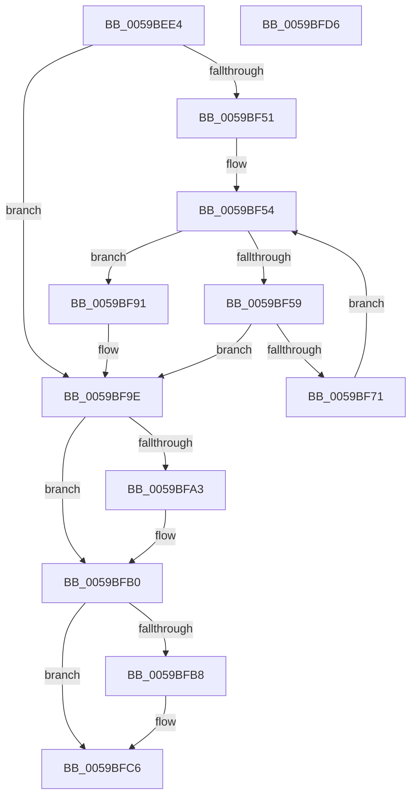

# IopLiveDumpFreeIoSpaceRanges

- RVA: `0x0059BEE4`–`0x0059BFD7` (길이 `243` bytes)
- VA: `0x000000014059BEE4`
- 실행 섹션: `.text`
- PDB 이름 있음: `예`; PDB Function 태그: `아니요`
- unwind 정보 RVA: `0x000C7968`
- 디코드: `70`개 명령, `243/243` bytes 표시
- 미해석 바이트: `0` (있으면 어셈블리에 `.byte`로 보존)

> 이 문서는 커널 이미지의 기계어와 PDB 기호를 분석해 생성했습니다. 4번과 5번은 함수 원형과 자료형을 바이너리 사용 방식에서 추정한 C 해석이며 원본 소스 복구 결과는 아닙니다.

## 1. Dependencies

- 직접 호출 지점: **5**; 고유 호출 대상: **4**
- 직접 호출자로 확인된 함수: **3**
- RIP 상대 이미지 참조: **0**

### Outgoing calls
- `0x0059BF40` → [ExAllocatePool2](../../poolcode/B8/ExAllocatePool2_function_00B820F0.md) (function, `0x00B820F0`)
- `0x0059BF68` → [IopLiveDumpUnpackMemoryRun](IopLiveDumpUnpackMemoryRun_function_0059F5EC.md) (function, `0x0059F5EC`)
- `0x0059BF95` → [MmFreeMemoryRanges](../../page/7F/MmFreeMemoryRanges_function_007FC320.md) (function, `0x007FC320`)
- `0x0059BFAB` → [ExFreePoolWithTag](../../poolcode/B8/ExFreePoolWithTag_function_00B82870.md) (function, `0x00B82870`)
- `0x0059BFBD` → [ExFreePoolWithTag](../../poolcode/B8/ExFreePoolWithTag_function_00B82870.md) (function, `0x00B82870`)

### Direct callers
- [IopLiveDumpFreeDumpBuffers](../3F/IopLiveDumpFreeDumpBuffers_function_003F5FE8.md) at `0x003F60D3`
- [IopLiveDumpFreeDumpBuffers](../3F/IopLiveDumpFreeDumpBuffers_function_003F5FE8.md) at `0x003F6165`
- [IopLiveDumpAllocateFromIOSpace](IopLiveDumpAllocateFromIOSpace_function_00599DEC.md) at `0x0059A25F`
- [sub_006EB65A](../6E/Unknown_function_006EB65A.md) at `0x006EB6D1`
- [sub_006EB65A](../6E/Unknown_function_006EB65A.md) at `0x006EB73F`

### Static image references
- 디코드된 RIP-relative 메모리 참조가 없습니다.

## 2. Other-region calls and transfers

- 다른 실행 섹션으로 향하는 call: **4**
  - `0x0059BF40` → [ExAllocatePool2](../../poolcode/B8/ExAllocatePool2_function_00B820F0.md) (`.text` → `POOLCODE`)
  - `0x0059BF95` → [MmFreeMemoryRanges](../../page/7F/MmFreeMemoryRanges_function_007FC320.md) (`.text` → `PAGE`)
  - `0x0059BFAB` → [ExFreePoolWithTag](../../poolcode/B8/ExFreePoolWithTag_function_00B82870.md) (`.text` → `POOLCODE`)
  - `0x0059BFBD` → [ExFreePoolWithTag](../../poolcode/B8/ExFreePoolWithTag_function_00B82870.md) (`.text` → `POOLCODE`)
- 별도 외부 분기/꼬리 이동을 확인하지 못했습니다.

## 3. Assembly (complete function range)

```asm
0059BEE4  48 89 5C 24 18                  mov qword ptr [rsp + 0x18], rbx
0059BEE9  55                              push rbp
0059BEEA  56                              push rsi
0059BEEB  57                              push rdi
0059BEEC  48 8B EC                        mov rbp, rsp
0059BEEF  48 83 EC 60                     sub rsp, 0x60
0059BEF3  48 83 65 20 00                  and qword ptr [rbp + 0x20], 0
0059BEF8  0F 57 C0                        xorps xmm0, xmm0
0059BEFB  83 65 28 00                     and dword ptr [rbp + 0x28], 0
0059BEFF  48 8B D9                        mov rbx, rcx
0059BF02  83 65 D4 00                     and dword ptr [rbp - 0x2c], 0
0059BF06  B9 40 00 00 00                  mov ecx, 0x40
0059BF0B  48 83 65 E0 00                  and qword ptr [rbp - 0x20], 0
0059BF10  41 B8 4C 64 6D 70               mov r8d, 0x706d644c
0059BF16  8B F2                           mov esi, edx
0059BF18  8B D2                           mov edx, edx
0059BF1A  66 0F 7E C0                     movd eax, xmm0
0059BF1E  48 89 55 E8                     mov qword ptr [rbp - 0x18], rdx
0059BF22  F3 0F 7F 45 C4                  movdqu xmmword ptr [rbp - 0x3c], xmm0
0059BF27  83 C8 01                        or eax, 1
0059BF2A  48 C1 E2 03                     shl rdx, 3
0059BF2E  89 45 C4                        mov dword ptr [rbp - 0x3c], eax
0059BF31  C7 45 C0 01 00 00 00            mov dword ptr [rbp - 0x40], 1
0059BF38  48 C7 45 D8 00 00 00 40         mov qword ptr [rbp - 0x28], 0x40000000
0059BF40  E8 AB 61 5E 00                  call 0x140b820f0
0059BF45  48 89 45 F0                     mov qword ptr [rbp - 0x10], rax
0059BF49  4C 8B D0                        mov r10, rax
0059BF4C  48 85 C0                        test rax, rax
0059BF4F  74 4D                           je 0x14059bf9e
0059BF51  45 33 DB                        xor r11d, r11d
0059BF54  44 3B DE                        cmp r11d, esi
0059BF57  73 38                           jae 0x14059bf91
0059BF59  48 8B 0B                        mov rcx, qword ptr [rbx]
0059BF5C  4C 8D 45 28                     lea r8, [rbp + 0x28]
0059BF60  48 8D 55 20                     lea rdx, [rbp + 0x20]
0059BF64  4A 8B 0C D9                     mov rcx, qword ptr [rcx + r11*8]
0059BF68  E8 7F 36 00 00                  call 0x14059f5ec
0059BF6D  85 C0                           test eax, eax
0059BF6F  78 2D                           js 0x14059bf9e
0059BF71  8B 4D 28                        mov ecx, dword ptr [rbp + 0x28]
0059BF74  48 8B 45 20                     mov rax, qword ptr [rbp + 0x20]
0059BF78  C1 E9 12                        shr ecx, 0x12
0059BF7B  FF C9                           dec ecx
0059BF7D  48 C1 E0 0C                     shl rax, 0xc
0059BF81  48 0B C8                        or rcx, rax
0059BF84  4B 89 0C DA                     mov qword ptr [r10 + r11*8], rcx
0059BF88  41 FF C3                        inc r11d
0059BF8B  4C 8B 55 F0                     mov r10, qword ptr [rbp - 0x10]
0059BF8F  EB C3                           jmp 0x14059bf54
0059BF91  48 8D 4D C0                     lea rcx, [rbp - 0x40]
0059BF95  E8 86 03 26 00                  call 0x1407fc320
0059BF9A  4C 8B 55 F0                     mov r10, qword ptr [rbp - 0x10]
0059BF9E  4D 85 D2                        test r10, r10
0059BFA1  74 0D                           je 0x14059bfb0
0059BFA3  BA 4C 64 6D 70                  mov edx, 0x706d644c
0059BFA8  49 8B CA                        mov rcx, r10
0059BFAB  E8 C0 68 5E 00                  call 0x140b82870
0059BFB0  48 8B 0B                        mov rcx, qword ptr [rbx]
0059BFB3  48 85 C9                        test rcx, rcx
0059BFB6  74 0E                           je 0x14059bfc6
0059BFB8  BA 4C 64 6D 70                  mov edx, 0x706d644c
0059BFBD  E8 AE 68 5E 00                  call 0x140b82870
0059BFC2  48 83 23 00                     and qword ptr [rbx], 0
0059BFC6  48 8B 9C 24 90 00 00 00         mov rbx, qword ptr [rsp + 0x90]
0059BFCE  48 83 C4 60                     add rsp, 0x60
0059BFD2  5F                              pop rdi
0059BFD3  5E                              pop rsi
0059BFD4  5D                              pop rbp
0059BFD5  C3                              ret
0059BFD6  CC                              int3
```

## 4. C-style interpretation (structured pseudocode)

```c
__int64 __fastcall IopLiveDumpFreeIoSpaceRanges(__int64 a1, int a2)
{
    __int64 result;
    __int64 v_r11;
    __int64 v_rsp;
    unsigned __int64 v_stack_m28;
    unsigned __int64 v_stack_m30;
    unsigned __int64 v_stack_m38;
    unsigned __int64 v_stack_m40;
    unsigned int v_stack_m44;
    unsigned __int64 v_stack_m54;
    unsigned int v_stack_m58;
    unsigned int v_stack_p10;
    unsigned __int64 v_stack_p18;
    unsigned __int64 v_stack_p8;

    v_stack_p18 = v_rbx;
    v_rsp = (v_rsp) - (96);
    v_stack_m30 = (unsigned int)(a2);
    v_stack_m54 = v_xmm0;
    result = (unsigned int)((result) | (1));
    a2 = ((unsigned int)(a2)) << (3);
    v_stack_m54 = (unsigned int)(result);
    v_stack_m58 = 1;
    v_stack_m40 = 0x40000000ULL;
    result = ExAllocatePool2(64, a2, (unsigned int)(0x706D644CULL), a4);
    v_stack_m28 = result;
    if (result == 0) goto loc_0059BF9E;
    v_r11 = 0;
loc_0059BF54:
    if (0 >= ((unsigned int)((unsigned int)(a2)))) goto loc_0059BF91;
    result = IopLiveDumpUnpackMemoryRun(*(unsigned __int64 *)(*(unsigned __int64 *)(a1) + v_r11 * 8), v_stack_p8, v_stack_p10, a4);
    if (sign_flag) goto loc_0059BF9E;
    a1 = (unsigned int)(((unsigned int)(v_stack_p10)) >> (18));
    a1 = (unsigned int)((a1) - 1);
    result = (v_stack_p8) << (12);
    a1 = (a1) | (result);
    *(unsigned __int64 *)(result + v_r11 * 8) = a1;
    v_r11 = (unsigned int)((v_r11) + 1);
    goto loc_0059BF54;
loc_0059BF91:
    result = MmFreeMemoryRanges(v_stack_m58, v_stack_p8, v_stack_p10, a4);
loc_0059BF9E:
    if (v_stack_m28 != 0) {
        a2 = 0x706D644CULL;
        a1 = v_stack_m28;
        result = ExFreePoolWithTag(a1, a2, v_stack_p10, a4);
    }
    if (*(unsigned __int64 *)(a1) != 0) {
        a2 = 0x706D644CULL;
        result = ExFreePoolWithTag(*(unsigned __int64 *)(a1), a2, v_stack_p10, a4);
    }
    v_rsp = (v_rsp) + (96);
    return result;
}
```

## 5. (Beta) C Style

```c
int64_t IopLiveDumpFreeIoSpaceRanges(void *Arg1, int32_t Arg2)
{
    uint8_t *arg1 = (uint8_t *)Arg1;

    int64_t result;
    int64_t local_r11;
    int64_t local_rsp;
    uint64_t v_stack_m28;
    uint64_t v_stack_m30;
    uint64_t v_stack_m38;
    uint64_t v_stack_m40;
    uint32_t v_stack_m44;
    uint64_t v_stack_m54;
    uint32_t v_stack_m58;
    uint32_t v_stack_p10;
    uint64_t v_stack_p18;
    uint64_t v_stack_p8;

    v_stack_p18 = local_rbx;
    local_rsp = (local_rsp) - (96);
    v_stack_m30 = (uint32_t)(Arg2);
    v_stack_m54 = v_xmm0;
    result = (uint32_t)((result) | (1));
    Arg2 = ((uint32_t)(Arg2)) << (3);
    v_stack_m54 = (uint32_t)(result);
    v_stack_m58 = 1;
    v_stack_m40 = 0x40000000ULL;
    result = ExAllocatePool2(64, Arg2, (uint32_t)(0x706D644CULL), a4);
    v_stack_m28 = result;
    if (result == 0) goto loc_0059BF9E;
    local_r11 = 0;
loc_0059BF54:
    if (0 >= ((uint32_t)((uint32_t)(Arg2)))) goto loc_0059BF91;
    result = IopLiveDumpUnpackMemoryRun(*(uint64_t *)(*(uint64_t *)(arg1) + local_r11 * 8), v_stack_p8, v_stack_p10, a4);
    if (sign_flag) goto loc_0059BF9E;
    Arg1 = (uint32_t)(((uint32_t)(v_stack_p10)) >> (18));
    Arg1 = (uint32_t)((Arg1) - 1);
    result = (v_stack_p8) << (12);
    Arg1 = (Arg1) | (result);
    *(void **)(result + local_r11 * 8) = Arg1;
    local_r11 = (uint32_t)((local_r11) + 1);
    goto loc_0059BF54;
loc_0059BF91:
    result = MmFreeMemoryRanges(v_stack_m58, v_stack_p8, v_stack_p10, a4);
loc_0059BF9E:
    if (v_stack_m28 != 0) {
        Arg2 = 0x706D644CULL;
        Arg1 = v_stack_m28;
        result = ExFreePoolWithTag(Arg1, Arg2, v_stack_p10, a4);
    }
    if (*(uint64_t *)(arg1) != 0) {
        Arg2 = 0x706D644CULL;
        result = ExFreePoolWithTag(*(uint64_t *)(arg1), Arg2, v_stack_p10, a4);
    }
    local_rsp = (local_rsp) + (96);
    return result;
}
```

### 관측된 메모리 오프셋

구조체 형식이 확인되지 않은 접근은 인자 기준의 오프셋으로만 기록했습니다.

| 기준 인자 | 오프셋 표현 | 폭 (bit) | 접근 |
|---|---:|---:|---|
| `Arg1` | `+ 0x0` | `64` | `R` |
| `Arg1` | `+ 0x0` | `64` | `R/W` |

## 6. Execution-region graph

[열기: 2D/3D 그래프와 함수 탐색 컨트롤 패널](../../../control-panel.html?section=text&rva=0x0059BEE4&view=graph)

- 2D 그래프는 위에서 아래로 흐르고, 3D 그래프는 빈 공간을 드래그해 회전합니다. Shift+드래그는 이동, 휠은 확대·축소, 함수 노드 선택은 대상 보고서 이동입니다.

### Static fallback


