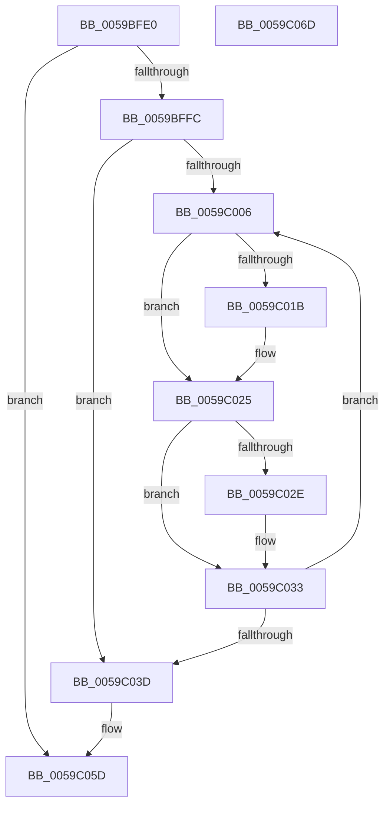

# IopLiveDumpFreeMappingResources

- RVA: `0x0059BFE0`–`0x0059C06E` (길이 `142` bytes)
- VA: `0x000000014059BFE0`
- 실행 섹션: `.text`
- PDB 이름 있음: `예`; PDB Function 태그: `아니요`
- unwind 정보 RVA: `0x00060BC4`
- 디코드: `36`개 명령, `142/142` bytes 표시
- 미해석 바이트: `0` (있으면 어셈블리에 `.byte`로 보존)

> 이 문서는 커널 이미지의 기계어와 PDB 기호를 분석해 생성했습니다. 4번과 5번은 함수 원형과 자료형을 바이너리 사용 방식에서 추정한 C 해석이며 원본 소스 복구 결과는 아닙니다.

## 1. Dependencies

- 직접 호출 지점: **3**; 고유 호출 대상: **3**
- 직접 호출자로 확인된 함수: **2**
- RIP 상대 이미지 참조: **0**

### Outgoing calls
- `0x0059C020` → [MmReleaseDumpHibernateResources](../../page/7F/MmReleaseDumpHibernateResources_function_007FE418.md) (function, `0x007FE418`)
- `0x0059C02E` → [IoFreeMdl](../29/IoFreeMdl_function_0029EA80.md) (function, `0x0029EA80`)
- `0x0059C049` → [ExFreePoolWithTag](../../poolcode/B8/ExFreePoolWithTag_function_00B82870.md) (function, `0x00B82870`)

### Direct callers
- [IopLiveDumpAllocateMappingResources](IopLiveDumpAllocateMappingResources_function_0059A868.md) at `0x0059A8BC`
- [IopLiveDumpReleaseResources](IopLiveDumpReleaseResources_function_0059DF1C.md) at `0x0059DF8B`

### Static image references
- 디코드된 RIP-relative 메모리 참조가 없습니다.

## 2. Other-region calls and transfers

- 다른 실행 섹션으로 향하는 call: **2**
  - `0x0059C020` → [MmReleaseDumpHibernateResources](../../page/7F/MmReleaseDumpHibernateResources_function_007FE418.md) (`.text` → `PAGE`)
  - `0x0059C049` → [ExFreePoolWithTag](../../poolcode/B8/ExFreePoolWithTag_function_00B82870.md) (`.text` → `POOLCODE`)
- 별도 외부 분기/꼬리 이동을 확인하지 못했습니다.

## 3. Assembly (complete function range)

```asm
0059BFE0  48 89 5C 24 08                  mov qword ptr [rsp + 8], rbx
0059BFE5  48 89 74 24 10                  mov qword ptr [rsp + 0x10], rsi
0059BFEA  57                              push rdi
0059BFEB  48 83 EC 20                     sub rsp, 0x20
0059BFEF  48 83 B9 80 03 00 00 00         cmp qword ptr [rcx + 0x380], 0
0059BFF7  48 8B D9                        mov rbx, rcx
0059BFFA  74 61                           je 0x14059c05d
0059BFFC  33 FF                           xor edi, edi
0059BFFE  39 B9 78 03 00 00               cmp dword ptr [rcx + 0x378], edi
0059C004  76 37                           jbe 0x14059c03d
0059C006  8B F7                           mov esi, edi
0059C008  48 C1 E6 04                     shl rsi, 4
0059C00C  48 03 B3 80 03 00 00            add rsi, qword ptr [rbx + 0x380]
0059C013  48 8B 0E                        mov rcx, qword ptr [rsi]
0059C016  48 85 C9                        test rcx, rcx
0059C019  74 0A                           je 0x14059c025
0059C01B  BA 00 00 01 00                  mov edx, 0x10000
0059C020  E8 F3 23 26 00                  call 0x1407fe418
0059C025  48 8B 4E 08                     mov rcx, qword ptr [rsi + 8]
0059C029  48 85 C9                        test rcx, rcx
0059C02C  74 05                           je 0x14059c033
0059C02E  E8 4D 2A D0 FF                  call 0x14029ea80
0059C033  FF C7                           inc edi
0059C035  3B BB 78 03 00 00               cmp edi, dword ptr [rbx + 0x378]
0059C03B  72 C9                           jb 0x14059c006
0059C03D  48 8B 8B 80 03 00 00            mov rcx, qword ptr [rbx + 0x380]
0059C044  BA 4C 64 6D 70                  mov edx, 0x706d644c
0059C049  E8 22 68 5E 00                  call 0x140b82870
0059C04E  48 83 A3 80 03 00 00 00         and qword ptr [rbx + 0x380], 0
0059C056  83 A3 78 03 00 00 00            and dword ptr [rbx + 0x378], 0
0059C05D  48 8B 5C 24 30                  mov rbx, qword ptr [rsp + 0x30]
0059C062  48 8B 74 24 38                  mov rsi, qword ptr [rsp + 0x38]
0059C067  48 83 C4 20                     add rsp, 0x20
0059C06B  5F                              pop rdi
0059C06C  C3                              ret
0059C06D  CC                              int3
```

## 4. C-style interpretation (structured pseudocode)

```c
__int64 __fastcall IopLiveDumpFreeMappingResources(__int64 a1)
{
    __int64 result;
    __int64 v_rdi;
    __int64 v_rsi;
    __int64 v_rsp;
    unsigned __int64 v_stack_p10;
    unsigned __int64 v_stack_p8;

    v_stack_p8 = v_rbx;
    v_stack_p10 = v_rsi;
    v_rsp = (v_rsp) - (32);
    if ((*(unsigned __int64 *)(a1 + 896)) == 0) goto loc_0059C05D;
    v_rdi = 0;
    if ((*(unsigned int *)(a1 + 888)) <= 0) goto loc_0059C03D;
loc_0059C006:
    v_rsi = (0) << (4);
    v_rsi = (v_rsi) + (*(unsigned __int64 *)(a1 + 896));
    if (*(unsigned __int64 *)(v_rsi) != 0) {
        a2 = 0x10000ULL;
        result = MmReleaseDumpHibernateResources(*(unsigned __int64 *)(v_rsi), a2, a3, a4);
    }
    if (*(unsigned __int64 *)(v_rsi + 8) != 0) {
        result = IoFreeMdl(*(unsigned __int64 *)(v_rsi + 8), a2, a3, a4);
    }
    v_rdi = (unsigned int)((v_rdi) + 1);
    if (((unsigned int)(v_rdi)) < (*(unsigned int *)(a1 + 888))) goto loc_0059C006;
loc_0059C03D:
    result = ExFreePoolWithTag(*(unsigned __int64 *)(a1 + 896), (unsigned int)(0x706D644CULL), a3, a4);
loc_0059C05D:
    v_rsp = (v_rsp) + (32);
    return result;
}
```

## 5. (Beta) C Style

```c
int64_t IopLiveDumpFreeMappingResources(void *Arg1)
{
    uint8_t *arg1 = (uint8_t *)Arg1;

    int64_t result;
    int64_t local_rdi;
    int64_t local_rsi;
    int64_t local_rsp;
    uint64_t v_stack_p10;
    uint64_t v_stack_p8;

    v_stack_p8 = local_rbx;
    v_stack_p10 = local_rsi;
    local_rsp = (local_rsp) - (32);
    if ((*(uint64_t *)(arg1 + 0x380)) == 0) goto loc_0059C05D;
    local_rdi = 0;
    if ((*(uint32_t *)(arg1 + 0x378)) <= 0) goto loc_0059C03D;
loc_0059C006:
    local_rsi = (0) << (4);
    local_rsi = (local_rsi) + (*(uint64_t *)(arg1 + 0x380));
    if (*(uint64_t *)(local_rsi) != 0) {
        a2 = 0x10000ULL;
        result = MmReleaseDumpHibernateResources(*(uint64_t *)(local_rsi), a2, a3, a4);
    }
    if (*(uint64_t *)(local_rsi + 0x8) != 0) {
        result = IoFreeMdl(*(uint64_t *)(local_rsi + 0x8), a2, a3, a4);
    }
    local_rdi = (uint32_t)((local_rdi) + 1);
    if (((uint32_t)(local_rdi)) < (*(uint32_t *)(arg1 + 0x378))) goto loc_0059C006;
loc_0059C03D:
    result = ExFreePoolWithTag(*(uint64_t *)(arg1 + 0x380), (uint32_t)(0x706D644CULL), a3, a4);
loc_0059C05D:
    local_rsp = (local_rsp) + (32);
    return result;
}
```

### 관측된 메모리 오프셋

구조체 형식이 확인되지 않은 접근은 인자 기준의 오프셋으로만 기록했습니다.

| 기준 인자 | 오프셋 표현 | 폭 (bit) | 접근 |
|---|---:|---:|---|
| `Arg1` | `+ 0x378` | `32` | `R` |
| `Arg1` | `+ 0x378` | `32` | `R/W` |
| `Arg1` | `+ 0x380` | `64` | `R` |
| `Arg1` | `+ 0x380` | `64` | `R/W` |

## 6. Execution-region graph

[열기: 2D/3D 그래프와 함수 탐색 컨트롤 패널](../../../control-panel.html?section=text&rva=0x0059BFE0&view=graph)

- 2D 그래프는 위에서 아래로 흐르고, 3D 그래프는 빈 공간을 드래그해 회전합니다. Shift+드래그는 이동, 휠은 확대·축소, 함수 노드 선택은 대상 보고서 이동입니다.

### Static fallback


