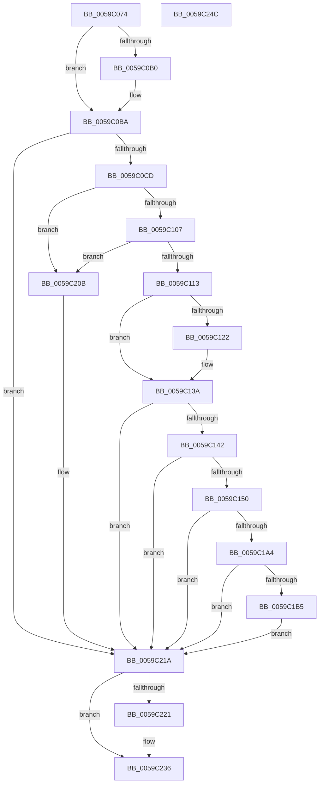

# IopLiveDumpGenerateIptSecondaryData

- RVA: `0x0059C074`–`0x0059C24D` (길이 `473` bytes)
- VA: `0x000000014059C074`
- 실행 섹션: `.text`
- PDB 이름 있음: `예`; PDB Function 태그: `아니요`
- unwind 정보 RVA: `0x000C7B70`
- 디코드: `114`개 명령, `473/473` bytes 표시
- 미해석 바이트: `0` (있으면 어셈블리에 `.byte`로 보존)

> 이 문서는 커널 이미지의 기계어와 PDB 기호를 분석해 생성했습니다. 4번과 5번은 함수 원형과 자료형을 바이너리 사용 방식에서 추정한 C 해석이며 원본 소스 복구 결과는 아닙니다.

## 1. Dependencies

- 직접 호출 지점: **7**; 고유 호출 대상: **4**
- 직접 호출자로 확인된 함수: **1**
- RIP 상대 이미지 참조: **3**

### Outgoing calls
- `0x0059C0B2` → [IopLiveDumpGetMillisecondCounter](../3F/IopLiveDumpGetMillisecondCounter_function_003F5964.md) (function, `0x003F5964`)
- `0x0059C0F4` → [guard_dispatch_icall](../6B/guard_dispatch_icall_function_006BAAD0.md) (function, `0x006BAAD0`)
- `0x0059C125` → [memcpy](../6C/memcpy_function_006C6840.md) (function, `0x006C6840`)
- `0x0059C196` → [guard_dispatch_icall](../6B/guard_dispatch_icall_function_006BAAD0.md) (function, `0x006BAAD0`)
- `0x0059C1F7` → [memcpy](../6C/memcpy_function_006C6840.md) (function, `0x006C6840`)
- `0x0059C223` → [IopLiveDumpGetMillisecondCounter](../3F/IopLiveDumpGetMillisecondCounter_function_003F5964.md) (function, `0x003F5964`)
- `0x0059C231` → [IopLiveDumpTraceCaptureGenerateIptSecondaryDataDuration](IopLiveDumpTraceCaptureGenerateIptSecondaryDataDuration_function_0059E50C.md) (function, `0x0059E50C`)

### Direct callers
- [IopLiveDumpCollectPages](IopLiveDumpCollectPages_function_0059B328.md) at `0x0059B5FC`

### Static image references
- `0x0059C08B` → RVA `0x00E66188` (`.data`; read)
- `0x0059C0CD` → RVA `0x00E66178` (`.data`; read)
- `0x0059C1BC` → RVA `0x000296A8` (`.rdata`; read)

## 2. Other-region calls and transfers

- 다른 실행 섹션으로 향하는 call: **0**
- 별도 외부 분기/꼬리 이동을 확인하지 못했습니다.

## 3. Assembly (complete function range)

```asm
0059C074  48 89 5C 24 08                  mov qword ptr [rsp + 8], rbx
0059C079  48 89 74 24 10                  mov qword ptr [rsp + 0x10], rsi
0059C07E  48 89 7C 24 18                  mov qword ptr [rsp + 0x18], rdi
0059C083  55                              push rbp
0059C084  48 8B EC                        mov rbp, rsp
0059C087  48 83 EC 70                     sub rsp, 0x70
0059C08B  48 8B 3D F6 A0 8C 00            mov rdi, qword ptr [rip + 0x8ca0f6]
0059C092  33 C0                           xor eax, eax
0059C094  0F 57 C0                        xorps xmm0, xmm0
0059C097  48 89 45 F0                     mov qword ptr [rbp - 0x10], rax
0059C09B  33 F6                           xor esi, esi
0059C09D  0F 11 45 C0                     movups xmmword ptr [rbp - 0x40], xmm0
0059C0A1  8B 47 50                        mov eax, dword ptr [rdi + 0x50]
0059C0A4  0F 11 45 D0                     movups xmmword ptr [rbp - 0x30], xmm0
0059C0A8  0F 11 45 E0                     movups xmmword ptr [rbp - 0x20], xmm0
0059C0AC  84 C0                           test al, al
0059C0AE  79 0A                           jns 0x14059c0ba
0059C0B0  33 C9                           xor ecx, ecx
0059C0B2  E8 AD 98 E5 FF                  call 0x1403f5964
0059C0B7  48 8B F0                        mov rsi, rax
0059C0BA  48 8D 9F 18 04 00 00            lea rbx, [rdi + 0x418]
0059C0C1  48 8B 0B                        mov rcx, qword ptr [rbx]
0059C0C4  48 85 C9                        test rcx, rcx
0059C0C7  0F 84 4D 01 00 00               je 0x14059c21a
0059C0CD  48 8B 05 A4 A0 8C 00            mov rax, qword ptr [rip + 0x8ca0a4]
0059C0D4  33 D2                           xor edx, edx
0059C0D6  83 A7 40 04 00 00 00            and dword ptr [rdi + 0x440], 0
0059C0DD  41 B9 30 00 00 00               mov r9d, 0x30
0059C0E3  48 89 8F 38 04 00 00            mov qword ptr [rdi + 0x438], rcx
0059C0EA  4C 8B C3                        mov r8, rbx
0059C0ED  48 8B 40 28                     mov rax, qword ptr [rax + 0x28]
0059C0F1  8D 4A 02                        lea ecx, [rdx + 2]
0059C0F4  E8 D7 E9 11 00                  call 0x1406baad0
0059C0F9  8B 87 40 04 00 00               mov eax, dword ptr [rdi + 0x440]
0059C0FF  85 C0                           test eax, eax
0059C101  0F 84 04 01 00 00               je 0x14059c20b
0059C107  39 87 20 04 00 00               cmp dword ptr [rdi + 0x420], eax
0059C10D  0F 82 F8 00 00 00               jb 0x14059c20b
0059C113  48 8B 0B                        mov rcx, qword ptr [rbx]
0059C116  48 8B 97 38 04 00 00            mov rdx, qword ptr [rdi + 0x438]
0059C11D  48 3B CA                        cmp rcx, rdx
0059C120  74 18                           je 0x14059c13a
0059C122  44 8B C0                        mov r8d, eax
0059C125  E8 16 A7 12 00                  call 0x1406c6840
0059C12A  48 8B 03                        mov rax, qword ptr [rbx]
0059C12D  48 89 87 38 04 00 00            mov qword ptr [rdi + 0x438], rax
0059C134  8B 87 40 04 00 00               mov eax, dword ptr [rdi + 0x440]
0059C13A  85 C0                           test eax, eax
0059C13C  0F 84 D8 00 00 00               je 0x14059c21a
0059C142  48 83 BF E8 03 00 00 00         cmp qword ptr [rdi + 0x3e8], 0
0059C14A  0F 84 CA 00 00 00               je 0x14059c21a
0059C150  8B 07                           mov eax, dword ptr [rdi]
0059C152  4C 8D 45 C0                     lea r8, [rbp - 0x40]
0059C156  89 45 D0                        mov dword ptr [rbp - 0x30], eax
0059C159  33 D2                           xor edx, edx
0059C15B  48 8B 47 08                     mov rax, qword ptr [rdi + 8]
0059C15F  41 B9 38 00 00 00               mov r9d, 0x38
0059C165  48 89 45 D8                     mov qword ptr [rbp - 0x28], rax
0059C169  48 8B 47 10                     mov rax, qword ptr [rdi + 0x10]
0059C16D  48 89 45 E0                     mov qword ptr [rbp - 0x20], rax
0059C171  8D 4A 07                        lea ecx, [rdx + 7]
0059C174  48 8B 47 18                     mov rax, qword ptr [rdi + 0x18]
0059C178  48 89 45 E8                     mov qword ptr [rbp - 0x18], rax
0059C17C  48 8B 47 20                     mov rax, qword ptr [rdi + 0x20]
0059C180  48 89 45 F0                     mov qword ptr [rbp - 0x10], rax
0059C184  48 8B 05 ED 9F 8C 00            mov rax, qword ptr [rip + 0x8c9fed]
0059C18B  C7 45 CC 00 00 00 02            mov dword ptr [rbp - 0x34], 0x2000000
0059C192  48 8B 40 20                     mov rax, qword ptr [rax + 0x20]
0059C196  E8 35 E9 11 00                  call 0x1406baad0
0059C19B  48 8B 4D C0                     mov rcx, qword ptr [rbp - 0x40]
0059C19F  48 85 C9                        test rcx, rcx
0059C1A2  74 76                           je 0x14059c21a
0059C1A4  8B 41 10                        mov eax, dword ptr [rcx + 0x10]
0059C1A7  C1 E0 04                        shl eax, 4
0059C1AA  83 C0 0C                        add eax, 0xc
0059C1AD  3B 87 F0 03 00 00               cmp eax, dword ptr [rdi + 0x3f0]
0059C1B3  77 65                           ja 0x14059c21a
0059C1B5  48 8B 9F E8 03 00 00            mov rbx, qword ptr [rdi + 0x3e8]
0059C1BC  0F 10 05 E5 D4 A8 FF            movups xmm0, xmmword ptr [rip - 0x572b1b]
0059C1C3  89 87 10 04 00 00               mov dword ptr [rdi + 0x410], eax
0059C1C9  48 89 9F 08 04 00 00            mov qword ptr [rdi + 0x408], rbx
0059C1D0  F3 0F 7F 87 F8 03 00 00         movdqu xmmword ptr [rdi + 0x3f8], xmm0
0059C1D8  8B 41 10                        mov eax, dword ptr [rcx + 0x10]
0059C1DB  48 8D 4B 08                     lea rcx, [rbx + 8]
0059C1DF  89 03                           mov dword ptr [rbx], eax
0059C1E1  44 8B C0                        mov r8d, eax
0059C1E4  C7 43 04 04 00 00 00            mov dword ptr [rbx + 4], 4
0059C1EB  48 8B 55 C0                     mov rdx, qword ptr [rbp - 0x40]
0059C1EF  48 83 C2 30                     add rdx, 0x30
0059C1F3  49 C1 E0 04                     shl r8, 4
0059C1F7  E8 44 A6 12 00                  call 0x1406c6840
0059C1FC  8B 03                           mov eax, dword ptr [rbx]
0059C1FE  48 03 C0                        add rax, rax
0059C201  C7 44 C3 08 49 50 54 00         mov dword ptr [rbx + rax*8 + 8], 0x545049
0059C209  EB 0F                           jmp 0x14059c21a
0059C20B  48 83 A7 38 04 00 00 00         and qword ptr [rdi + 0x438], 0
0059C213  83 A7 40 04 00 00 00            and dword ptr [rdi + 0x440], 0
0059C21A  8B 47 50                        mov eax, dword ptr [rdi + 0x50]
0059C21D  84 C0                           test al, al
0059C21F  79 15                           jns 0x14059c236
0059C221  33 C9                           xor ecx, ecx
0059C223  E8 3C 97 E5 FF                  call 0x1403f5964
0059C228  48 2B C6                        sub rax, rsi
0059C22B  48 8B CF                        mov rcx, rdi
0059C22E  48 8B D0                        mov rdx, rax
0059C231  E8 D6 22 00 00                  call 0x14059e50c
0059C236  4C 8D 5C 24 70                  lea r11, [rsp + 0x70]
0059C23B  49 8B 5B 10                     mov rbx, qword ptr [r11 + 0x10]
0059C23F  49 8B 73 18                     mov rsi, qword ptr [r11 + 0x18]
0059C243  49 8B 7B 20                     mov rdi, qword ptr [r11 + 0x20]
0059C247  49 8B E3                        mov rsp, r11
0059C24A  5D                              pop rbp
0059C24B  C3                              ret
0059C24C  CC                              int3
```

## 4. C-style interpretation (structured pseudocode)

```c
__int64 __fastcall IopLiveDumpGenerateIptSecondaryData(int a1, int a2)
{
    __int64 result;
    __int64 v_rsi;
    __int64 v_rsp;
    unsigned __int64 v_stack_m18;
    unsigned __int64 v_stack_m20;
    unsigned __int64 v_stack_m28;
    unsigned __int64 v_stack_m30;
    unsigned __int64 v_stack_m38;
    unsigned int v_stack_m3C;
    unsigned __int64 v_stack_m48;
    unsigned __int64 v_stack_m8;
    unsigned __int64 v_stack_p10;
    unsigned __int64 v_stack_p18;
    unsigned __int64 v_stack_p8;

    v_stack_p8 = v_rbx;
    v_stack_p10 = v_rsi;
    v_stack_p18 = v_rdi;
    v_rsp = (v_rsp) - (112);
    result = 0;
    v_stack_m18 = 0;
    v_rsi = 0;
    v_stack_m48 = v_xmm0;
    v_stack_m38 = v_xmm0;
    v_stack_m28 = v_xmm0;
    result = (unsigned int)(*(unsigned int *)(*(unsigned __int64 *)(v_rip + 9216246) + 80));
    if (sign_flag) {
        a1 = 0;
        result = IopLiveDumpGetMillisecondCounter(a1, a2, a3, a4);
        v_rsi = result;
    }
    if (*(unsigned __int64 *)(*(unsigned __int64 *)(v_rip + 9216246) + 1048) == 0) goto loc_0059C21A;
    a2 = 0;
    *(unsigned __int64 *)(*(unsigned __int64 *)(v_rip + 9216246) + 1080) = *(unsigned __int64 *)(*(unsigned __int64 *)(v_rip + 9216246) + 1048);
    result = guard_dispatch_icall(a2 + 2, a2, *(unsigned __int64 *)(v_rip + 9216246) + 1048, 48);
    if ((unsigned int)((unsigned int)(*(unsigned int *)(*(unsigned __int64 *)(v_rip + 9216246) + 1088))) == 0) goto loc_0059C20B;
    if ((*(unsigned int *)(*(unsigned __int64 *)(v_rip + 9216246) + 1056)) < ((unsigned int)((unsigned int)(*(unsigned int *)(*(unsigned __int64 *)(v_rip + 9216246) + 1088))))) goto loc_0059C20B;
    result = (unsigned int)(*(unsigned int *)(*(unsigned __int64 *)(v_rip + 9216246) + 1088));
    if ((*(unsigned __int64 *)(*(unsigned __int64 *)(v_rip + 9216246) + 1048)) != (*(unsigned __int64 *)(*(unsigned __int64 *)(v_rip + 9216246) + 1080))) {
        a3 = (unsigned int)((unsigned int)(*(unsigned int *)(*(unsigned __int64 *)(v_rip + 9216246) + 1088)));
        result = memcpy(*(unsigned __int64 *)(*(unsigned __int64 *)(v_rip + 9216246) + 1048), *(unsigned __int64 *)(*(unsigned __int64 *)(v_rip + 9216246) + 1080), a3, 48);
        result = *(unsigned __int64 *)(*(unsigned __int64 *)(v_rip + 9216246) + 1048);
        *(unsigned __int64 *)(*(unsigned __int64 *)(v_rip + 9216246) + 1080) = result;
        result = *(unsigned int *)(*(unsigned __int64 *)(v_rip + 9216246) + 1088);
    }
    if ((unsigned int)(result) == 0) goto loc_0059C21A;
    if ((*(unsigned __int64 *)(*(unsigned __int64 *)(v_rip + 9216246) + 1000)) == 0) goto loc_0059C21A;
    v_stack_m38 = (unsigned int)((unsigned int)(*(unsigned int *)(*(unsigned __int64 *)(v_rip + 9216246))));
    a2 = 0;
    v_stack_m30 = *(unsigned __int64 *)(*(unsigned __int64 *)(v_rip + 9216246) + 8);
    v_stack_m28 = *(unsigned __int64 *)(*(unsigned __int64 *)(v_rip + 9216246) + 16);
    v_stack_m20 = *(unsigned __int64 *)(*(unsigned __int64 *)(v_rip + 9216246) + 24);
    v_stack_m18 = *(unsigned __int64 *)(*(unsigned __int64 *)(v_rip + 9216246) + 32);
    v_stack_m3C = 0x2000000ULL;
    result = guard_dispatch_icall(a2 + 7, a2, v_stack_m48, 56);
    if (v_stack_m48 == 0) goto loc_0059C21A;
    result = (unsigned int)(((unsigned int)(*(unsigned int *)(v_stack_m48 + 16))) << (4));
    result = (unsigned int)((result) + (12));
    if (((unsigned int)(result)) > (*(unsigned int *)(*(unsigned __int64 *)(v_rip + 9216246) + 1008))) goto loc_0059C21A;
    *(unsigned int *)(*(unsigned __int64 *)(v_rip + 9216246) + 1040) = (unsigned int)(result);
    *(unsigned __int64 *)(*(unsigned __int64 *)(v_rip + 9216246) + 1032) = *(unsigned __int64 *)(*(unsigned __int64 *)(v_rip + 9216246) + 1000);
    *(unsigned __int64 *)(*(unsigned __int64 *)(v_rip + 9216246) + 1016) = v_xmm0;
    *(unsigned int *)(*(unsigned __int64 *)(*(unsigned __int64 *)(v_rip + 9216246) + 1000)) = (unsigned int)((unsigned int)(*(unsigned int *)(v_stack_m48 + 16)));
    *(unsigned int *)(*(unsigned __int64 *)(*(unsigned __int64 *)(v_rip + 9216246) + 1000) + 4) = 4;
    a2 = (v_stack_m48) + (48);
    a3 = ((unsigned int)((unsigned int)((unsigned int)(*(unsigned int *)(v_stack_m48 + 16))))) << (4);
    result = memcpy(*(unsigned __int64 *)(*(unsigned __int64 *)(v_rip + 9216246) + 1000) + 8, a2, a3, 56);
    result = ((unsigned int)(*(unsigned int *)(*(unsigned __int64 *)(*(unsigned __int64 *)(v_rip + 9216246) + 1000)))) + ((unsigned int)(*(unsigned int *)(*(unsigned __int64 *)(*(unsigned __int64 *)(v_rip + 9216246) + 1000))));
    *(unsigned int *)(*(unsigned __int64 *)(*(unsigned __int64 *)(v_rip + 9216246) + 1000) + result * 8 + 8) = 0x545049ULL;
    goto loc_0059C21A;
loc_0059C20B:
loc_0059C21A:
    result = (unsigned int)(*(unsigned int *)(*(unsigned __int64 *)(v_rip + 9216246) + 80));
    if (sign_flag) {
        a1 = 0;
        result = IopLiveDumpGetMillisecondCounter(a1, a2, a3, 56);
        result = (result) - (v_rsi);
        a1 = *(unsigned __int64 *)(v_rip + 9216246);
        a2 = result;
        result = IopLiveDumpTraceCaptureGenerateIptSecondaryDataDuration(a1, a2, a3, 56);
    }
    return result;
}
```

## 5. (Beta) C Style

```c
int64_t IopLiveDumpGenerateIptSecondaryData(int32_t Arg1, int32_t Arg2)
{
    int64_t result;
    int64_t local_rsi;
    int64_t local_rsp;
    uint64_t v_stack_m18;
    uint64_t v_stack_m20;
    uint64_t v_stack_m28;
    uint64_t v_stack_m30;
    uint64_t v_stack_m38;
    uint32_t v_stack_m3C;
    uint64_t v_stack_m48;
    uint64_t v_stack_m8;
    uint64_t v_stack_p10;
    uint64_t v_stack_p18;
    uint64_t v_stack_p8;

    v_stack_p8 = local_rbx;
    v_stack_p10 = local_rsi;
    v_stack_p18 = local_rdi;
    local_rsp = (local_rsp) - (112);
    result = 0;
    v_stack_m18 = 0;
    local_rsi = 0;
    v_stack_m48 = v_xmm0;
    v_stack_m38 = v_xmm0;
    v_stack_m28 = v_xmm0;
    result = (uint32_t)(*(uint32_t *)(*(uint64_t *)(v_rip + 0x8CA0F6) + 0x50));
    if (sign_flag) {
        Arg1 = 0;
        result = IopLiveDumpGetMillisecondCounter(Arg1, Arg2, a3, a4);
        local_rsi = result;
    }
    if (*(uint64_t *)(*(uint64_t *)(v_rip + 0x8CA0F6) + 0x418) == 0) goto loc_0059C21A;
    Arg2 = 0;
    *(uint64_t *)(*(uint64_t *)(v_rip + 0x8CA0F6) + 0x438) = *(uint64_t *)(*(uint64_t *)(v_rip + 0x8CA0F6) + 0x418);
    result = guard_dispatch_icall(Arg2 + 2, Arg2, *(uint64_t *)(v_rip + 0x8CA0F6) + 1048, 48);
    if ((uint32_t)((uint32_t)(*(uint32_t *)(*(uint64_t *)(v_rip + 0x8CA0F6) + 0x440))) == 0) goto loc_0059C20B;
    if ((*(uint32_t *)(*(uint64_t *)(v_rip + 0x8CA0F6) + 0x420)) < ((uint32_t)((uint32_t)(*(uint32_t *)(*(uint64_t *)(v_rip + 0x8CA0F6) + 0x440))))) goto loc_0059C20B;
    result = (uint32_t)(*(uint32_t *)(*(uint64_t *)(v_rip + 0x8CA0F6) + 0x440));
    if ((*(uint64_t *)(*(uint64_t *)(v_rip + 0x8CA0F6) + 0x418)) != (*(uint64_t *)(*(uint64_t *)(v_rip + 0x8CA0F6) + 0x438))) {
        a3 = (uint32_t)((uint32_t)(*(uint32_t *)(*(uint64_t *)(v_rip + 0x8CA0F6) + 0x440)));
        result = memcpy(*(uint64_t *)(*(uint64_t *)(v_rip + 0x8CA0F6) + 0x418), *(uint64_t *)(*(uint64_t *)(v_rip + 0x8CA0F6) + 0x438), a3, 48);
        result = *(uint64_t *)(*(uint64_t *)(v_rip + 0x8CA0F6) + 0x418);
        *(uint64_t *)(*(uint64_t *)(v_rip + 0x8CA0F6) + 0x438) = result;
        result = *(uint32_t *)(*(uint64_t *)(v_rip + 0x8CA0F6) + 0x440);
    }
    if ((uint32_t)(result) == 0) goto loc_0059C21A;
    if ((*(uint64_t *)(*(uint64_t *)(v_rip + 0x8CA0F6) + 0x3E8)) == 0) goto loc_0059C21A;
    v_stack_m38 = (uint32_t)((uint32_t)(*(uint32_t *)(*(uint64_t *)(v_rip + 0x8CA0F6))));
    Arg2 = 0;
    v_stack_m30 = *(uint64_t *)(*(uint64_t *)(v_rip + 0x8CA0F6) + 0x8);
    v_stack_m28 = *(uint64_t *)(*(uint64_t *)(v_rip + 0x8CA0F6) + 0x10);
    v_stack_m20 = *(uint64_t *)(*(uint64_t *)(v_rip + 0x8CA0F6) + 0x18);
    v_stack_m18 = *(uint64_t *)(*(uint64_t *)(v_rip + 0x8CA0F6) + 0x20);
    v_stack_m3C = 0x2000000ULL;
    result = guard_dispatch_icall(Arg2 + 7, Arg2, v_stack_m48, 56);
    if (v_stack_m48 == 0) goto loc_0059C21A;
    result = (uint32_t)(((uint32_t)(*(uint32_t *)(v_stack_m48 + 0x10))) << (4));
    result = (uint32_t)((result) + (12));
    if (((uint32_t)(result)) > (*(uint32_t *)(*(uint64_t *)(v_rip + 0x8CA0F6) + 0x3F0))) goto loc_0059C21A;
    *(uint32_t *)(*(uint64_t *)(v_rip + 0x8CA0F6) + 0x410) = (uint32_t)(result);
    *(uint64_t *)(*(uint64_t *)(v_rip + 0x8CA0F6) + 0x408) = *(uint64_t *)(*(uint64_t *)(v_rip + 0x8CA0F6) + 0x3E8);
    *(uint64_t *)(*(uint64_t *)(v_rip + 0x8CA0F6) + 0x3F8) = v_xmm0;
    *(uint32_t *)(*(uint64_t *)(*(uint64_t *)(v_rip + 0x8CA0F6) + 0x3E8)) = (uint32_t)((uint32_t)(*(uint32_t *)(v_stack_m48 + 0x10)));
    *(uint32_t *)(*(uint64_t *)(*(uint64_t *)(v_rip + 0x8CA0F6) + 0x3E8) + 0x4) = 4;
    Arg2 = (v_stack_m48) + (48);
    a3 = ((uint32_t)((uint32_t)((uint32_t)(*(uint32_t *)(v_stack_m48 + 0x10))))) << (4);
    result = memcpy(*(uint64_t *)(*(uint64_t *)(v_rip + 0x8CA0F6) + 0x3E8) + 8, Arg2, a3, 56);
    result = ((uint32_t)(*(uint32_t *)(*(uint64_t *)(*(uint64_t *)(v_rip + 0x8CA0F6) + 0x3E8)))) + ((uint32_t)(*(uint32_t *)(*(uint64_t *)(*(uint64_t *)(v_rip + 0x8CA0F6) + 0x3E8))));
    *(uint32_t *)(*(uint64_t *)(*(uint64_t *)(v_rip + 0x8CA0F6) + 0x3E8) + result * 8 + 0x8) = 0x545049ULL;
    goto loc_0059C21A;
loc_0059C20B:
loc_0059C21A:
    result = (uint32_t)(*(uint32_t *)(*(uint64_t *)(v_rip + 0x8CA0F6) + 0x50));
    if (sign_flag) {
        Arg1 = 0;
        result = IopLiveDumpGetMillisecondCounter(Arg1, Arg2, a3, 56);
        result = (result) - (local_rsi);
        Arg1 = *(uint64_t *)(v_rip + 0x8CA0F6);
        Arg2 = result;
        result = IopLiveDumpTraceCaptureGenerateIptSecondaryDataDuration(Arg1, Arg2, a3, 56);
    }
    return result;
}
```

## 6. Execution-region graph

[열기: 2D/3D 그래프와 함수 탐색 컨트롤 패널](../../../control-panel.html?section=text&rva=0x0059C074&view=graph)

- 2D 그래프는 위에서 아래로 흐르고, 3D 그래프는 빈 공간을 드래그해 회전합니다. Shift+드래그는 이동, 휠은 확대·축소, 함수 노드 선택은 대상 보고서 이동입니다.

### Static fallback


