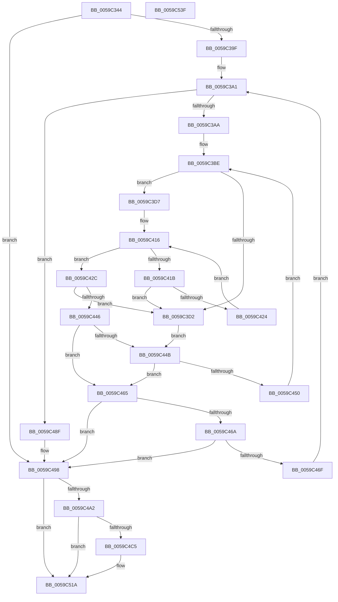

# IopLiveDumpGetCapturePagesNoLock

- RVA: `0x0059C344`–`0x0059C540` (길이 `508` bytes)
- VA: `0x000000014059C344`
- 실행 섹션: `.text`
- PDB 이름 있음: `예`; PDB Function 태그: `아니요`
- unwind 정보 RVA: `0x000C7BA4`
- 디코드: `140`개 명령, `508/508` bytes 표시
- 미해석 바이트: `0` (있으면 어셈블리에 `.byte`로 보존)

> 이 문서는 커널 이미지의 기계어와 PDB 기호를 분석해 생성했습니다. 4번과 5번은 함수 원형과 자료형을 바이너리 사용 방식에서 추정한 C 해석이며 원본 소스 복구 결과는 아닙니다.

## 1. Dependencies

- 직접 호출 지점: **2**; 고유 호출 대상: **2**
- 직접 호출자로 확인된 함수: **2**
- RIP 상대 이미지 참조: **5**

### Outgoing calls
- `0x0059C515` → [IopLiveDumpTraceEventGeneric](../5A/IopLiveDumpTraceEventGeneric_function_005A41E4.md) (function, `0x005A41E4`)
- `0x0059C522` → [_security_check_cookie](../6A/_security_check_cookie_function_006AC640.md) (function, `0x006AC640`)

### Direct callers
- [IopLiveDumpGetCapturePages](IopLiveDumpGetCapturePages_function_0059C254.md) at `0x0059C2B5`
- [IopLiveDumpGetNtMergePages](IopLiveDumpGetNtMergePages_function_0059C81C.md) at `0x0059C86B`

### Static image references
- `0x0059C358` → RVA `0x00E0A740` (`.data`; read)
- `0x0059C4C5` → RVA `0x006CAAA0` (` ?? ::FNODOBFM::`string'`; read)
- `0x0059C4DB` → RVA `0x006CAAC0` (` ?? ::FNODOBFM::`string'`; read)
- `0x0059C4F1` → RVA `0x006CA9D0` (` ?? ::FNODOBFM::`string'`; read)
- `0x0059C4FD` → RVA `0x006CA9E0` (` ?? ::FNODOBFM::`string'`; read)

## 2. Other-region calls and transfers

- 다른 실행 섹션으로 향하는 call: **0**
- 별도 외부 분기/꼬리 이동을 확인하지 못했습니다.

## 3. Assembly (complete function range)

```asm
0059C344  48 89 5C 24 20                  mov qword ptr [rsp + 0x20], rbx
0059C349  55                              push rbp
0059C34A  56                              push rsi
0059C34B  57                              push rdi
0059C34C  41 54                           push r12
0059C34E  41 55                           push r13
0059C350  41 56                           push r14
0059C352  41 57                           push r15
0059C354  48 83 EC 70                     sub rsp, 0x70
0059C358  48 8B 05 E1 E3 86 00            mov rax, qword ptr [rip + 0x86e3e1]
0059C35F  48 33 C4                        xor rax, rsp
0059C362  48 89 44 24 60                  mov qword ptr [rsp + 0x60], rax
0059C367  4C 8B 94 24 D0 00 00 00         mov r10, qword ptr [rsp + 0xd0]
0059C36F  45 8B D9                        mov r11d, r9d
0059C372  4C 8B A4 24 D8 00 00 00         mov r12, qword ptr [rsp + 0xd8]
0059C37A  4D 8B F8                        mov r15, r8
0059C37D  44 89 4C 24 20                  mov dword ptr [rsp + 0x20], r9d
0059C382  48 8B DA                        mov rbx, rdx
0059C385  49 83 C9 FF                     or r9, 0xffffffffffffffff
0059C389  48 89 4C 24 28                  mov qword ptr [rsp + 0x28], rcx
0059C38E  41 83 22 00                     and dword ptr [r10], 0
0059C392  48 8B 72 30                     mov rsi, qword ptr [rdx + 0x30]
0059C396  49 3B F1                        cmp rsi, r9
0059C399  0F 84 F9 00 00 00               je 0x14059c498
0059C39F  33 C0                           xor eax, eax
0059C3A1  41 3B C3                        cmp eax, r11d
0059C3A4  0F 83 E5 00 00 00               jae 0x14059c48f
0059C3AA  48 8B 29                        mov rbp, qword ptr [rcx]
0059C3AD  4C 8B 69 08                     mov r13, qword ptr [rcx + 8]
0059C3B1  48 3B F5                        cmp rsi, rbp
0059C3B4  48 1B FF                        sbb rdi, rdi
0059C3B7  48 23 FE                        and rdi, rsi
0059C3BA  4C 8D 45 FF                     lea r8, [rbp - 1]
0059C3BE  83 64 24 24 00                  and dword ptr [rsp + 0x24], 0
0059C3C3  49 8B C0                        mov rax, r8
0059C3C6  48 2B C7                        sub rax, rdi
0059C3C9  48 FF C0                        inc rax
0059C3CC  48 83 F8 01                     cmp rax, 1
0059C3D0  73 05                           jae 0x14059c3d7
0059C3D2  49 8B D1                        mov rdx, r9
0059C3D5  EB 74                           jmp 0x14059c44b
0059C3D7  49 8B C0                        mov rax, r8
0059C3DA  40 8A CF                        mov cl, dil
0059C3DD  48 C1 E8 06                     shr rax, 6
0059C3E1  80 E1 3F                        and cl, 0x3f
0059C3E4  41 BB 01 00 00 00               mov r11d, 1
0059C3EA  49 D3 E3                        shl r11, cl
0059C3ED  49 FF CB                        dec r11
0059C3F0  4C 8D 34 C5 00 00 00 00         lea r14, [rax*8]
0059C3F8  48 8B C7                        mov rax, rdi
0059C3FB  48 C1 E8 06                     shr rax, 6
0059C3FF  4D 03 F5                        add r14, r13
0059C402  48 8D 14 C5 00 00 00 00         lea rdx, [rax*8]
0059C40A  49 03 D5                        add rdx, r13
0059C40D  48 8B 02                        mov rax, qword ptr [rdx]
0059C410  48 F7 D0                        not rax
0059C413  4C 0B D8                        or r11, rax
0059C416  4D 3B D9                        cmp r11, r9
0059C419  75 11                           jne 0x14059c42c
0059C41B  48 83 C2 08                     add rdx, 8
0059C41F  49 3B D6                        cmp rdx, r14
0059C422  77 AE                           ja 0x14059c3d2
0059C424  4C 8B 1A                        mov r11, qword ptr [rdx]
0059C427  49 F7 D3                        not r11
0059C42A  EB EA                           jmp 0x14059c416
0059C42C  49 2B D5                        sub rdx, r13
0059C42F  49 F7 D3                        not r11
0059C432  48 C1 FA 03                     sar rdx, 3
0059C436  49 0F BC C3                     bsf rax, r11
0059C43A  48 C1 E2 06                     shl rdx, 6
0059C43E  48 03 D0                        add rdx, rax
0059C441  49 3B D0                        cmp rdx, r8
0059C444  77 8C                           ja 0x14059c3d2
0059C446  49 3B D1                        cmp rdx, r9
0059C449  75 1A                           jne 0x14059c465
0059C44B  48 85 FF                        test rdi, rdi
0059C44E  74 15                           je 0x14059c465
0059C450  4C 8D 46 01                     lea r8, [rsi + 1]
0059C454  4C 3B C5                        cmp r8, rbp
0059C457  4C 0F 47 C5                     cmova r8, rbp
0059C45B  49 FF C8                        dec r8
0059C45E  33 FF                           xor edi, edi
0059C460  E9 59 FF FF FF                  jmp 0x14059c3be
0059C465  48 3B D6                        cmp rdx, rsi
0059C468  72 2E                           jb 0x14059c498
0059C46A  49 3B D1                        cmp rdx, r9
0059C46D  74 29                           je 0x14059c498
0059C46F  41 8B 02                        mov eax, dword ptr [r10]
0059C472  48 8D 72 01                     lea rsi, [rdx + 1]
0059C476  48 8B 4C 24 28                  mov rcx, qword ptr [rsp + 0x28]
0059C47B  44 8B 5C 24 20                  mov r11d, dword ptr [rsp + 0x20]
0059C480  49 89 14 C7                     mov qword ptr [r15 + rax*8], rdx
0059C484  41 FF 02                        inc dword ptr [r10]
0059C487  41 8B 02                        mov eax, dword ptr [r10]
0059C48A  E9 12 FF FF FF                  jmp 0x14059c3a1
0059C48F  FF C8                           dec eax
0059C491  4D 8B 0C C7                     mov r9, qword ptr [r15 + rax*8]
0059C495  49 FF C1                        inc r9
0059C498  4C 89 4B 30                     mov qword ptr [rbx + 0x30], r9
0059C49C  41 83 3A 00                     cmp dword ptr [r10], 0
0059C4A0  76 78                           jbe 0x14059c51a
0059C4A2  48 8B 43 38                     mov rax, qword ptr [rbx + 0x38]
0059C4A6  49 89 04 24                     mov qword ptr [r12], rax
0059C4AA  48 8B 4B 38                     mov rcx, qword ptr [rbx + 0x38]
0059C4AE  48 FF C1                        inc rcx
0059C4B1  80 BC 24 E0 00 00 00 00         cmp byte ptr [rsp + 0xe0], 0
0059C4B9  48 89 4B 38                     mov qword ptr [rbx + 0x38], rcx
0059C4BD  41 8B 02                        mov eax, dword ptr [r10]
0059C4C0  89 43 28                        mov dword ptr [rbx + 0x28], eax
0059C4C3  74 55                           je 0x14059c51a
0059C4C5  48 8D 05 D4 E5 12 00            lea rax, [rip + 0x12e5d4]
0059C4CC  48 89 4C 24 40                  mov qword ptr [rsp + 0x40], rcx
0059C4D1  48 89 44 24 48                  mov qword ptr [rsp + 0x48], rax
0059C4D6  4C 8D 4C 24 30                  lea r9, [rsp + 0x30]
0059C4DB  48 8D 05 DE E5 12 00            lea rax, [rip + 0x12e5de]
0059C4E2  BA 03 00 00 00                  mov edx, 3
0059C4E7  48 89 44 24 50                  mov qword ptr [rsp + 0x50], rax
0059C4EC  4C 8D 44 24 48                  lea r8, [rsp + 0x48]
0059C4F1  48 8D 05 D8 E4 12 00            lea rax, [rip + 0x12e4d8]
0059C4F8  48 89 44 24 58                  mov qword ptr [rsp + 0x58], rax
0059C4FD  48 8D 0D DC E4 12 00            lea rcx, [rip + 0x12e4dc]
0059C504  49 8B 04 24                     mov rax, qword ptr [r12]
0059C508  48 89 44 24 30                  mov qword ptr [rsp + 0x30], rax
0059C50D  41 8B 02                        mov eax, dword ptr [r10]
0059C510  48 89 44 24 38                  mov qword ptr [rsp + 0x38], rax
0059C515  E8 CA 7C 00 00                  call 0x1405a41e4
0059C51A  48 8B 4C 24 60                  mov rcx, qword ptr [rsp + 0x60]
0059C51F  48 33 CC                        xor rcx, rsp
0059C522  E8 19 01 11 00                  call 0x1406ac640
0059C527  48 8B 9C 24 C8 00 00 00         mov rbx, qword ptr [rsp + 0xc8]
0059C52F  48 83 C4 70                     add rsp, 0x70
0059C533  41 5F                           pop r15
0059C535  41 5E                           pop r14
0059C537  41 5D                           pop r13
0059C539  41 5C                           pop r12
0059C53B  5F                              pop rdi
0059C53C  5E                              pop rsi
0059C53D  5D                              pop rbp
0059C53E  C3                              ret
0059C53F  CC                              int3
```

## 4. C-style interpretation (structured pseudocode)

```c
__int64 __fastcall IopLiveDumpGetCapturePagesNoLock(__int64 a1, __int64 a2, __int64 a3, __int64 a4, __int64 a5, __int64 a6, unsigned __int8 a7)
{
    __int64 result;
    __int64 v_r11;
    __int64 v_r14;
    __int64 v_rdi;
    __int64 v_rsp;
    unsigned __int64 v_stack_m48;
    unsigned __int64 v_stack_m50;
    unsigned __int64 v_stack_m58;
    unsigned __int64 v_stack_m60;
    unsigned __int64 v_stack_m68;
    unsigned __int64 v_stack_m70;
    unsigned __int64 v_stack_m78;
    unsigned __int64 v_stack_m80;
    unsigned int v_stack_m84;
    unsigned int v_stack_m88;
    unsigned __int64 v_stack_p20;

    v_stack_p20 = v_rbx;
    v_rsp = (v_rsp) - (112);
    result = (*(unsigned __int64 *)(v_rip + 8840161)) ^ (v_rsp);
    v_stack_m48 = result;
    v_stack_m88 = (unsigned int)(a4);
    a4 = (a4) | (-1);
    v_stack_m80 = a1;
    if ((*(unsigned __int64 *)(a2 + 48)) == a4) goto loc_0059C498;
    result = 0;
loc_0059C3A1:
    if (0 >= ((unsigned int)((unsigned int)((unsigned int)(a4))))) goto loc_0059C48F;
    v_rdi = (v_rdi) & (*(unsigned __int64 *)(a2 + 48));
loc_0059C3BE:
    result = (*(unsigned __int64 *)(a1) - 1) - (v_rdi);
    result = (result) + 1;
    if (result >= 1) goto loc_0059C3D7;
loc_0059C3D2:
    goto loc_0059C44B;
loc_0059C3D7:
    result = (*(unsigned __int64 *)(a1) - 1) >> (6);
    a1 = (unsigned __int8)(((unsigned __int8)(v_rdi)) & (63));
    v_r11 = (1) << ((unsigned __int8)(a1));
    v_r11 = (v_r11) - 1;
    result = (v_rdi) >> (6);
    v_r14 = (result * 8) + (*(unsigned __int64 *)(a1 + 8));
    a2 = (result * 8) + (*(unsigned __int64 *)(a1 + 8));
    result = ~(*(unsigned __int64 *)(a2));
    v_r11 = (v_r11) | (result);
loc_0059C416:
    if (v_r11 != a4) goto loc_0059C42C;
    a2 = (a2) + (8);
    if (a2 > v_r14) goto loc_0059C3D2;
    v_r11 = ~(*(unsigned __int64 *)(a2));
    goto loc_0059C416;
loc_0059C42C:
    a2 = (a2) - (*(unsigned __int64 *)(a1 + 8));
    v_r11 = ~(v_r11);
    a2 = (a2) >> (3);
    a2 = (a2) << (6);
    a2 = (a2) + (result);
    if (a2 > (*(unsigned __int64 *)(a1) - 1)) goto loc_0059C3D2;
    if (a2 != a4) goto loc_0059C465;
loc_0059C44B:
    if (v_rdi == 0) goto loc_0059C465;
    a3 = *(unsigned __int64 *)(a2 + 48) + 1;
    if ((*(unsigned __int64 *)(a2 + 48) + 1) > (*(unsigned __int64 *)(a1))) { a3 = *(unsigned __int64 *)(a1); }
    a3 = (a3) - 1;
    v_rdi = 0;
    goto loc_0059C3BE;
loc_0059C465:
    if (a2 < (*(unsigned __int64 *)(a2 + 48))) goto loc_0059C498;
    if (a2 == a4) goto loc_0059C498;
    *(unsigned __int64 *)(a3 + (unsigned int)(*(unsigned int *)(a5)) * 8) = a2;
    goto loc_0059C3A1;
loc_0059C48F:
    result = (unsigned int)(((unsigned int)(*(unsigned int *)(a5))) - 1);
    a4 = (*(unsigned __int64 *)(a3 + result * 8)) + 1;
loc_0059C498:
    *(unsigned __int64 *)(a2 + 48) = a4;
    if ((*(unsigned int *)(a5)) <= 0) goto loc_0059C51A;
    *(unsigned __int64 *)(a6) = *(unsigned __int64 *)(a2 + 56);
    a1 = (*(unsigned __int64 *)(a2 + 56)) + 1;
    *(unsigned __int64 *)(a2 + 56) = a1;
    *(unsigned int *)(a2 + 40) = (unsigned int)((unsigned int)(*(unsigned int *)(a5)));
    result = (unsigned int)(*(unsigned int *)(a5));
    if (a7 != 0) {
        result = v_rip + 1238484;
        v_stack_m68 = a1;
        v_stack_m60 = result;
        a4 = v_stack_m78;
        result = v_rip + 1238494;
        a2 = 3;
        v_stack_m58 = result;
        a3 = v_stack_m60;
        result = v_rip + 1238232;
        v_stack_m50 = result;
        a1 = v_rip + 1238236;
        result = *(unsigned __int64 *)(a6);
        v_stack_m78 = result;
        result = *(unsigned int *)(a5);
        v_stack_m70 = result;
        result = IopLiveDumpTraceEventGeneric(a1, a2, a3, a4);
    }
    a1 = (v_stack_m48) ^ (v_rsp);
    result = _security_check_cookie(a1, a2, a3, a4);
    v_rsp = (v_rsp) + (112);
    return result;
}
```

## 5. (Beta) C Style

```c
int64_t IopLiveDumpGetCapturePagesNoLock(int64_t Arg1, void *Arg2, void *Arg3, int64_t Arg4, void *Arg5, void *Arg6, uint8_t Arg7)
{
    uint8_t *arg2 = (uint8_t *)Arg2;
    uint8_t *arg3 = (uint8_t *)Arg3;
    uint8_t *arg5 = (uint8_t *)Arg5;
    uint8_t *arg6 = (uint8_t *)Arg6;

    int64_t result;
    int64_t local_r11;
    int64_t local_r14;
    int64_t local_rdi;
    int64_t local_rsp;
    uint64_t v_stack_m48;
    uint64_t v_stack_m50;
    uint64_t v_stack_m58;
    uint64_t v_stack_m60;
    uint64_t v_stack_m68;
    uint64_t v_stack_m70;
    uint64_t v_stack_m78;
    uint64_t v_stack_m80;
    uint32_t v_stack_m84;
    uint32_t v_stack_m88;
    uint64_t v_stack_p20;

    v_stack_p20 = local_rbx;
    local_rsp = (local_rsp) - (112);
    result = (*(uint64_t *)(v_rip + 0x86E3E1)) ^ (local_rsp);
    v_stack_m48 = result;
    v_stack_m88 = (uint32_t)(Arg4);
    Arg4 = (Arg4) | (-1);
    v_stack_m80 = Arg1;
    if ((*(uint64_t *)(arg2 + 0x30)) == Arg4) goto loc_0059C498;
    result = 0;
loc_0059C3A1:
    if (0 >= ((uint32_t)((uint32_t)((uint32_t)(Arg4))))) goto loc_0059C48F;
    local_rdi = (local_rdi) & (*(uint64_t *)(arg2 + 0x30));
loc_0059C3BE:
    result = (*(uint64_t *)(Arg1) - 1) - (local_rdi);
    result = (result) + 1;
    if (result >= 1) goto loc_0059C3D7;
loc_0059C3D2:
    goto loc_0059C44B;
loc_0059C3D7:
    result = (*(uint64_t *)(Arg1) - 1) >> (6);
    Arg1 = (uint8_t)(((uint8_t)(local_rdi)) & (63));
    local_r11 = (1) << ((uint8_t)(Arg1));
    local_r11 = (local_r11) - 1;
    result = (local_rdi) >> (6);
    local_r14 = (result * 8) + (*(uint64_t *)(Arg1 + 0x8));
    Arg2 = (result * 8) + (*(uint64_t *)(Arg1 + 0x8));
    result = ~(*(uint64_t *)(arg2));
    local_r11 = (local_r11) | (result);
loc_0059C416:
    if (local_r11 != Arg4) goto loc_0059C42C;
    Arg2 = (Arg2) + (8);
    if (Arg2 > local_r14) goto loc_0059C3D2;
    local_r11 = ~(*(uint64_t *)(arg2));
    goto loc_0059C416;
loc_0059C42C:
    Arg2 = (Arg2) - (*(uint64_t *)(Arg1 + 0x8));
    local_r11 = ~(local_r11);
    Arg2 = (Arg2) >> (3);
    Arg2 = (Arg2) << (6);
    Arg2 = (Arg2) + (result);
    if (Arg2 > (*(uint64_t *)(Arg1) - 1)) goto loc_0059C3D2;
    if (Arg2 != Arg4) goto loc_0059C465;
loc_0059C44B:
    if (local_rdi == 0) goto loc_0059C465;
    Arg3 = *(uint64_t *)(arg2 + 0x30) + 1;
    if ((*(uint64_t *)(arg2 + 0x30) + 1) > (*(uint64_t *)(Arg1))) { Arg3 = *(uint64_t *)(Arg1); }
    Arg3 = (Arg3) - 1;
    local_rdi = 0;
    goto loc_0059C3BE;
loc_0059C465:
    if (Arg2 < (*(uint64_t *)(arg2 + 0x30))) goto loc_0059C498;
    if (Arg2 == Arg4) goto loc_0059C498;
    *(void **)(arg3 + (uint32_t)(*(uint32_t *)(arg5)) * 8) = Arg2;
    goto loc_0059C3A1;
loc_0059C48F:
    result = (uint32_t)(((uint32_t)(*(uint32_t *)(arg5))) - 1);
    Arg4 = (*(uint64_t *)(arg3 + result * 8)) + 1;
loc_0059C498:
    *(uint64_t *)(arg2 + 0x30) = Arg4;
    if ((*(uint32_t *)(arg5)) <= 0) goto loc_0059C51A;
    *(uint64_t *)(arg6) = *(uint64_t *)(arg2 + 0x38);
    Arg1 = (*(uint64_t *)(arg2 + 0x38)) + 1;
    *(uint64_t *)(arg2 + 0x38) = Arg1;
    *(uint32_t *)(arg2 + 0x28) = (uint32_t)((uint32_t)(*(uint32_t *)(arg5)));
    result = (uint32_t)(*(uint32_t *)(arg5));
    if (Arg7 != 0) {
        result = v_rip + 1238484;
        v_stack_m68 = Arg1;
        v_stack_m60 = result;
        Arg4 = v_stack_m78;
        result = v_rip + 1238494;
        Arg2 = 3;
        v_stack_m58 = result;
        Arg3 = v_stack_m60;
        result = v_rip + 1238232;
        v_stack_m50 = result;
        Arg1 = v_rip + 1238236;
        result = *(uint64_t *)(arg6);
        v_stack_m78 = result;
        result = *(uint32_t *)(arg5);
        v_stack_m70 = result;
        result = IopLiveDumpTraceEventGeneric(Arg1, Arg2, Arg3, Arg4);
    }
    Arg1 = (v_stack_m48) ^ (local_rsp);
    result = _security_check_cookie(Arg1, Arg2, Arg3, Arg4);
    local_rsp = (local_rsp) + (112);
    return result;
}
```

### 관측된 메모리 오프셋

구조체 형식이 확인되지 않은 접근은 인자 기준의 오프셋으로만 기록했습니다.

| 기준 인자 | 오프셋 표현 | 폭 (bit) | 접근 |
|---|---:|---:|---|
| `Arg2` | `+ 0x28` | `32` | `W` |
| `Arg2` | `+ 0x30` | `64` | `R` |
| `Arg2` | `+ 0x30` | `64` | `W` |
| `Arg2` | `+ 0x38` | `64` | `R` |
| `Arg2` | `+ 0x38` | `64` | `W` |
| `Arg3` | `+ 0x0 + rax*8` | `64` | `R` |
| `Arg3` | `+ 0x0 + rax*8` | `64` | `W` |
| `Arg5` | `+ 0x0` | `32` | `R` |
| `Arg5` | `+ 0x0` | `32` | `R/W` |
| `Arg6` | `+ 0x0` | `64` | `R` |
| `Arg6` | `+ 0x0` | `64` | `W` |

## 6. Execution-region graph

[열기: 2D/3D 그래프와 함수 탐색 컨트롤 패널](../../../control-panel.html?section=text&rva=0x0059C344&view=graph)

- 2D 그래프는 위에서 아래로 흐르고, 3D 그래프는 빈 공간을 드래그해 회전합니다. Shift+드래그는 이동, 휠은 확대·축소, 함수 노드 선택은 대상 보고서 이동입니다.

### Static fallback


