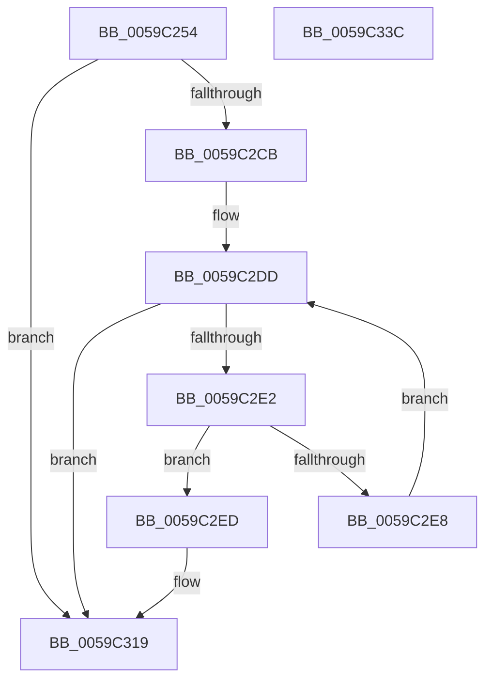

# IopLiveDumpGetCapturePages

- RVA: `0x0059C254`–`0x0059C33D` (길이 `233` bytes)
- VA: `0x000000014059C254`
- 실행 섹션: `.text`
- PDB 이름 있음: `예`; PDB Function 태그: `아니요`
- unwind 정보 RVA: `0x000C7B88`
- 디코드: `60`개 명령, `233/233` bytes 표시
- 미해석 바이트: `0` (있으면 어셈블리에 `.byte`로 보존)

> 이 문서는 커널 이미지의 기계어와 PDB 기호를 분석해 생성했습니다. 4번과 5번은 함수 원형과 자료형을 바이너리 사용 방식에서 추정한 C 해석이며 원본 소스 복구 결과는 아닙니다.

## 1. Dependencies

- 직접 호출 지점: **5**; 고유 호출 대상: **5**
- 직접 호출자로 확인된 함수: **1**
- RIP 상대 이미지 참조: **4**

### Outgoing calls
- `0x0059C27F` → [KeAcquireSpinLockAtDpcLevel](../20/KeAcquireSpinLockAtDpcLevel_function_00208430.md) (function, `0x00208430`)
- `0x0059C2B5` → [IopLiveDumpGetCapturePagesNoLock](IopLiveDumpGetCapturePagesNoLock_function_0059C344.md) (function, `0x0059C344`)
- `0x0059C2C0` → [IopLiveDumpShouldCheckChunkCRC](../3F/IopLiveDumpShouldCheckChunkCRC_function_003F67B0.md) (function, `0x003F67B0`)
- `0x0059C314` → [IopLiveDumpTraceEventGeneric](../5A/IopLiveDumpTraceEventGeneric_function_005A41E4.md) (function, `0x005A41E4`)
- `0x0059C31D` → [KxReleaseSpinLock](../20/KxReleaseSpinLock_function_00206670.md) (function, `0x00206670`)

### Direct callers
- [IopLiveDumpBufferDumpData](IopLiveDumpBufferDumpData_function_0059A938.md) at `0x0059AA14`

### Static image references
- `0x0059C26C` → RVA `0x00E0A9D4` (`.data`; read)
- `0x0059C2D3` → RVA `0x00E0A9D0` (`.data`; read)
- `0x0059C2ED` → RVA `0x006CAAA0` (` ?? ::FNODOBFM::`string'`; read)
- `0x0059C30D` → RVA `0x006CAA30` (` ?? ::FNODOBFM::`string'`; read)

## 2. Other-region calls and transfers

- 다른 실행 섹션으로 향하는 call: **0**
- 별도 외부 분기/꼬리 이동을 확인하지 못했습니다.

## 3. Assembly (complete function range)

```asm
0059C254  48 89 5C 24 08                  mov qword ptr [rsp + 8], rbx
0059C259  48 89 6C 24 18                  mov qword ptr [rsp + 0x18], rbp
0059C25E  48 89 74 24 20                  mov qword ptr [rsp + 0x20], rsi
0059C263  57                              push rdi
0059C264  41 56                           push r14
0059C266  41 57                           push r15
0059C268  48 83 EC 50                     sub rsp, 0x50
0059C26C  8B 3D 62 E7 86 00               mov edi, dword ptr [rip + 0x86e762]
0059C272  48 8B E9                        mov rbp, rcx
0059C275  48 8D 4A 20                     lea rcx, [rdx + 0x20]
0059C279  49 8B F0                        mov rsi, r8
0059C27C  4C 8B F2                        mov r14, rdx
0059C27F  E8 AC C1 C6 FF                  call 0x140208430
0059C284  8A 84 24 A0 00 00 00            mov al, byte ptr [rsp + 0xa0]
0059C28B  44 8B CF                        mov r9d, edi
0059C28E  48 8B 9C 24 98 00 00 00         mov rbx, qword ptr [rsp + 0x98]
0059C296  4C 8B C6                        mov r8, rsi
0059C299  88 44 24 30                     mov byte ptr [rsp + 0x30], al
0059C29D  49 8B D6                        mov rdx, r14
0059C2A0  48 8B 84 24 90 00 00 00         mov rax, qword ptr [rsp + 0x90]
0059C2A8  48 8B CD                        mov rcx, rbp
0059C2AB  48 89 5C 24 28                  mov qword ptr [rsp + 0x28], rbx
0059C2B0  48 89 44 24 20                  mov qword ptr [rsp + 0x20], rax
0059C2B5  E8 8A 00 00 00                  call 0x14059c344
0059C2BA  48 8B 13                        mov rdx, qword ptr [rbx]
0059C2BD  49 8B CE                        mov rcx, r14
0059C2C0  E8 EB A4 E5 FF                  call 0x1403f67b0
0059C2C5  33 C9                           xor ecx, ecx
0059C2C7  84 C0                           test al, al
0059C2C9  74 4E                           je 0x14059c319
0059C2CB  49 8B 46 48                     mov rax, qword ptr [r14 + 0x48]
0059C2CF  4C 8B 04 D0                     mov r8, qword ptr [rax + rdx*8]
0059C2D3  8B 05 F7 E6 86 00               mov eax, dword ptr [rip + 0x86e6f7]
0059C2D9  48 C1 E8 03                     shr rax, 3
0059C2DD  48 3B C8                        cmp rcx, rax
0059C2E0  73 37                           jae 0x14059c319
0059C2E2  49 39 14 C8                     cmp qword ptr [r8 + rcx*8], rdx
0059C2E6  75 05                           jne 0x14059c2ed
0059C2E8  48 FF C1                        inc rcx
0059C2EB  EB F0                           jmp 0x14059c2dd
0059C2ED  48 8D 05 AC E7 12 00            lea rax, [rip + 0x12e7ac]
0059C2F4  48 89 54 24 78                  mov qword ptr [rsp + 0x78], rdx
0059C2F9  BA 01 00 00 00                  mov edx, 1
0059C2FE  48 89 44 24 40                  mov qword ptr [rsp + 0x40], rax
0059C303  4C 8D 4C 24 78                  lea r9, [rsp + 0x78]
0059C308  4C 8D 44 24 40                  lea r8, [rsp + 0x40]
0059C30D  48 8D 0D 1C E7 12 00            lea rcx, [rip + 0x12e71c]
0059C314  E8 CB 7E 00 00                  call 0x1405a41e4
0059C319  49 8D 4E 20                     lea rcx, [r14 + 0x20]
0059C31D  E8 4E A3 C6 FF                  call 0x140206670
0059C322  4C 8D 5C 24 50                  lea r11, [rsp + 0x50]
0059C327  49 8B 5B 20                     mov rbx, qword ptr [r11 + 0x20]
0059C32B  49 8B 6B 30                     mov rbp, qword ptr [r11 + 0x30]
0059C32F  49 8B 73 38                     mov rsi, qword ptr [r11 + 0x38]
0059C333  49 8B E3                        mov rsp, r11
0059C336  41 5F                           pop r15
0059C338  41 5E                           pop r14
0059C33A  5F                              pop rdi
0059C33B  C3                              ret
0059C33C  CC                              int3
```

## 4. C-style interpretation (structured pseudocode)

```c
__int64 __fastcall IopLiveDumpGetCapturePages(__int64 a1, __int64 a2, __int64 a3, __int64 a4, __int64 a5, __int64 a6, unsigned __int8 a7)
{
    __int64 result;
    __int64 v_rsp;
    unsigned __int64 v_stack_m18;
    unsigned __int64 v_stack_m28;
    unsigned __int8 v_stack_m38;
    unsigned __int64 v_stack_m40;
    unsigned __int64 v_stack_m48;
    unsigned __int64 v_stack_p10;
    unsigned __int64 v_stack_p18;
    unsigned __int64 v_stack_p20;
    unsigned __int64 v_stack_p8;

    v_stack_p8 = v_rbx;
    v_stack_p18 = v_rbp;
    v_stack_p20 = v_rsi;
    v_rsp = (v_rsp) - (80);
    result = KeAcquireSpinLockAtDpcLevel(a2 + 32, a2, a3, a4);
    v_stack_m38 = a7;
    v_stack_m40 = a6;
    v_stack_m48 = a5;
    result = IopLiveDumpGetCapturePagesNoLock(a1, a2, a3, (unsigned int)((unsigned int)((unsigned int)(*(unsigned int *)(v_rip + 8841058)))));
    result = IopLiveDumpShouldCheckChunkCRC(a2, *(unsigned __int64 *)(a6), a3, (unsigned int)((unsigned int)((unsigned int)(*(unsigned int *)(v_rip + 8841058)))));
    a1 = 0;
    if ((unsigned __int8)(result) == 0) goto loc_0059C319;
    result = ((unsigned int)(*(unsigned int *)(v_rip + 8840951))) >> (3);
loc_0059C2DD:
    if (0 >= result) goto loc_0059C319;
    if ((*(unsigned __int64 *)(*(unsigned __int64 *)(*(unsigned __int64 *)(a2 + 72) + *(unsigned __int64 *)(a6) * 8) + a1 * 8)) != (*(unsigned __int64 *)(a6))) goto loc_0059C2ED;
    a1 = (a1) + 1;
    goto loc_0059C2DD;
loc_0059C2ED:
    v_stack_p10 = *(unsigned __int64 *)(a6);
    v_stack_m28 = v_rip + 1238956;
    result = IopLiveDumpTraceEventGeneric(v_rip + 1238812, 1, v_stack_m28, v_stack_p10);
loc_0059C319:
    result = KxReleaseSpinLock(a2 + 32, 1, v_stack_m28, v_stack_p10);
    return result;
}
```

## 5. (Beta) C Style

```c
int64_t IopLiveDumpGetCapturePages(int64_t Arg1, void *Arg2, int64_t Arg3, int64_t Arg4, int64_t Arg5, void *Arg6, uint8_t Arg7)
{
    uint8_t *arg2 = (uint8_t *)Arg2;
    uint8_t *arg6 = (uint8_t *)Arg6;

    int64_t result;
    int64_t local_rsp;
    uint64_t v_stack_m18;
    uint64_t v_stack_m28;
    uint8_t v_stack_m38;
    uint64_t v_stack_m40;
    uint64_t v_stack_m48;
    uint64_t v_stack_p10;
    uint64_t v_stack_p18;
    uint64_t v_stack_p20;
    uint64_t v_stack_p8;

    v_stack_p8 = local_rbx;
    v_stack_p18 = local_rbp;
    v_stack_p20 = local_rsi;
    local_rsp = (local_rsp) - (80);
    result = KeAcquireSpinLockAtDpcLevel(Arg2 + 32, Arg2, Arg3, Arg4);
    v_stack_m38 = Arg7;
    v_stack_m40 = Arg6;
    v_stack_m48 = Arg5;
    result = IopLiveDumpGetCapturePagesNoLock(Arg1, Arg2, Arg3, (uint32_t)((uint32_t)((uint32_t)(*(uint32_t *)(v_rip + 0x86E762)))));
    result = IopLiveDumpShouldCheckChunkCRC(Arg2, *(uint64_t *)(arg6), Arg3, (uint32_t)((uint32_t)((uint32_t)(*(uint32_t *)(v_rip + 0x86E762)))));
    Arg1 = 0;
    if ((uint8_t)(result) == 0) goto loc_0059C319;
    result = ((uint32_t)(*(uint32_t *)(v_rip + 0x86E6F7))) >> (3);
loc_0059C2DD:
    if (0 >= result) goto loc_0059C319;
    if ((*(uint64_t *)(*(uint64_t *)(*(uint64_t *)(arg2 + 0x48) + *(uint64_t *)(arg6) * 8) + Arg1 * 8)) != (*(uint64_t *)(arg6))) goto loc_0059C2ED;
    Arg1 = (Arg1) + 1;
    goto loc_0059C2DD;
loc_0059C2ED:
    v_stack_p10 = *(uint64_t *)(arg6);
    v_stack_m28 = v_rip + 1238956;
    result = IopLiveDumpTraceEventGeneric(v_rip + 1238812, 1, v_stack_m28, v_stack_p10);
loc_0059C319:
    result = KxReleaseSpinLock(Arg2 + 32, 1, v_stack_m28, v_stack_p10);
    return result;
}
```

### 관측된 메모리 오프셋

구조체 형식이 확인되지 않은 접근은 인자 기준의 오프셋으로만 기록했습니다.

| 기준 인자 | 오프셋 표현 | 폭 (bit) | 접근 |
|---|---:|---:|---|
| `Arg2` | `+ 0x20` | `64` | `R` |
| `Arg2` | `+ 0x48` | `64` | `R` |
| `Arg6` | `+ 0x0` | `64` | `R` |

## 6. Execution-region graph

[열기: 2D/3D 그래프와 함수 탐색 컨트롤 패널](../../../control-panel.html?section=text&rva=0x0059C254&view=graph)

- 2D 그래프는 위에서 아래로 흐르고, 3D 그래프는 빈 공간을 드래그해 회전합니다. Shift+드래그는 이동, 휠은 확대·축소, 함수 노드 선택은 대상 보고서 이동입니다.

### Static fallback


