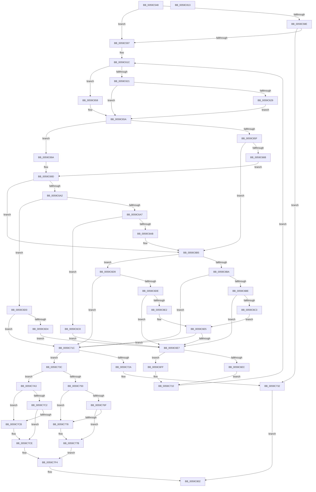

# IopLiveDumpGetExtraMergePages

- RVA: `0x0059C548`–`0x0059C814` (길이 `716` bytes)
- VA: `0x000000014059C548`
- 실행 섹션: `.text`
- PDB 이름 있음: `예`; PDB Function 태그: `아니요`
- unwind 정보 RVA: `0x000BB5F0`
- 디코드: `197`개 명령, `716/716` bytes 표시
- 미해석 바이트: `0` (있으면 어셈블리에 `.byte`로 보존)

> 이 문서는 커널 이미지의 기계어와 PDB 기호를 분석해 생성했습니다. 4번과 5번은 함수 원형과 자료형을 바이너리 사용 방식에서 추정한 C 해석이며 원본 소스 복구 결과는 아닙니다.

## 1. Dependencies

- 직접 호출 지점: **0**; 고유 호출 대상: **0**
- 직접 호출자로 확인된 함수: **1**
- RIP 상대 이미지 참조: **1**

### Outgoing calls
- 직접 디코드된 call 명령이 없습니다.

### Direct callers
- [IopLiveDumpWriteDumpFileWithExtraPages](IopLiveDumpWriteDumpFileWithExtraPages_function_0059F910.md) at `0x0059FAA8`
- [IopLiveDumpWriteDumpFileWithExtraPages](IopLiveDumpWriteDumpFileWithExtraPages_function_0059F910.md) at `0x0059FB63`

### Static image references
- `0x0059C597` → RVA `0x00E0A9D0` (`.data`; read)

## 2. Other-region calls and transfers

- 다른 실행 섹션으로 향하는 call: **0**
- 별도 외부 분기/꼬리 이동을 확인하지 못했습니다.

## 3. Assembly (complete function range)

```asm
0059C548  4C 89 4C 24 20                  mov qword ptr [rsp + 0x20], r9
0059C54D  4C 89 44 24 18                  mov qword ptr [rsp + 0x18], r8
0059C552  48 89 54 24 10                  mov qword ptr [rsp + 0x10], rdx
0059C557  53                              push rbx
0059C558  55                              push rbp
0059C559  56                              push rsi
0059C55A  57                              push rdi
0059C55B  41 54                           push r12
0059C55D  41 55                           push r13
0059C55F  41 56                           push r14
0059C561  41 57                           push r15
0059C563  48 83 EC 28                     sub rsp, 0x28
0059C567  48 8B B9 F0 00 00 00            mov rdi, qword ptr [rcx + 0xf0]
0059C56E  48 8D 99 C8 00 00 00            lea rbx, [rcx + 0xc8]
0059C575  48 8B A9 C0 00 00 00            mov rbp, qword ptr [rcx + 0xc0]
0059C57C  49 8B C1                        mov rax, r9
0059C57F  4C 8B 99 10 01 00 00            mov r11, qword ptr [rcx + 0x110]
0059C586  4C 8B D1                        mov r10, rcx
0059C589  48 3B FD                        cmp rdi, rbp
0059C58C  75 09                           jne 0x14059c597
0059C58E  4C 3B 1B                        cmp r11, qword ptr [rbx]
0059C591  0F 84 9B 01 00 00               je 0x14059c732
0059C597  44 8B 05 32 E4 86 00            mov r8d, dword ptr [rip + 0x86e432]
0059C59E  33 D2                           xor edx, edx
0059C5A0  48 8B 81 E0 00 00 00            mov rax, qword ptr [rcx + 0xe0]
0059C5A7  48 2B EF                        sub rbp, rdi
0059C5AA  48 8B 89 D8 00 00 00            mov rcx, qword ptr [rcx + 0xd8]
0059C5B1  33 FF                           xor edi, edi
0059C5B3  4C 8B 3B                        mov r15, qword ptr [rbx]
0059C5B6  33 DB                           xor ebx, ebx
0059C5B8  49 F7 F0                        div r8
0059C5BB  4D 2B FB                        sub r15, r11
0059C5BE  45 33 DB                        xor r11d, r11d
0059C5C1  4C 8B CA                        mov r9, rdx
0059C5C4  48 89 54 24 18                  mov qword ptr [rsp + 0x18], rdx
0059C5C9  33 D2                           xor edx, edx
0059C5CB  4C 8D 24 01                     lea r12, [rcx + rax]
0059C5CF  49 8B 82 00 01 00 00            mov rax, qword ptr [r10 + 0x100]
0059C5D6  49 F7 F0                        div r8
0059C5D9  4C 89 24 24                     mov qword ptr [rsp], r12
0059C5DD  4C 8B 64 24 78                  mov r12, qword ptr [rsp + 0x78]
0059C5E2  48 89 54 24 10                  mov qword ptr [rsp + 0x10], rdx
0059C5E7  4C 8D 2C 01                     lea r13, [rcx + rax]
0059C5EB  41 8B C8                        mov ecx, r8d
0059C5EE  49 2B C9                        sub rcx, r9
0059C5F1  4C 89 6C 24 08                  mov qword ptr [rsp + 8], r13
0059C5F6  48 C1 E9 0C                     shr rcx, 0xc
0059C5FA  41 8B C0                        mov eax, r8d
0059C5FD  48 2B C2                        sub rax, rdx
0059C600  45 8B E8                        mov r13d, r8d
0059C603  48 C1 E8 0C                     shr rax, 0xc
0059C607  45 33 C0                        xor r8d, r8d
0059C60A  48 3B CD                        cmp rcx, rbp
0059C60D  48 0F 46 E9                     cmovbe rbp, rcx
0059C611  49 3B C7                        cmp rax, r15
0059C614  45 8D 48 01                     lea r9d, [r8 + 1]
0059C618  4C 0F 46 F8                     cmovbe r15, rax
0059C61C  4D 85 FF                        test r15, r15
0059C61F  74 37                           je 0x14059c658
0059C621  41 8B F1                        mov esi, r9d
0059C624  45 3B C1                        cmp r8d, r9d
0059C627  77 31                           ja 0x14059c65a
0059C629  49 8B 82 08 01 00 00            mov rax, qword ptr [r10 + 0x108]
0059C630  33 D2                           xor edx, edx
0059C632  49 8B 8A D8 00 00 00            mov rcx, qword ptr [r10 + 0xd8]
0059C639  4A 8D 04 D8                     lea rax, [rax + r11*8]
0059C63D  49 F7 F5                        div r13
0059C640  48 03 C8                        add rcx, rax
0059C643  49 8B 82 F0 02 00 00            mov rax, qword ptr [r10 + 0x2f0]
0059C64A  48 8B 0C C8                     mov rcx, qword ptr [rax + rcx*8]
0059C64E  48 8B 1C 0A                     mov rbx, qword ptr [rdx + rcx]
0059C652  48 C1 EB 0C                     shr rbx, 0xc
0059C656  EB 02                           jmp 0x14059c65a
0059C658  33 F6                           xor esi, esi
0059C65A  48 85 ED                        test rbp, rbp
0059C65D  74 3B                           je 0x14059c69a
0059C65F  45 8B F1                        mov r14d, r9d
0059C662  41 F7 C0 FD FF FF FF            test r8d, 0xfffffffd
0059C669  75 4A                           jne 0x14059c6b5
0059C66B  49 8B 82 E8 00 00 00            mov rax, qword ptr [r10 + 0xe8]
0059C672  33 D2                           xor edx, edx
0059C674  49 8B 8A D8 00 00 00            mov rcx, qword ptr [r10 + 0xd8]
0059C67B  4A 8D 04 D8                     lea rax, [rax + r11*8]
0059C67F  49 F7 F5                        div r13
0059C682  48 03 C8                        add rcx, rax
0059C685  49 8B 82 F0 02 00 00            mov rax, qword ptr [r10 + 0x2f0]
0059C68C  48 8B 0C C8                     mov rcx, qword ptr [rax + rcx*8]
0059C690  48 8B 3C 0A                     mov rdi, qword ptr [rdx + rcx]
0059C694  48 C1 EF 0C                     shr rdi, 0xc
0059C698  EB 03                           jmp 0x14059c69d
0059C69A  45 33 F6                        xor r14d, r14d
0059C69D  45 85 C0                        test r8d, r8d
0059C6A0  75 13                           jne 0x14059c6b5
0059C6A2  45 85 F6                        test r14d, r14d
0059C6A5  74 29                           je 0x14059c6d0
0059C6A7  85 F6                           test esi, esi
0059C6A9  74 1D                           je 0x14059c6c8
0059C6AB  48 3B DF                        cmp rbx, rdi
0059C6AE  45 1B C0                        sbb r8d, r8d
0059C6B1  41 83 C0 02                     add r8d, 2
0059C6B5  45 3B C1                        cmp r8d, r9d
0059C6B8  75 1F                           jne 0x14059c6d9
0059C6BA  85 F6                           test esi, esi
0059C6BC  74 5E                           je 0x14059c71c
0059C6BE  45 85 F6                        test r14d, r14d
0059C6C1  74 24                           je 0x14059c6e7
0059C6C3  48 3B FB                        cmp rdi, rbx
0059C6C6  EB 1D                           jmp 0x14059c6e5
0059C6C8  41 B8 02 00 00 00               mov r8d, 2
0059C6CE  EB 17                           jmp 0x14059c6e7
0059C6D0  85 F6                           test esi, esi
0059C6D2  74 48                           je 0x14059c71c
0059C6D4  45 8B C1                        mov r8d, r9d
0059C6D7  EB 0E                           jmp 0x14059c6e7
0059C6D9  45 85 F6                        test r14d, r14d
0059C6DC  74 3E                           je 0x14059c71c
0059C6DE  85 F6                           test esi, esi
0059C6E0  74 05                           je 0x14059c6e7
0059C6E2  48 3B DF                        cmp rbx, rdi
0059C6E5  72 35                           jb 0x14059c71c
0059C6E7  45 3B C1                        cmp r8d, r9d
0059C6EA  75 13                           jne 0x14059c6ff
0059C6EC  4B 89 1C DC                     mov qword ptr [r12 + r11*8], rbx
0059C6F0  4D 2B F9                        sub r15, r9
0059C6F3  49 8B 82 80 02 00 00            mov rax, qword ptr [r10 + 0x280]
0059C6FA  48 8B CB                        mov rcx, rbx
0059C6FD  EB 11                           jmp 0x14059c710
0059C6FF  4B 89 3C DC                     mov qword ptr [r12 + r11*8], rdi
0059C703  49 2B E9                        sub rbp, r9
0059C706  49 8B 82 70 02 00 00            mov rax, qword ptr [r10 + 0x270]
0059C70D  48 8B CF                        mov rcx, rdi
0059C710  48 0F AB 08                     bts qword ptr [rax], rcx
0059C714  45 03 D9                        add r11d, r9d
0059C717  E9 00 FF FF FF                  jmp 0x14059c61c
0059C71C  4C 8B 24 24                     mov r12, qword ptr [rsp]
0059C720  4C 8B 6C 24 08                  mov r13, qword ptr [rsp + 8]
0059C725  45 85 DB                        test r11d, r11d
0059C728  75 12                           jne 0x14059c73c
0059C72A  48 8B 84 24 88 00 00 00         mov rax, qword ptr [rsp + 0x88]
0059C732  83 20 00                        and dword ptr [rax], 0
0059C735  32 C0                           xor al, al
0059C737  E9 C6 00 00 00                  jmp 0x14059c802
0059C73C  49 8B 8A F0 02 00 00            mov rcx, qword ptr [r10 + 0x2f0]
0059C743  48 8B 84 24 90 00 00 00         mov rax, qword ptr [rsp + 0x90]
0059C74B  45 3B C1                        cmp r8d, r9d
0059C74E  75 53                           jne 0x14059c7a3
0059C750  4C 89 28                        mov qword ptr [rax], r13
0059C753  4A 8B 04 E9                     mov rax, qword ptr [rcx + r13*8]
0059C757  48 8B 4C 24 10                  mov rcx, qword ptr [rsp + 0x10]
0059C75C  48 03 C8                        add rcx, rax
0059C75F  48 8B 84 24 80 00 00 00         mov rax, qword ptr [rsp + 0x80]
0059C767  48 89 08                        mov qword ptr [rax], rcx
0059C76A  4D 85 FF                        test r15, r15
0059C76D  75 09                           jne 0x14059c778
0059C76F  4D 39 AA 18 01 00 00            cmp qword ptr [r10 + 0x118], r13
0059C776  75 03                           jne 0x14059c77b
0059C778  45 32 C9                        xor r9b, r9b
0059C77B  41 8B C3                        mov eax, r11d
0059C77E  41 8B CB                        mov ecx, r11d
0059C781  49 01 8A 10 01 00 00            add qword ptr [r10 + 0x110], rcx
0059C788  C1 E0 0C                        shl eax, 0xc
0059C78B  49 01 82 00 01 00 00            add qword ptr [r10 + 0x100], rax
0059C792  4A 8D 04 DD 00 00 00 00         lea rax, [r11*8]
0059C79A  49 01 82 08 01 00 00            add qword ptr [r10 + 0x108], rax
0059C7A1  EB 51                           jmp 0x14059c7f4
0059C7A3  4C 89 20                        mov qword ptr [rax], r12
0059C7A6  4A 8B 04 E1                     mov rax, qword ptr [rcx + r12*8]
0059C7AA  48 8B 4C 24 18                  mov rcx, qword ptr [rsp + 0x18]
0059C7AF  48 03 C8                        add rcx, rax
0059C7B2  48 8B 84 24 80 00 00 00         mov rax, qword ptr [rsp + 0x80]
0059C7BA  48 89 08                        mov qword ptr [rax], rcx
0059C7BD  48 85 ED                        test rbp, rbp
0059C7C0  75 09                           jne 0x14059c7cb
0059C7C2  4D 39 A2 F8 00 00 00            cmp qword ptr [r10 + 0xf8], r12
0059C7C9  75 03                           jne 0x14059c7ce
0059C7CB  45 32 C9                        xor r9b, r9b
0059C7CE  41 8B CB                        mov ecx, r11d
0059C7D1  41 8B D3                        mov edx, r11d
0059C7D4  49 01 92 F0 00 00 00            add qword ptr [r10 + 0xf0], rdx
0059C7DB  C1 E1 0C                        shl ecx, 0xc
0059C7DE  49 01 8A E0 00 00 00            add qword ptr [r10 + 0xe0], rcx
0059C7E5  4A 8D 0C DD 00 00 00 00         lea rcx, [r11*8]
0059C7ED  49 01 8A E8 00 00 00            add qword ptr [r10 + 0xe8], rcx
0059C7F4  48 8B 84 24 88 00 00 00         mov rax, qword ptr [rsp + 0x88]
0059C7FC  44 89 18                        mov dword ptr [rax], r11d
0059C7FF  41 8A C1                        mov al, r9b
0059C802  48 83 C4 28                     add rsp, 0x28
0059C806  41 5F                           pop r15
0059C808  41 5E                           pop r14
0059C80A  41 5D                           pop r13
0059C80C  41 5C                           pop r12
0059C80E  5F                              pop rdi
0059C80F  5E                              pop rsi
0059C810  5D                              pop rbp
0059C811  5B                              pop rbx
0059C812  C3                              ret
0059C813  CC                              int3
```

## 4. C-style interpretation (structured pseudocode)

```c
__int64 __fastcall IopLiveDumpGetExtraMergePages(__int64 a1, __int64 a2, __int64 a3, __int64 a4, __int64 a5)
{
    __int64 result;
    __int64 v_r11;
    __int64 v_r14;
    __int64 v_r15;
    __int64 v_rbp;
    __int64 v_rbx;
    __int64 v_rdi;
    __int64 v_rsi;
    __int64 v_rsp;
    unsigned __int64 v_stack_m50;
    unsigned __int64 v_stack_m58;
    unsigned __int64 v_stack_m60;
    unsigned __int64 v_stack_m68;
    unsigned __int64 v_stack_p10;
    unsigned __int64 v_stack_p18;
    unsigned __int64 v_stack_p20;

    v_stack_p20 = a4;
    v_stack_p18 = a3;
    v_stack_p10 = a2;
    v_rsp = (v_rsp) - (40);
    if ((*(unsigned __int64 *)(a1 + 240)) != (*(unsigned __int64 *)(a1 + 192))) goto loc_0059C597;
    if ((*(unsigned __int64 *)(a1 + 272)) == (*(unsigned __int64 *)(a1 + 200))) goto loc_0059C732;
loc_0059C597:
    a2 = 0;
    v_rbp = (*(unsigned __int64 *)(a1 + 192)) - (*(unsigned __int64 *)(a1 + 240));
    v_rdi = 0;
    v_rbx = 0;
    v_r15 = (*(unsigned __int64 *)(a1 + 200)) - (*(unsigned __int64 *)(a1 + 272));
    v_r11 = 0;
    v_stack_m50 = 0;
    a2 = 0;
    v_stack_m68 = *(unsigned __int64 *)(a1 + 216) + *(unsigned __int64 *)(a1 + 224) * 1;
    v_stack_m58 = 0;
    a1 = ((unsigned int)((unsigned int)((unsigned int)(*(unsigned int *)(v_rip + 8840242))))) - (0);
    v_stack_m60 = *(unsigned __int64 *)(a1 + 216) + *(unsigned __int64 *)(a1 + 256) * 1;
    a1 = (a1) >> (12);
    result = ((unsigned int)((unsigned int)((unsigned int)(*(unsigned int *)(v_rip + 8840242))))) - (0);
    result = (result) >> (12);
    a3 = 0;
    if (a1 <= v_rbp) { v_rbp = a1; }
    if (result <= v_r15) { v_r15 = result; }
loc_0059C61C:
    if (v_r15 == 0) goto loc_0059C658;
    if (0 > ((unsigned int)(a3 + 1))) goto loc_0059C65A;
    a2 = 0;
    a1 = (*(unsigned __int64 *)(a1 + 216)) + (*(unsigned __int64 *)(a1 + 264) + v_r11 * 8);
    v_rbx = (*(unsigned __int64 *)(a2 + *(unsigned __int64 *)(*(unsigned __int64 *)(a1 + 752) + a1 * 8) * 1)) >> (12);
    goto loc_0059C65A;
loc_0059C658:
    v_rsi = 0;
loc_0059C65A:
    if (v_rbp == 0) goto loc_0059C69A;
    if (((0) & (0xFFFFFFFDULL)) != 0) goto loc_0059C6B5;
    a2 = 0;
    a1 = (*(unsigned __int64 *)(a1 + 216)) + (*(unsigned __int64 *)(a1 + 232) + v_r11 * 8);
    v_rdi = (*(unsigned __int64 *)(a2 + *(unsigned __int64 *)(*(unsigned __int64 *)(a1 + 752) + a1 * 8) * 1)) >> (12);
    goto loc_0059C69D;
loc_0059C69A:
    v_r14 = 0;
loc_0059C69D:
    if (0 != 0) goto loc_0059C6B5;
    if (0 == 0) goto loc_0059C6D0;
    if (0 == 0) goto loc_0059C6C8;
    a3 = (unsigned int)((a3) + (2));
loc_0059C6B5:
    if (((unsigned int)(a3)) != ((unsigned int)(a3 + 1))) goto loc_0059C6D9;
    if (0 == 0) goto loc_0059C71C;
    if (0 == 0) goto loc_0059C6E7;
    goto loc_0059C6E5;
loc_0059C6C8:
    goto loc_0059C6E7;
loc_0059C6D0:
    if (0 == 0) goto loc_0059C71C;
    goto loc_0059C6E7;
loc_0059C6D9:
    if (0 == 0) goto loc_0059C71C;
    if (0 == 0) goto loc_0059C6E7;
loc_0059C6E5:
    if (v_rbx < v_rdi) goto loc_0059C71C;
loc_0059C6E7:
    if (((unsigned int)((unsigned int)((unsigned int)(a3 + 1)))) != ((unsigned int)(a3 + 1))) goto loc_0059C6FF;
    *(unsigned __int64 *)(v_stack_p10 + v_r11 * 8) = v_rbx;
    v_r15 = (v_r15) - (a3 + 1);
    goto loc_0059C710;
loc_0059C6FF:
    *(unsigned __int64 *)(v_stack_p10 + v_r11 * 8) = v_rdi;
    v_rbp = (v_rbp) - (a3 + 1);
loc_0059C710:
    v_r11 = (unsigned int)((v_r11) + ((unsigned int)(a3 + 1)));
    goto loc_0059C61C;
loc_0059C71C:
    if ((unsigned int)(v_r11) != 0) goto loc_0059C73C;
loc_0059C732:
    result = 0;
    goto loc_0059C802;
loc_0059C73C:
    if (((unsigned int)((unsigned int)((unsigned int)(a3 + 1)))) != ((unsigned int)(a3 + 1))) goto loc_0059C7A3;
    *(unsigned __int64 *)(a5) = v_stack_m60;
    a1 = (v_stack_m58) + (*(unsigned __int64 *)(*(unsigned __int64 *)(a1 + 752) + v_stack_m60 * 8));
    *(unsigned __int64 *)(v_stack_p18) = a1;
    if (v_r15 != 0) goto loc_0059C778;
    if ((*(unsigned __int64 *)(a1 + 280)) == v_stack_m60) {
        a4 = 0;
    }
    result = (unsigned int)(((unsigned int)((unsigned int)(v_r11))) << (12));
    goto loc_0059C7F4;
loc_0059C7A3:
    *(unsigned __int64 *)(v_r11 * 8) = v_stack_m68;
    a1 = (v_stack_m50) + (*(unsigned __int64 *)((unsigned int)((unsigned int)(v_r11)) + v_stack_m68 * 8));
    *(unsigned __int64 *)(v_stack_p18) = a1;
    if (v_rbp != 0) goto loc_0059C7CB;
    if ((*(unsigned __int64 *)(a1 + 248)) == v_stack_m68) {
        a4 = 0;
    }
    a1 = (unsigned int)(((unsigned int)((unsigned int)(v_r11))) << (12));
loc_0059C7F4:
    *(unsigned int *)(v_stack_p20) = (unsigned int)(v_r11);
loc_0059C802:
    v_rsp = (v_rsp) + (40);
    return 0;
}
```

## 5. (Beta) C Style

```c
int64_t IopLiveDumpGetExtraMergePages(void *Arg1, int64_t Arg2, int64_t Arg3, int64_t Arg4, void *Arg5)
{
    uint8_t *arg1 = (uint8_t *)Arg1;
    uint8_t *arg5 = (uint8_t *)Arg5;

    int64_t result;
    int64_t local_r11;
    int64_t local_r14;
    int64_t local_r15;
    int64_t local_rbp;
    int64_t local_rbx;
    int64_t local_rdi;
    int64_t local_rsi;
    int64_t local_rsp;
    uint64_t v_stack_m50;
    uint64_t v_stack_m58;
    uint64_t v_stack_m60;
    uint64_t v_stack_m68;
    uint64_t v_stack_p10;
    uint64_t v_stack_p18;
    uint64_t v_stack_p20;

    v_stack_p20 = Arg4;
    v_stack_p18 = Arg3;
    v_stack_p10 = Arg2;
    local_rsp = (local_rsp) - (40);
    if ((*(uint64_t *)(arg1 + 0xF0)) != (*(uint64_t *)(arg1 + 0xC0))) goto loc_0059C597;
    if ((*(uint64_t *)(arg1 + 0x110)) == (*(uint64_t *)(arg1 + 0xC8))) goto loc_0059C732;
loc_0059C597:
    Arg2 = 0;
    local_rbp = (*(uint64_t *)(arg1 + 0xC0)) - (*(uint64_t *)(arg1 + 0xF0));
    local_rdi = 0;
    local_rbx = 0;
    local_r15 = (*(uint64_t *)(arg1 + 0xC8)) - (*(uint64_t *)(arg1 + 0x110));
    local_r11 = 0;
    v_stack_m50 = 0;
    Arg2 = 0;
    v_stack_m68 = *(uint64_t *)(arg1 + 0xD8) + *(uint64_t *)(arg1 + 0xE0) * 1;
    v_stack_m58 = 0;
    Arg1 = ((uint32_t)((uint32_t)((uint32_t)(*(uint32_t *)(v_rip + 0x86E432))))) - (0);
    v_stack_m60 = *(uint64_t *)(arg1 + 0xD8) + *(uint64_t *)(arg1 + 0x100) * 1;
    Arg1 = (Arg1) >> (12);
    result = ((uint32_t)((uint32_t)((uint32_t)(*(uint32_t *)(v_rip + 0x86E432))))) - (0);
    result = (result) >> (12);
    Arg3 = 0;
    if (Arg1 <= local_rbp) { local_rbp = Arg1; }
    if (result <= local_r15) { local_r15 = result; }
loc_0059C61C:
    if (local_r15 == 0) goto loc_0059C658;
    if (0 > ((uint32_t)(Arg3 + 1))) goto loc_0059C65A;
    Arg2 = 0;
    Arg1 = (*(uint64_t *)(arg1 + 0xD8)) + (*(uint64_t *)(arg1 + 0x108) + local_r11 * 8);
    local_rbx = (*(uint64_t *)(Arg2 + *(uint64_t *)(*(uint64_t *)(arg1 + 0x2F0) + arg1 * 8) * 1)) >> (12);
    goto loc_0059C65A;
loc_0059C658:
    local_rsi = 0;
loc_0059C65A:
    if (local_rbp == 0) goto loc_0059C69A;
    if (((0) & (0xFFFFFFFDULL)) != 0) goto loc_0059C6B5;
    Arg2 = 0;
    Arg1 = (*(uint64_t *)(arg1 + 0xD8)) + (*(uint64_t *)(arg1 + 0xE8) + local_r11 * 8);
    local_rdi = (*(uint64_t *)(Arg2 + *(uint64_t *)(*(uint64_t *)(arg1 + 0x2F0) + arg1 * 8) * 1)) >> (12);
    goto loc_0059C69D;
loc_0059C69A:
    local_r14 = 0;
loc_0059C69D:
    if (0 != 0) goto loc_0059C6B5;
    if (0 == 0) goto loc_0059C6D0;
    if (0 == 0) goto loc_0059C6C8;
    Arg3 = (uint32_t)((Arg3) + (2));
loc_0059C6B5:
    if (((uint32_t)(Arg3)) != ((uint32_t)(Arg3 + 1))) goto loc_0059C6D9;
    if (0 == 0) goto loc_0059C71C;
    if (0 == 0) goto loc_0059C6E7;
    goto loc_0059C6E5;
loc_0059C6C8:
    goto loc_0059C6E7;
loc_0059C6D0:
    if (0 == 0) goto loc_0059C71C;
    goto loc_0059C6E7;
loc_0059C6D9:
    if (0 == 0) goto loc_0059C71C;
    if (0 == 0) goto loc_0059C6E7;
loc_0059C6E5:
    if (local_rbx < local_rdi) goto loc_0059C71C;
loc_0059C6E7:
    if (((uint32_t)((uint32_t)((uint32_t)(Arg3 + 1)))) != ((uint32_t)(Arg3 + 1))) goto loc_0059C6FF;
    *(uint64_t *)(v_stack_p10 + local_r11 * 8) = local_rbx;
    local_r15 = (local_r15) - (Arg3 + 1);
    goto loc_0059C710;
loc_0059C6FF:
    *(uint64_t *)(v_stack_p10 + local_r11 * 8) = local_rdi;
    local_rbp = (local_rbp) - (Arg3 + 1);
loc_0059C710:
    local_r11 = (uint32_t)((local_r11) + ((uint32_t)(Arg3 + 1)));
    goto loc_0059C61C;
loc_0059C71C:
    if ((uint32_t)(local_r11) != 0) goto loc_0059C73C;
loc_0059C732:
    result = 0;
    goto loc_0059C802;
loc_0059C73C:
    if (((uint32_t)((uint32_t)((uint32_t)(Arg3 + 1)))) != ((uint32_t)(Arg3 + 1))) goto loc_0059C7A3;
    *(uint64_t *)(arg5) = v_stack_m60;
    Arg1 = (v_stack_m58) + (*(uint64_t *)(*(uint64_t *)(arg1 + 0x2F0) + v_stack_m60 * 8));
    *(void **)(v_stack_p18) = Arg1;
    if (local_r15 != 0) goto loc_0059C778;
    if ((*(uint64_t *)(arg1 + 0x118)) == v_stack_m60) {
        Arg4 = 0;
    }
    result = (uint32_t)(((uint32_t)((uint32_t)(local_r11))) << (12));
    goto loc_0059C7F4;
loc_0059C7A3:
    *(uint64_t *)(local_r11 * 8) = v_stack_m68;
    Arg1 = (v_stack_m50) + (*(uint64_t *)((uint32_t)((uint32_t)(local_r11)) + v_stack_m68 * 8));
    *(void **)(v_stack_p18) = Arg1;
    if (local_rbp != 0) goto loc_0059C7CB;
    if ((*(uint64_t *)(arg1 + 0xF8)) == v_stack_m68) {
        Arg4 = 0;
    }
    Arg1 = (uint32_t)(((uint32_t)((uint32_t)(local_r11))) << (12));
loc_0059C7F4:
    *(uint32_t *)(v_stack_p20) = (uint32_t)(local_r11);
loc_0059C802:
    local_rsp = (local_rsp) + (40);
    return 0;
}
```

### 관측된 메모리 오프셋

구조체 형식이 확인되지 않은 접근은 인자 기준의 오프셋으로만 기록했습니다.

| 기준 인자 | 오프셋 표현 | 폭 (bit) | 접근 |
|---|---:|---:|---|
| `Arg1` | `+ 0x0` | `64` | `R` |
| `Arg1` | `+ 0xC0` | `64` | `R` |
| `Arg1` | `+ 0xC8` | `64` | `R` |
| `Arg1` | `+ 0xD8` | `64` | `R` |
| `Arg1` | `+ 0xE0` | `64` | `R` |
| `Arg1` | `+ 0xE0` | `64` | `R/W` |
| `Arg1` | `+ 0xE8` | `64` | `R` |
| `Arg1` | `+ 0xE8` | `64` | `R/W` |
| `Arg1` | `+ 0xF0` | `64` | `R` |
| `Arg1` | `+ 0xF0` | `64` | `R/W` |
| `Arg1` | `+ 0xF8` | `64` | `R` |
| `Arg1` | `+ 0x100` | `64` | `R` |
| `Arg1` | `+ 0x100` | `64` | `R/W` |
| `Arg1` | `+ 0x108` | `64` | `R` |
| `Arg1` | `+ 0x108` | `64` | `R/W` |
| `Arg1` | `+ 0x110` | `64` | `R` |
| `Arg1` | `+ 0x110` | `64` | `R/W` |
| `Arg1` | `+ 0x118` | `64` | `R` |
| `Arg1` | `+ 0x270` | `64` | `R` |
| `Arg1` | `+ 0x280` | `64` | `R` |
| `Arg1` | `+ 0x2F0` | `64` | `R` |
| `Arg5` | `+ 0x0` | `64` | `W` |

## 6. Execution-region graph

[열기: 2D/3D 그래프와 함수 탐색 컨트롤 패널](../../../control-panel.html?section=text&rva=0x0059C548&view=graph)

- 2D 그래프는 위에서 아래로 흐르고, 3D 그래프는 빈 공간을 드래그해 회전합니다. Shift+드래그는 이동, 휠은 확대·축소, 함수 노드 선택은 대상 보고서 이동입니다.

### Static fallback


