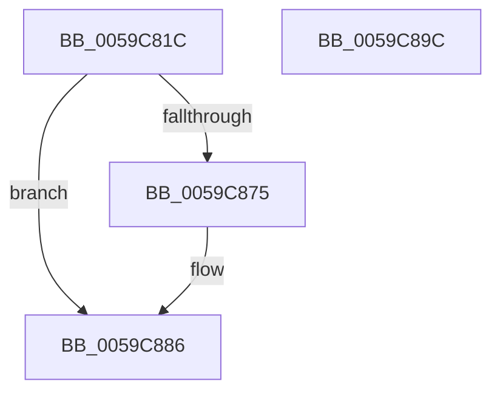

# IopLiveDumpGetNtMergePages

- RVA: `0x0059C81C`–`0x0059C89D` (길이 `129` bytes)
- VA: `0x000000014059C81C`
- 실행 섹션: `.text`
- PDB 이름 있음: `예`; PDB Function 태그: `아니요`
- unwind 정보 RVA: `0x000BCAF8`
- 디코드: `34`개 명령, `129/129` bytes 표시
- 미해석 바이트: `0` (있으면 어셈블리에 `.byte`로 보존)

> 이 문서는 커널 이미지의 기계어와 PDB 기호를 분석해 생성했습니다. 4번과 5번은 함수 원형과 자료형을 바이너리 사용 방식에서 추정한 C 해석이며 원본 소스 복구 결과는 아닙니다.

## 1. Dependencies

- 직접 호출 지점: **1**; 고유 호출 대상: **1**
- 직접 호출자로 확인된 함수: **1**
- RIP 상대 이미지 참조: **1**

### Outgoing calls
- `0x0059C86B` → [IopLiveDumpGetCapturePagesNoLock](IopLiveDumpGetCapturePagesNoLock_function_0059C344.md) (function, `0x0059C344`)

### Direct callers
- [IopLiveDumpWriteDumpFileWithExtraPages](IopLiveDumpWriteDumpFileWithExtraPages_function_0059F910.md) at `0x0059FA88`
- [IopLiveDumpWriteDumpFileWithExtraPages](IopLiveDumpWriteDumpFileWithExtraPages_function_0059F910.md) at `0x0059FC50`
- [IopLiveDumpWriteDumpFileWithExtraPages](IopLiveDumpWriteDumpFileWithExtraPages_function_0059F910.md) at `0x0059FCD2`

### Static image references
- `0x0059C83F` → RVA `0x00E0A9D4` (`.data`; read)

## 2. Other-region calls and transfers

- 다른 실행 섹션으로 향하는 call: **0**
- 별도 외부 분기/꼬리 이동을 확인하지 못했습니다.

## 3. Assembly (complete function range)

```asm
0059C81C  4C 8B DC                        mov r11, rsp
0059C81F  49 89 5B 08                     mov qword ptr [r11 + 8], rbx
0059C823  49 89 73 10                     mov qword ptr [r11 + 0x10], rsi
0059C827  49 89 7B 18                     mov qword ptr [r11 + 0x18], rdi
0059C82B  41 56                           push r14
0059C82D  48 83 EC 40                     sub rsp, 0x40
0059C831  8B 41 50                        mov eax, dword ptr [rcx + 0x50]
0059C834  49 8B D9                        mov rbx, r9
0059C837  48 8B 74 24 70                  mov rsi, qword ptr [rsp + 0x70]
0059C83C  4D 8B F0                        mov r14, r8
0059C83F  44 8B 0D 8E E1 86 00            mov r9d, dword ptr [rip + 0x86e18e]
0059C846  4C 8B C2                        mov r8, rdx
0059C849  C1 E8 11                        shr eax, 0x11
0059C84C  48 8D 91 A8 02 00 00            lea rdx, [rcx + 0x2a8]
0059C853  24 01                           and al, 1
0059C855  48 8B F9                        mov rdi, rcx
0059C858  88 44 24 30                     mov byte ptr [rsp + 0x30], al
0059C85C  48 81 C1 20 02 00 00            add rcx, 0x220
0059C863  49 89 73 E0                     mov qword ptr [r11 - 0x20], rsi
0059C867  49 89 5B D8                     mov qword ptr [r11 - 0x28], rbx
0059C86B  E8 D4 FA FF FF                  call 0x14059c344
0059C870  83 3B 00                        cmp dword ptr [rbx], 0
0059C873  76 11                           jbe 0x14059c886
0059C875  48 8B 0E                        mov rcx, qword ptr [rsi]
0059C878  48 8B 87 F0 02 00 00            mov rax, qword ptr [rdi + 0x2f0]
0059C87F  48 8B 0C C8                     mov rcx, qword ptr [rax + rcx*8]
0059C883  49 89 0E                        mov qword ptr [r14], rcx
0059C886  48 8B 5C 24 50                  mov rbx, qword ptr [rsp + 0x50]
0059C88B  48 8B 74 24 58                  mov rsi, qword ptr [rsp + 0x58]
0059C890  48 8B 7C 24 60                  mov rdi, qword ptr [rsp + 0x60]
0059C895  48 83 C4 40                     add rsp, 0x40
0059C899  41 5E                           pop r14
0059C89B  C3                              ret
0059C89C  CC                              int3
```

## 4. C-style interpretation (structured pseudocode)

```c
__int64 __fastcall IopLiveDumpGetNtMergePages(__int64 a1, __int64 a2, __int64 a3, __int64 a4, __int64 a5)
{
    __int64 result;
    __int64 v_rsp;
    unsigned __int8 v_stack_m18;
    unsigned __int64 v_stack_p10;
    unsigned __int64 v_stack_p18;
    unsigned __int64 v_stack_p8;

    *(unsigned __int64 *)(v_rsp + 8) = v_rbx;
    *(unsigned __int64 *)(v_rsp + 16) = v_rsi;
    *(unsigned __int64 *)(v_rsp + 24) = v_rdi;
    v_rsp = (v_rsp) - (64);
    result = (unsigned int)(((unsigned int)(*(unsigned int *)(a1 + 80))) >> (17));
    result = (unsigned __int8)((result) & (1));
    v_stack_m18 = (unsigned __int8)(result);
    a1 = (a1) + (544);
    *(unsigned __int64 *)(v_rsp - 32) = a5;
    *(unsigned __int64 *)(v_rsp - 40) = a4;
    result = IopLiveDumpGetCapturePagesNoLock(a1, a1 + 680, a2, (unsigned int)(*(unsigned int *)(v_rip + 8839566)));
    if ((*(unsigned int *)(a4)) >= = 0) {
        a1 = *(unsigned __int64 *)(a5);
        result = *(unsigned __int64 *)(a1 + 752);
        a1 = *(unsigned __int64 *)(result + a1 * 8);
        *(unsigned __int64 *)(a3) = a1;
    }
    v_rsp = (v_rsp) + (64);
    return result;
}
```

## 5. (Beta) C Style

```c
int64_t IopLiveDumpGetNtMergePages(void *Arg1, int64_t Arg2, void *Arg3, void *Arg4, void *Arg5)
{
    uint8_t *arg1 = (uint8_t *)Arg1;
    uint8_t *arg3 = (uint8_t *)Arg3;
    uint8_t *arg4 = (uint8_t *)Arg4;
    uint8_t *arg5 = (uint8_t *)Arg5;

    int64_t result;
    int64_t local_rsp;
    uint8_t v_stack_m18;
    uint64_t v_stack_p10;
    uint64_t v_stack_p18;
    uint64_t v_stack_p8;

    *(uint64_t *)(local_rsp + 0x8) = local_rbx;
    *(uint64_t *)(local_rsp + 0x10) = local_rsi;
    *(uint64_t *)(local_rsp + 0x18) = local_rdi;
    local_rsp = (local_rsp) - (64);
    result = (uint32_t)(((uint32_t)(*(uint32_t *)(arg1 + 0x50))) >> (17));
    result = (uint8_t)((result) & (1));
    v_stack_m18 = (uint8_t)(result);
    Arg1 = (Arg1) + (544);
    *(void **)(local_rsp - 0x20) = Arg5;
    *(void **)(local_rsp - 0x28) = Arg4;
    result = IopLiveDumpGetCapturePagesNoLock(Arg1, Arg1 + 680, Arg2, (uint32_t)(*(uint32_t *)(v_rip + 0x86E18E)));
    if ((*(uint32_t *)(arg4)) >= = 0) {
        Arg1 = *(uint64_t *)(arg5);
        result = *(uint64_t *)(arg1 + 0x2F0);
        Arg1 = *(uint64_t *)(result + arg1 * 8);
        *(void **)(arg3) = Arg1;
    }
    local_rsp = (local_rsp) + (64);
    return result;
}
```

### 관측된 메모리 오프셋

구조체 형식이 확인되지 않은 접근은 인자 기준의 오프셋으로만 기록했습니다.

| 기준 인자 | 오프셋 표현 | 폭 (bit) | 접근 |
|---|---:|---:|---|
| `Arg1` | `+ 0x50` | `32` | `R` |
| `Arg1` | `+ 0x2A8` | `64` | `R` |
| `Arg1` | `+ 0x2F0` | `64` | `R` |
| `Arg3` | `+ 0x0` | `64` | `W` |
| `Arg4` | `+ 0x0` | `32` | `R` |
| `Arg5` | `+ 0x0` | `64` | `R` |

## 6. Execution-region graph

[열기: 2D/3D 그래프와 함수 탐색 컨트롤 패널](../../../control-panel.html?section=text&rva=0x0059C81C&view=graph)

- 2D 그래프는 위에서 아래로 흐르고, 3D 그래프는 빈 공간을 드래그해 회전합니다. Shift+드래그는 이동, 휠은 확대·축소, 함수 노드 선택은 대상 보고서 이동입니다.

### Static fallback


