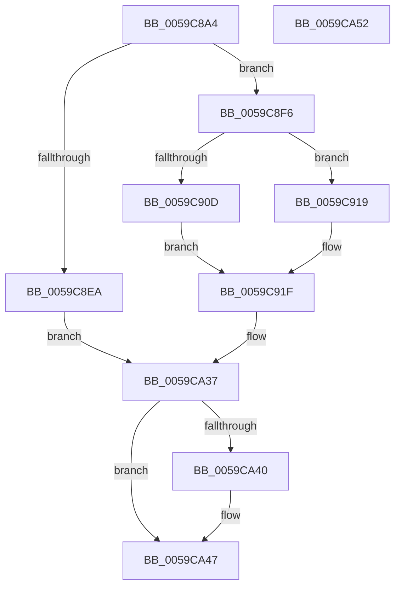

# IopLiveDumpInitRegistrySettings

- RVA: `0x0059C8A4`–`0x0059CA53` (길이 `431` bytes)
- VA: `0x000000014059C8A4`
- 실행 섹션: `.text`
- PDB 이름 있음: `예`; PDB Function 태그: `아니요`
- unwind 정보 RVA: `0x000BB544`
- 디코드: `115`개 명령, `431/431` bytes 표시
- 미해석 바이트: `0` (있으면 어셈블리에 `.byte`로 보존)

> 이 문서는 커널 이미지의 기계어와 PDB 기호를 분석해 생성했습니다. 4번과 5번은 함수 원형과 자료형을 바이너리 사용 방식에서 추정한 C 해석이며 원본 소스 복구 결과는 아닙니다.

## 1. Dependencies

- 직접 호출 지점: **11**; 고유 호출 대상: **4**
- 직접 호출자로 확인된 함수: **1**
- RIP 상대 이미지 참조: **10**

### Outgoing calls
- `0x0059C8E1` → [IopOpenRegistryKey](../../page/A8/IopOpenRegistryKey_function_00A8F200.md) (function, `0x00A8F200`)
- `0x0059C901` → [IopGetRegistryULongValue](IopGetRegistryULongValue_function_00598EA4.md) (function, `0x00598EA4`)
- `0x0059C934` → [IopGetRegistryBoolValue](IopGetRegistryBoolValue_function_00598E84.md) (function, `0x00598E84`)
- `0x0059C956` → [IopGetRegistryBoolValue](IopGetRegistryBoolValue_function_00598E84.md) (function, `0x00598E84`)
- `0x0059C976` → [IopGetRegistryBoolValue](IopGetRegistryBoolValue_function_00598E84.md) (function, `0x00598E84`)
- `0x0059C998` → [IopGetRegistryBoolValue](IopGetRegistryBoolValue_function_00598E84.md) (function, `0x00598E84`)
- `0x0059C9BA` → [IopGetRegistryBoolValue](IopGetRegistryBoolValue_function_00598E84.md) (function, `0x00598E84`)
- `0x0059C9DC` → [IopGetRegistryBoolValue](IopGetRegistryBoolValue_function_00598E84.md) (function, `0x00598E84`)
- `0x0059C9FE` → [IopGetRegistryBoolValue](IopGetRegistryBoolValue_function_00598E84.md) (function, `0x00598E84`)
- `0x0059CA20` → [IopGetRegistryBoolValue](IopGetRegistryBoolValue_function_00598E84.md) (function, `0x00598E84`)
- `0x0059CA42` → [ObCloseHandle](../../page/8A/ObCloseHandle_function_008A1870.md) (function, `0x008A1870`)

### Direct callers
- [IoCaptureLiveDump](../4E/IoCaptureLiveDump_function_004E085C.md) at `0x004E0B77`

### Static image references
- `0x0059C8B6` → RVA `0x006CA2B0` (` ?? ::FNODOBFM::`string'`; read)
- `0x0059C8FA` → RVA `0x006CA110` (` ?? ::FNODOBFM::`string'`; read)
- `0x0059C922` → RVA `0x006CA130` (` ?? ::FNODOBFM::`string'`; read)
- `0x0059C93C` → RVA `0x006CA150` (` ?? ::FNODOBFM::`string'`; read)
- `0x0059C95E` → RVA `0x006CA190` (` ?? ::FNODOBFM::`string'`; read)
- `0x0059C97E` → RVA `0x006CA460` (` ?? ::FNODOBFM::`string'`; read)
- `0x0059C9A0` → RVA `0x006CA490` (` ?? ::FNODOBFM::`string'`; read)
- `0x0059C9C2` → RVA `0x006CA4D0` (` ?? ::FNODOBFM::`string'`; read)
- `0x0059C9E4` → RVA `0x006CA510` (` ?? ::FNODOBFM::`string'`; read)
- `0x0059CA06` → RVA `0x006CA330` (` ?? ::FNODOBFM::`string'`; read)

## 2. Other-region calls and transfers

- 다른 실행 섹션으로 향하는 call: **2**
  - `0x0059C8E1` → [IopOpenRegistryKey](../../page/A8/IopOpenRegistryKey_function_00A8F200.md) (`.text` → `PAGE`)
  - `0x0059CA42` → [ObCloseHandle](../../page/8A/ObCloseHandle_function_008A1870.md) (`.text` → `PAGE`)
- 별도 외부 분기/꼬리 이동을 확인하지 못했습니다.

## 3. Assembly (complete function range)

```asm
0059C8A4  48 89 5C 24 08                  mov qword ptr [rsp + 8], rbx
0059C8A9  55                              push rbp
0059C8AA  48 8B EC                        mov rbp, rsp
0059C8AD  48 83 EC 40                     sub rsp, 0x40
0059C8B1  48 83 65 18 00                  and qword ptr [rbp + 0x18], 0
0059C8B6  48 8D 05 F3 D9 12 00            lea rax, [rip + 0x12d9f3]
0059C8BD  48 8B D9                        mov rbx, rcx
0059C8C0  48 89 45 F8                     mov qword ptr [rbp - 8], rax
0059C8C4  48 8D 4D 18                     lea rcx, [rbp + 0x18]
0059C8C8  48 C7 45 F0 76 00 78 00         mov qword ptr [rbp - 0x10], 0x780076
0059C8D0  41 B9 19 00 02 00               mov r9d, 0x20019
0059C8D6  C6 44 24 20 00                  mov byte ptr [rsp + 0x20], 0
0059C8DB  4C 8D 45 F0                     lea r8, [rbp - 0x10]
0059C8DF  33 D2                           xor edx, edx
0059C8E1  E8 1A 29 4F 00                  call 0x140a8f200
0059C8E6  85 C0                           test eax, eax
0059C8E8  79 0C                           jns 0x14059c8f6
0059C8EA  81 63 50 5F D4 FD FF            and dword ptr [rbx + 0x50], 0xfffdd45f
0059C8F1  E9 41 01 00 00                  jmp 0x14059ca37
0059C8F6  48 8B 4D 18                     mov rcx, qword ptr [rbp + 0x18]
0059C8FA  48 8D 15 0F D8 12 00            lea rdx, [rip + 0x12d80f]
0059C901  E8 9E C5 FF FF                  call 0x140598ea4
0059C906  8B 4B 50                        mov ecx, dword ptr [rbx + 0x50]
0059C909  85 C0                           test eax, eax
0059C90B  74 0C                           je 0x14059c919
0059C90D  8B C0                           mov eax, eax
0059C90F  48 C1 E0 14                     shl rax, 0x14
0059C913  0F BA E9 09                     bts ecx, 9
0059C917  EB 06                           jmp 0x14059c91f
0059C919  33 C0                           xor eax, eax
0059C91B  0F BA F1 09                     btr ecx, 9
0059C91F  89 4B 50                        mov dword ptr [rbx + 0x50], ecx
0059C922  48 8D 15 07 D8 12 00            lea rdx, [rip + 0x12d807]
0059C929  48 89 83 78 04 00 00            mov qword ptr [rbx + 0x478], rax
0059C930  48 8B 4D 18                     mov rcx, qword ptr [rbp + 0x18]
0059C934  E8 4B C5 FF FF                  call 0x140598e84
0059C939  8B 4B 50                        mov ecx, dword ptr [rbx + 0x50]
0059C93C  48 8D 15 0D D8 12 00            lea rdx, [rip + 0x12d80d]
0059C943  C1 E0 0B                        shl eax, 0xb
0059C946  33 C1                           xor eax, ecx
0059C948  25 00 08 00 00                  and eax, 0x800
0059C94D  33 C1                           xor eax, ecx
0059C94F  48 8B 4D 18                     mov rcx, qword ptr [rbp + 0x18]
0059C953  89 43 50                        mov dword ptr [rbx + 0x50], eax
0059C956  E8 29 C5 FF FF                  call 0x140598e84
0059C95B  8B 4B 50                        mov ecx, dword ptr [rbx + 0x50]
0059C95E  48 8D 15 2B D8 12 00            lea rdx, [rip + 0x12d82b]
0059C965  C1 E0 05                        shl eax, 5
0059C968  33 C1                           xor eax, ecx
0059C96A  83 E0 20                        and eax, 0x20
0059C96D  33 C1                           xor eax, ecx
0059C96F  48 8B 4D 18                     mov rcx, qword ptr [rbp + 0x18]
0059C973  89 43 50                        mov dword ptr [rbx + 0x50], eax
0059C976  E8 09 C5 FF FF                  call 0x140598e84
0059C97B  8B 4B 50                        mov ecx, dword ptr [rbx + 0x50]
0059C97E  48 8D 15 DB DA 12 00            lea rdx, [rip + 0x12dadb]
0059C985  C1 E0 07                        shl eax, 7
0059C988  33 C1                           xor eax, ecx
0059C98A  25 80 00 00 00                  and eax, 0x80
0059C98F  33 C1                           xor eax, ecx
0059C991  48 8B 4D 18                     mov rcx, qword ptr [rbp + 0x18]
0059C995  89 43 50                        mov dword ptr [rbx + 0x50], eax
0059C998  E8 E7 C4 FF FF                  call 0x140598e84
0059C99D  8B 4B 50                        mov ecx, dword ptr [rbx + 0x50]
0059C9A0  48 8D 15 E9 DA 12 00            lea rdx, [rip + 0x12dae9]
0059C9A7  C1 E0 08                        shl eax, 8
0059C9AA  33 C1                           xor eax, ecx
0059C9AC  25 00 01 00 00                  and eax, 0x100
0059C9B1  33 C1                           xor eax, ecx
0059C9B3  48 8B 4D 18                     mov rcx, qword ptr [rbp + 0x18]
0059C9B7  89 43 50                        mov dword ptr [rbx + 0x50], eax
0059C9BA  E8 C5 C4 FF FF                  call 0x140598e84
0059C9BF  8B 4B 50                        mov ecx, dword ptr [rbx + 0x50]
0059C9C2  48 8D 15 07 DB 12 00            lea rdx, [rip + 0x12db07]
0059C9C9  C1 E0 0D                        shl eax, 0xd
0059C9CC  33 C1                           xor eax, ecx
0059C9CE  25 00 20 00 00                  and eax, 0x2000
0059C9D3  33 C1                           xor eax, ecx
0059C9D5  48 8B 4D 18                     mov rcx, qword ptr [rbp + 0x18]
0059C9D9  89 43 50                        mov dword ptr [rbx + 0x50], eax
0059C9DC  E8 A3 C4 FF FF                  call 0x140598e84
0059C9E1  8B 4B 50                        mov ecx, dword ptr [rbx + 0x50]
0059C9E4  48 8D 15 25 DB 12 00            lea rdx, [rip + 0x12db25]
0059C9EB  C1 E0 11                        shl eax, 0x11
0059C9EE  33 C1                           xor eax, ecx
0059C9F0  25 00 00 02 00                  and eax, 0x20000
0059C9F5  33 C1                           xor eax, ecx
0059C9F7  48 8B 4D 18                     mov rcx, qword ptr [rbp + 0x18]
0059C9FB  89 43 50                        mov dword ptr [rbx + 0x50], eax
0059C9FE  E8 81 C4 FF FF                  call 0x140598e84
0059CA03  8B 4B 50                        mov ecx, dword ptr [rbx + 0x50]
0059CA06  48 8D 15 23 D9 12 00            lea rdx, [rip + 0x12d923]
0059CA0D  C1 E0 12                        shl eax, 0x12
0059CA10  33 C1                           xor eax, ecx
0059CA12  25 00 00 04 00                  and eax, 0x40000
0059CA17  33 C1                           xor eax, ecx
0059CA19  48 8B 4D 18                     mov rcx, qword ptr [rbp + 0x18]
0059CA1D  89 43 50                        mov dword ptr [rbx + 0x50], eax
0059CA20  E8 5F C4 FF FF                  call 0x140598e84
0059CA25  8B 4B 50                        mov ecx, dword ptr [rbx + 0x50]
0059CA28  C1 E0 13                        shl eax, 0x13
0059CA2B  33 C1                           xor eax, ecx
0059CA2D  25 00 00 08 00                  and eax, 0x80000
0059CA32  33 C1                           xor eax, ecx
0059CA34  89 43 50                        mov dword ptr [rbx + 0x50], eax
0059CA37  48 8B 4D 18                     mov rcx, qword ptr [rbp + 0x18]
0059CA3B  48 85 C9                        test rcx, rcx
0059CA3E  74 07                           je 0x14059ca47
0059CA40  33 D2                           xor edx, edx
0059CA42  E8 29 4E 30 00                  call 0x1408a1870
0059CA47  48 8B 5C 24 50                  mov rbx, qword ptr [rsp + 0x50]
0059CA4C  48 83 C4 40                     add rsp, 0x40
0059CA50  5D                              pop rbp
0059CA51  C3                              ret
0059CA52  CC                              int3
```

## 4. C-style interpretation (structured pseudocode)

```c
__int64 __fastcall IopLiveDumpInitRegistrySettings(__int64 a1, int a2)
{
    __int64 result;
    __int64 v_rsp;
    unsigned __int64 v_stack_m10;
    unsigned __int64 v_stack_m18;
    unsigned __int8 v_stack_m28;
    unsigned __int64 v_stack_p10;
    unsigned __int64 v_stack_p8;

    v_stack_p8 = v_rbx;
    v_rsp = (v_rsp) - (64);
    v_stack_m10 = v_rip + 1235443;
    v_stack_m18 = 0x780076ULL;
    v_stack_m28 = 0;
    a2 = 0;
    result = IopOpenRegistryKey(v_stack_p10, a2, v_stack_m18, (unsigned int)(0x20019ULL));
    if (!sign_flag) goto loc_0059C8F6;
    goto loc_0059CA37;
loc_0059C8F6:
    result = IopGetRegistryULongValue(v_stack_p10, v_rip + 1234959, v_stack_m18, (unsigned int)(0x20019ULL));
    if ((unsigned int)(result) == 0) goto loc_0059C919;
    result = ((unsigned int)((unsigned int)(result))) << (20);
    goto loc_0059C91F;
loc_0059C919:
    result = 0;
loc_0059C91F:
    *(unsigned int *)(a1 + 80) = (unsigned int)((unsigned int)(*(unsigned int *)(a1 + 80)));
    *(unsigned __int64 *)(a1 + 1144) = 0;
    result = IopGetRegistryBoolValue(v_stack_p10, v_rip + 1234951, v_stack_m18, (unsigned int)(0x20019ULL));
    result = (unsigned int)((result) << (11));
    result = (unsigned int)((result) ^ ((unsigned int)((unsigned int)(*(unsigned int *)(a1 + 80)))));
    result = (unsigned int)((result) & (0x800ULL));
    result = (unsigned int)((result) ^ ((unsigned int)((unsigned int)(*(unsigned int *)(a1 + 80)))));
    *(unsigned int *)(a1 + 80) = (unsigned int)(result);
    result = IopGetRegistryBoolValue(v_stack_p10, v_rip + 1234957, v_stack_m18, (unsigned int)(0x20019ULL));
    result = (unsigned int)((result) << (5));
    result = (unsigned int)((result) ^ ((unsigned int)((unsigned int)(*(unsigned int *)(a1 + 80)))));
    result = (unsigned int)((result) & (32));
    result = (unsigned int)((result) ^ ((unsigned int)((unsigned int)(*(unsigned int *)(a1 + 80)))));
    *(unsigned int *)(a1 + 80) = (unsigned int)(result);
    result = IopGetRegistryBoolValue(v_stack_p10, v_rip + 1234987, v_stack_m18, (unsigned int)(0x20019ULL));
    result = (unsigned int)((result) << (7));
    result = (unsigned int)((result) ^ ((unsigned int)((unsigned int)(*(unsigned int *)(a1 + 80)))));
    result = (unsigned int)((result) & (128));
    result = (unsigned int)((result) ^ ((unsigned int)((unsigned int)(*(unsigned int *)(a1 + 80)))));
    *(unsigned int *)(a1 + 80) = (unsigned int)(result);
    result = IopGetRegistryBoolValue(v_stack_p10, v_rip + 1235675, v_stack_m18, (unsigned int)(0x20019ULL));
    result = (unsigned int)((result) << (8));
    result = (unsigned int)((result) ^ ((unsigned int)((unsigned int)(*(unsigned int *)(a1 + 80)))));
    result = (unsigned int)((result) & (256));
    result = (unsigned int)((result) ^ ((unsigned int)((unsigned int)(*(unsigned int *)(a1 + 80)))));
    *(unsigned int *)(a1 + 80) = (unsigned int)(result);
    result = IopGetRegistryBoolValue(v_stack_p10, v_rip + 1235689, v_stack_m18, (unsigned int)(0x20019ULL));
    result = (unsigned int)((result) << (13));
    result = (unsigned int)((result) ^ ((unsigned int)((unsigned int)(*(unsigned int *)(a1 + 80)))));
    result = (unsigned int)((result) & (0x2000ULL));
    result = (unsigned int)((result) ^ ((unsigned int)((unsigned int)(*(unsigned int *)(a1 + 80)))));
    *(unsigned int *)(a1 + 80) = (unsigned int)(result);
    result = IopGetRegistryBoolValue(v_stack_p10, v_rip + 1235719, v_stack_m18, (unsigned int)(0x20019ULL));
    result = (unsigned int)((result) << (17));
    result = (unsigned int)((result) ^ ((unsigned int)((unsigned int)(*(unsigned int *)(a1 + 80)))));
    result = (unsigned int)((result) & (0x20000ULL));
    result = (unsigned int)((result) ^ ((unsigned int)((unsigned int)(*(unsigned int *)(a1 + 80)))));
    *(unsigned int *)(a1 + 80) = (unsigned int)(result);
    result = IopGetRegistryBoolValue(v_stack_p10, v_rip + 1235749, v_stack_m18, (unsigned int)(0x20019ULL));
    result = (unsigned int)((result) << (18));
    result = (unsigned int)((result) ^ ((unsigned int)((unsigned int)(*(unsigned int *)(a1 + 80)))));
    result = (unsigned int)((result) & (0x40000ULL));
    result = (unsigned int)((result) ^ ((unsigned int)((unsigned int)(*(unsigned int *)(a1 + 80)))));
    *(unsigned int *)(a1 + 80) = (unsigned int)(result);
    result = IopGetRegistryBoolValue(v_stack_p10, v_rip + 1235235, v_stack_m18, (unsigned int)(0x20019ULL));
    result = (unsigned int)((result) << (19));
    result = (unsigned int)((result) ^ ((unsigned int)((unsigned int)(*(unsigned int *)(a1 + 80)))));
    result = (unsigned int)((result) & (0x80000ULL));
    result = (unsigned int)((result) ^ ((unsigned int)((unsigned int)(*(unsigned int *)(a1 + 80)))));
    *(unsigned int *)(a1 + 80) = (unsigned int)(result);
loc_0059CA37:
    if (v_stack_p10 != 0) {
        a2 = 0;
        result = ObCloseHandle(v_stack_p10, a2, v_stack_m18, (unsigned int)(0x20019ULL));
    }
    v_rsp = (v_rsp) + (64);
    return result;
}
```

## 5. (Beta) C Style

```c
int64_t IopLiveDumpInitRegistrySettings(void *Arg1, int32_t Arg2)
{
    uint8_t *arg1 = (uint8_t *)Arg1;

    int64_t result;
    int64_t local_rsp;
    uint64_t v_stack_m10;
    uint64_t v_stack_m18;
    uint8_t v_stack_m28;
    uint64_t v_stack_p10;
    uint64_t v_stack_p8;

    v_stack_p8 = local_rbx;
    local_rsp = (local_rsp) - (64);
    v_stack_m10 = v_rip + 1235443;
    v_stack_m18 = 0x780076ULL;
    v_stack_m28 = 0;
    Arg2 = 0;
    result = IopOpenRegistryKey(v_stack_p10, Arg2, v_stack_m18, (uint32_t)(0x20019ULL));
    if (!sign_flag) goto loc_0059C8F6;
    goto loc_0059CA37;
loc_0059C8F6:
    result = IopGetRegistryULongValue(v_stack_p10, v_rip + 1234959, v_stack_m18, (uint32_t)(0x20019ULL));
    if ((uint32_t)(result) == 0) goto loc_0059C919;
    result = ((uint32_t)((uint32_t)(result))) << (20);
    goto loc_0059C91F;
loc_0059C919:
    result = 0;
loc_0059C91F:
    *(uint32_t *)(arg1 + 0x50) = (uint32_t)((uint32_t)(*(uint32_t *)(arg1 + 0x50)));
    *(uint64_t *)(arg1 + 0x478) = 0;
    result = IopGetRegistryBoolValue(v_stack_p10, v_rip + 1234951, v_stack_m18, (uint32_t)(0x20019ULL));
    result = (uint32_t)((result) << (11));
    result = (uint32_t)((result) ^ ((uint32_t)((uint32_t)(*(uint32_t *)(arg1 + 0x50)))));
    result = (uint32_t)((result) & (0x800ULL));
    result = (uint32_t)((result) ^ ((uint32_t)((uint32_t)(*(uint32_t *)(arg1 + 0x50)))));
    *(uint32_t *)(arg1 + 0x50) = (uint32_t)(result);
    result = IopGetRegistryBoolValue(v_stack_p10, v_rip + 1234957, v_stack_m18, (uint32_t)(0x20019ULL));
    result = (uint32_t)((result) << (5));
    result = (uint32_t)((result) ^ ((uint32_t)((uint32_t)(*(uint32_t *)(arg1 + 0x50)))));
    result = (uint32_t)((result) & (32));
    result = (uint32_t)((result) ^ ((uint32_t)((uint32_t)(*(uint32_t *)(arg1 + 0x50)))));
    *(uint32_t *)(arg1 + 0x50) = (uint32_t)(result);
    result = IopGetRegistryBoolValue(v_stack_p10, v_rip + 1234987, v_stack_m18, (uint32_t)(0x20019ULL));
    result = (uint32_t)((result) << (7));
    result = (uint32_t)((result) ^ ((uint32_t)((uint32_t)(*(uint32_t *)(arg1 + 0x50)))));
    result = (uint32_t)((result) & (128));
    result = (uint32_t)((result) ^ ((uint32_t)((uint32_t)(*(uint32_t *)(arg1 + 0x50)))));
    *(uint32_t *)(arg1 + 0x50) = (uint32_t)(result);
    result = IopGetRegistryBoolValue(v_stack_p10, v_rip + 1235675, v_stack_m18, (uint32_t)(0x20019ULL));
    result = (uint32_t)((result) << (8));
    result = (uint32_t)((result) ^ ((uint32_t)((uint32_t)(*(uint32_t *)(arg1 + 0x50)))));
    result = (uint32_t)((result) & (256));
    result = (uint32_t)((result) ^ ((uint32_t)((uint32_t)(*(uint32_t *)(arg1 + 0x50)))));
    *(uint32_t *)(arg1 + 0x50) = (uint32_t)(result);
    result = IopGetRegistryBoolValue(v_stack_p10, v_rip + 1235689, v_stack_m18, (uint32_t)(0x20019ULL));
    result = (uint32_t)((result) << (13));
    result = (uint32_t)((result) ^ ((uint32_t)((uint32_t)(*(uint32_t *)(arg1 + 0x50)))));
    result = (uint32_t)((result) & (0x2000ULL));
    result = (uint32_t)((result) ^ ((uint32_t)((uint32_t)(*(uint32_t *)(arg1 + 0x50)))));
    *(uint32_t *)(arg1 + 0x50) = (uint32_t)(result);
    result = IopGetRegistryBoolValue(v_stack_p10, v_rip + 1235719, v_stack_m18, (uint32_t)(0x20019ULL));
    result = (uint32_t)((result) << (17));
    result = (uint32_t)((result) ^ ((uint32_t)((uint32_t)(*(uint32_t *)(arg1 + 0x50)))));
    result = (uint32_t)((result) & (0x20000ULL));
    result = (uint32_t)((result) ^ ((uint32_t)((uint32_t)(*(uint32_t *)(arg1 + 0x50)))));
    *(uint32_t *)(arg1 + 0x50) = (uint32_t)(result);
    result = IopGetRegistryBoolValue(v_stack_p10, v_rip + 1235749, v_stack_m18, (uint32_t)(0x20019ULL));
    result = (uint32_t)((result) << (18));
    result = (uint32_t)((result) ^ ((uint32_t)((uint32_t)(*(uint32_t *)(arg1 + 0x50)))));
    result = (uint32_t)((result) & (0x40000ULL));
    result = (uint32_t)((result) ^ ((uint32_t)((uint32_t)(*(uint32_t *)(arg1 + 0x50)))));
    *(uint32_t *)(arg1 + 0x50) = (uint32_t)(result);
    result = IopGetRegistryBoolValue(v_stack_p10, v_rip + 1235235, v_stack_m18, (uint32_t)(0x20019ULL));
    result = (uint32_t)((result) << (19));
    result = (uint32_t)((result) ^ ((uint32_t)((uint32_t)(*(uint32_t *)(arg1 + 0x50)))));
    result = (uint32_t)((result) & (0x80000ULL));
    result = (uint32_t)((result) ^ ((uint32_t)((uint32_t)(*(uint32_t *)(arg1 + 0x50)))));
    *(uint32_t *)(arg1 + 0x50) = (uint32_t)(result);
loc_0059CA37:
    if (v_stack_p10 != 0) {
        Arg2 = 0;
        result = ObCloseHandle(v_stack_p10, Arg2, v_stack_m18, (uint32_t)(0x20019ULL));
    }
    local_rsp = (local_rsp) + (64);
    return result;
}
```

### 관측된 메모리 오프셋

구조체 형식이 확인되지 않은 접근은 인자 기준의 오프셋으로만 기록했습니다.

| 기준 인자 | 오프셋 표현 | 폭 (bit) | 접근 |
|---|---:|---:|---|
| `Arg1` | `+ 0x50` | `32` | `R` |
| `Arg1` | `+ 0x50` | `32` | `R/W` |
| `Arg1` | `+ 0x50` | `32` | `W` |
| `Arg1` | `+ 0x478` | `64` | `W` |

## 6. Execution-region graph

[열기: 2D/3D 그래프와 함수 탐색 컨트롤 패널](../../../control-panel.html?section=text&rva=0x0059C8A4&view=graph)

- 2D 그래프는 위에서 아래로 흐르고, 3D 그래프는 빈 공간을 드래그해 회전합니다. Shift+드래그는 이동, 휠은 확대·축소, 함수 노드 선택은 대상 보고서 이동입니다.

### Static fallback


