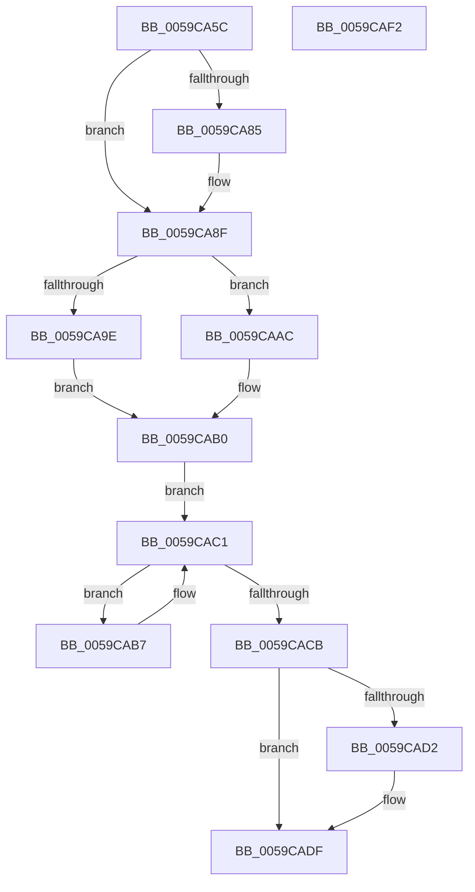

# IopLiveDumpInitiateCorralStateChange

- RVA: `0x0059CA5C`–`0x0059CAF3` (길이 `151` bytes)
- VA: `0x000000014059CA5C`
- 실행 섹션: `.text`
- PDB 이름 있음: `예`; PDB Function 태그: `아니요`
- unwind 정보 RVA: `0x00061768`
- 디코드: `52`개 명령, `151/151` bytes 표시
- 미해석 바이트: `0` (있으면 어셈블리에 `.byte`로 보존)

> 이 문서는 커널 이미지의 기계어와 PDB 기호를 분석해 생성했습니다. 4번과 5번은 함수 원형과 자료형을 바이너리 사용 방식에서 추정한 C 해석이며 원본 소스 복구 결과는 아닙니다.

## 1. Dependencies

- 직접 호출 지점: **4**; 고유 호출 대상: **3**
- 직접 호출자로 확인된 함수: **3**
- RIP 상대 이미지 참조: **0**

### Outgoing calls
- `0x0059CA87` → [IopLiveDumpGetMillisecondCounter](../3F/IopLiveDumpGetMillisecondCounter_function_003F5964.md) (function, `0x003F5964`)
- `0x0059CAA5` → [IopLiveDumpProcessCorralStateChange](../47/IopLiveDumpProcessCorralStateChange_function_00471C7C.md) (function, `0x00471C7C`)
- `0x0059CABC` → [KeYieldProcessorEx](../3F/KeYieldProcessorEx_function_003FBD00.md) (function, `0x003FBD00`)
- `0x0059CAD4` → [IopLiveDumpGetMillisecondCounter](../3F/IopLiveDumpGetMillisecondCounter_function_003F5964.md) (function, `0x003F5964`)

### Direct callers
- [IopLiveDumpCollectPages](IopLiveDumpCollectPages_function_0059B328.md) at `0x0059B631`
- [IopLiveDumpCorralProcessors](IopLiveDumpCorralProcessors_function_0059B720.md) at `0x0059B920`
- [IopLiveDumpCorralProcessors](IopLiveDumpCorralProcessors_function_0059B720.md) at `0x0059B938`
- [IopLiveDumpCorralProcessors](IopLiveDumpCorralProcessors_function_0059B720.md) at `0x0059B949`
- [IopLiveDumpUncorralProcessors](IopLiveDumpUncorralProcessors_function_0059F4E0.md) at `0x0059F513`
- [IopLiveDumpUncorralProcessors](IopLiveDumpUncorralProcessors_function_0059F4E0.md) at `0x0059F523`
- [IopLiveDumpUncorralProcessors](IopLiveDumpUncorralProcessors_function_0059F4E0.md) at `0x0059F53C`
- [IopLiveDumpUncorralProcessors](IopLiveDumpUncorralProcessors_function_0059F4E0.md) at `0x0059F556`

### Static image references
- 디코드된 RIP-relative 메모리 참조가 없습니다.

## 2. Other-region calls and transfers

- 다른 실행 섹션으로 향하는 call: **0**
- 별도 외부 분기/꼬리 이동을 확인하지 못했습니다.

## 3. Assembly (complete function range)

```asm
0059CA5C  48 89 5C 24 08                  mov qword ptr [rsp + 8], rbx
0059CA61  48 89 6C 24 18                  mov qword ptr [rsp + 0x18], rbp
0059CA66  56                              push rsi
0059CA67  57                              push rdi
0059CA68  41 56                           push r14
0059CA6A  48 83 EC 20                     sub rsp, 0x20
0059CA6E  48 8B 29                        mov rbp, qword ptr [rcx]
0059CA71  33 FF                           xor edi, edi
0059CA73  49 21 38                        and qword ptr [r8], rdi
0059CA76  4D 8B F0                        mov r14, r8
0059CA79  8B F2                           mov esi, edx
0059CA7B  48 8B D9                        mov rbx, rcx
0059CA7E  8B 45 50                        mov eax, dword ptr [rbp + 0x50]
0059CA81  84 C0                           test al, al
0059CA83  79 0A                           jns 0x14059ca8f
0059CA85  33 C9                           xor ecx, ecx
0059CA87  E8 D8 8E E5 FF                  call 0x1403f5964
0059CA8C  48 8B F8                        mov rdi, rax
0059CA8F  33 C9                           xor ecx, ecx
0059CA91  87 4B 10                        xchg dword ptr [rbx + 0x10], ecx
0059CA94  8B CE                           mov ecx, esi
0059CA96  87 4B 0C                        xchg dword ptr [rbx + 0xc], ecx
0059CA99  83 FE 07                        cmp esi, 7
0059CA9C  74 0E                           je 0x14059caac
0059CA9E  48 8D 53 70                     lea rdx, [rbx + 0x70]
0059CAA2  48 8B CB                        mov rcx, rbx
0059CAA5  E8 D2 51 ED FF                  call 0x140471c7c
0059CAAA  EB 04                           jmp 0x14059cab0
0059CAAC  F0 FF 43 10                     lock inc dword ptr [rbx + 0x10]
0059CAB0  83 64 24 48 00                  and dword ptr [rsp + 0x48], 0
0059CAB5  EB 0A                           jmp 0x14059cac1
0059CAB7  48 8D 4C 24 48                  lea rcx, [rsp + 0x48]
0059CABC  E8 3F F2 E5 FF                  call 0x1403fbd00
0059CAC1  8B 4B 10                        mov ecx, dword ptr [rbx + 0x10]
0059CAC4  8B 43 14                        mov eax, dword ptr [rbx + 0x14]
0059CAC7  3B C8                           cmp ecx, eax
0059CAC9  75 EC                           jne 0x14059cab7
0059CACB  8B 45 50                        mov eax, dword ptr [rbp + 0x50]
0059CACE  84 C0                           test al, al
0059CAD0  79 0D                           jns 0x14059cadf
0059CAD2  33 C9                           xor ecx, ecx
0059CAD4  E8 8B 8E E5 FF                  call 0x1403f5964
0059CAD9  48 2B C7                        sub rax, rdi
0059CADC  49 89 06                        mov qword ptr [r14], rax
0059CADF  48 8B 5C 24 40                  mov rbx, qword ptr [rsp + 0x40]
0059CAE4  48 8B 6C 24 50                  mov rbp, qword ptr [rsp + 0x50]
0059CAE9  48 83 C4 20                     add rsp, 0x20
0059CAED  41 5E                           pop r14
0059CAEF  5F                              pop rdi
0059CAF0  5E                              pop rsi
0059CAF1  C3                              ret
0059CAF2  CC                              int3
```

## 4. C-style interpretation (structured pseudocode)

```c
__int64 __fastcall IopLiveDumpInitiateCorralStateChange(__int64 a1, int a2, __int64 a3)
{
    __int64 result;
    __int64 v_rdi;
    __int64 v_rsp;
    unsigned int v_stack_p10;
    unsigned __int64 v_stack_p18;
    unsigned __int64 v_stack_p8;

    v_stack_p8 = v_rbx;
    v_stack_p18 = v_rbp;
    v_rsp = (v_rsp) - (32);
    v_rdi = 0;
    result = (unsigned int)(*(unsigned int *)(*(unsigned __int64 *)(a1) + 80));
    if (sign_flag) {
        a1 = 0;
        result = IopLiveDumpGetMillisecondCounter(a1, a2, a3, a4);
        v_rdi = result;
    }
    a1 = 0;
    if (((unsigned int)((unsigned int)(a2))) == 7) goto loc_0059CAAC;
    result = IopLiveDumpProcessCorralStateChange(0, a1 + 112, a3, a4);
    goto loc_0059CAB0;
loc_0059CAAC:
loc_0059CAB0:
    goto loc_0059CAC1;
loc_0059CAB7:
    result = KeYieldProcessorEx(v_stack_p10, a1 + 112, a3, a4);
loc_0059CAC1:
    if (((unsigned int)((unsigned int)(*(unsigned int *)(a1 + 16)))) != ((unsigned int)((unsigned int)(*(unsigned int *)(a1 + 20))))) goto loc_0059CAB7;
    result = (unsigned int)(*(unsigned int *)(*(unsigned __int64 *)(a1) + 80));
    if (sign_flag) {
        a1 = 0;
        result = IopLiveDumpGetMillisecondCounter(a1, a1 + 112, a3, a4);
        result = (result) - (v_rdi);
        *(unsigned __int64 *)(a3) = result;
    }
    v_rsp = (v_rsp) + (32);
    return result;
}
```

## 5. (Beta) C Style

```c
int64_t IopLiveDumpInitiateCorralStateChange(void *Arg1, int32_t Arg2, void *Arg3)
{
    uint8_t *arg1 = (uint8_t *)Arg1;
    uint8_t *arg3 = (uint8_t *)Arg3;

    int64_t result;
    int64_t local_rdi;
    int64_t local_rsp;
    uint32_t v_stack_p10;
    uint64_t v_stack_p18;
    uint64_t v_stack_p8;

    v_stack_p8 = local_rbx;
    v_stack_p18 = local_rbp;
    local_rsp = (local_rsp) - (32);
    local_rdi = 0;
    result = (uint32_t)(*(uint32_t *)(*(uint64_t *)(arg1) + 0x50));
    if (sign_flag) {
        Arg1 = 0;
        result = IopLiveDumpGetMillisecondCounter(Arg1, Arg2, Arg3, a4);
        local_rdi = result;
    }
    Arg1 = 0;
    if (((uint32_t)((uint32_t)(Arg2))) == 7) goto loc_0059CAAC;
    result = IopLiveDumpProcessCorralStateChange(0, Arg1 + 112, Arg3, a4);
    goto loc_0059CAB0;
loc_0059CAAC:
loc_0059CAB0:
    goto loc_0059CAC1;
loc_0059CAB7:
    result = KeYieldProcessorEx(v_stack_p10, Arg1 + 112, Arg3, a4);
loc_0059CAC1:
    if (((uint32_t)((uint32_t)(*(uint32_t *)(arg1 + 0x10)))) != ((uint32_t)((uint32_t)(*(uint32_t *)(arg1 + 0x14))))) goto loc_0059CAB7;
    result = (uint32_t)(*(uint32_t *)(*(uint64_t *)(arg1) + 0x50));
    if (sign_flag) {
        Arg1 = 0;
        result = IopLiveDumpGetMillisecondCounter(Arg1, Arg1 + 112, Arg3, a4);
        result = (result) - (local_rdi);
        *(uint64_t *)(arg3) = result;
    }
    local_rsp = (local_rsp) + (32);
    return result;
}
```

### 관측된 메모리 오프셋

구조체 형식이 확인되지 않은 접근은 인자 기준의 오프셋으로만 기록했습니다.

| 기준 인자 | 오프셋 표현 | 폭 (bit) | 접근 |
|---|---:|---:|---|
| `Arg1` | `+ 0x0` | `64` | `R` |
| `Arg1` | `+ 0xC` | `32` | `R/W` |
| `Arg1` | `+ 0x10` | `32` | `R` |
| `Arg1` | `+ 0x10` | `32` | `R/W` |
| `Arg1` | `+ 0x14` | `32` | `R` |
| `Arg1` | `+ 0x70` | `64` | `R` |
| `Arg3` | `+ 0x0` | `64` | `R/W` |
| `Arg3` | `+ 0x0` | `64` | `W` |

## 6. Execution-region graph

[열기: 2D/3D 그래프와 함수 탐색 컨트롤 패널](../../../control-panel.html?section=text&rva=0x0059CA5C&view=graph)

- 2D 그래프는 위에서 아래로 흐르고, 3D 그래프는 빈 공간을 드래그해 회전합니다. Shift+드래그는 이동, 휠은 확대·축소, 함수 노드 선택은 대상 보고서 이동입니다.

### Static fallback


