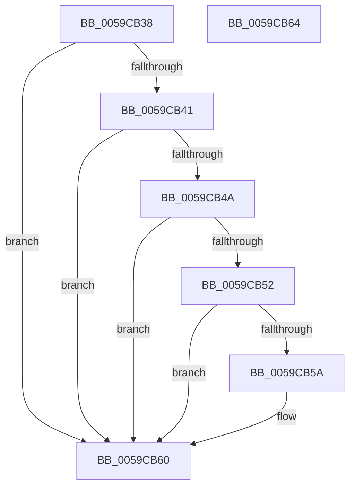

# IopLiveDumpIsChunkInIOSpaceBuffer

- RVA: `0x0059CB38`–`0x0059CB65` (길이 `45` bytes)
- VA: `0x000000014059CB38`
- 실행 섹션: `.text`
- PDB 이름 있음: `예`; PDB Function 태그: `아니요`
- unwind 정보 RVA: `0x000DB714`
- 디코드: `16`개 명령, `45/45` bytes 표시
- 미해석 바이트: `0` (있으면 어셈블리에 `.byte`로 보존)

> 이 문서는 커널 이미지의 기계어와 PDB 기호를 분석해 생성했습니다. 4번과 5번은 함수 원형과 자료형을 바이너리 사용 방식에서 추정한 C 해석이며 원본 소스 복구 결과는 아닙니다.

## 1. Dependencies

- 직접 호출 지점: **0**; 고유 호출 대상: **0**
- 직접 호출자로 확인된 함수: **2**
- RIP 상대 이미지 참조: **0**

### Outgoing calls
- 직접 디코드된 call 명령이 없습니다.

### Direct callers
- [IopLiveDumpBufferDumpData](IopLiveDumpBufferDumpData_function_0059A938.md) at `0x0059AB5E`
- [IopLiveDumpBufferDumpData](IopLiveDumpBufferDumpData_function_0059A938.md) at `0x0059AB74`
- [IopLiveDumpIsChunkInIOSpace](IopLiveDumpIsChunkInIOSpace_function_0059CAFC.md) at `0x0059CB0A`
- [IopLiveDumpIsChunkInIOSpace](IopLiveDumpIsChunkInIOSpace_function_0059CAFC.md) at `0x0059CB1A`

### Static image references
- 디코드된 RIP-relative 메모리 참조가 없습니다.

## 2. Other-region calls and transfers

- 다른 실행 섹션으로 향하는 call: **0**
- 별도 외부 분기/꼬리 이동을 확인하지 못했습니다.

## 3. Assembly (complete function range)

```asm
0059CB38  45 33 C0                        xor r8d, r8d
0059CB3B  4C 39 41 10                     cmp qword ptr [rcx + 0x10], r8
0059CB3F  74 1F                           je 0x14059cb60
0059CB41  48 8B 41 08                     mov rax, qword ptr [rcx + 8]
0059CB45  48 85 C0                        test rax, rax
0059CB48  74 16                           je 0x14059cb60
0059CB4A  4C 8B 09                        mov r9, qword ptr [rcx]
0059CB4D  49 3B D1                        cmp rdx, r9
0059CB50  72 0E                           jb 0x14059cb60
0059CB52  49 03 C1                        add rax, r9
0059CB55  48 3B D0                        cmp rdx, rax
0059CB58  73 06                           jae 0x14059cb60
0059CB5A  41 B8 01 00 00 00               mov r8d, 1
0059CB60  41 8B C0                        mov eax, r8d
0059CB63  C3                              ret
0059CB64  CC                              int3
```

## 4. C-style interpretation (structured pseudocode)

```c
__int64 __fastcall IopLiveDumpIsChunkInIOSpaceBuffer(__int64 a1, __int64 a2, int a3)
{
    __int64 result;

    a3 = 0;
    if ((*(unsigned __int64 *)(a1 + 16)) == 0) goto loc_0059CB60;
    if (*(unsigned __int64 *)(a1 + 8) == 0) goto loc_0059CB60;
    if (a2 < (*(unsigned __int64 *)(a1))) goto loc_0059CB60;
    result = (*(unsigned __int64 *)(a1 + 8)) + (*(unsigned __int64 *)(a1));
    if (a2 < result) {
        a3 = 1;
    }
    return (unsigned int)(a3);
}
```

## 5. (Beta) C Style

```c
int64_t IopLiveDumpIsChunkInIOSpaceBuffer(void *Arg1, int64_t Arg2, int32_t Arg3)
{
    uint8_t *arg1 = (uint8_t *)Arg1;

    int64_t result;

    Arg3 = 0;
    if ((*(uint64_t *)(arg1 + 0x10)) == 0) goto loc_0059CB60;
    if (*(uint64_t *)(arg1 + 0x8) == 0) goto loc_0059CB60;
    if (Arg2 < (*(uint64_t *)(arg1))) goto loc_0059CB60;
    result = (*(uint64_t *)(arg1 + 0x8)) + (*(uint64_t *)(arg1));
    if (Arg2 < result) {
        Arg3 = 1;
    }
    return (uint32_t)(Arg3);
}
```

### 관측된 메모리 오프셋

구조체 형식이 확인되지 않은 접근은 인자 기준의 오프셋으로만 기록했습니다.

| 기준 인자 | 오프셋 표현 | 폭 (bit) | 접근 |
|---|---:|---:|---|
| `Arg1` | `+ 0x0` | `64` | `R` |
| `Arg1` | `+ 0x8` | `64` | `R` |
| `Arg1` | `+ 0x10` | `64` | `R` |

## 6. Execution-region graph

[열기: 2D/3D 그래프와 함수 탐색 컨트롤 패널](../../../control-panel.html?section=text&rva=0x0059CB38&view=graph)

- 2D 그래프는 위에서 아래로 흐르고, 3D 그래프는 빈 공간을 드래그해 회전합니다. Shift+드래그는 이동, 휠은 확대·축소, 함수 노드 선택은 대상 보고서 이동입니다.

### Static fallback


