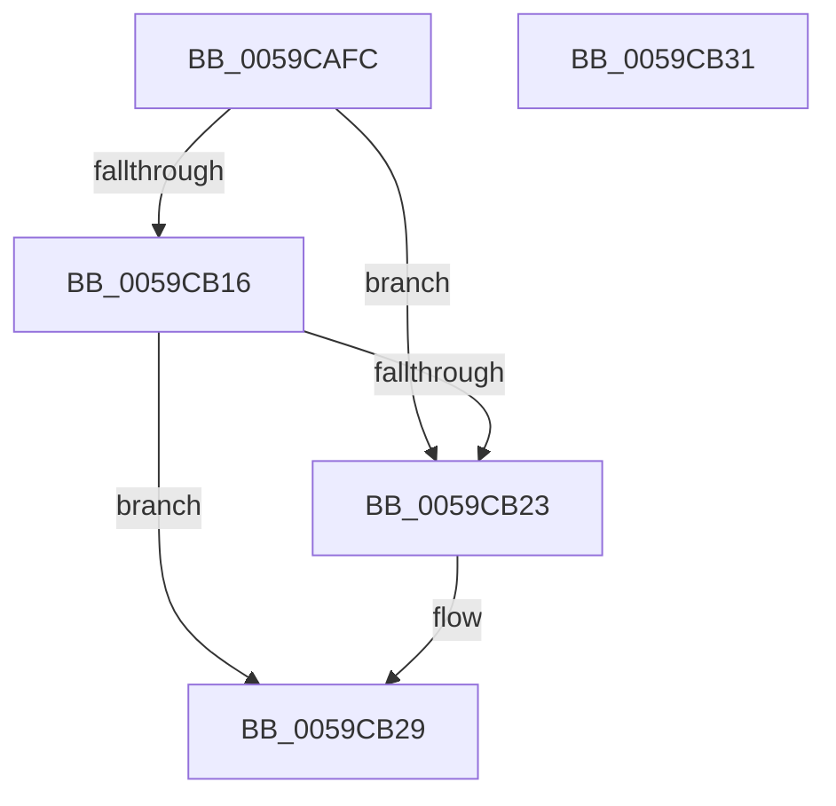

# IopLiveDumpIsChunkInIOSpace

- RVA: `0x0059CAFC`–`0x0059CB32` (길이 `54` bytes)
- VA: `0x000000014059CAFC`
- 실행 섹션: `.text`
- PDB 이름 있음: `예`; PDB Function 태그: `아니요`
- unwind 정보 RVA: `0x0005C788`
- 디코드: `16`개 명령, `54/54` bytes 표시
- 미해석 바이트: `0` (있으면 어셈블리에 `.byte`로 보존)

> 이 문서는 커널 이미지의 기계어와 PDB 기호를 분석해 생성했습니다. 4번과 5번은 함수 원형과 자료형을 바이너리 사용 방식에서 추정한 C 해석이며 원본 소스 복구 결과는 아닙니다.

## 1. Dependencies

- 직접 호출 지점: **2**; 고유 호출 대상: **1**
- 직접 호출자로 확인된 함수: **2**
- RIP 상대 이미지 참조: **0**

### Outgoing calls
- `0x0059CB0A` → [IopLiveDumpIsChunkInIOSpaceBuffer](IopLiveDumpIsChunkInIOSpaceBuffer_function_0059CB38.md) (function, `0x0059CB38`)
- `0x0059CB1A` → [IopLiveDumpIsChunkInIOSpaceBuffer](IopLiveDumpIsChunkInIOSpaceBuffer_function_0059CB38.md) (function, `0x0059CB38`)

### Direct callers
- [IopLiveDumpShouldCheckChunkCRC](../3F/IopLiveDumpShouldCheckChunkCRC_function_003F67B0.md) at `0x003F67CA`
- [IopLiveDumpBufferDumpData](IopLiveDumpBufferDumpData_function_0059A938.md) at `0x0059AB43`

### Static image references
- 디코드된 RIP-relative 메모리 참조가 없습니다.

## 2. Other-region calls and transfers

- 다른 실행 섹션으로 향하는 call: **0**
- 별도 외부 분기/꼬리 이동을 확인하지 못했습니다.

## 3. Assembly (complete function range)

```asm
0059CAFC  48 83 EC 28                     sub rsp, 0x28
0059CB00  4C 8B D9                        mov r11, rcx
0059CB03  48 81 C1 A0 00 00 00            add rcx, 0xa0
0059CB0A  E8 29 00 00 00                  call 0x14059cb38
0059CB0F  45 33 D2                        xor r10d, r10d
0059CB12  85 C0                           test eax, eax
0059CB14  75 0D                           jne 0x14059cb23
0059CB16  49 8D 4B 78                     lea rcx, [r11 + 0x78]
0059CB1A  E8 19 00 00 00                  call 0x14059cb38
0059CB1F  85 C0                           test eax, eax
0059CB21  74 06                           je 0x14059cb29
0059CB23  41 BA 01 00 00 00               mov r10d, 1
0059CB29  41 8B C2                        mov eax, r10d
0059CB2C  48 83 C4 28                     add rsp, 0x28
0059CB30  C3                              ret
0059CB31  CC                              int3
```

## 4. C-style interpretation (structured pseudocode)

```c
__int64 __fastcall IopLiveDumpIsChunkInIOSpace(__int64 a1)
{
    __int64 result;
    __int64 v_r10;
    __int64 v_rsp;

    v_rsp = (v_rsp) - (40);
    a1 = (a1) + (160);
    result = IopLiveDumpIsChunkInIOSpaceBuffer(a1, a2, a3, a4);
    v_r10 = 0;
    if ((unsigned int)(result) != 0) goto loc_0059CB23;
    result = IopLiveDumpIsChunkInIOSpaceBuffer(a1 + 120, a2, a3, a4);
    if ((unsigned int)(result) != 0) {
        v_r10 = 1;
    }
    v_rsp = (v_rsp) + (40);
    return (unsigned int)((unsigned int)(v_r10));
}
```

## 5. (Beta) C Style

```c
int64_t IopLiveDumpIsChunkInIOSpace(int64_t Arg1)
{
    int64_t result;
    int64_t local_r10;
    int64_t local_rsp;

    local_rsp = (local_rsp) - (40);
    Arg1 = (Arg1) + (160);
    result = IopLiveDumpIsChunkInIOSpaceBuffer(Arg1, a2, a3, a4);
    local_r10 = 0;
    if ((uint32_t)(result) != 0) goto loc_0059CB23;
    result = IopLiveDumpIsChunkInIOSpaceBuffer(Arg1 + 120, a2, a3, a4);
    if ((uint32_t)(result) != 0) {
        local_r10 = 1;
    }
    local_rsp = (local_rsp) + (40);
    return (uint32_t)((uint32_t)(local_r10));
}
```

## 6. Execution-region graph

[열기: 2D/3D 그래프와 함수 탐색 컨트롤 패널](../../../control-panel.html?section=text&rva=0x0059CAFC&view=graph)

- 2D 그래프는 위에서 아래로 흐르고, 3D 그래프는 빈 공간을 드래그해 회전합니다. Shift+드래그는 이동, 휠은 확대·축소, 함수 노드 선택은 대상 보고서 이동입니다.

### Static fallback


