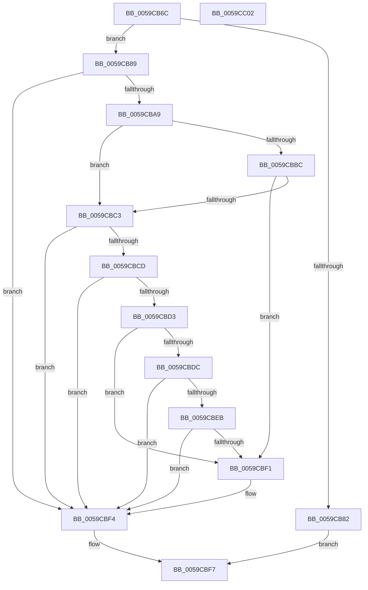

# IopLiveDumpIsProcessPageIncluded

- RVA: `0x0059CB6C`–`0x0059CC03` (길이 `151` bytes)
- VA: `0x000000014059CB6C`
- 실행 섹션: `.text`
- PDB 이름 있음: `예`; PDB Function 태그: `아니요`
- unwind 정보 RVA: `0x0005CAAC`
- 디코드: `43`개 명령, `151/151` bytes 표시
- 미해석 바이트: `0` (있으면 어셈블리에 `.byte`로 보존)

> 이 문서는 커널 이미지의 기계어와 PDB 기호를 분석해 생성했습니다. 4번과 5번은 함수 원형과 자료형을 바이너리 사용 방식에서 추정한 C 해석이며 원본 소스 복구 결과는 아닙니다.

## 1. Dependencies

- 직접 호출 지점: **1**; 고유 호출 대상: **1**
- 직접 호출자로 확인된 함수: **1**
- RIP 상대 이미지 참조: **0**

### Outgoing calls
- `0x0059CBC3` → [IopLiveDumpLookupProcessFilter](IopLiveDumpLookupProcessFilter_function_0059CC0C.md) (function, `0x0059CC0C`)

### Direct callers
- [IopLiveDumpMirrorPhysicalMemoryCallback](IopLiveDumpMirrorPhysicalMemoryCallback_function_0059D260.md) at `0x0059D436`

### Static image references
- 디코드된 RIP-relative 메모리 참조가 없습니다.

## 2. Other-region calls and transfers

- 다른 실행 섹션으로 향하는 call: **0**
- 별도 외부 분기/꼬리 이동을 확인하지 못했습니다.

## 3. Assembly (complete function range)

```asm
0059CB6C  48 89 5C 24 08                  mov qword ptr [rsp + 8], rbx
0059CB71  57                              push rdi
0059CB72  48 83 EC 20                     sub rsp, 0x20
0059CB76  8B 59 50                        mov ebx, dword ptr [rcx + 0x50]
0059CB79  4C 8B DA                        mov r11, rdx
0059CB7C  0F BA E3 0F                     bt ebx, 0xf
0059CB80  72 07                           jb 0x14059cb89
0059CB82  B8 01 00 00 00                  mov eax, 1
0059CB87  EB 6E                           jmp 0x14059cbf7
0059CB89  48 8B 12                        mov rdx, qword ptr [rdx]
0059CB8C  48 B8 FF FF FF FF FF FF 00 00   movabs rax, 0xffffffffffff
0059CB96  4D 8B 5B 10                     mov r11, qword ptr [r11 + 0x10]
0059CB9A  41 BA 01 00 00 00               mov r10d, 1
0059CBA0  48 C1 EA 09                     shr rdx, 9
0059CBA4  48 23 D0                        and rdx, rax
0059CBA7  74 4B                           je 0x14059cbf4
0059CBA9  49 8D 43 FF                     lea rax, [r11 - 1]
0059CBAD  48 BF FE FF FE FF FF 7F 00 00   movabs rdi, 0x7ffffffefffe
0059CBB7  48 3B C7                        cmp rax, rdi
0059CBBA  77 07                           ja 0x14059cbc3
0059CBBC  8B 41 28                        mov eax, dword ptr [rcx + 0x28]
0059CBBF  A8 04                           test al, 4
0059CBC1  74 2E                           je 0x14059cbf1
0059CBC3  E8 44 00 00 00                  call 0x14059cc0c
0059CBC8  48 85 C0                        test rax, rax
0059CBCB  74 27                           je 0x14059cbf4
0059CBCD  83 78 20 02                     cmp dword ptr [rax + 0x20], 2
0059CBD1  75 21                           jne 0x14059cbf4
0059CBD3  49 8D 43 FF                     lea rax, [r11 - 1]
0059CBD7  48 3B C7                        cmp rax, rdi
0059CBDA  76 15                           jbe 0x14059cbf1
0059CBDC  48 B8 00 00 00 00 00 80 FF FF   movabs rax, 0xffff800000000000
0059CBE6  4C 3B D8                        cmp r11, rax
0059CBE9  72 09                           jb 0x14059cbf4
0059CBEB  0F BA E3 10                     bt ebx, 0x10
0059CBEF  73 03                           jae 0x14059cbf4
0059CBF1  45 33 D2                        xor r10d, r10d
0059CBF4  41 8B C2                        mov eax, r10d
0059CBF7  48 8B 5C 24 30                  mov rbx, qword ptr [rsp + 0x30]
0059CBFC  48 83 C4 20                     add rsp, 0x20
0059CC00  5F                              pop rdi
0059CC01  C3                              ret
0059CC02  CC                              int3
```

## 4. C-style interpretation (structured pseudocode)

```c
__int64 __fastcall IopLiveDumpIsProcessPageIncluded(__int64 a1, __int64 a2)
{
    __int64 result;
    __int64 v_r10;
    __int64 v_rsp;
    unsigned __int64 v_stack_p8;

    v_stack_p8 = v_rbx;
    v_rsp = (v_rsp) - (32);
    if (condition_is_below) goto loc_0059CB89;
    goto loc_0059CBF7;
loc_0059CB89:
    a2 = (*(unsigned __int64 *)(a2)) >> (9);
    a2 = (a2) & (1);
    if (condition_is_equal) goto loc_0059CBF4;
    if ((*(unsigned __int64 *)(a2 + 16) - 1) > v_rdi) goto loc_0059CBC3;
    if ((((unsigned __int8)((unsigned int)(*(unsigned int *)(a1 + 40)))) & (4)) == 0) goto loc_0059CBF1;
loc_0059CBC3:
    result = IopLiveDumpLookupProcessFilter(a1, a2, a3, a4);
    if (result == 0) goto loc_0059CBF4;
    if ((*(unsigned int *)(result + 32)) != 2) goto loc_0059CBF4;
    if ((*(unsigned __int64 *)(a2 + 16) - 1) <= v_rdi) goto loc_0059CBF1;
    if ((*(unsigned __int64 *)(a2 + 16)) < (*(unsigned __int64 *)(a2 + 16) - 1)) goto loc_0059CBF4;
    v_r10 = 1;
    if ((*(unsigned __int64 *)(a2 + 16)) < (*(unsigned __int64 *)(a2 + 16) - 1)) {
        v_r10 = 0;
    }
loc_0059CBF7:
    v_rsp = (v_rsp) + (32);
    return 0;
}
```

## 5. (Beta) C Style

```c
int64_t IopLiveDumpIsProcessPageIncluded(void *Arg1, void *Arg2)
{
    uint8_t *arg1 = (uint8_t *)Arg1;
    uint8_t *arg2 = (uint8_t *)Arg2;

    int64_t result;
    int64_t local_r10;
    int64_t local_rsp;
    uint64_t v_stack_p8;

    v_stack_p8 = local_rbx;
    local_rsp = (local_rsp) - (32);
    if (condition_is_below) goto loc_0059CB89;
    goto loc_0059CBF7;
loc_0059CB89:
    Arg2 = (*(uint64_t *)(arg2)) >> (9);
    Arg2 = (Arg2) & (1);
    if (condition_is_equal) goto loc_0059CBF4;
    if ((*(uint64_t *)(arg2 + 0x10) - 1) > local_rdi) goto loc_0059CBC3;
    if ((((uint8_t)((uint32_t)(*(uint32_t *)(arg1 + 0x28)))) & (4)) == 0) goto loc_0059CBF1;
loc_0059CBC3:
    result = IopLiveDumpLookupProcessFilter(Arg1, Arg2, a3, a4);
    if (result == 0) goto loc_0059CBF4;
    if ((*(uint32_t *)(result + 0x20)) != 2) goto loc_0059CBF4;
    if ((*(uint64_t *)(arg2 + 0x10) - 1) <= local_rdi) goto loc_0059CBF1;
    if ((*(uint64_t *)(arg2 + 0x10)) < (*(uint64_t *)(arg2 + 0x10) - 1)) goto loc_0059CBF4;
    local_r10 = 1;
    if ((*(uint64_t *)(arg2 + 0x10)) < (*(uint64_t *)(arg2 + 0x10) - 1)) {
        local_r10 = 0;
    }
loc_0059CBF7:
    local_rsp = (local_rsp) + (32);
    return 0;
}
```

### 관측된 메모리 오프셋

구조체 형식이 확인되지 않은 접근은 인자 기준의 오프셋으로만 기록했습니다.

| 기준 인자 | 오프셋 표현 | 폭 (bit) | 접근 |
|---|---:|---:|---|
| `Arg1` | `+ 0x28` | `32` | `R` |
| `Arg1` | `+ 0x50` | `32` | `R` |
| `Arg2` | `+ 0x0` | `64` | `R` |
| `Arg2` | `+ 0x10` | `64` | `R` |

## 6. Execution-region graph

[열기: 2D/3D 그래프와 함수 탐색 컨트롤 패널](../../../control-panel.html?section=text&rva=0x0059CB6C&view=graph)

- 2D 그래프는 위에서 아래로 흐르고, 3D 그래프는 빈 공간을 드래그해 회전합니다. Shift+드래그는 이동, 휠은 확대·축소, 함수 노드 선택은 대상 보고서 이동입니다.

### Static fallback


