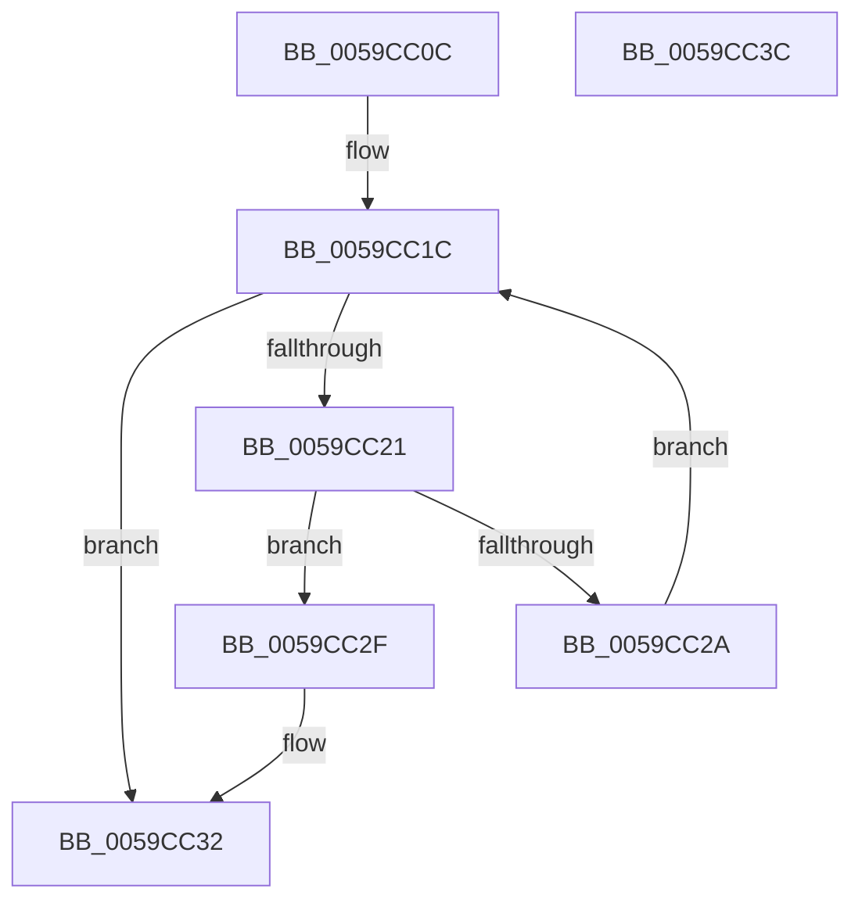

# IopLiveDumpLookupProcessFilter

- RVA: `0x0059CC0C`–`0x0059CC3D` (길이 `49` bytes)
- VA: `0x000000014059CC0C`
- 실행 섹션: `.text`
- PDB 이름 있음: `예`; PDB Function 태그: `아니요`
- unwind 정보 RVA: `0x000DB714`
- 디코드: `17`개 명령, `49/49` bytes 표시
- 미해석 바이트: `0` (있으면 어셈블리에 `.byte`로 보존)

> 이 문서는 커널 이미지의 기계어와 PDB 기호를 분석해 생성했습니다. 4번과 5번은 함수 원형과 자료형을 바이너리 사용 방식에서 추정한 C 해석이며 원본 소스 복구 결과는 아닙니다.

## 1. Dependencies

- 직접 호출 지점: **0**; 고유 호출 대상: **0**
- 직접 호출자로 확인된 함수: **3**
- RIP 상대 이미지 참조: **0**

### Outgoing calls
- 직접 디코드된 call 명령이 없습니다.

### Direct callers
- [IopLiveDumpAddProcessFilter](IopLiveDumpAddProcessFilter_function_00599008.md) at `0x0059909A`
- [IopLiveDumpIsProcessPageIncluded](IopLiveDumpIsProcessPageIncluded_function_0059CB6C.md) at `0x0059CBC3`
- [IopLiveDumpValidateProtectedProcessExclusions](IopLiveDumpValidateProtectedProcessExclusions_function_0059F830.md) at `0x0059F88B`

### Static image references
- 디코드된 RIP-relative 메모리 참조가 없습니다.

## 2. Other-region calls and transfers

- 다른 실행 섹션으로 향하는 call: **0**
- 별도 외부 분기/꼬리 이동을 확인하지 못했습니다.

## 3. Assembly (complete function range)

```asm
0059CC0C  45 33 C9                        xor r9d, r9d
0059CC0F  48 81 C1 B0 04 00 00            add rcx, 0x4b0
0059CC16  45 8A C1                        mov r8b, r9b
0059CC19  48 8B 01                        mov rax, qword ptr [rcx]
0059CC1C  48 3B C1                        cmp rax, rcx
0059CC1F  74 11                           je 0x14059cc32
0059CC21  4C 8B C8                        mov r9, rax
0059CC24  48 39 50 10                     cmp qword ptr [rax + 0x10], rdx
0059CC28  74 05                           je 0x14059cc2f
0059CC2A  48 8B 00                        mov rax, qword ptr [rax]
0059CC2D  EB ED                           jmp 0x14059cc1c
0059CC2F  41 B0 01                        mov r8b, 1
0059CC32  41 F6 D8                        neg r8b
0059CC35  48 1B C0                        sbb rax, rax
0059CC38  49 23 C1                        and rax, r9
0059CC3B  C3                              ret
0059CC3C  CC                              int3
```

## 4. C-style interpretation (structured pseudocode)

```c
__int64 __fastcall IopLiveDumpLookupProcessFilter(__int64 a1, __int64 a2, __int64 a3, int a4)
{
    __int64 result;

    a4 = 0;
    a1 = (a1) + (0x4B0ULL);
loc_0059CC1C:
    if ((*(unsigned __int64 *)(a1)) == a1) goto loc_0059CC32;
    if ((*(unsigned __int64 *)(*(unsigned __int64 *)(a1) + 16)) == a2) goto loc_0059CC2F;
    goto loc_0059CC1C;
loc_0059CC2F:
loc_0059CC32:
    a3 = (unsigned __int8)(-(1));
    result = (*(unsigned __int64 *)(*(unsigned __int64 *)(a1))) & (*(unsigned __int64 *)(a1));
    return result;
}
```

## 5. (Beta) C Style

```c
int64_t IopLiveDumpLookupProcessFilter(void *Arg1, int64_t Arg2, int64_t Arg3, int32_t Arg4)
{
    uint8_t *arg1 = (uint8_t *)Arg1;

    int64_t result;

    Arg4 = 0;
    Arg1 = (Arg1) + (0x4B0ULL);
loc_0059CC1C:
    if ((*(uint64_t *)(arg1)) == Arg1) goto loc_0059CC32;
    if ((*(uint64_t *)(*(uint64_t *)(arg1) + 0x10)) == Arg2) goto loc_0059CC2F;
    goto loc_0059CC1C;
loc_0059CC2F:
loc_0059CC32:
    Arg3 = (uint8_t)(-(1));
    result = (*(uint64_t *)(*(uint64_t *)(arg1))) & (*(uint64_t *)(arg1));
    return result;
}
```

### 관측된 메모리 오프셋

구조체 형식이 확인되지 않은 접근은 인자 기준의 오프셋으로만 기록했습니다.

| 기준 인자 | 오프셋 표현 | 폭 (bit) | 접근 |
|---|---:|---:|---|
| `Arg1` | `+ 0x0` | `64` | `R` |

## 6. Execution-region graph

[열기: 2D/3D 그래프와 함수 탐색 컨트롤 패널](../../../control-panel.html?section=text&rva=0x0059CC0C&view=graph)

- 2D 그래프는 위에서 아래로 흐르고, 3D 그래프는 빈 공간을 드래그해 회전합니다. Shift+드래그는 이동, 휠은 확대·축소, 함수 노드 선택은 대상 보고서 이동입니다.

### Static fallback


