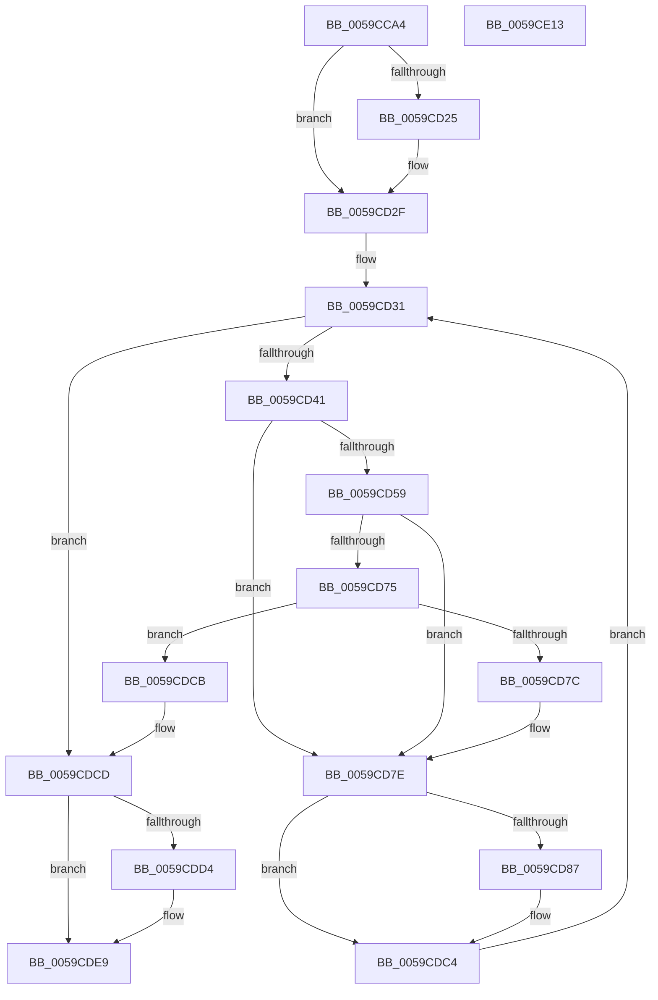

# IopLiveDumpMarkImportantDumpData

- RVA: `0x0059CCA4`–`0x0059CE14` (길이 `368` bytes)
- VA: `0x000000014059CCA4`
- 실행 섹션: `.text`
- PDB 이름 있음: `예`; PDB Function 태그: `아니요`
- unwind 정보 RVA: `0x000C7BC8`
- 디코드: `102`개 명령, `368/368` bytes 표시
- 미해석 바이트: `0` (있으면 어셈블리에 `.byte`로 보존)

> 이 문서는 커널 이미지의 기계어와 PDB 기호를 분석해 생성했습니다. 4번과 5번은 함수 원형과 자료형을 바이너리 사용 방식에서 추정한 C 해석이며 원본 소스 복구 결과는 아닙니다.

## 1. Dependencies

- 직접 호출 지점: **8**; 고유 호출 대상: **6**
- 직접 호출자로 확인된 함수: **1**
- RIP 상대 이미지 참조: **5**

### Outgoing calls
- `0x0059CD27` → [IopLiveDumpGetMillisecondCounter](../3F/IopLiveDumpGetMillisecondCounter_function_003F5964.md) (function, `0x003F5964`)
- `0x0059CD4D` → [guard_dispatch_icall](../6B/guard_dispatch_icall_function_006BAAD0.md) (function, `0x006BAAD0`)
- `0x0059CD6C` → [guard_dispatch_icall](../6B/guard_dispatch_icall_function_006BAAD0.md) (function, `0x006BAAD0`)
- `0x0059CD7E` → [IopLiveDumpIsTracingEnabled](../4F/IopLiveDumpIsTracingEnabled_function_004FC5AC.md) (function, `0x004FC5AC`)
- `0x0059CDBF` → [IopLiveDumpTrace](../5A/IopLiveDumpTrace_function_005A4070.md) (function, `0x005A4070`)
- `0x0059CDD6` → [IopLiveDumpGetMillisecondCounter](../3F/IopLiveDumpGetMillisecondCounter_function_003F5964.md) (function, `0x003F5964`)
- `0x0059CDE4` → [IopLiveDumpTraceMarkImportantDumpDataDuration](IopLiveDumpTraceMarkImportantDumpDataDuration_function_0059EE44.md) (function, `0x0059EE44`)
- `0x0059CDF2` → [_security_check_cookie](../6A/_security_check_cookie_function_006AC640.md) (function, `0x006AC640`)

### Direct callers
- [IopLiveDumpCollectPages](IopLiveDumpCollectPages_function_0059B328.md) at `0x0059B588`

### Static image references
- `0x0059CCC0` → RVA `0x00E0A740` (`.data`; read)
- `0x0059CCDE` → RVA `0x000210E8` (`.rdata`; read)
- `0x0059CCFA` → RVA `0x005931F0` (`IoSetDumpRange`; read)
- `0x0059CD16` → RVA `0x00020C10` (`.rdata`; read)
- `0x0059CD31` → RVA `0x00E00E90` (`.data`; read)

## 2. Other-region calls and transfers

- 다른 실행 섹션으로 향하는 call: **0**
- 별도 외부 분기/꼬리 이동을 확인하지 못했습니다.

## 3. Assembly (complete function range)

```asm
0059CCA4  48 89 5C 24 18                  mov qword ptr [rsp + 0x18], rbx
0059CCA9  48 89 74 24 20                  mov qword ptr [rsp + 0x20], rsi
0059CCAE  55                              push rbp
0059CCAF  57                              push rdi
0059CCB0  41 54                           push r12
0059CCB2  41 56                           push r14
0059CCB4  41 57                           push r15
0059CCB6  48 8B EC                        mov rbp, rsp
0059CCB9  48 81 EC 80 00 00 00            sub rsp, 0x80
0059CCC0  48 8B 05 79 DA 86 00            mov rax, qword ptr [rip + 0x86da79]
0059CCC7  48 33 C4                        xor rax, rsp
0059CCCA  48 89 45 F8                     mov qword ptr [rbp - 8], rax
0059CCCE  48 83 65 D0 00                  and qword ptr [rbp - 0x30], 0
0059CCD3  48 8D 81 20 02 00 00            lea rax, [rcx + 0x220]
0059CCDA  83 65 A0 00                     and dword ptr [rbp - 0x60], 0
0059CCDE  4C 8D 25 03 44 A8 FF            lea r12, [rip - 0x57bbfd]
0059CCE5  48 83 65 C0 00                  and qword ptr [rbp - 0x40], 0
0059CCEA  45 33 F6                        xor r14d, r14d
0059CCED  4C 21 75 B0                     and qword ptr [rbp - 0x50], r14
0059CCF1  33 FF                           xor edi, edi
0059CCF3  48 89 45 B8                     mov qword ptr [rbp - 0x48], rax
0059CCF7  48 8B F1                        mov rsi, rcx
0059CCFA  48 8D 05 EF 64 FF FF            lea rax, [rip - 0x9b11]
0059CD01  48 89 55 C8                     mov qword ptr [rbp - 0x38], rdx
0059CD05  48 89 45 A8                     mov qword ptr [rbp - 0x58], rax
0059CD09  33 C0                           xor eax, eax
0059CD0B  83 C8 01                        or eax, 1
0059CD0E  89 45 D0                        mov dword ptr [rbp - 0x30], eax
0059CD11  8B 41 50                        mov eax, dword ptr [rcx + 0x50]
0059CD14  A8 01                           test al, 1
0059CD16  48 8D 0D F3 3E A8 FF            lea rcx, [rip - 0x57c10d]
0059CD1D  4C 0F 44 E1                     cmove r12, rcx
0059CD21  84 C0                           test al, al
0059CD23  79 0A                           jns 0x14059cd2f
0059CD25  33 C9                           xor ecx, ecx
0059CD27  E8 38 8C E5 FF                  call 0x1403f5964
0059CD2C  4C 8B F0                        mov r14, rax
0059CD2F  33 DB                           xor ebx, ebx
0059CD31  48 8D 05 58 41 86 00            lea rax, [rip + 0x864158]
0059CD38  83 FB 05                        cmp ebx, 5
0059CD3B  0F 83 8C 00 00 00               jae 0x14059cdcd
0059CD41  4C 8D 3C 5B                     lea r15, [rbx + rbx*2]
0059CD45  48 8B CE                        mov rcx, rsi
0059CD48  4A 8B 44 F8 10                  mov rax, qword ptr [rax + r15*8 + 0x10]
0059CD4D  E8 7E DD 11 00                  call 0x1406baad0
0059CD52  89 45 A0                        mov dword ptr [rbp - 0x60], eax
0059CD55  85 C0                           test eax, eax
0059CD57  74 25                           je 0x14059cd7e
0059CD59  48 8D 05 30 41 86 00            lea rax, [rip + 0x864130]
0059CD60  48 8B CE                        mov rcx, rsi
0059CD63  4A 8B 44 F8 08                  mov rax, qword ptr [rax + r15*8 + 8]
0059CD68  48 8D 55 A8                     lea rdx, [rbp - 0x58]
0059CD6C  E8 5F DD 11 00                  call 0x1406baad0
0059CD71  85 C0                           test eax, eax
0059CD73  79 09                           jns 0x14059cd7e
0059CD75  3D 23 00 00 C0                  cmp eax, 0xc0000023
0059CD7A  74 4F                           je 0x14059cdcb
0059CD7C  8B F8                           mov edi, eax
0059CD7E  E8 29 F8 F5 FF                  call 0x1404fc5ac
0059CD83  84 C0                           test al, al
0059CD85  74 3D                           je 0x14059cdc4
0059CD87  83 65 E4 00                     and dword ptr [rbp - 0x1c], 0
0059CD8B  48 8D 05 FE 40 86 00            lea rax, [rip + 0x8640fe]
0059CD92  83 65 F4 00                     and dword ptr [rbp - 0xc], 0
0059CD96  4A 8D 04 F8                     lea rax, [rax + r15*8]
0059CD9A  41 BF 04 00 00 00               mov r15d, 4
0059CDA0  48 89 45 D8                     mov qword ptr [rbp - 0x28], rax
0059CDA4  48 8D 45 A0                     lea rax, [rbp - 0x60]
0059CDA8  44 89 7D E0                     mov dword ptr [rbp - 0x20], r15d
0059CDAC  4C 8D 45 D8                     lea r8, [rbp - 0x28]
0059CDB0  48 89 45 E8                     mov qword ptr [rbp - 0x18], rax
0059CDB4  49 8B CC                        mov rcx, r12
0059CDB7  44 89 7D F0                     mov dword ptr [rbp - 0x10], r15d
0059CDBB  41 8D 57 FE                     lea edx, [r15 - 2]
0059CDBF  E8 AC 72 00 00                  call 0x1405a4070
0059CDC4  FF C3                           inc ebx
0059CDC6  E9 66 FF FF FF                  jmp 0x14059cd31
0059CDCB  33 FF                           xor edi, edi
0059CDCD  8B 56 50                        mov edx, dword ptr [rsi + 0x50]
0059CDD0  84 D2                           test dl, dl
0059CDD2  79 15                           jns 0x14059cde9
0059CDD4  33 C9                           xor ecx, ecx
0059CDD6  E8 89 8B E5 FF                  call 0x1403f5964
0059CDDB  49 2B C6                        sub rax, r14
0059CDDE  48 8B CE                        mov rcx, rsi
0059CDE1  48 8B D0                        mov rdx, rax
0059CDE4  E8 5B 20 00 00                  call 0x14059ee44
0059CDE9  8B C7                           mov eax, edi
0059CDEB  48 8B 4D F8                     mov rcx, qword ptr [rbp - 8]
0059CDEF  48 33 CC                        xor rcx, rsp
0059CDF2  E8 49 F8 10 00                  call 0x1406ac640
0059CDF7  4C 8D 9C 24 80 00 00 00         lea r11, [rsp + 0x80]
0059CDFF  49 8B 5B 40                     mov rbx, qword ptr [r11 + 0x40]
0059CE03  49 8B 73 48                     mov rsi, qword ptr [r11 + 0x48]
0059CE07  49 8B E3                        mov rsp, r11
0059CE0A  41 5F                           pop r15
0059CE0C  41 5E                           pop r14
0059CE0E  41 5C                           pop r12
0059CE10  5F                              pop rdi
0059CE11  5D                              pop rbp
0059CE12  C3                              ret
0059CE13  CC                              int3
```

## 4. C-style interpretation (structured pseudocode)

```c
__int64 __fastcall IopLiveDumpMarkImportantDumpData(__int64 a1, __int64 a2)
{
    __int64 result;
    __int64 v_r12;
    __int64 v_r14;
    __int64 v_r15;
    __int64 v_rbx;
    __int64 v_rdi;
    __int64 v_rsp;
    unsigned __int64 v_stack_m28;
    unsigned __int64 v_stack_m30;
    unsigned int v_stack_m34;
    unsigned int v_stack_m38;
    unsigned __int64 v_stack_m40;
    unsigned int v_stack_m44;
    unsigned int v_stack_m48;
    unsigned __int64 v_stack_m50;
    unsigned __int64 v_stack_m58;
    unsigned __int64 v_stack_m60;
    unsigned __int64 v_stack_m68;
    unsigned __int64 v_stack_m70;
    unsigned __int64 v_stack_m78;
    unsigned __int64 v_stack_m80;
    unsigned int v_stack_m88;
    unsigned __int64 v_stack_p18;
    unsigned __int64 v_stack_p20;

    v_stack_p18 = v_rbx;
    v_stack_p20 = v_rsi;
    v_rsp = (v_rsp) - (128);
    result = (*(unsigned __int64 *)(v_rip + 8837753)) ^ (v_rsp);
    v_stack_m30 = result;
    v_r14 = 0;
    v_rdi = 0;
    v_stack_m70 = a1 + 544;
    v_stack_m60 = a2;
    v_stack_m80 = v_rip - 39697;
    result = 0;
    result = (unsigned int)((result) | (1));
    v_stack_m58 = (unsigned int)(result);
    v_r12 = v_rip - 5749757;
    if ((((unsigned __int8)((unsigned int)(*(unsigned int *)(a1 + 80)))) & (1)) == 0) { v_r12 = v_rip - 5751053; }
    result = (unsigned int)(*(unsigned int *)(a1 + 80));
    if (sign_flag) {
        a1 = 0;
        result = IopLiveDumpGetMillisecondCounter(a1, a2, a3, a4);
        v_r14 = result;
    }
    v_rbx = 0;
loc_0059CD31:
    if (0 >= 5) goto loc_0059CDCD;
    result = guard_dispatch_icall(0, a2, a3, a4);
    v_stack_m88 = (unsigned int)(result);
    if ((unsigned int)(result) == 0) goto loc_0059CD7E;
    result = guard_dispatch_icall(0, v_stack_m80, a3, a4);
    if (!sign_flag) goto loc_0059CD7E;
    if (((unsigned int)(result)) == 0xC0000023ULL) goto loc_0059CDCB;
loc_0059CD7E:
    result = IopLiveDumpIsTracingEnabled(0, v_stack_m80, a3, a4);
    v_r15 = v_rbx + v_rbx * 2;
    if ((unsigned __int8)(result) != 0) {
        result = v_rip + 8798462;
        result = result + v_rbx + v_rbx * 2 * 8;
        v_r15 = 4;
        v_stack_m50 = result;
        result = v_stack_m88;
        v_stack_m48 = (unsigned int)(v_r15);
        a3 = v_stack_m50;
        v_stack_m40 = result;
        a1 = v_r12;
        v_stack_m38 = (unsigned int)(v_r15);
        a2 = v_r15 - 2;
        result = IopLiveDumpTrace(a1, a2, a3, a4);
    }
    v_rbx = (unsigned int)((v_rbx) + 1);
    goto loc_0059CD31;
loc_0059CDCB:
    v_rdi = 0;
loc_0059CDCD:
    if (sign_flag) {
        a1 = 0;
        result = IopLiveDumpGetMillisecondCounter(a1, (unsigned int)(*(unsigned int *)(a1 + 80)), a3, a4);
        result = (result) - (v_r14);
        a1 = 0;
        a2 = result;
        result = IopLiveDumpTraceMarkImportantDumpDataDuration(a1, a2, a3, a4);
    }
    a1 = (v_stack_m30) ^ (v_rsp);
    result = _security_check_cookie(a1, a2, a3, a4);
    return result;
}
```

## 5. (Beta) C Style

```c
int64_t IopLiveDumpMarkImportantDumpData(void *Arg1, int64_t Arg2)
{
    uint8_t *arg1 = (uint8_t *)Arg1;

    int64_t result;
    int64_t local_r12;
    int64_t local_r14;
    int64_t local_r15;
    int64_t local_rbx;
    int64_t local_rdi;
    int64_t local_rsp;
    uint64_t v_stack_m28;
    uint64_t v_stack_m30;
    uint32_t v_stack_m34;
    uint32_t v_stack_m38;
    uint64_t v_stack_m40;
    uint32_t v_stack_m44;
    uint32_t v_stack_m48;
    uint64_t v_stack_m50;
    uint64_t v_stack_m58;
    uint64_t v_stack_m60;
    uint64_t v_stack_m68;
    uint64_t v_stack_m70;
    uint64_t v_stack_m78;
    uint64_t v_stack_m80;
    uint32_t v_stack_m88;
    uint64_t v_stack_p18;
    uint64_t v_stack_p20;

    v_stack_p18 = local_rbx;
    v_stack_p20 = local_rsi;
    local_rsp = (local_rsp) - (128);
    result = (*(uint64_t *)(v_rip + 0x86DA79)) ^ (local_rsp);
    v_stack_m30 = result;
    local_r14 = 0;
    local_rdi = 0;
    v_stack_m70 = Arg1 + 544;
    v_stack_m60 = Arg2;
    v_stack_m80 = v_rip - 39697;
    result = 0;
    result = (uint32_t)((result) | (1));
    v_stack_m58 = (uint32_t)(result);
    local_r12 = v_rip - 5749757;
    if ((((uint8_t)((uint32_t)(*(uint32_t *)(arg1 + 0x50)))) & (1)) == 0) { local_r12 = v_rip - 5751053; }
    result = (uint32_t)(*(uint32_t *)(arg1 + 0x50));
    if (sign_flag) {
        Arg1 = 0;
        result = IopLiveDumpGetMillisecondCounter(Arg1, Arg2, a3, a4);
        local_r14 = result;
    }
    local_rbx = 0;
loc_0059CD31:
    if (0 >= 5) goto loc_0059CDCD;
    result = guard_dispatch_icall(0, Arg2, a3, a4);
    v_stack_m88 = (uint32_t)(result);
    if ((uint32_t)(result) == 0) goto loc_0059CD7E;
    result = guard_dispatch_icall(0, v_stack_m80, a3, a4);
    if (!sign_flag) goto loc_0059CD7E;
    if (((uint32_t)(result)) == 0xC0000023ULL) goto loc_0059CDCB;
loc_0059CD7E:
    result = IopLiveDumpIsTracingEnabled(0, v_stack_m80, a3, a4);
    local_r15 = local_rbx + local_rbx * 2;
    if ((uint8_t)(result) != 0) {
        result = v_rip + 8798462;
        result = result + local_rbx + local_rbx * 2 * 8;
        local_r15 = 4;
        v_stack_m50 = result;
        result = v_stack_m88;
        v_stack_m48 = (uint32_t)(local_r15);
        a3 = v_stack_m50;
        v_stack_m40 = result;
        Arg1 = local_r12;
        v_stack_m38 = (uint32_t)(local_r15);
        Arg2 = local_r15 - 2;
        result = IopLiveDumpTrace(Arg1, Arg2, a3, a4);
    }
    local_rbx = (uint32_t)((local_rbx) + 1);
    goto loc_0059CD31;
loc_0059CDCB:
    local_rdi = 0;
loc_0059CDCD:
    if (sign_flag) {
        Arg1 = 0;
        result = IopLiveDumpGetMillisecondCounter(Arg1, (uint32_t)(*(uint32_t *)(arg1 + 0x50)), a3, a4);
        result = (result) - (local_r14);
        Arg1 = 0;
        Arg2 = result;
        result = IopLiveDumpTraceMarkImportantDumpDataDuration(Arg1, Arg2, a3, a4);
    }
    Arg1 = (v_stack_m30) ^ (local_rsp);
    result = _security_check_cookie(Arg1, Arg2, a3, a4);
    return result;
}
```

### 관측된 메모리 오프셋

구조체 형식이 확인되지 않은 접근은 인자 기준의 오프셋으로만 기록했습니다.

| 기준 인자 | 오프셋 표현 | 폭 (bit) | 접근 |
|---|---:|---:|---|
| `Arg1` | `+ 0x50` | `32` | `R` |
| `Arg1` | `+ 0x220` | `64` | `R` |

## 6. Execution-region graph

[열기: 2D/3D 그래프와 함수 탐색 컨트롤 패널](../../../control-panel.html?section=text&rva=0x0059CCA4&view=graph)

- 2D 그래프는 위에서 아래로 흐르고, 3D 그래프는 빈 공간을 드래그해 회전합니다. Shift+드래그는 이동, 휠은 확대·축소, 함수 노드 선택은 대상 보고서 이동입니다.

### Static fallback


