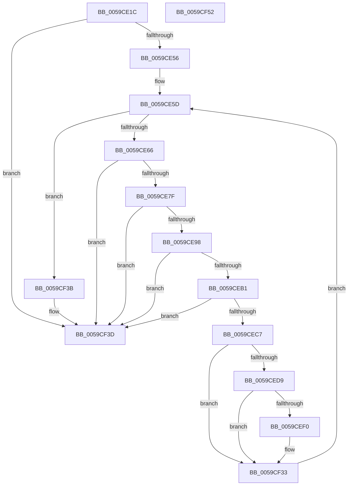

# IopLiveDumpMarkLoadedModuleList

- RVA: `0x0059CE1C`–`0x0059CF53` (길이 `311` bytes)
- VA: `0x000000014059CE1C`
- 실행 섹션: `.text`
- PDB 이름 있음: `예`; PDB Function 태그: `아니요`
- unwind 정보 RVA: `0x000AE1B4`
- 디코드: `77`개 명령, `311/311` bytes 표시
- 미해석 바이트: `0` (있으면 어셈블리에 `.byte`로 보존)

> 이 문서는 커널 이미지의 기계어와 PDB 기호를 분석해 생성했습니다. 4번과 5번은 함수 원형과 자료형을 바이너리 사용 방식에서 추정한 C 해석이며 원본 소스 복구 결과는 아닙니다.

## 1. Dependencies

- 직접 호출 지점: **8**; 고유 호출 대상: **3**
- 직접 호출자로 확인된 함수: **1**
- RIP 상대 이미지 참조: **4**

### Outgoing calls
- `0x0059CE47` → [MmAddRangeToCrashDump](../67/MmAddRangeToCrashDump_function_0067D8B0.md) (function, `0x0067D8B0`)
- `0x0059CE72` → [MmAddRangeToCrashDump](../67/MmAddRangeToCrashDump_function_0067D8B0.md) (function, `0x0067D8B0`)
- `0x0059CE8B` → [MmAddRangeToCrashDump](../67/MmAddRangeToCrashDump_function_0067D8B0.md) (function, `0x0067D8B0`)
- `0x0059CEA4` → [MmAddRangeToCrashDump](../67/MmAddRangeToCrashDump_function_0067D8B0.md) (function, `0x0067D8B0`)
- `0x0059CEBC` → [MmAddRangeToCrashDump](../67/MmAddRangeToCrashDump_function_0067D8B0.md) (function, `0x0067D8B0`)
- `0x0059CECF` → [MmGetLoadedModuleImageAdditionalTablesAddress](../3D/MmGetLoadedModuleImageAdditionalTablesAddress_function_003D4CF0.md) (function, `0x003D4CF0`)
- `0x0059CEE4` → [MmAddRangeToCrashDump](../67/MmAddRangeToCrashDump_function_0067D8B0.md) (function, `0x0067D8B0`)
- `0x0059CF2C` → [IopLiveDumpTraceEventGeneric](../5A/IopLiveDumpTraceEventGeneric_function_005A41E4.md) (function, `0x005A41E4`)

### Direct callers
- [IopLiveDumpMarkRequiredDumpData](IopLiveDumpMarkRequiredDumpData_function_0059D070.md) at `0x0059D11E`

### Static image references
- `0x0059CE34` → RVA `0x00EF54C0` (`.data`; read)
- `0x0059CEF0` → RVA `0x006CB070` (` ?? ::FNODOBFM::`string'`; read)
- `0x0059CF0A` → RVA `0x006CAF80` (` ?? ::FNODOBFM::`string'`; read)
- `0x0059CF25` → RVA `0x006CA0E0` (` ?? ::FNODOBFM::`string'`; read)

## 2. Other-region calls and transfers

- 다른 실행 섹션으로 향하는 call: **0**
- 별도 외부 분기/꼬리 이동을 확인하지 못했습니다.

## 3. Assembly (complete function range)

```asm
0059CE1C  48 8B C4                        mov rax, rsp
0059CE1F  48 89 58 08                     mov qword ptr [rax + 8], rbx
0059CE23  48 89 68 18                     mov qword ptr [rax + 0x18], rbp
0059CE27  48 89 70 20                     mov qword ptr [rax + 0x20], rsi
0059CE2B  57                              push rdi
0059CE2C  48 83 EC 40                     sub rsp, 0x40
0059CE30  83 60 10 00                     and dword ptr [rax + 0x10], 0
0059CE34  48 8D 2D 85 86 95 00            lea rbp, [rip + 0x958685]
0059CE3B  48 8B D5                        mov rdx, rbp
0059CE3E  41 B8 10 00 00 00               mov r8d, 0x10
0059CE44  48 8B F1                        mov rsi, rcx
0059CE47  E8 64 0A 0E 00                  call 0x14067d8b0
0059CE4C  8B F8                           mov edi, eax
0059CE4E  85 C0                           test eax, eax
0059CE50  0F 88 E7 00 00 00               js 0x14059cf3d
0059CE56  48 8B 1D 63 86 95 00            mov rbx, qword ptr [rip + 0x958663]
0059CE5D  48 3B DD                        cmp rbx, rbp
0059CE60  0F 84 D5 00 00 00               je 0x14059cf3b
0059CE66  41 B8 A0 00 00 00               mov r8d, 0xa0
0059CE6C  48 8B D3                        mov rdx, rbx
0059CE6F  48 8B CE                        mov rcx, rsi
0059CE72  E8 39 0A 0E 00                  call 0x14067d8b0
0059CE77  85 C0                           test eax, eax
0059CE79  0F 88 BE 00 00 00               js 0x14059cf3d
0059CE7F  44 0F B7 43 58                  movzx r8d, word ptr [rbx + 0x58]
0059CE84  48 8B CE                        mov rcx, rsi
0059CE87  48 8B 53 60                     mov rdx, qword ptr [rbx + 0x60]
0059CE8B  E8 20 0A 0E 00                  call 0x14067d8b0
0059CE90  85 C0                           test eax, eax
0059CE92  0F 88 A5 00 00 00               js 0x14059cf3d
0059CE98  44 0F B7 43 48                  movzx r8d, word ptr [rbx + 0x48]
0059CE9D  48 8B CE                        mov rcx, rsi
0059CEA0  48 8B 53 50                     mov rdx, qword ptr [rbx + 0x50]
0059CEA4  E8 07 0A 0E 00                  call 0x14067d8b0
0059CEA9  85 C0                           test eax, eax
0059CEAB  0F 88 8C 00 00 00               js 0x14059cf3d
0059CEB1  44 8B 43 40                     mov r8d, dword ptr [rbx + 0x40]
0059CEB5  48 8B CE                        mov rcx, rsi
0059CEB8  48 8B 53 30                     mov rdx, qword ptr [rbx + 0x30]
0059CEBC  E8 EF 09 0E 00                  call 0x14067d8b0
0059CEC1  8B F8                           mov edi, eax
0059CEC3  85 C0                           test eax, eax
0059CEC5  78 76                           js 0x14059cf3d
0059CEC7  48 8D 54 24 58                  lea rdx, [rsp + 0x58]
0059CECC  48 8B CB                        mov rcx, rbx
0059CECF  E8 1C 7E E3 FF                  call 0x1403d4cf0
0059CED4  48 85 C0                        test rax, rax
0059CED7  74 5A                           je 0x14059cf33
0059CED9  44 8B 44 24 58                  mov r8d, dword ptr [rsp + 0x58]
0059CEDE  48 8B D0                        mov rdx, rax
0059CEE1  48 8B CE                        mov rcx, rsi
0059CEE4  E8 C7 09 0E 00                  call 0x14067d8b0
0059CEE9  48 63 F8                        movsxd rdi, eax
0059CEEC  85 C0                           test eax, eax
0059CEEE  79 43                           jns 0x14059cf33
0059CEF0  48 8D 05 79 E1 12 00            lea rax, [rip + 0x12e179]
0059CEF7  48 C7 44 24 20 38 0C 00 00      mov qword ptr [rsp + 0x20], 0xc38
0059CF00  48 89 44 24 30                  mov qword ptr [rsp + 0x30], rax
0059CF05  4C 8D 4C 24 20                  lea r9, [rsp + 0x20]
0059CF0A  48 8D 05 6F E0 12 00            lea rax, [rip + 0x12e06f]
0059CF11  48 89 7C 24 28                  mov qword ptr [rsp + 0x28], rdi
0059CF16  4C 8D 44 24 30                  lea r8, [rsp + 0x30]
0059CF1B  48 89 44 24 38                  mov qword ptr [rsp + 0x38], rax
0059CF20  BA 02 00 00 00                  mov edx, 2
0059CF25  48 8D 0D B4 D1 12 00            lea rcx, [rip + 0x12d1b4]
0059CF2C  E8 B3 72 00 00                  call 0x1405a41e4
0059CF31  33 FF                           xor edi, edi
0059CF33  48 8B 1B                        mov rbx, qword ptr [rbx]
0059CF36  E9 22 FF FF FF                  jmp 0x14059ce5d
0059CF3B  8B C7                           mov eax, edi
0059CF3D  48 8B 5C 24 50                  mov rbx, qword ptr [rsp + 0x50]
0059CF42  48 8B 6C 24 60                  mov rbp, qword ptr [rsp + 0x60]
0059CF47  48 8B 74 24 68                  mov rsi, qword ptr [rsp + 0x68]
0059CF4C  48 83 C4 40                     add rsp, 0x40
0059CF50  5F                              pop rdi
0059CF51  C3                              ret
0059CF52  CC                              int3
```

## 4. C-style interpretation (structured pseudocode)

```c
__int64 __fastcall IopLiveDumpMarkLoadedModuleList(__int64 a1)
{
    __int64 result;
    __int64 v_rdi;
    __int64 v_rsp;
    unsigned __int64 v_stack_m10;
    unsigned __int64 v_stack_m18;
    unsigned __int64 v_stack_m20;
    unsigned __int64 v_stack_m28;
    unsigned __int64 v_stack_p10;
    unsigned __int64 v_stack_p18;
    unsigned __int64 v_stack_p20;
    unsigned __int64 v_stack_p8;

    *(unsigned __int64 *)(v_rsp + 8) = v_rbx;
    *(unsigned __int64 *)(v_rsp + 24) = v_rbp;
    *(unsigned __int64 *)(v_rsp + 32) = v_rsi;
    v_rsp = (v_rsp) - (64);
    result = MmAddRangeToCrashDump(a1, v_rip + 9799301, 16, a4);
    if (sign_flag) goto loc_0059CF3D;
loc_0059CE5D:
    if ((*(unsigned __int64 *)(v_rip + 9799267)) == (v_rip + 9799301)) goto loc_0059CF3B;
    result = MmAddRangeToCrashDump(a1, *(unsigned __int64 *)(v_rip + 9799267), 160, a4);
    if (sign_flag) goto loc_0059CF3D;
    result = MmAddRangeToCrashDump(a1, *(unsigned __int64 *)(*(unsigned __int64 *)(v_rip + 9799267) + 96), *(unsigned __int16 *)(*(unsigned __int64 *)(v_rip + 9799267) + 88), a4);
    if (sign_flag) goto loc_0059CF3D;
    result = MmAddRangeToCrashDump(a1, *(unsigned __int64 *)(*(unsigned __int64 *)(v_rip + 9799267) + 80), *(unsigned __int16 *)(*(unsigned __int64 *)(v_rip + 9799267) + 72), a4);
    if (sign_flag) goto loc_0059CF3D;
    result = MmAddRangeToCrashDump(a1, *(unsigned __int64 *)(*(unsigned __int64 *)(v_rip + 9799267) + 48), (unsigned int)(*(unsigned int *)(*(unsigned __int64 *)(v_rip + 9799267) + 64)), a4);
    if (sign_flag) goto loc_0059CF3D;
    result = MmGetLoadedModuleImageAdditionalTablesAddress(*(unsigned __int64 *)(v_rip + 9799267), v_stack_p10, (unsigned int)(*(unsigned int *)(*(unsigned __int64 *)(v_rip + 9799267) + 64)), a4);
    if (result == 0) goto loc_0059CF33;
    result = MmAddRangeToCrashDump(a1, result, (unsigned int)(v_stack_p10), a4);
    v_rdi = (int)((unsigned int)(result));
    if (sign_flag) {
        result = v_rip + 1237369;
        v_stack_m28 = 0xC38ULL;
        v_stack_m18 = result;
        a4 = v_stack_m28;
        result = v_rip + 1237103;
        v_stack_m20 = (int)((unsigned int)(result));
        a3 = v_stack_m18;
        v_stack_m10 = result;
        a2 = 2;
        a1 = v_rip + 1233332;
        result = IopLiveDumpTraceEventGeneric(a1, a2, a3, a4);
        v_rdi = 0;
    }
    goto loc_0059CE5D;
loc_0059CF3B:
loc_0059CF3D:
    v_rsp = (v_rsp) + (64);
    return 0;
}
```

## 5. (Beta) C Style

```c
int64_t IopLiveDumpMarkLoadedModuleList(int64_t Arg1)
{
    int64_t result;
    int64_t local_rdi;
    int64_t local_rsp;
    uint64_t v_stack_m10;
    uint64_t v_stack_m18;
    uint64_t v_stack_m20;
    uint64_t v_stack_m28;
    uint64_t v_stack_p10;
    uint64_t v_stack_p18;
    uint64_t v_stack_p20;
    uint64_t v_stack_p8;

    *(uint64_t *)(local_rsp + 0x8) = local_rbx;
    *(uint64_t *)(local_rsp + 0x18) = local_rbp;
    *(uint64_t *)(local_rsp + 0x20) = local_rsi;
    local_rsp = (local_rsp) - (64);
    result = MmAddRangeToCrashDump(Arg1, v_rip + 9799301, 16, a4);
    if (sign_flag) goto loc_0059CF3D;
loc_0059CE5D:
    if ((*(uint64_t *)(v_rip + 0x958663)) == (v_rip + 9799301)) goto loc_0059CF3B;
    result = MmAddRangeToCrashDump(Arg1, *(uint64_t *)(v_rip + 0x958663), 160, a4);
    if (sign_flag) goto loc_0059CF3D;
    result = MmAddRangeToCrashDump(Arg1, *(uint64_t *)(*(uint64_t *)(v_rip + 0x958663) + 0x60), *(uint16_t *)(*(uint64_t *)(v_rip + 0x958663) + 0x58), a4);
    if (sign_flag) goto loc_0059CF3D;
    result = MmAddRangeToCrashDump(Arg1, *(uint64_t *)(*(uint64_t *)(v_rip + 0x958663) + 0x50), *(uint16_t *)(*(uint64_t *)(v_rip + 0x958663) + 0x48), a4);
    if (sign_flag) goto loc_0059CF3D;
    result = MmAddRangeToCrashDump(Arg1, *(uint64_t *)(*(uint64_t *)(v_rip + 0x958663) + 0x30), (uint32_t)(*(uint32_t *)(*(uint64_t *)(v_rip + 0x958663) + 0x40)), a4);
    if (sign_flag) goto loc_0059CF3D;
    result = MmGetLoadedModuleImageAdditionalTablesAddress(*(uint64_t *)(v_rip + 0x958663), v_stack_p10, (uint32_t)(*(uint32_t *)(*(uint64_t *)(v_rip + 0x958663) + 0x40)), a4);
    if (result == 0) goto loc_0059CF33;
    result = MmAddRangeToCrashDump(Arg1, result, (uint32_t)(v_stack_p10), a4);
    local_rdi = (int32_t)((uint32_t)(result));
    if (sign_flag) {
        result = v_rip + 1237369;
        v_stack_m28 = 0xC38ULL;
        v_stack_m18 = result;
        a4 = v_stack_m28;
        result = v_rip + 1237103;
        v_stack_m20 = (int32_t)((uint32_t)(result));
        a3 = v_stack_m18;
        v_stack_m10 = result;
        a2 = 2;
        Arg1 = v_rip + 1233332;
        result = IopLiveDumpTraceEventGeneric(Arg1, a2, a3, a4);
        local_rdi = 0;
    }
    goto loc_0059CE5D;
loc_0059CF3B:
loc_0059CF3D:
    local_rsp = (local_rsp) + (64);
    return 0;
}
```

## 6. Execution-region graph

[열기: 2D/3D 그래프와 함수 탐색 컨트롤 패널](../../../control-panel.html?section=text&rva=0x0059CE1C&view=graph)

- 2D 그래프는 위에서 아래로 흐르고, 3D 그래프는 빈 공간을 드래그해 회전합니다. Shift+드래그는 이동, 휠은 확대·축소, 함수 노드 선택은 대상 보고서 이동입니다.

### Static fallback


