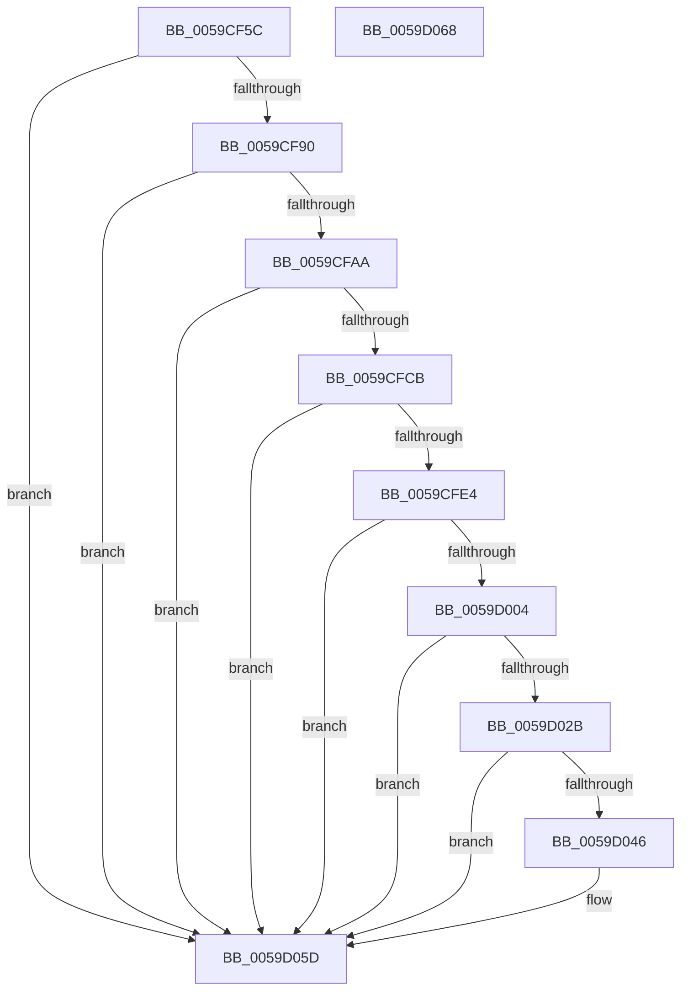

# IopLiveDumpMarkProcessorData

- RVA: `0x0059CF5C`–`0x0059D069` (길이 `269` bytes)
- VA: `0x000000014059CF5C`
- 실행 섹션: `.text`
- PDB 이름 있음: `예`; PDB Function 태그: `아니요`
- unwind 정보 RVA: `0x0005CAAC`
- 디코드: `61`개 명령, `269/269` bytes 표시
- 미해석 바이트: `0` (있으면 어셈블리에 `.byte`로 보존)

> 이 문서는 커널 이미지의 기계어와 PDB 기호를 분석해 생성했습니다. 4번과 5번은 함수 원형과 자료형을 바이너리 사용 방식에서 추정한 C 해석이며 원본 소스 복구 결과는 아닙니다.

## 1. Dependencies

- 직접 호출 지점: **8**; 고유 호출 대상: **1**
- 직접 호출자로 확인된 함수: **1**
- RIP 상대 이미지 참조: **1**

### Outgoing calls
- `0x0059CF83` → [MmAddRangeToCrashDump](../67/MmAddRangeToCrashDump_function_0067D8B0.md) (function, `0x0067D8B0`)
- `0x0059CF9D` → [MmAddRangeToCrashDump](../67/MmAddRangeToCrashDump_function_0067D8B0.md) (function, `0x0067D8B0`)
- `0x0059CFBE` → [MmAddRangeToCrashDump](../67/MmAddRangeToCrashDump_function_0067D8B0.md) (function, `0x0067D8B0`)
- `0x0059CFDB` → [MmAddRangeToCrashDump](../67/MmAddRangeToCrashDump_function_0067D8B0.md) (function, `0x0067D8B0`)
- `0x0059CFFB` → [MmAddRangeToCrashDump](../67/MmAddRangeToCrashDump_function_0067D8B0.md) (function, `0x0067D8B0`)
- `0x0059D022` → [MmAddRangeToCrashDump](../67/MmAddRangeToCrashDump_function_0067D8B0.md) (function, `0x0067D8B0`)
- `0x0059D03D` → [MmAddRangeToCrashDump](../67/MmAddRangeToCrashDump_function_0067D8B0.md) (function, `0x0067D8B0`)
- `0x0059D058` → [MmAddRangeToCrashDump](../67/MmAddRangeToCrashDump_function_0067D8B0.md) (function, `0x0067D8B0`)

### Direct callers
- [IopLiveDumpMarkRequiredDumpData](IopLiveDumpMarkRequiredDumpData_function_0059D070.md) at `0x0059D15E`

### Static image references
- `0x0059CF68` → RVA `0x00FC8C40` (`ALMOSTRO`; read)

## 2. Other-region calls and transfers

- 다른 실행 섹션으로 향하는 call: **0**
- 별도 외부 분기/꼬리 이동을 확인하지 못했습니다.

## 3. Assembly (complete function range)

```asm
0059CF5C  48 89 5C 24 08                  mov qword ptr [rsp + 8], rbx
0059CF61  57                              push rdi
0059CF62  48 83 EC 20                     sub rsp, 0x20
0059CF66  8B C2                           mov eax, edx
0059CF68  48 8D 1D D1 BC A2 00            lea rbx, [rip + 0xa2bcd1]
0059CF6F  41 B8 80 D0 00 00               mov r8d, 0xd080
0059CF75  48 8B F9                        mov rdi, rcx
0059CF78  48 8B 1C C3                     mov rbx, qword ptr [rbx + rax*8]
0059CF7C  48 8D 93 80 FE FF FF            lea rdx, [rbx - 0x180]
0059CF83  E8 28 09 0E 00                  call 0x14067d8b0
0059CF88  85 C0                           test eax, eax
0059CF8A  0F 88 CD 00 00 00               js 0x14059d05d
0059CF90  48 8B 53 08                     mov rdx, qword ptr [rbx + 8]
0059CF94  41 B8 98 07 00 00               mov r8d, 0x798
0059CF9A  48 8B CF                        mov rcx, rdi
0059CF9D  E8 0E 09 0E 00                  call 0x14067d8b0
0059CFA2  85 C0                           test eax, eax
0059CFA4  0F 88 B3 00 00 00               js 0x14059d05d
0059CFAA  48 8B 43 08                     mov rax, qword ptr [rbx + 8]
0059CFAE  41 B8 40 08 00 00               mov r8d, 0x840
0059CFB4  48 8B CF                        mov rcx, rdi
0059CFB7  48 8B 90 B8 00 00 00            mov rdx, qword ptr [rax + 0xb8]
0059CFBE  E8 ED 08 0E 00                  call 0x14067d8b0
0059CFC3  85 C0                           test eax, eax
0059CFC5  0F 88 92 00 00 00               js 0x14059d05d
0059CFCB  48 8B 93 C0 8F 00 00            mov rdx, qword ptr [rbx + 0x8fc0]
0059CFD2  41 B8 D0 04 00 00               mov r8d, 0x4d0
0059CFD8  48 8B CF                        mov rcx, rdi
0059CFDB  E8 D0 08 0E 00                  call 0x14067d8b0
0059CFE0  85 C0                           test eax, eax
0059CFE2  78 79                           js 0x14059d05d
0059CFE4  48 8B 83 C0 8F 00 00            mov rax, qword ptr [rbx + 0x8fc0]
0059CFEB  41 B8 00 20 00 00               mov r8d, 0x2000
0059CFF1  48 8B CF                        mov rcx, rdi
0059CFF4  48 8B 90 98 00 00 00            mov rdx, qword ptr [rax + 0x98]
0059CFFB  E8 B0 08 0E 00                  call 0x14067d8b0
0059D000  85 C0                           test eax, eax
0059D002  78 59                           js 0x14059d05d
0059D004  48 8B 83 C0 8F 00 00            mov rax, qword ptr [rbx + 0x8fc0]
0059D00B  41 B8 00 20 00 00               mov r8d, 0x2000
0059D011  48 8B CF                        mov rcx, rdi
0059D014  48 8B 90 F8 00 00 00            mov rdx, qword ptr [rax + 0xf8]
0059D01B  48 81 EA 00 10 00 00            sub rdx, 0x1000
0059D022  E8 89 08 0E 00                  call 0x14067d8b0
0059D027  85 C0                           test eax, eax
0059D029  78 32                           js 0x14059d05d
0059D02B  48 8B 93 58 01 00 00            mov rdx, qword ptr [rbx + 0x158]
0059D032  48 8B CF                        mov rcx, rdi
0059D035  44 0F B7 83 56 01 00 00         movzx r8d, word ptr [rbx + 0x156]
0059D03D  E8 6E 08 0E 00                  call 0x14067d8b0
0059D042  85 C0                           test eax, eax
0059D044  78 17                           js 0x14059d05d
0059D046  48 8B 93 68 01 00 00            mov rdx, qword ptr [rbx + 0x168]
0059D04D  48 8B CF                        mov rcx, rdi
0059D050  44 0F B7 83 66 01 00 00         movzx r8d, word ptr [rbx + 0x166]
0059D058  E8 53 08 0E 00                  call 0x14067d8b0
0059D05D  48 8B 5C 24 30                  mov rbx, qword ptr [rsp + 0x30]
0059D062  48 83 C4 20                     add rsp, 0x20
0059D066  5F                              pop rdi
0059D067  C3                              ret
0059D068  CC                              int3
```

## 4. C-style interpretation (structured pseudocode)

```c
__int64 __fastcall IopLiveDumpMarkProcessorData(__int64 a1, int a2)
{
    __int64 result;
    __int64 v_rsp;
    unsigned __int64 v_stack_p8;

    v_stack_p8 = v_rbx;
    v_rsp = (v_rsp) - (32);
    result = MmAddRangeToCrashDump(a1, *(unsigned __int64 *)(v_rip + 10665169 + (unsigned int)(a2) * 8) - 384, (unsigned int)(0xD080ULL), a4);
    if (sign_flag) goto loc_0059D05D;
    result = MmAddRangeToCrashDump(a1, *(unsigned __int64 *)(*(unsigned __int64 *)(v_rip + 10665169 + (unsigned int)(a2) * 8) + 8), (unsigned int)(0x798ULL), a4);
    if (sign_flag) goto loc_0059D05D;
    result = MmAddRangeToCrashDump(a1, *(unsigned __int64 *)(*(unsigned __int64 *)(*(unsigned __int64 *)(v_rip + 10665169 + (unsigned int)(a2) * 8) + 8) + 184), (unsigned int)(0x840ULL), a4);
    if (sign_flag) goto loc_0059D05D;
    result = MmAddRangeToCrashDump(a1, *(unsigned __int64 *)(*(unsigned __int64 *)(v_rip + 10665169 + (unsigned int)(a2) * 8) + 36800), (unsigned int)(0x4D0ULL), a4);
    if (sign_flag) goto loc_0059D05D;
    result = MmAddRangeToCrashDump(a1, *(unsigned __int64 *)(*(unsigned __int64 *)(*(unsigned __int64 *)(v_rip + 10665169 + (unsigned int)(a2) * 8) + 36800) + 152), (unsigned int)(0x2000ULL), a4);
    if (sign_flag) goto loc_0059D05D;
    a2 = (*(unsigned __int64 *)(*(unsigned __int64 *)(*(unsigned __int64 *)(v_rip + 10665169 + (unsigned int)(a2) * 8) + 36800) + 248)) - (0x1000ULL);
    result = MmAddRangeToCrashDump(a1, a2, (unsigned int)(0x2000ULL), a4);
    if (sign_flag) goto loc_0059D05D;
    result = MmAddRangeToCrashDump(a1, *(unsigned __int64 *)(*(unsigned __int64 *)(v_rip + 10665169 + (unsigned int)(a2) * 8) + 344), *(unsigned __int16 *)(*(unsigned __int64 *)(v_rip + 10665169 + (unsigned int)(a2) * 8) + 342), a4);
    if (!(sign_flag)) {
        a2 = *(unsigned __int64 *)(*(unsigned __int64 *)(v_rip + 10665169 + (unsigned int)(a2) * 8) + 360);
        a1 = a1;
        a3 = *(unsigned __int16 *)(*(unsigned __int64 *)(v_rip + 10665169 + (unsigned int)(a2) * 8) + 358);
        result = MmAddRangeToCrashDump(a1, a2, a3, a4);
    }
    v_rsp = (v_rsp) + (32);
    return result;
}
```

## 5. (Beta) C Style

```c
int64_t IopLiveDumpMarkProcessorData(int64_t Arg1, int32_t Arg2)
{
    int64_t result;
    int64_t local_rsp;
    uint64_t v_stack_p8;

    v_stack_p8 = local_rbx;
    local_rsp = (local_rsp) - (32);
    result = MmAddRangeToCrashDump(Arg1, *(uint64_t *)(v_rip + 0xA2BCD1 + (uint32_t)(Arg2) * 8) - 384, (uint32_t)(0xD080ULL), a4);
    if (sign_flag) goto loc_0059D05D;
    result = MmAddRangeToCrashDump(Arg1, *(uint64_t *)(*(uint64_t *)(v_rip + 0xA2BCD1 + (uint32_t)(Arg2) * 8) + 0x8), (uint32_t)(0x798ULL), a4);
    if (sign_flag) goto loc_0059D05D;
    result = MmAddRangeToCrashDump(Arg1, *(uint64_t *)(*(uint64_t *)(*(uint64_t *)(v_rip + 0xA2BCD1 + (uint32_t)(Arg2) * 8) + 0x8) + 0xB8), (uint32_t)(0x840ULL), a4);
    if (sign_flag) goto loc_0059D05D;
    result = MmAddRangeToCrashDump(Arg1, *(uint64_t *)(*(uint64_t *)(v_rip + 0xA2BCD1 + (uint32_t)(Arg2) * 8) + 0x8FC0), (uint32_t)(0x4D0ULL), a4);
    if (sign_flag) goto loc_0059D05D;
    result = MmAddRangeToCrashDump(Arg1, *(uint64_t *)(*(uint64_t *)(*(uint64_t *)(v_rip + 0xA2BCD1 + (uint32_t)(Arg2) * 8) + 0x8FC0) + 0x98), (uint32_t)(0x2000ULL), a4);
    if (sign_flag) goto loc_0059D05D;
    Arg2 = (*(uint64_t *)(*(uint64_t *)(*(uint64_t *)(v_rip + 0xA2BCD1 + (uint32_t)(Arg2) * 8) + 0x8FC0) + 0xF8)) - (0x1000ULL);
    result = MmAddRangeToCrashDump(Arg1, Arg2, (uint32_t)(0x2000ULL), a4);
    if (sign_flag) goto loc_0059D05D;
    result = MmAddRangeToCrashDump(Arg1, *(uint64_t *)(*(uint64_t *)(v_rip + 0xA2BCD1 + (uint32_t)(Arg2) * 8) + 0x158), *(uint16_t *)(*(uint64_t *)(v_rip + 0xA2BCD1 + (uint32_t)(Arg2) * 8) + 0x156), a4);
    if (!(sign_flag)) {
        Arg2 = *(uint64_t *)(*(uint64_t *)(v_rip + 0xA2BCD1 + (uint32_t)(Arg2) * 8) + 0x168);
        Arg1 = Arg1;
        a3 = *(uint16_t *)(*(uint64_t *)(v_rip + 0xA2BCD1 + (uint32_t)(Arg2) * 8) + 0x166);
        result = MmAddRangeToCrashDump(Arg1, Arg2, a3, a4);
    }
    local_rsp = (local_rsp) + (32);
    return result;
}
```

## 6. Execution-region graph

[열기: 2D/3D 그래프와 함수 탐색 컨트롤 패널](../../../control-panel.html?section=text&rva=0x0059CF5C&view=graph)

- 2D 그래프는 위에서 아래로 흐르고, 3D 그래프는 빈 공간을 드래그해 회전합니다. Shift+드래그는 이동, 휠은 확대·축소, 함수 노드 선택은 대상 보고서 이동입니다.

### Static fallback


