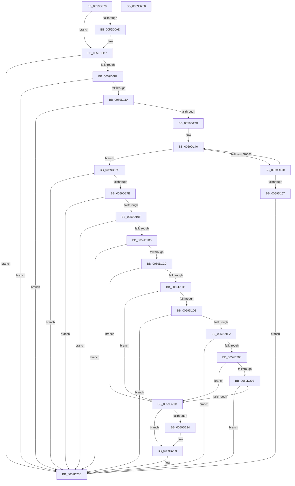

# IopLiveDumpMarkRequiredDumpData

- RVA: `0x0059D070`–`0x0059D251` (길이 `481` bytes)
- VA: `0x000000014059D070`
- 실행 섹션: `.text`
- PDB 이름 있음: `예`; PDB Function 태그: `아니요`
- unwind 정보 RVA: `0x000C7C04`
- 디코드: `127`개 명령, `481/481` bytes 표시
- 미해석 바이트: `0` (있으면 어셈블리에 `.byte`로 보존)

> 이 문서는 커널 이미지의 기계어와 PDB 기호를 분석해 생성했습니다. 4번과 5번은 함수 원형과 자료형을 바이너리 사용 방식에서 추정한 C 해석이며 원본 소스 복구 결과는 아닙니다.

## 1. Dependencies

- 직접 호출 지점: **15**; 고유 호출 대상: **8**
- 직접 호출자로 확인된 함수: **1**
- RIP 상대 이미지 참조: **6**

### Outgoing calls
- `0x0059D0AF` → [IopLiveDumpGetMillisecondCounter](../3F/IopLiveDumpGetMillisecondCounter_function_003F5964.md) (function, `0x003F5964`)
- `0x0059D0EA` → [MmAddRangeToCrashDump](../67/MmAddRangeToCrashDump_function_0067D8B0.md) (function, `0x0067D8B0`)
- `0x0059D10D` → [MmAddRangeToCrashDump](../67/MmAddRangeToCrashDump_function_0067D8B0.md) (function, `0x0067D8B0`)
- `0x0059D11E` → [IopLiveDumpMarkLoadedModuleList](IopLiveDumpMarkLoadedModuleList_function_0059CE1C.md) (function, `0x0059CE1C`)
- `0x0059D14E` → [KeEnumerateNextProcessor](../41/KeEnumerateNextProcessor_function_00415480.md) (function, `0x00415480`)
- `0x0059D15E` → [IopLiveDumpMarkProcessorData](IopLiveDumpMarkProcessorData_function_0059CF5C.md) (function, `0x0059CF5C`)
- `0x0059D171` → [MmAddPrivateDataToCrashDump](../67/MmAddPrivateDataToCrashDump_function_0067D794.md) (function, `0x0067D794`)
- `0x0059D192` → [MmAddRangeToCrashDump](../67/MmAddRangeToCrashDump_function_0067D8B0.md) (function, `0x0067D8B0`)
- `0x0059D1A8` → [MmAddPrivateDataToCrashDump](../67/MmAddPrivateDataToCrashDump_function_0067D794.md) (function, `0x0067D794`)
- `0x0059D1BE` → [MmAddPrivateDataToCrashDump](../67/MmAddPrivateDataToCrashDump_function_0067D794.md) (function, `0x0067D794`)
- `0x0059D1E9` → [MmAddRangeToCrashDump](../67/MmAddRangeToCrashDump_function_0067D8B0.md) (function, `0x0067D8B0`)
- `0x0059D1FA` → [IopLiveDumpMarkDeviceNode](IopLiveDumpMarkDeviceNode_function_0059CC44.md) (function, `0x0059CC44`)
- `0x0059D212` → [IopLiveDumpMarkDeviceNode](IopLiveDumpMarkDeviceNode_function_0059CC44.md) (function, `0x0059CC44`)
- `0x0059D226` → [IopLiveDumpGetMillisecondCounter](../3F/IopLiveDumpGetMillisecondCounter_function_003F5964.md) (function, `0x003F5964`)
- `0x0059D234` → [IopLiveDumpTraceMarkRequiredDumpDataDuration](IopLiveDumpTraceMarkRequiredDumpDataDuration_function_0059EF80.md) (function, `0x0059EF80`)

### Direct callers
- [IopLiveDumpCollectPages](IopLiveDumpCollectPages_function_0059B328.md) at `0x0059B51C`

### Static image references
- `0x0059D0C6` → RVA `0x005931F0` (`IoSetDumpRange`; read)
- `0x0059D0DF` → RVA `0x00E01060` (`.data`; read)
- `0x0059D0F7` → RVA `0x00FC6A80` (`ALMOSTRO`; read)
- `0x0059D0FE` → RVA `0x00FC8C40` (`ALMOSTRO`; read)
- `0x0059D12B` → RVA `0x00FC7128` (`ALMOSTRO`; read)
- `0x0059D136` → RVA `0x00FC7120` (`ALMOSTRO`; read)

## 2. Other-region calls and transfers

- 다른 실행 섹션으로 향하는 call: **0**
- 별도 외부 분기/꼬리 이동을 확인하지 못했습니다.

## 3. Assembly (complete function range)

```asm
0059D070  48 89 5C 24 10                  mov qword ptr [rsp + 0x10], rbx
0059D075  48 89 74 24 18                  mov qword ptr [rsp + 0x18], rsi
0059D07A  55                              push rbp
0059D07B  57                              push rdi
0059D07C  41 56                           push r14
0059D07E  48 8B EC                        mov rbp, rsp
0059D081  48 83 EC 70                     sub rsp, 0x70
0059D085  8B 41 50                        mov eax, dword ptr [rcx + 0x50]
0059D088  45 33 F6                        xor r14d, r14d
0059D08B  4C 89 75 E0                     mov qword ptr [rbp - 0x20], r14
0059D08F  48 8B DA                        mov rbx, rdx
0059D092  4C 89 75 F0                     mov qword ptr [rbp - 0x10], r14
0059D096  48 8B F9                        mov rdi, rcx
0059D099  44 89 75 C2                     mov dword ptr [rbp - 0x3e], r14d
0059D09D  41 8B F6                        mov esi, r14d
0059D0A0  66 44 89 75 C6                  mov word ptr [rbp - 0x3a], r14w
0059D0A5  44 89 75 20                     mov dword ptr [rbp + 0x20], r14d
0059D0A9  84 C0                           test al, al
0059D0AB  79 0A                           jns 0x14059d0b7
0059D0AD  33 C9                           xor ecx, ecx
0059D0AF  E8 B0 88 E5 FF                  call 0x1403f5964
0059D0B4  48 8B F0                        mov rsi, rax
0059D0B7  83 4D F0 01                     or dword ptr [rbp - 0x10], 1
0059D0BB  48 8D 8F 20 02 00 00            lea rcx, [rdi + 0x220]
0059D0C2  48 89 4D D8                     mov qword ptr [rbp - 0x28], rcx
0059D0C6  48 8D 05 23 61 FF FF            lea rax, [rip - 0x9edd]
0059D0CD  48 8D 4D C8                     lea rcx, [rbp - 0x38]
0059D0D1  48 89 5D E8                     mov qword ptr [rbp - 0x18], rbx
0059D0D5  41 B8 A0 03 00 00               mov r8d, 0x3a0
0059D0DB  48 89 45 C8                     mov qword ptr [rbp - 0x38], rax
0059D0DF  48 8D 15 7A 3F 86 00            lea rdx, [rip + 0x863f7a]
0059D0E6  4C 89 75 D0                     mov qword ptr [rbp - 0x30], r14
0059D0EA  E8 C1 07 0E 00                  call 0x14067d8b0
0059D0EF  85 C0                           test eax, eax
0059D0F1  0F 88 44 01 00 00               js 0x14059d23b
0059D0F7  44 8B 05 82 99 A2 00            mov r8d, dword ptr [rip + 0xa29982]
0059D0FE  48 8D 15 3B BB A2 00            lea rdx, [rip + 0xa2bb3b]
0059D105  49 C1 E0 03                     shl r8, 3
0059D109  48 8D 4D C8                     lea rcx, [rbp - 0x38]
0059D10D  E8 9E 07 0E 00                  call 0x14067d8b0
0059D112  85 C0                           test eax, eax
0059D114  0F 88 21 01 00 00               js 0x14059d23b
0059D11A  48 8D 4D C8                     lea rcx, [rbp - 0x38]
0059D11E  E8 F9 FC FF FF                  call 0x14059ce1c
0059D123  85 C0                           test eax, eax
0059D125  0F 88 10 01 00 00               js 0x14059d23b
0059D12B  48 8B 05 F6 9F A2 00            mov rax, qword ptr [rip + 0xa29ff6]
0059D132  48 89 45 B8                     mov qword ptr [rbp - 0x48], rax
0059D136  48 8D 05 E3 9F A2 00            lea rax, [rip + 0xa29fe3]
0059D13D  48 89 45 B0                     mov qword ptr [rbp - 0x50], rax
0059D141  66 44 89 75 C0                  mov word ptr [rbp - 0x40], r14w
0059D146  48 8D 55 B0                     lea rdx, [rbp - 0x50]
0059D14A  48 8D 4D 20                     lea rcx, [rbp + 0x20]
0059D14E  E8 2D 83 E7 FF                  call 0x140415480
0059D153  48 8D 4D C8                     lea rcx, [rbp - 0x38]
0059D157  85 C0                           test eax, eax
0059D159  75 11                           jne 0x14059d16c
0059D15B  8B 55 20                        mov edx, dword ptr [rbp + 0x20]
0059D15E  E8 F9 FD FF FF                  call 0x14059cf5c
0059D163  85 C0                           test eax, eax
0059D165  79 DF                           jns 0x14059d146
0059D167  E9 CF 00 00 00                  jmp 0x14059d23b
0059D16C  BA 02 00 00 00                  mov edx, 2
0059D171  E8 1E 06 0E 00                  call 0x14067d794
0059D176  85 C0                           test eax, eax
0059D178  0F 88 BD 00 00 00               js 0x14059d23b
0059D17E  48 BA 00 00 00 00 80 F7 FF FF   movabs rdx, 0xfffff78000000000
0059D188  48 8D 4D C8                     lea rcx, [rbp - 0x38]
0059D18C  41 B8 80 0A 00 00               mov r8d, 0xa80
0059D192  E8 19 07 0E 00                  call 0x14067d8b0
0059D197  85 C0                           test eax, eax
0059D199  0F 88 9C 00 00 00               js 0x14059d23b
0059D19F  BA 04 00 00 00                  mov edx, 4
0059D1A4  48 8D 4D C8                     lea rcx, [rbp - 0x38]
0059D1A8  E8 E7 05 0E 00                  call 0x14067d794
0059D1AD  85 C0                           test eax, eax
0059D1AF  0F 88 86 00 00 00               js 0x14059d23b
0059D1B5  BA 08 00 00 00                  mov edx, 8
0059D1BA  48 8D 4D C8                     lea rcx, [rbp - 0x38]
0059D1BE  E8 D1 05 0E 00                  call 0x14067d794
0059D1C3  8B D8                           mov ebx, eax
0059D1C5  85 C0                           test eax, eax
0059D1C7  78 72                           js 0x14059d23b
0059D1C9  81 3F 5F 01 00 00               cmp dword ptr [rdi], 0x15f
0059D1CF  75 4C                           jne 0x14059d21d
0059D1D1  48 83 7F 08 02                  cmp qword ptr [rdi + 8], 2
0059D1D6  75 45                           jne 0x14059d21d
0059D1D8  48 8B 5F 10                     mov rbx, qword ptr [rdi + 0x10]
0059D1DC  48 8D 4D C8                     lea rcx, [rbp - 0x38]
0059D1E0  48 8B D3                        mov rdx, rbx
0059D1E3  41 B8 38 00 00 00               mov r8d, 0x38
0059D1E9  E8 C2 06 0E 00                  call 0x14067d8b0
0059D1EE  85 C0                           test eax, eax
0059D1F0  78 49                           js 0x14059d23b
0059D1F2  48 8B 53 30                     mov rdx, qword ptr [rbx + 0x30]
0059D1F6  48 8D 4D C8                     lea rcx, [rbp - 0x38]
0059D1FA  E8 45 FA FF FF                  call 0x14059cc44
0059D1FF  8B D8                           mov ebx, eax
0059D201  85 C0                           test eax, eax
0059D203  78 36                           js 0x14059d23b
0059D205  48 8B 57 20                     mov rdx, qword ptr [rdi + 0x20]
0059D209  48 85 D2                        test rdx, rdx
0059D20C  74 0F                           je 0x14059d21d
0059D20E  48 8D 4D C8                     lea rcx, [rbp - 0x38]
0059D212  E8 2D FA FF FF                  call 0x14059cc44
0059D217  8B D8                           mov ebx, eax
0059D219  85 C0                           test eax, eax
0059D21B  78 1E                           js 0x14059d23b
0059D21D  8B 47 50                        mov eax, dword ptr [rdi + 0x50]
0059D220  84 C0                           test al, al
0059D222  79 15                           jns 0x14059d239
0059D224  33 C9                           xor ecx, ecx
0059D226  E8 39 87 E5 FF                  call 0x1403f5964
0059D22B  48 2B C6                        sub rax, rsi
0059D22E  48 8B CF                        mov rcx, rdi
0059D231  48 8B D0                        mov rdx, rax
0059D234  E8 47 1D 00 00                  call 0x14059ef80
0059D239  8B C3                           mov eax, ebx
0059D23B  4C 8D 5C 24 70                  lea r11, [rsp + 0x70]
0059D240  49 8B 5B 28                     mov rbx, qword ptr [r11 + 0x28]
0059D244  49 8B 73 30                     mov rsi, qword ptr [r11 + 0x30]
0059D248  49 8B E3                        mov rsp, r11
0059D24B  41 5E                           pop r14
0059D24D  5F                              pop rdi
0059D24E  5D                              pop rbp
0059D24F  C3                              ret
0059D250  CC                              int3
```

## 4. C-style interpretation (structured pseudocode)

```c
__int64 __fastcall IopLiveDumpMarkRequiredDumpData(__int64 a1, __int64 a2)
{
    __int64 result;
    __int64 v_r14;
    __int64 v_rsi;
    __int64 v_rsp;
    unsigned __int64 v_stack_m18;
    unsigned __int64 v_stack_m28;
    unsigned __int64 v_stack_m30;
    unsigned __int64 v_stack_m38;
    unsigned __int64 v_stack_m40;
    unsigned __int64 v_stack_m48;
    unsigned __int64 v_stack_m50;
    unsigned __int16 v_stack_m52;
    unsigned int v_stack_m56;
    unsigned __int16 v_stack_m58;
    unsigned __int64 v_stack_m60;
    unsigned __int64 v_stack_m68;
    unsigned __int64 v_stack_p10;
    unsigned __int64 v_stack_p18;
    unsigned int v_stack_p8;

    v_stack_p10 = v_rbx;
    v_stack_p18 = v_rsi;
    v_rsp = (v_rsp) - (112);
    v_r14 = 0;
    v_stack_m38 = 0;
    v_stack_m28 = 0;
    v_stack_m56 = 0;
    v_stack_m52 = 0;
    v_stack_p8 = 0;
    result = (unsigned int)(*(unsigned int *)(a1 + 80));
    v_rsi = 0;
    if (sign_flag) {
        a1 = 0;
        result = IopLiveDumpGetMillisecondCounter(a1, a2, a3, a4);
        v_rsi = result;
    }
    v_stack_m40 = a1 + 544;
    v_stack_m30 = a2;
    v_stack_m50 = v_rip - 40669;
    v_stack_m48 = 0;
    result = MmAddRangeToCrashDump(v_stack_m50, v_rip + 8798074, 928, a4);
    if (sign_flag) goto loc_0059D23B;
    a3 = ((unsigned int)(*(unsigned int *)(v_rip + 10656130))) << (3);
    result = MmAddRangeToCrashDump(v_stack_m50, v_rip + 10664763, a3, a4);
    if (sign_flag) goto loc_0059D23B;
    result = IopLiveDumpMarkLoadedModuleList(v_stack_m50, v_rip + 10664763, a3, a4);
    if (sign_flag) goto loc_0059D23B;
    v_stack_m60 = *(unsigned __int64 *)(v_rip + 10657782);
    v_stack_m68 = v_rip + 10657763;
    v_stack_m58 = 0;
loc_0059D146:
    result = KeEnumerateNextProcessor(v_stack_p8, v_stack_m68, a3, a4);
    if ((unsigned int)(result) != 0) goto loc_0059D16C;
    result = IopLiveDumpMarkProcessorData(v_stack_m50, (unsigned int)(v_stack_p8), a3, a4);
    if (!sign_flag) goto loc_0059D146;
    goto loc_0059D23B;
loc_0059D16C:
    result = MmAddPrivateDataToCrashDump(v_stack_m50, 2, a3, a4);
    if (sign_flag) goto loc_0059D23B;
    result = MmAddRangeToCrashDump(v_stack_m50, 2, (unsigned int)(0xA80ULL), a4);
    if (sign_flag) goto loc_0059D23B;
    result = MmAddPrivateDataToCrashDump(v_stack_m50, 4, (unsigned int)(0xA80ULL), a4);
    if (sign_flag) goto loc_0059D23B;
    result = MmAddPrivateDataToCrashDump(v_stack_m50, 8, (unsigned int)(0xA80ULL), a4);
    if (sign_flag) goto loc_0059D23B;
    if ((*(unsigned int *)(a1)) != 351) goto loc_0059D21D;
    if ((*(unsigned __int64 *)(a1 + 8)) != 2) goto loc_0059D21D;
    result = MmAddRangeToCrashDump(v_stack_m50, *(unsigned __int64 *)(a1 + 16), 56, a4);
    if (sign_flag) goto loc_0059D23B;
    result = IopLiveDumpMarkDeviceNode(v_stack_m50, *(unsigned __int64 *)(*(unsigned __int64 *)(a1 + 16) + 48), 56, a4);
    if (sign_flag) goto loc_0059D23B;
    if (*(unsigned __int64 *)(a1 + 32) == 0) goto loc_0059D21D;
    result = IopLiveDumpMarkDeviceNode(v_stack_m50, *(unsigned __int64 *)(a1 + 32), 56, a4);
    if (sign_flag) goto loc_0059D23B;
loc_0059D21D:
    result = (unsigned int)(*(unsigned int *)(a1 + 80));
    if (sign_flag) {
        a1 = 0;
        result = IopLiveDumpGetMillisecondCounter(a1, *(unsigned __int64 *)(a1 + 32), 56, a4);
        result = (result) - (v_rsi);
        a1 = 0;
        a2 = result;
        result = IopLiveDumpTraceMarkRequiredDumpDataDuration(a1, a2, 56, a4);
    }
loc_0059D23B:
    return (unsigned int)((unsigned int)((unsigned int)((unsigned int)(result))));
}
```

## 5. (Beta) C Style

```c
int64_t IopLiveDumpMarkRequiredDumpData(void *Arg1, int64_t Arg2)
{
    uint8_t *arg1 = (uint8_t *)Arg1;

    int64_t result;
    int64_t local_r14;
    int64_t local_rsi;
    int64_t local_rsp;
    uint64_t v_stack_m18;
    uint64_t v_stack_m28;
    uint64_t v_stack_m30;
    uint64_t v_stack_m38;
    uint64_t v_stack_m40;
    uint64_t v_stack_m48;
    uint64_t v_stack_m50;
    uint16_t v_stack_m52;
    uint32_t v_stack_m56;
    uint16_t v_stack_m58;
    uint64_t v_stack_m60;
    uint64_t v_stack_m68;
    uint64_t v_stack_p10;
    uint64_t v_stack_p18;
    uint32_t v_stack_p8;

    v_stack_p10 = local_rbx;
    v_stack_p18 = local_rsi;
    local_rsp = (local_rsp) - (112);
    local_r14 = 0;
    v_stack_m38 = 0;
    v_stack_m28 = 0;
    v_stack_m56 = 0;
    v_stack_m52 = 0;
    v_stack_p8 = 0;
    result = (uint32_t)(*(uint32_t *)(arg1 + 0x50));
    local_rsi = 0;
    if (sign_flag) {
        Arg1 = 0;
        result = IopLiveDumpGetMillisecondCounter(Arg1, Arg2, a3, a4);
        local_rsi = result;
    }
    v_stack_m40 = Arg1 + 544;
    v_stack_m30 = Arg2;
    v_stack_m50 = v_rip - 40669;
    v_stack_m48 = 0;
    result = MmAddRangeToCrashDump(v_stack_m50, v_rip + 8798074, 928, a4);
    if (sign_flag) goto loc_0059D23B;
    a3 = ((uint32_t)(*(uint32_t *)(v_rip + 0xA29982))) << (3);
    result = MmAddRangeToCrashDump(v_stack_m50, v_rip + 10664763, a3, a4);
    if (sign_flag) goto loc_0059D23B;
    result = IopLiveDumpMarkLoadedModuleList(v_stack_m50, v_rip + 10664763, a3, a4);
    if (sign_flag) goto loc_0059D23B;
    v_stack_m60 = *(uint64_t *)(v_rip + 0xA29FF6);
    v_stack_m68 = v_rip + 10657763;
    v_stack_m58 = 0;
loc_0059D146:
    result = KeEnumerateNextProcessor(v_stack_p8, v_stack_m68, a3, a4);
    if ((uint32_t)(result) != 0) goto loc_0059D16C;
    result = IopLiveDumpMarkProcessorData(v_stack_m50, (uint32_t)(v_stack_p8), a3, a4);
    if (!sign_flag) goto loc_0059D146;
    goto loc_0059D23B;
loc_0059D16C:
    result = MmAddPrivateDataToCrashDump(v_stack_m50, 2, a3, a4);
    if (sign_flag) goto loc_0059D23B;
    result = MmAddRangeToCrashDump(v_stack_m50, 2, (uint32_t)(0xA80ULL), a4);
    if (sign_flag) goto loc_0059D23B;
    result = MmAddPrivateDataToCrashDump(v_stack_m50, 4, (uint32_t)(0xA80ULL), a4);
    if (sign_flag) goto loc_0059D23B;
    result = MmAddPrivateDataToCrashDump(v_stack_m50, 8, (uint32_t)(0xA80ULL), a4);
    if (sign_flag) goto loc_0059D23B;
    if ((*(uint32_t *)(arg1)) != 351) goto loc_0059D21D;
    if ((*(uint64_t *)(arg1 + 0x8)) != 2) goto loc_0059D21D;
    result = MmAddRangeToCrashDump(v_stack_m50, *(uint64_t *)(arg1 + 0x10), 56, a4);
    if (sign_flag) goto loc_0059D23B;
    result = IopLiveDumpMarkDeviceNode(v_stack_m50, *(uint64_t *)(*(uint64_t *)(arg1 + 0x10) + 0x30), 56, a4);
    if (sign_flag) goto loc_0059D23B;
    if (*(uint64_t *)(arg1 + 0x20) == 0) goto loc_0059D21D;
    result = IopLiveDumpMarkDeviceNode(v_stack_m50, *(uint64_t *)(arg1 + 0x20), 56, a4);
    if (sign_flag) goto loc_0059D23B;
loc_0059D21D:
    result = (uint32_t)(*(uint32_t *)(arg1 + 0x50));
    if (sign_flag) {
        Arg1 = 0;
        result = IopLiveDumpGetMillisecondCounter(Arg1, *(uint64_t *)(arg1 + 0x20), 56, a4);
        result = (result) - (local_rsi);
        Arg1 = 0;
        Arg2 = result;
        result = IopLiveDumpTraceMarkRequiredDumpDataDuration(Arg1, Arg2, 56, a4);
    }
loc_0059D23B:
    return (uint32_t)((uint32_t)((uint32_t)((uint32_t)(result))));
}
```

### 관측된 메모리 오프셋

구조체 형식이 확인되지 않은 접근은 인자 기준의 오프셋으로만 기록했습니다.

| 기준 인자 | 오프셋 표현 | 폭 (bit) | 접근 |
|---|---:|---:|---|
| `Arg1` | `+ 0x0` | `32` | `R` |
| `Arg1` | `+ 0x8` | `64` | `R` |
| `Arg1` | `+ 0x10` | `64` | `R` |
| `Arg1` | `+ 0x20` | `64` | `R` |
| `Arg1` | `+ 0x50` | `32` | `R` |
| `Arg1` | `+ 0x220` | `64` | `R` |

## 6. Execution-region graph

[열기: 2D/3D 그래프와 함수 탐색 컨트롤 패널](../../../control-panel.html?section=text&rva=0x0059D070&view=graph)

- 2D 그래프는 위에서 아래로 흐르고, 3D 그래프는 빈 공간을 드래그해 회전합니다. Shift+드래그는 이동, 휠은 확대·축소, 함수 노드 선택은 대상 보고서 이동입니다.

### Static fallback


