# IopLiveDumpMirrorPhysicalMemoryCallback

- RVA: `0x0059D260`–`0x0059D4FF` (길이 `671` bytes)
- VA: `0x000000014059D260`
- 실행 섹션: `.text`
- PDB 이름 있음: `예`; PDB Function 태그: `아니요`
- unwind 정보 RVA: `0x000C7B3C`
- 디코드: `183`개 명령, `671/671` bytes 표시
- 미해석 바이트: `0` (있으면 어셈블리에 `.byte`로 보존)

> 이 문서는 커널 이미지의 기계어와 PDB 기호를 분석해 생성했습니다. 4번과 5번은 함수 원형과 자료형을 바이너리 사용 방식에서 추정한 C 해석이며 원본 소스 복구 결과는 아닙니다.

## 1. Dependencies

- 직접 호출 지점: **5**; 고유 호출 대상: **4**
- 직접 호출자로 확인된 함수: **0**
- RIP 상대 이미지 참조: **1**

### Outgoing calls
- `0x0059D284` → [IopLiveDumpGetMillisecondCounter](../3F/IopLiveDumpGetMillisecondCounter_function_003F5964.md) (function, `0x003F5964`)
- `0x0059D425` → [MmTryIdentifyPage](../67/MmTryIdentifyPage_function_00678738.md) (function, `0x00678738`)
- `0x0059D436` → [IopLiveDumpIsProcessPageIncluded](IopLiveDumpIsProcessPageIncluded_function_0059CB6C.md) (function, `0x0059CB6C`)
- `0x0059D475` → [RtlSetBitsEx](../3B/RtlSetBitsEx_function_003B6570.md) (function, `0x003B6570`)
- `0x0059D4BB` → [IopLiveDumpGetMillisecondCounter](../3F/IopLiveDumpGetMillisecondCounter_function_003F5964.md) (function, `0x003F5964`)

### Direct callers
- 이 함수 시작 RVA로 연결되는 직접 call은 확인되지 않았습니다. 간접 호출은 완전히 역산할 수 없습니다.

### Static image references
- `0x0059D275` → RVA `0x00E66188` (`.data`; read)

## 2. Other-region calls and transfers

- 다른 실행 섹션으로 향하는 call: **0**
- 별도 외부 분기/꼬리 이동을 확인하지 못했습니다.

## 3. Assembly (complete function range)

```asm
0059D260  48 89 54 24 10                  mov qword ptr [rsp + 0x10], rdx
0059D265  53                              push rbx
0059D266  55                              push rbp
0059D267  56                              push rsi
0059D268  57                              push rdi
0059D269  41 54                           push r12
0059D26B  41 55                           push r13
0059D26D  41 56                           push r14
0059D26F  41 57                           push r15
0059D271  48 83 EC 48                     sub rsp, 0x48
0059D275  48 8B 3D 0C 8F 8C 00            mov rdi, qword ptr [rip + 0x8c8f0c]
0059D27C  48 8B E9                        mov rbp, rcx
0059D27F  33 C9                           xor ecx, ecx
0059D281  48 8B DA                        mov rbx, rdx
0059D284  E8 DB 86 E5 FF                  call 0x1403f5964
0059D289  48 C1 ED 0C                     shr rbp, 0xc
0059D28D  BE 00 00 00 00                  mov esi, 0
0059D292  48 F7 C3 FF 0F 00 00            test rbx, 0xfff
0059D299  48 89 44 24 20                  mov qword ptr [rsp + 0x20], rax
0059D29E  48 8B 87 40 02 00 00            mov rax, qword ptr [rdi + 0x240]
0059D2A5  48 8B D3                        mov rdx, rbx
0059D2A8  40 0F 95 C6                     setne sil
0059D2AC  48 C1 FA 0C                     sar rdx, 0xc
0059D2B0  48 03 F2                        add rsi, rdx
0059D2B3  48 8D 4D FF                     lea rcx, [rbp - 1]
0059D2B7  48 03 CE                        add rcx, rsi
0059D2BA  48 89 8C 24 90 00 00 00         mov qword ptr [rsp + 0x90], rcx
0059D2C2  48 3B E8                        cmp rbp, rax
0059D2C5  0F 83 EE 01 00 00               jae 0x14059d4b9
0059D2CB  48 3B C8                        cmp rcx, rax
0059D2CE  72 15                           jb 0x14059d2e5
0059D2D0  48 8D 48 FF                     lea rcx, [rax - 1]
0059D2D4  48 8B F1                        mov rsi, rcx
0059D2D7  48 89 8C 24 90 00 00 00         mov qword ptr [rsp + 0x90], rcx
0059D2DF  48 2B F5                        sub rsi, rbp
0059D2E2  48 FF C6                        inc rsi
0059D2E5  48 85 F6                        test rsi, rsi
0059D2E8  0F 84 CB 01 00 00               je 0x14059d4b9
0059D2EE  48 8B 9C 24 90 00 00 00         mov rbx, qword ptr [rsp + 0x90]
0059D2F6  4C 8B 9F 48 02 00 00            mov r11, qword ptr [rdi + 0x248]
0059D2FD  4C 89 9C 24 A8 00 00 00         mov qword ptr [rsp + 0xa8], r11
0059D305  4C 8D 53 01                     lea r10, [rbx + 1]
0059D309  4C 89 94 24 A0 00 00 00         mov qword ptr [rsp + 0xa0], r10
0059D311  83 A4 24 90 00 00 00 00         and dword ptr [rsp + 0x90], 0
0059D319  45 33 FF                        xor r15d, r15d
0059D31C  4C 3B D5                        cmp r10, rbp
0059D31F  77 08                           ja 0x14059d329
0059D321  4C 8B F5                        mov r14, rbp
0059D324  E9 BE 00 00 00                  jmp 0x14059d3e7
0059D329  48 8B C3                        mov rax, rbx
0059D32C  40 8A CD                        mov cl, bpl
0059D32F  48 C1 E8 06                     shr rax, 6
0059D333  80 E1 3F                        and cl, 0x3f
0059D336  4D 8D 0C C3                     lea r9, [r11 + rax*8]
0059D33A  48 8B C5                        mov rax, rbp
0059D33D  48 C1 E8 06                     shr rax, 6
0059D341  49 8D 14 C3                     lea rdx, [r11 + rax*8]
0059D345  B8 01 00 00 00                  mov eax, 1
0059D34A  4C 8B 02                        mov r8, qword ptr [rdx]
0059D34D  48 D3 E0                        shl rax, cl
0059D350  48 FF C8                        dec rax
0059D353  4C 0B C0                        or r8, rax
0059D356  48 8D 42 08                     lea rax, [rdx + 8]
0059D35A  49 F7 D0                        not r8
0059D35D  4D 85 C0                        test r8, r8
0059D360  75 12                           jne 0x14059d374
0059D362  49 3B C1                        cmp rax, r9
0059D365  77 29                           ja 0x14059d390
0059D367  48 83 C2 08                     add rdx, 8
0059D36B  48 83 C0 08                     add rax, 8
0059D36F  4C 8B 02                        mov r8, qword ptr [rdx]
0059D372  EB E6                           jmp 0x14059d35a
0059D374  49 0F BC C8                     bsf rcx, r8
0059D378  4C 8B F2                        mov r14, rdx
0059D37B  4D 2B F3                        sub r14, r11
0059D37E  8B C1                           mov eax, ecx
0059D380  49 C1 FE 03                     sar r14, 3
0059D384  49 C1 E6 06                     shl r14, 6
0059D388  4C 03 F0                        add r14, rax
0059D38B  4D 3B F2                        cmp r14, r10
0059D38E  76 05                           jbe 0x14059d395
0059D390  4D 8B F2                        mov r14, r10
0059D393  EB 4D                           jmp 0x14059d3e2
0059D395  B8 01 00 00 00                  mov eax, 1
0059D39A  48 D3 E0                        shl rax, cl
0059D39D  48 FF C8                        dec rax
0059D3A0  49 0B C0                        or rax, r8
0059D3A3  48 F7 D0                        not rax
0059D3A6  48 85 C0                        test rax, rax
0059D3A9  75 18                           jne 0x14059d3c3
0059D3AB  48 8D 42 08                     lea rax, [rdx + 8]
0059D3AF  49 3B C1                        cmp rax, r9
0059D3B2  77 08                           ja 0x14059d3bc
0059D3B4  48 8B D0                        mov rdx, rax
0059D3B7  48 8B 00                        mov rax, qword ptr [rax]
0059D3BA  EB EA                           jmp 0x14059d3a6
0059D3BC  B8 40 00 00 00                  mov eax, 0x40
0059D3C1  EB 04                           jmp 0x14059d3c7
0059D3C3  48 0F BC C0                     bsf rax, rax
0059D3C7  4C 8B FA                        mov r15, rdx
0059D3CA  4D 2B FB                        sub r15, r11
0059D3CD  49 C1 FF 03                     sar r15, 3
0059D3D1  49 C1 E7 06                     shl r15, 6
0059D3D5  4C 03 F8                        add r15, rax
0059D3D8  4D 3B FA                        cmp r15, r10
0059D3DB  4D 0F 47 FA                     cmova r15, r10
0059D3DF  4D 2B FE                        sub r15, r14
0059D3E2  4D 85 FF                        test r15, r15
0059D3E5  75 05                           jne 0x14059d3ec
0059D3E7  4C 8B E6                        mov r12, rsi
0059D3EA  EB 06                           jmp 0x14059d3f2
0059D3EC  4D 8B E6                        mov r12, r14
0059D3EF  4C 2B E5                        sub r12, rbp
0059D3F2  4D 85 E4                        test r12, r12
0059D3F5  0F 84 9C 00 00 00               je 0x14059d497
0059D3FB  4D 8B EC                        mov r13, r12
0059D3FE  8B 47 28                        mov eax, dword ptr [rdi + 0x28]
0059D401  A8 04                           test al, 4
0059D403  75 09                           jne 0x14059d40e
0059D405  48 8D 8F 58 02 00 00            lea rcx, [rdi + 0x258]
0059D40C  EB 5E                           jmp 0x14059d46c
0059D40E  0F 57 C0                        xorps xmm0, xmm0
0059D411  48 8D 54 24 28                  lea rdx, [rsp + 0x28]
0059D416  33 C0                           xor eax, eax
0059D418  48 8B CD                        mov rcx, rbp
0059D41B  0F 11 44 24 28                  movups xmmword ptr [rsp + 0x28], xmm0
0059D420  48 89 44 24 38                  mov qword ptr [rsp + 0x38], rax
0059D425  E8 0E B3 0D 00                  call 0x140678738
0059D42A  85 C0                           test eax, eax
0059D42C  74 4C                           je 0x14059d47a
0059D42E  48 8D 54 24 28                  lea rdx, [rsp + 0x28]
0059D433  48 8B CF                        mov rcx, rdi
0059D436  E8 31 F7 FF FF                  call 0x14059cb6c
0059D43B  85 C0                           test eax, eax
0059D43D  74 3B                           je 0x14059d47a
0059D43F  48 8B 44 24 38                  mov rax, qword ptr [rsp + 0x38]
0059D444  48 B9 00 00 00 00 00 80 FF FF   movabs rcx, 0xffff800000000000
0059D44E  48 3B C1                        cmp rax, rcx
0059D451  73 B2                           jae 0x14059d405
0059D453  48 FF C8                        dec rax
0059D456  48 B9 FE FF FE FF FF 7F 00 00   movabs rcx, 0x7ffffffefffe
0059D460  48 3B C1                        cmp rax, rcx
0059D463  77 15                           ja 0x14059d47a
0059D465  48 8D 8F 90 02 00 00            lea rcx, [rdi + 0x290]
0059D46C  41 B8 01 00 00 00               mov r8d, 1
0059D472  48 8B D5                        mov rdx, rbp
0059D475  E8 F6 90 E1 FF                  call 0x1403b6570
0059D47A  48 FF C5                        inc rbp
0059D47D  49 83 ED 01                     sub r13, 1
0059D481  0F 85 77 FF FF FF               jne 0x14059d3fe
0059D487  4C 8B 94 24 A0 00 00 00         mov r10, qword ptr [rsp + 0xa0]
0059D48F  4C 8B 9C 24 A8 00 00 00         mov r11, qword ptr [rsp + 0xa8]
0059D497  4B 8D 04 27                     lea rax, [r15 + r12]
0059D49B  48 3B F0                        cmp rsi, rax
0059D49E  76 11                           jbe 0x14059d4b1
0059D4A0  4B 8D 04 27                     lea rax, [r15 + r12]
0059D4A4  4B 8D 2C 37                     lea rbp, [r15 + r14]
0059D4A8  48 2B F0                        sub rsi, rax
0059D4AB  0F 85 60 FE FF FF               jne 0x14059d311
0059D4B1  48 8B 9C 24 98 00 00 00         mov rbx, qword ptr [rsp + 0x98]
0059D4B9  33 C9                           xor ecx, ecx
0059D4BB  E8 A4 84 E5 FF                  call 0x1403f5964
0059D4C0  48 2B 44 24 20                  sub rax, qword ptr [rsp + 0x20]
0059D4C5  8B 4F 50                        mov ecx, dword ptr [rdi + 0x50]
0059D4C8  F6 C1 01                        test cl, 1
0059D4CB  74 10                           je 0x14059d4dd
0059D4CD  48 01 9F D8 01 00 00            add qword ptr [rdi + 0x1d8], rbx
0059D4D4  48 01 87 D0 01 00 00            add qword ptr [rdi + 0x1d0], rax
0059D4DB  EB 0E                           jmp 0x14059d4eb
0059D4DD  48 01 9F 00 02 00 00            add qword ptr [rdi + 0x200], rbx
0059D4E4  48 01 87 F8 01 00 00            add qword ptr [rdi + 0x1f8], rax
0059D4EB  33 C0                           xor eax, eax
0059D4ED  48 83 C4 48                     add rsp, 0x48
0059D4F1  41 5F                           pop r15
0059D4F3  41 5E                           pop r14
0059D4F5  41 5D                           pop r13
0059D4F7  41 5C                           pop r12
0059D4F9  5F                              pop rdi
0059D4FA  5E                              pop rsi
0059D4FB  5D                              pop rbp
0059D4FC  5B                              pop rbx
0059D4FD  C3                              ret
0059D4FE  CC                              int3
```

## 4. C-style interpretation (structured pseudocode)

```c
__int64 __fastcall IopLiveDumpMirrorPhysicalMemoryCallback(__int64 a1, __int64 a2)
{
    __int64 result;
    __int64 v_r12;
    __int64 v_r13;
    __int64 v_r14;
    __int64 v_r15;
    __int64 v_rbp;
    __int64 v_rsi;
    __int64 v_rsp;
    unsigned __int64 v_stack_m50;
    unsigned __int64 v_stack_m60;
    unsigned __int64 v_stack_m68;
    unsigned __int64 v_stack_p10;
    unsigned __int64 v_stack_p18;
    unsigned __int64 v_stack_p20;
    unsigned __int64 v_stack_p8;

    v_stack_p10 = a2;
    v_rsp = (v_rsp) - (72);
    a1 = 0;
    result = IopLiveDumpGetMillisecondCounter(a1, a2, a3, a4);
    v_rbp = (a1) >> (12);
    v_stack_m68 = result;
    v_rsi = (((a2) & (0xFFFULL)) != 0) ? 1 : 0;
    a2 = (a2) >> (12);
    v_rsi = (v_rsi) + (a2);
    a1 = (v_rbp - 1) + (v_rsi);
    v_stack_p8 = a1;
    if (v_rbp >= (*(unsigned __int64 *)(*(unsigned __int64 *)(v_rip + 9211660) + 576))) goto loc_0059D4B9;
    if (a1 >= (*(unsigned __int64 *)(*(unsigned __int64 *)(v_rip + 9211660) + 576))) {
        a1 = *(unsigned __int64 *)(*(unsigned __int64 *)(v_rip + 9211660) + 576) - 1;
        v_rsi = a1;
        v_stack_p8 = a1;
        v_rsi = (v_rsi) - (v_rbp);
        v_rsi = (v_rsi) + 1;
    }
    if (v_rsi == 0) goto loc_0059D4B9;
    v_stack_p20 = *(unsigned __int64 *)(*(unsigned __int64 *)(v_rip + 9211660) + 584);
    v_stack_p18 = v_stack_p8 + 1;
loc_0059D311:
    v_r15 = 0;
    if ((v_stack_p8 + 1) > v_rbp) goto loc_0059D329;
    goto loc_0059D3E7;
loc_0059D329:
    result = (v_stack_p8) >> (6);
    a1 = (unsigned __int8)(((unsigned __int8)(v_rbp)) & (63));
    result = (v_rbp) >> (6);
    result = (1) << ((unsigned __int8)(a1));
    result = (result) - 1;
    a3 = (*(unsigned __int64 *)(*(unsigned __int64 *)(*(unsigned __int64 *)(v_rip + 9211660) + 584) + result * 8)) | (result);
loc_0059D35A:
    a3 = ~(a3);
    if (a3 != 0) goto loc_0059D374;
    if ((*(unsigned __int64 *)(*(unsigned __int64 *)(v_rip + 9211660) + 584) + result * 8 + 8) > (*(unsigned __int64 *)(*(unsigned __int64 *)(v_rip + 9211660) + 584) + result * 8)) goto loc_0059D390;
    a2 = (*(unsigned __int64 *)(*(unsigned __int64 *)(v_rip + 9211660) + 584) + result * 8) + (8);
    result = (*(unsigned __int64 *)(*(unsigned __int64 *)(v_rip + 9211660) + 584) + result * 8 + 8) + (8);
    goto loc_0059D35A;
loc_0059D374:
    v_r14 = (a2) - (*(unsigned __int64 *)(*(unsigned __int64 *)(v_rip + 9211660) + 584));
    v_r14 = (v_r14) >> (3);
    v_r14 = (v_r14) << (6);
    v_r14 = (v_r14) + ((unsigned int)((unsigned int)(a1)));
    if (v_r14 <= (v_stack_p8 + 1)) goto loc_0059D395;
loc_0059D390:
    goto loc_0059D3E2;
loc_0059D395:
    result = (1) << ((unsigned __int8)(a1));
    result = (result) - 1;
    result = (result) | (*(unsigned __int64 *)(a2));
    result = ~(result);
loc_0059D3A6:
    if (result != 0) goto loc_0059D3C3;
    if ((a2 + 8) > (*(unsigned __int64 *)(*(unsigned __int64 *)(v_rip + 9211660) + 584) + result * 8)) goto loc_0059D3BC;
    goto loc_0059D3A6;
loc_0059D3BC:
    goto loc_0059D3C7;
loc_0059D3C3:
loc_0059D3C7:
    v_r15 = (a2 + 8) - (*(unsigned __int64 *)(*(unsigned __int64 *)(v_rip + 9211660) + 584));
    v_r15 = (v_r15) >> (3);
    v_r15 = (v_r15) << (6);
    v_r15 = (v_r15) + (64);
    if (v_r15 > (v_stack_p8 + 1)) { v_r15 = v_stack_p8 + 1; }
    v_r15 = (v_r15) - (v_stack_p8 + 1);
loc_0059D3E2:
    if (v_r15 != 0) goto loc_0059D3EC;
loc_0059D3E7:
    goto loc_0059D3F2;
loc_0059D3EC:
    v_r12 = (v_stack_p8 + 1) - (v_rbp);
loc_0059D3F2:
    if (v_r12 == 0) goto loc_0059D497;
loc_0059D3FE:
    if ((((unsigned __int8)((unsigned int)(*(unsigned int *)(*(unsigned __int64 *)(v_rip + 9211660) + 40)))) & (4)) != 0) goto loc_0059D40E;
loc_0059D405:
    goto loc_0059D46C;
loc_0059D40E:
    result = 0;
    v_stack_m60 = v_xmm0;
    v_stack_m50 = 0;
    result = MmTryIdentifyPage(v_rbp, v_stack_m60, *(unsigned __int64 *)(a2), *(unsigned __int64 *)(*(unsigned __int64 *)(v_rip + 9211660) + 584) + result * 8);
    if ((unsigned int)(result) == 0) goto loc_0059D47A;
    result = IopLiveDumpIsProcessPageIncluded(*(unsigned __int64 *)(v_rip + 9211660), v_stack_m60, *(unsigned __int64 *)(a2), *(unsigned __int64 *)(*(unsigned __int64 *)(v_rip + 9211660) + 584) + result * 8);
    if ((unsigned int)(result) == 0) goto loc_0059D47A;
    if (v_stack_m50 >= (*(unsigned __int64 *)(v_rip + 9211660))) goto loc_0059D405;
    result = (v_stack_m50) - 1;
    if (result > (*(unsigned __int64 *)(v_rip + 9211660))) goto loc_0059D47A;
loc_0059D46C:
    result = RtlSetBitsEx(*(unsigned __int64 *)(v_rip + 9211660) + 656, v_rbp, 1, *(unsigned __int64 *)(*(unsigned __int64 *)(v_rip + 9211660) + 584) + result * 8);
loc_0059D47A:
    v_rbp = (v_rbp) + 1;
    v_r13 = (v_r12) - (1);
    if (condition_is_not_equal) goto loc_0059D3FE;
loc_0059D497:
    if (v_rsi <= (v_r15 + v_r12 * 1)) goto loc_0059D4B1;
    v_rsi = (v_rsi) - (v_r15 + v_r12 * 1);
    if (condition_is_not_equal) goto loc_0059D311;
loc_0059D4B1:
loc_0059D4B9:
    a1 = 0;
    result = IopLiveDumpGetMillisecondCounter(a1, v_rbp, 1, *(unsigned __int64 *)(*(unsigned __int64 *)(v_rip + 9211660) + 584) + result * 8);
    result = (result) - (v_stack_m68);
    if ((((unsigned __int8)((unsigned int)(*(unsigned int *)(*(unsigned __int64 *)(v_rip + 9211660) + 80)))) & (1)) == 0) goto loc_0059D4DD;
    goto loc_0059D4EB;
loc_0059D4DD:
loc_0059D4EB:
    result = 0;
    v_rsp = (v_rsp) + (72);
    return result;
}
```

## 5. (Beta) C Style

```c
int64_t IopLiveDumpMirrorPhysicalMemoryCallback(int64_t Arg1, int64_t Arg2)
{
    int64_t result;
    int64_t local_r12;
    int64_t local_r13;
    int64_t local_r14;
    int64_t local_r15;
    int64_t local_rbp;
    int64_t local_rsi;
    int64_t local_rsp;
    uint64_t v_stack_m50;
    uint64_t v_stack_m60;
    uint64_t v_stack_m68;
    uint64_t v_stack_p10;
    uint64_t v_stack_p18;
    uint64_t v_stack_p20;
    uint64_t v_stack_p8;

    v_stack_p10 = Arg2;
    local_rsp = (local_rsp) - (72);
    Arg1 = 0;
    result = IopLiveDumpGetMillisecondCounter(Arg1, Arg2, a3, a4);
    local_rbp = (Arg1) >> (12);
    v_stack_m68 = result;
    local_rsi = (((Arg2) & (0xFFFULL)) != 0) ? 1 : 0;
    Arg2 = (Arg2) >> (12);
    local_rsi = (local_rsi) + (Arg2);
    Arg1 = (local_rbp - 1) + (local_rsi);
    v_stack_p8 = Arg1;
    if (local_rbp >= (*(uint64_t *)(*(uint64_t *)(v_rip + 0x8C8F0C) + 0x240))) goto loc_0059D4B9;
    if (Arg1 >= (*(uint64_t *)(*(uint64_t *)(v_rip + 0x8C8F0C) + 0x240))) {
        Arg1 = *(uint64_t *)(*(uint64_t *)(v_rip + 0x8C8F0C) + 0x240) - 1;
        local_rsi = Arg1;
        v_stack_p8 = Arg1;
        local_rsi = (local_rsi) - (local_rbp);
        local_rsi = (local_rsi) + 1;
    }
    if (local_rsi == 0) goto loc_0059D4B9;
    v_stack_p20 = *(uint64_t *)(*(uint64_t *)(v_rip + 0x8C8F0C) + 0x248);
    v_stack_p18 = v_stack_p8 + 1;
loc_0059D311:
    local_r15 = 0;
    if ((v_stack_p8 + 1) > local_rbp) goto loc_0059D329;
    goto loc_0059D3E7;
loc_0059D329:
    result = (v_stack_p8) >> (6);
    Arg1 = (uint8_t)(((uint8_t)(local_rbp)) & (63));
    result = (local_rbp) >> (6);
    result = (1) << ((uint8_t)(Arg1));
    result = (result) - 1;
    a3 = (*(uint64_t *)(*(uint64_t *)(*(uint64_t *)(v_rip + 0x8C8F0C) + 0x248) + result * 8)) | (result);
loc_0059D35A:
    a3 = ~(a3);
    if (a3 != 0) goto loc_0059D374;
    if ((*(uint64_t *)(*(uint64_t *)(v_rip + 0x8C8F0C) + 0x248) + result * 8 + 8) > (*(uint64_t *)(*(uint64_t *)(v_rip + 0x8C8F0C) + 0x248) + result * 8)) goto loc_0059D390;
    Arg2 = (*(uint64_t *)(*(uint64_t *)(v_rip + 0x8C8F0C) + 0x248) + result * 8) + (8);
    result = (*(uint64_t *)(*(uint64_t *)(v_rip + 0x8C8F0C) + 0x248) + result * 8 + 8) + (8);
    goto loc_0059D35A;
loc_0059D374:
    local_r14 = (Arg2) - (*(uint64_t *)(*(uint64_t *)(v_rip + 0x8C8F0C) + 0x248));
    local_r14 = (local_r14) >> (3);
    local_r14 = (local_r14) << (6);
    local_r14 = (local_r14) + ((uint32_t)((uint32_t)(Arg1)));
    if (local_r14 <= (v_stack_p8 + 1)) goto loc_0059D395;
loc_0059D390:
    goto loc_0059D3E2;
loc_0059D395:
    result = (1) << ((uint8_t)(Arg1));
    result = (result) - 1;
    result = (result) | (*(uint64_t *)(Arg2));
    result = ~(result);
loc_0059D3A6:
    if (result != 0) goto loc_0059D3C3;
    if ((Arg2 + 8) > (*(uint64_t *)(*(uint64_t *)(v_rip + 0x8C8F0C) + 0x248) + result * 8)) goto loc_0059D3BC;
    goto loc_0059D3A6;
loc_0059D3BC:
    goto loc_0059D3C7;
loc_0059D3C3:
loc_0059D3C7:
    local_r15 = (Arg2 + 8) - (*(uint64_t *)(*(uint64_t *)(v_rip + 0x8C8F0C) + 0x248));
    local_r15 = (local_r15) >> (3);
    local_r15 = (local_r15) << (6);
    local_r15 = (local_r15) + (64);
    if (local_r15 > (v_stack_p8 + 1)) { local_r15 = v_stack_p8 + 1; }
    local_r15 = (local_r15) - (v_stack_p8 + 1);
loc_0059D3E2:
    if (local_r15 != 0) goto loc_0059D3EC;
loc_0059D3E7:
    goto loc_0059D3F2;
loc_0059D3EC:
    local_r12 = (v_stack_p8 + 1) - (local_rbp);
loc_0059D3F2:
    if (local_r12 == 0) goto loc_0059D497;
loc_0059D3FE:
    if ((((uint8_t)((uint32_t)(*(uint32_t *)(*(uint64_t *)(v_rip + 0x8C8F0C) + 0x28)))) & (4)) != 0) goto loc_0059D40E;
loc_0059D405:
    goto loc_0059D46C;
loc_0059D40E:
    result = 0;
    v_stack_m60 = v_xmm0;
    v_stack_m50 = 0;
    result = MmTryIdentifyPage(local_rbp, v_stack_m60, *(uint64_t *)(Arg2), *(uint64_t *)(*(uint64_t *)(v_rip + 0x8C8F0C) + 0x248) + result * 8);
    if ((uint32_t)(result) == 0) goto loc_0059D47A;
    result = IopLiveDumpIsProcessPageIncluded(*(uint64_t *)(v_rip + 0x8C8F0C), v_stack_m60, *(uint64_t *)(Arg2), *(uint64_t *)(*(uint64_t *)(v_rip + 0x8C8F0C) + 0x248) + result * 8);
    if ((uint32_t)(result) == 0) goto loc_0059D47A;
    if (v_stack_m50 >= (*(uint64_t *)(v_rip + 0x8C8F0C))) goto loc_0059D405;
    result = (v_stack_m50) - 1;
    if (result > (*(uint64_t *)(v_rip + 0x8C8F0C))) goto loc_0059D47A;
loc_0059D46C:
    result = RtlSetBitsEx(*(uint64_t *)(v_rip + 0x8C8F0C) + 656, local_rbp, 1, *(uint64_t *)(*(uint64_t *)(v_rip + 0x8C8F0C) + 0x248) + result * 8);
loc_0059D47A:
    local_rbp = (local_rbp) + 1;
    local_r13 = (local_r12) - (1);
    if (condition_is_not_equal) goto loc_0059D3FE;
loc_0059D497:
    if (local_rsi <= (local_r15 + local_r12 * 1)) goto loc_0059D4B1;
    local_rsi = (local_rsi) - (local_r15 + local_r12 * 1);
    if (condition_is_not_equal) goto loc_0059D311;
loc_0059D4B1:
loc_0059D4B9:
    Arg1 = 0;
    result = IopLiveDumpGetMillisecondCounter(Arg1, local_rbp, 1, *(uint64_t *)(*(uint64_t *)(v_rip + 0x8C8F0C) + 0x248) + result * 8);
    result = (result) - (v_stack_m68);
    if ((((uint8_t)((uint32_t)(*(uint32_t *)(*(uint64_t *)(v_rip + 0x8C8F0C) + 0x50)))) & (1)) == 0) goto loc_0059D4DD;
    goto loc_0059D4EB;
loc_0059D4DD:
loc_0059D4EB:
    result = 0;
    local_rsp = (local_rsp) + (72);
    return result;
}
```

## 6. Execution-region graph

[열기: 2D/3D 그래프와 함수 탐색 컨트롤 패널](../../../control-panel.html?section=text&rva=0x0059D260&view=graph)

- 2D 그래프는 위에서 아래로 흐르고, 3D 그래프는 빈 공간을 드래그해 회전합니다. Shift+드래그는 이동, 휠은 확대·축소, 함수 노드 선택은 대상 보고서 이동입니다.

### Static fallback

```mermaid
flowchart TD
  bb_0059D260[BB_0059D260]
  bb_0059D2CB[BB_0059D2CB]
  bb_0059D2D0[BB_0059D2D0]
  bb_0059D2E5[BB_0059D2E5]
  bb_0059D2EE[BB_0059D2EE]
  bb_0059D311[BB_0059D311]
  bb_0059D321[BB_0059D321]
  bb_0059D329[BB_0059D329]
  bb_0059D35A[BB_0059D35A]
  bb_0059D362[BB_0059D362]
  bb_0059D367[BB_0059D367]
  bb_0059D374[BB_0059D374]
  bb_0059D390[BB_0059D390]
  bb_0059D395[BB_0059D395]
  bb_0059D3A6[BB_0059D3A6]
  bb_0059D3AB[BB_0059D3AB]
  bb_0059D3B4[BB_0059D3B4]
  bb_0059D3BC[BB_0059D3BC]
  bb_0059D3C3[BB_0059D3C3]
  bb_0059D3C7[BB_0059D3C7]
  bb_0059D3E2[BB_0059D3E2]
  bb_0059D3E7[BB_0059D3E7]
  bb_0059D3EC[BB_0059D3EC]
  bb_0059D3F2[BB_0059D3F2]
  bb_0059D3FB[BB_0059D3FB]
  bb_0059D3FE[BB_0059D3FE]
  bb_0059D405[BB_0059D405]
  bb_0059D40E[BB_0059D40E]
  bb_0059D42E[BB_0059D42E]
  bb_0059D43F[BB_0059D43F]
  bb_0059D453[BB_0059D453]
  bb_0059D465[BB_0059D465]
  bb_0059D46C[BB_0059D46C]
  bb_0059D47A[BB_0059D47A]
  bb_0059D487[BB_0059D487]
  bb_0059D497[BB_0059D497]
  bb_0059D4A0[BB_0059D4A0]
  bb_0059D4B1[BB_0059D4B1]
  bb_0059D4B9[BB_0059D4B9]
  bb_0059D4CD[BB_0059D4CD]
  bb_0059D4DD[BB_0059D4DD]
  bb_0059D4EB[BB_0059D4EB]
  bb_0059D4FE[BB_0059D4FE]
  bb_0059D260 -->|branch| bb_0059D4B9
  bb_0059D260 -->|fallthrough| bb_0059D2CB
  bb_0059D2CB -->|branch| bb_0059D2E5
  bb_0059D2CB -->|fallthrough| bb_0059D2D0
  bb_0059D2D0 -->|flow| bb_0059D2E5
  bb_0059D2E5 -->|branch| bb_0059D4B9
  bb_0059D2E5 -->|fallthrough| bb_0059D2EE
  bb_0059D2EE -->|flow| bb_0059D311
  bb_0059D311 -->|branch| bb_0059D329
  bb_0059D311 -->|fallthrough| bb_0059D321
  bb_0059D321 -->|branch| bb_0059D3E7
  bb_0059D329 -->|flow| bb_0059D35A
  bb_0059D35A -->|branch| bb_0059D374
  bb_0059D35A -->|fallthrough| bb_0059D362
  bb_0059D362 -->|branch| bb_0059D390
  bb_0059D362 -->|fallthrough| bb_0059D367
  bb_0059D367 -->|branch| bb_0059D35A
  bb_0059D374 -->|branch| bb_0059D395
  bb_0059D374 -->|fallthrough| bb_0059D390
  bb_0059D390 -->|branch| bb_0059D3E2
  bb_0059D395 -->|flow| bb_0059D3A6
  bb_0059D3A6 -->|branch| bb_0059D3C3
  bb_0059D3A6 -->|fallthrough| bb_0059D3AB
  bb_0059D3AB -->|branch| bb_0059D3BC
  bb_0059D3AB -->|fallthrough| bb_0059D3B4
  bb_0059D3B4 -->|branch| bb_0059D3A6
  bb_0059D3BC -->|branch| bb_0059D3C7
  bb_0059D3C3 -->|flow| bb_0059D3C7
  bb_0059D3C7 -->|flow| bb_0059D3E2
  bb_0059D3E2 -->|branch| bb_0059D3EC
  bb_0059D3E2 -->|fallthrough| bb_0059D3E7
  bb_0059D3E7 -->|branch| bb_0059D3F2
  bb_0059D3EC -->|flow| bb_0059D3F2
  bb_0059D3F2 -->|branch| bb_0059D497
  bb_0059D3F2 -->|fallthrough| bb_0059D3FB
  bb_0059D3FB -->|flow| bb_0059D3FE
  bb_0059D3FE -->|branch| bb_0059D40E
  bb_0059D3FE -->|fallthrough| bb_0059D405
  bb_0059D405 -->|branch| bb_0059D46C
  bb_0059D40E -->|branch| bb_0059D47A
  bb_0059D40E -->|fallthrough| bb_0059D42E
  bb_0059D42E -->|branch| bb_0059D47A
  bb_0059D42E -->|fallthrough| bb_0059D43F
  bb_0059D43F -->|branch| bb_0059D405
  bb_0059D43F -->|fallthrough| bb_0059D453
  bb_0059D453 -->|branch| bb_0059D47A
  bb_0059D453 -->|fallthrough| bb_0059D465
  bb_0059D465 -->|flow| bb_0059D46C
  bb_0059D46C -->|flow| bb_0059D47A
  bb_0059D47A -->|branch| bb_0059D3FE
  bb_0059D47A -->|fallthrough| bb_0059D487
  bb_0059D487 -->|flow| bb_0059D497
  bb_0059D497 -->|branch| bb_0059D4B1
  bb_0059D497 -->|fallthrough| bb_0059D4A0
  bb_0059D4A0 -->|branch| bb_0059D311
  bb_0059D4A0 -->|fallthrough| bb_0059D4B1
  bb_0059D4B1 -->|flow| bb_0059D4B9
  bb_0059D4B9 -->|branch| bb_0059D4DD
  bb_0059D4B9 -->|fallthrough| bb_0059D4CD
  bb_0059D4CD -->|branch| bb_0059D4EB
  bb_0059D4DD -->|flow| bb_0059D4EB
```


