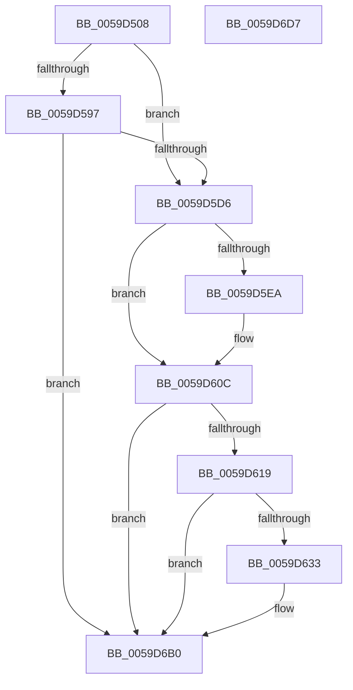

# IopLiveDumpOpenVMMemoryPartition

- RVA: `0x0059D508`–`0x0059D6D8` (길이 `464` bytes)
- VA: `0x000000014059D508`
- 실행 섹션: `.text`
- PDB 이름 있음: `예`; PDB Function 태그: `아니요`
- unwind 정보 RVA: `0x000C79B8`
- 디코드: `108`개 명령, `464/464` bytes 표시
- 미해석 바이트: `0` (있으면 어셈블리에 `.byte`로 보존)

> 이 문서는 커널 이미지의 기계어와 PDB 기호를 분석해 생성했습니다. 4번과 5번은 함수 원형과 자료형을 바이너리 사용 방식에서 추정한 C 해석이며 원본 소스 복구 결과는 아닙니다.

## 1. Dependencies

- 직접 호출 지점: **8**; 고유 호출 대상: **8**
- 직접 호출자로 확인된 함수: **1**
- RIP 상대 이미지 참조: **6**

### Outgoing calls
- `0x0059D551` → [RtlInitUnicodeString](../42/RtlInitUnicodeString_function_0042A780.md) (function, `0x0042A780`)
- `0x0059D58C` → [ZwOpenPartition](../6A/ZwOpenPartition_function_006AF710.md) (function, `0x006AF710`)
- `0x0059D5BC` → [ObReferenceObjectByHandle](../../page/86/ObReferenceObjectByHandle_function_00868DB0.md) (function, `0x00868DB0`)
- `0x0059D5E1` → [IopLiveDumpIsTracingEnabled](../4F/IopLiveDumpIsTracingEnabled_function_004FC5AC.md) (function, `0x004FC5AC`)
- `0x0059D607` → [IopLiveDumpTrace](../5A/IopLiveDumpTrace_function_005A4070.md) (function, `0x005A4070`)
- `0x0059D62A` → [tlgKeywordOn](../42/tlgKeywordOn_function_0042EAA0.md) (function, `0x0042EAA0`)
- `0x0059D6AB` → [tlgWriteTransfer_EtwWriteTransfer](../42/tlgWriteTransfer_EtwWriteTransfer_function_004260E0.md) (function, `0x004260E0`)
- `0x0059D6B9` → [_security_check_cookie](../6A/_security_check_cookie_function_006AC640.md) (function, `0x006AC640`)

### Direct callers
- [IoCaptureLiveDump](../4E/IoCaptureLiveDump_function_004E085C.md) at `0x004E0C6A`

### Static image references
- `0x0059D523` → RVA `0x00E0A740` (`.data`; read)
- `0x0059D533` → RVA `0x006CA260` (` ?? ::FNODOBFM::`string'`; read)
- `0x0059D5A1` → RVA `0x00FC6EB8` (`ALMOSTRO`; read)
- `0x0059D600` → RVA `0x00021360` (`.rdata`; read)
- `0x0059D60C` → RVA `0x00E06EA0` (`.data`; read)
- `0x0059D655` → RVA `0x000465D5` (`.rdata`; read)

## 2. Other-region calls and transfers

- 다른 실행 섹션으로 향하는 call: **1**
  - `0x0059D5BC` → [ObReferenceObjectByHandle](../../page/86/ObReferenceObjectByHandle_function_00868DB0.md) (`.text` → `PAGE`)
- 별도 외부 분기/꼬리 이동을 확인하지 못했습니다.

## 3. Assembly (complete function range)

```asm
0059D508  48 8B C4                        mov rax, rsp
0059D50B  48 89 58 10                     mov qword ptr [rax + 0x10], rbx
0059D50F  48 89 70 18                     mov qword ptr [rax + 0x18], rsi
0059D513  48 89 78 20                     mov qword ptr [rax + 0x20], rdi
0059D517  55                              push rbp
0059D518  48 8D 68 A1                     lea rbp, [rax - 0x5f]
0059D51C  48 81 EC F0 00 00 00            sub rsp, 0xf0
0059D523  48 8B 05 16 D2 86 00            mov rax, qword ptr [rip + 0x86d216]
0059D52A  48 33 C4                        xor rax, rsp
0059D52D  48 89 45 47                     mov qword ptr [rbp + 0x47], rax
0059D531  33 C0                           xor eax, eax
0059D533  48 8D 15 26 CD 12 00            lea rdx, [rip + 0x12cd26]
0059D53A  21 45 D3                        and dword ptr [rbp - 0x2d], eax
0059D53D  48 8B F9                        mov rdi, rcx
0059D540  0F 57 C0                        xorps xmm0, xmm0
0059D543  89 45 BB                        mov dword ptr [rbp - 0x45], eax
0059D546  21 45 BB                        and dword ptr [rbp - 0x45], eax
0059D549  48 8D 4D A7                     lea rcx, [rbp - 0x59]
0059D54D  0F 11 45 A7                     movups xmmword ptr [rbp - 0x59], xmm0
0059D551  E8 2A D2 E8 FF                  call 0x14042a780
0059D556  48 83 65 BF 00                  and qword ptr [rbp - 0x41], 0
0059D55B  48 8D 45 A7                     lea rax, [rbp - 0x59]
0059D55F  0F 57 C0                        xorps xmm0, xmm0
0059D562  48 89 45 C7                     mov qword ptr [rbp - 0x39], rax
0059D566  48 8D B7 48 04 00 00            lea rsi, [rdi + 0x448]
0059D56D  C7 45 B7 30 00 00 00            mov dword ptr [rbp - 0x49], 0x30
0059D574  48 8B CE                        mov rcx, rsi
0059D577  C7 45 CF 00 02 00 00            mov dword ptr [rbp - 0x31], 0x200
0059D57E  4C 8D 45 B7                     lea r8, [rbp - 0x49]
0059D582  BA 02 00 00 00                  mov edx, 2
0059D587  F3 0F 7F 45 D7                  movdqu xmmword ptr [rbp - 0x29], xmm0
0059D58C  E8 7F 21 11 00                  call 0x1406af710
0059D591  8B D8                           mov ebx, eax
0059D593  85 C0                           test eax, eax
0059D595  78 3F                           js 0x14059d5d6
0059D597  48 83 64 24 28 00               and qword ptr [rsp + 0x28], 0
0059D59D  48 8D 45 9F                     lea rax, [rbp - 0x61]
0059D5A1  4C 8B 05 10 99 A2 00            mov r8, qword ptr [rip + 0xa29910]
0059D5A8  45 33 C9                        xor r9d, r9d
0059D5AB  48 8B 0E                        mov rcx, qword ptr [rsi]
0059D5AE  48 83 65 9F 00                  and qword ptr [rbp - 0x61], 0
0059D5B3  48 89 44 24 20                  mov qword ptr [rsp + 0x20], rax
0059D5B8  41 8D 51 02                     lea edx, [r9 + 2]
0059D5BC  E8 EF B7 2C 00                  call 0x140868db0
0059D5C1  8B D8                           mov ebx, eax
0059D5C3  48 8B 45 9F                     mov rax, qword ptr [rbp - 0x61]
0059D5C7  48 89 87 50 04 00 00            mov qword ptr [rdi + 0x450], rax
0059D5CE  85 DB                           test ebx, ebx
0059D5D0  0F 89 DA 00 00 00               jns 0x14059d6b0
0059D5D6  BE 04 00 00 00                  mov esi, 4
0059D5DB  89 5D 9F                        mov dword ptr [rbp - 0x61], ebx
0059D5DE  09 77 50                        or dword ptr [rdi + 0x50], esi
0059D5E1  E8 C6 EF F5 FF                  call 0x1404fc5ac
0059D5E6  84 C0                           test al, al
0059D5E8  74 22                           je 0x14059d60c
0059D5EA  83 65 F3 00                     and dword ptr [rbp - 0xd], 0
0059D5EE  48 8D 45 9F                     lea rax, [rbp - 0x61]
0059D5F2  4C 8D 45 E7                     lea r8, [rbp - 0x19]
0059D5F6  48 89 45 E7                     mov qword ptr [rbp - 0x19], rax
0059D5FA  8D 56 FD                        lea edx, [rsi - 3]
0059D5FD  89 75 EF                        mov dword ptr [rbp - 0x11], esi
0059D600  48 8D 0D 59 3D A8 FF            lea rcx, [rip - 0x57c2a7]
0059D607  E8 64 6A 00 00                  call 0x1405a4070
0059D60C  83 3D 8D 98 86 00 05            cmp dword ptr [rip + 0x86988d], 5
0059D613  0F 86 97 00 00 00               jbe 0x14059d6b0
0059D619  48 BA 00 00 00 00 00 20 00 00   movabs rdx, 0x200000000000
0059D623  48 8D 0D 76 98 86 00            lea rcx, [rip + 0x869876]
0059D62A  E8 71 14 E9 FF                  call 0x14042eaa0
0059D62F  84 C0                           test al, al
0059D631  74 7D                           je 0x14059d6b0
0059D633  83 65 23 00                     and dword ptr [rbp + 0x23], 0
0059D637  48 8D 45 E7                     lea rax, [rbp - 0x19]
0059D63B  83 65 33 00                     and dword ptr [rbp + 0x33], 0
0059D63F  4C 8D 8F B8 03 00 00            lea r9, [rdi + 0x3b8]
0059D646  83 65 43 00                     and dword ptr [rbp + 0x43], 0
0059D64A  4C 8D 87 C8 03 00 00            lea r8, [rdi + 0x3c8]
0059D651  48 89 45 17                     mov qword ptr [rbp + 0x17], rax
0059D655  48 8D 15 79 8F AA FF            lea rdx, [rip - 0x557087]
0059D65C  8B 47 50                        mov eax, dword ptr [rdi + 0x50]
0059D65F  48 8D 0D 3A 98 86 00            lea rcx, [rip + 0x86983a]
0059D666  C1 E8 02                        shr eax, 2
0059D669  24 01                           and al, 1
0059D66B  48 C7 45 E7 00 00 00 01         mov qword ptr [rbp - 0x19], 0x1000000
0059D673  88 45 97                        mov byte ptr [rbp - 0x69], al
0059D676  48 8D 45 97                     lea rax, [rbp - 0x69]
0059D67A  48 89 45 27                     mov qword ptr [rbp + 0x27], rax
0059D67E  48 8D 45 9F                     lea rax, [rbp - 0x61]
0059D682  48 89 45 37                     mov qword ptr [rbp + 0x37], rax
0059D686  48 8D 45 F7                     lea rax, [rbp - 9]
0059D68A  48 89 44 24 28                  mov qword ptr [rsp + 0x28], rax
0059D68F  C7 44 24 20 05 00 00 00         mov dword ptr [rsp + 0x20], 5
0059D697  C7 45 1F 08 00 00 00            mov dword ptr [rbp + 0x1f], 8
0059D69E  C7 45 2F 01 00 00 00            mov dword ptr [rbp + 0x2f], 1
0059D6A5  89 5D 9F                        mov dword ptr [rbp - 0x61], ebx
0059D6A8  89 75 3F                        mov dword ptr [rbp + 0x3f], esi
0059D6AB  E8 30 8A E8 FF                  call 0x1404260e0
0059D6B0  8B C3                           mov eax, ebx
0059D6B2  48 8B 4D 47                     mov rcx, qword ptr [rbp + 0x47]
0059D6B6  48 33 CC                        xor rcx, rsp
0059D6B9  E8 82 EF 10 00                  call 0x1406ac640
0059D6BE  4C 8D 9C 24 F0 00 00 00         lea r11, [rsp + 0xf0]
0059D6C6  49 8B 5B 18                     mov rbx, qword ptr [r11 + 0x18]
0059D6CA  49 8B 73 20                     mov rsi, qword ptr [r11 + 0x20]
0059D6CE  49 8B 7B 28                     mov rdi, qword ptr [r11 + 0x28]
0059D6D2  49 8B E3                        mov rsp, r11
0059D6D5  5D                              pop rbp
0059D6D6  C3                              ret
0059D6D7  CC                              int3
```

## 4. C-style interpretation (structured pseudocode)

```c
__int64 __fastcall IopLiveDumpOpenVMMemoryPartition(__int64 a1, __int64 a2, __int64 a3, int a4)
{
    __int64 result;
    __int64 v_rsp;
    unsigned __int64 v_stack_m8;
    unsigned __int64 v_stack_mD0;
    unsigned __int64 v_stack_mD8;

    *(unsigned __int64 *)(v_rsp + 16) = v_rbx;
    *(unsigned __int64 *)(v_rsp + 24) = v_rsi;
    *(unsigned __int64 *)(v_rsp + 32) = v_rdi;
    v_rsp = (v_rsp) - (240);
    result = (*(unsigned __int64 *)(v_rip + 8835606)) ^ (v_rsp);
    *(unsigned __int64 *)(v_rsp - 95 + 71) = result;
    result = 0;
    *(unsigned int *)(v_rsp - 95 - 69) = 0;
    *(unsigned __int64 *)(v_rsp - 95 - 89) = v_xmm0;
    result = RtlInitUnicodeString(v_rsp - 95 - 89, v_rip + 1232166, a3, a4);
    *(unsigned __int64 *)(v_rsp - 95 - 57) = v_rsp - 95 - 89;
    *(unsigned int *)(v_rsp - 95 - 73) = 48;
    *(unsigned int *)(v_rsp - 95 - 49) = 512;
    *(unsigned __int64 *)(v_rsp - 95 - 41) = v_xmm0;
    result = ZwOpenPartition(a1 + 1096, 2, v_rsp - 95 - 73, a4);
    if (sign_flag) goto loc_0059D5D6;
    a4 = 0;
    v_stack_mD8 = v_rsp - 95 - 97;
    result = ObReferenceObjectByHandle(*(unsigned __int64 *)(a1 + 1096), a4 + 2, *(unsigned __int64 *)(v_rip + 10656016), a4);
    *(unsigned __int64 *)(a1 + 1104) = *(unsigned __int64 *)(v_rsp - 95 - 97);
    if (!sign_flag) goto loc_0059D6B0;
loc_0059D5D6:
    *(unsigned int *)(v_rsp - 95 - 97) = (unsigned int)((unsigned int)((unsigned int)(result)));
    result = IopLiveDumpIsTracingEnabled(*(unsigned __int64 *)(a1 + 1096), a4 + 2, *(unsigned __int64 *)(v_rip + 10656016), a4);
    if ((unsigned __int8)(result) != 0) {
        result = v_rsp - 95 - 97;
        a3 = v_rsp - 95 - 25;
        *(unsigned __int64 *)(v_rsp - 95 - 25) = result;
        a2 = 4 - 3;
        *(unsigned int *)(v_rsp - 95 - 17) = 4;
        a1 = v_rip - 5751463;
        result = IopLiveDumpTrace(a1, a2, a3, a4);
    }
    if ((*(unsigned int *)(v_rip + 8820877)) <= 5) goto loc_0059D6B0;
    result = tlgKeywordOn(v_rip + 8820854, a2, a3, a4);
    if ((unsigned __int8)(result) != 0) {
        result = v_rsp - 95 - 25;
        a4 = a1 + 952;
        a3 = a1 + 968;
        *(unsigned __int64 *)(v_rsp - 95 + 23) = result;
        a2 = v_rip - 5599367;
        result = *(unsigned int *)(a1 + 80);
        a1 = v_rip + 8820794;
        result = (unsigned int)((result) >> (2));
        result = (unsigned __int8)((result) & (1));
        *(unsigned __int64 *)(v_rsp - 95 - 25) = 0x1000000ULL;
        *(unsigned __int8 *)(v_rsp - 95 - 105) = (unsigned __int8)(result);
        result = v_rsp - 95 - 105;
        *(unsigned __int64 *)(v_rsp - 95 + 39) = result;
        result = v_rsp - 95 - 97;
        *(unsigned __int64 *)(v_rsp - 95 + 55) = result;
        result = v_rsp - 95 - 9;
        v_stack_mD0 = result;
        v_stack_mD8 = 5;
        *(unsigned int *)(v_rsp - 95 + 31) = 8;
        *(unsigned int *)(v_rsp - 95 + 47) = 1;
        *(unsigned int *)(v_rsp - 95 - 97) = (unsigned int)((unsigned int)((unsigned int)(result)));
        *(unsigned int *)(v_rsp - 95 + 63) = 4;
        result = tlgWriteTransfer_EtwWriteTransfer(a1, a2, a3, a4);
    }
    a1 = (*(unsigned __int64 *)(v_rsp - 95 + 71)) ^ (v_rsp);
    result = _security_check_cookie(a1, a2, a3, a4);
    return result;
}
```

## 5. (Beta) C Style

```c
int64_t IopLiveDumpOpenVMMemoryPartition(void *Arg1, int64_t Arg2, int64_t Arg3, int32_t Arg4)
{
    uint8_t *arg1 = (uint8_t *)Arg1;

    int64_t result;
    int64_t local_rsp;
    uint64_t v_stack_m8;
    uint64_t v_stack_mD0;
    uint64_t v_stack_mD8;

    *(uint64_t *)(local_rsp + 0x10) = local_rbx;
    *(uint64_t *)(local_rsp + 0x18) = local_rsi;
    *(uint64_t *)(local_rsp + 0x20) = local_rdi;
    local_rsp = (local_rsp) - (240);
    result = (*(uint64_t *)(v_rip + 0x86D216)) ^ (local_rsp);
    *(uint64_t *)(local_rsp - 0x5F + 0x47) = result;
    result = 0;
    *(uint32_t *)(local_rsp - 0x5F - 0x45) = 0;
    *(uint64_t *)(local_rsp - 0x5F - 0x59) = v_xmm0;
    result = RtlInitUnicodeString(local_rsp - 95 - 89, v_rip + 1232166, Arg3, Arg4);
    *(uint64_t *)(local_rsp - 0x5F - 0x39) = local_rsp - 95 - 89;
    *(uint32_t *)(local_rsp - 0x5F - 0x49) = 48;
    *(uint32_t *)(local_rsp - 0x5F - 0x31) = 512;
    *(uint64_t *)(local_rsp - 0x5F - 0x29) = v_xmm0;
    result = ZwOpenPartition(Arg1 + 1096, 2, local_rsp - 95 - 73, Arg4);
    if (sign_flag) goto loc_0059D5D6;
    Arg4 = 0;
    v_stack_mD8 = local_rsp - 95 - 97;
    result = ObReferenceObjectByHandle(*(uint64_t *)(arg1 + 0x448), Arg4 + 2, *(uint64_t *)(v_rip + 0xA29910), Arg4);
    *(uint64_t *)(arg1 + 0x450) = *(uint64_t *)(local_rsp - 0x5F - 0x61);
    if (!sign_flag) goto loc_0059D6B0;
loc_0059D5D6:
    *(uint32_t *)(local_rsp - 0x5F - 0x61) = (uint32_t)((uint32_t)((uint32_t)(result)));
    result = IopLiveDumpIsTracingEnabled(*(uint64_t *)(arg1 + 0x448), Arg4 + 2, *(uint64_t *)(v_rip + 0xA29910), Arg4);
    if ((uint8_t)(result) != 0) {
        result = local_rsp - 95 - 97;
        Arg3 = local_rsp - 95 - 25;
        *(uint64_t *)(local_rsp - 0x5F - 0x19) = result;
        Arg2 = 4 - 3;
        *(uint32_t *)(local_rsp - 0x5F - 0x11) = 4;
        Arg1 = v_rip - 5751463;
        result = IopLiveDumpTrace(Arg1, Arg2, Arg3, Arg4);
    }
    if ((*(uint32_t *)(v_rip + 0x86988D)) <= 5) goto loc_0059D6B0;
    result = tlgKeywordOn(v_rip + 8820854, Arg2, Arg3, Arg4);
    if ((uint8_t)(result) != 0) {
        result = local_rsp - 95 - 25;
        Arg4 = Arg1 + 952;
        Arg3 = Arg1 + 968;
        *(uint64_t *)(local_rsp - 0x5F + 0x17) = result;
        Arg2 = v_rip - 5599367;
        result = *(uint32_t *)(arg1 + 0x50);
        Arg1 = v_rip + 8820794;
        result = (uint32_t)((result) >> (2));
        result = (uint8_t)((result) & (1));
        *(uint64_t *)(local_rsp - 0x5F - 0x19) = 0x1000000ULL;
        *(uint8_t *)(local_rsp - 0x5F - 0x69) = (uint8_t)(result);
        result = local_rsp - 95 - 105;
        *(uint64_t *)(local_rsp - 0x5F + 0x27) = result;
        result = local_rsp - 95 - 97;
        *(uint64_t *)(local_rsp - 0x5F + 0x37) = result;
        result = local_rsp - 95 - 9;
        v_stack_mD0 = result;
        v_stack_mD8 = 5;
        *(uint32_t *)(local_rsp - 0x5F + 0x1F) = 8;
        *(uint32_t *)(local_rsp - 0x5F + 0x2F) = 1;
        *(uint32_t *)(local_rsp - 0x5F - 0x61) = (uint32_t)((uint32_t)((uint32_t)(result)));
        *(uint32_t *)(local_rsp - 0x5F + 0x3F) = 4;
        result = tlgWriteTransfer_EtwWriteTransfer(Arg1, Arg2, Arg3, Arg4);
    }
    Arg1 = (*(uint64_t *)(local_rsp - 0x5F + 0x47)) ^ (local_rsp);
    result = _security_check_cookie(Arg1, Arg2, Arg3, Arg4);
    return result;
}
```

### 관측된 메모리 오프셋

구조체 형식이 확인되지 않은 접근은 인자 기준의 오프셋으로만 기록했습니다.

| 기준 인자 | 오프셋 표현 | 폭 (bit) | 접근 |
|---|---:|---:|---|
| `Arg1` | `+ 0x0` | `64` | `R` |
| `Arg1` | `+ 0x50` | `32` | `R` |
| `Arg1` | `+ 0x50` | `32` | `R/W` |
| `Arg1` | `+ 0x3B8` | `64` | `R` |
| `Arg1` | `+ 0x3C8` | `64` | `R` |
| `Arg1` | `+ 0x448` | `64` | `R` |
| `Arg1` | `+ 0x450` | `64` | `W` |

## 6. Execution-region graph

[열기: 2D/3D 그래프와 함수 탐색 컨트롤 패널](../../../control-panel.html?section=text&rva=0x0059D508&view=graph)

- 2D 그래프는 위에서 아래로 흐르고, 3D 그래프는 빈 공간을 드래그해 회전합니다. Shift+드래그는 이동, 휠은 확대·축소, 함수 노드 선택은 대상 보고서 이동입니다.

### Static fallback


