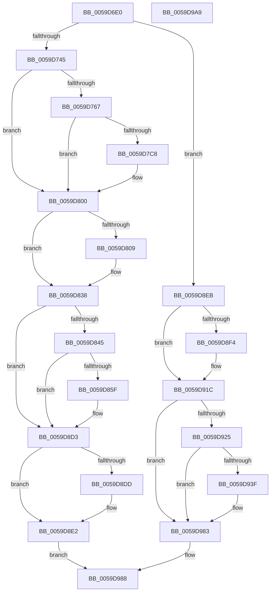

# IopLiveDumpPolicyChangeWnfCallback

- RVA: `0x0059D6E0`–`0x0059D9AA` (길이 `714` bytes)
- VA: `0x000000014059D6E0`
- 실행 섹션: `.text`
- PDB 이름 있음: `예`; PDB Function 태그: `아니요`
- unwind 정보 RVA: `0x000C6F60`
- 디코드: `153`개 명령, `714/714` bytes 표시
- 미해석 바이트: `0` (있으면 어셈블리에 `.byte`로 보존)

> 이 문서는 커널 이미지의 기계어와 PDB 기호를 분석해 생성했습니다. 4번과 5번은 함수 원형과 자료형을 바이너리 사용 방식에서 추정한 C 해석이며 원본 소스 복구 결과는 아닙니다.

## 1. Dependencies

- 직접 호출 지점: **16**; 고유 호출 대상: **11**
- 직접 호출자로 확인된 함수: **0**
- RIP 상대 이미지 참조: **11**

### Outgoing calls
- `0x0059D747` → [IopInitializeDumpPolicySettings](../../page/71/IopInitializeDumpPolicySettings_function_0071A444.md) (function, `0x0071A444`)
- `0x0059D757` → [RtlIsStateSeparationEnabled](../../page/A3/RtlIsStateSeparationEnabled_function_00A3C560.md) (function, `0x00A3C560`)
- `0x0059D772` → [RtlInitUnicodeString](../42/RtlInitUnicodeString_function_0042A780.md) (function, `0x0042A780`)
- `0x0059D7BB` → [ZwCreateKey](../6A/ZwCreateKey_function_006AD470.md) (function, `0x006AD470`)
- `0x0059D7D4` → [RtlInitUnicodeString](../42/RtlInitUnicodeString_function_0042A780.md) (function, `0x0042A780`)
- `0x0059D7F7` → [ZwSetValueKey](../6A/ZwSetValueKey_function_006ADCD0.md) (function, `0x006ADCD0`)
- `0x0059D800` → [IopLiveDumpIsTracingEnabled](../4F/IopLiveDumpIsTracingEnabled_function_004FC5AC.md) (function, `0x004FC5AC`)
- `0x0059D833` → [IopLiveDumpTrace](../5A/IopLiveDumpTrace_function_005A4070.md) (function, `0x005A4070`)
- `0x0059D856` → [tlgKeywordOn](../42/tlgKeywordOn_function_0042EAA0.md) (function, `0x0042EAA0`)
- `0x0059D8CE` → [tlgWriteTransfer_EtwWriteTransfer](../42/tlgWriteTransfer_EtwWriteTransfer_function_004260E0.md) (function, `0x004260E0`)
- `0x0059D8DD` → [ZwClose](../6A/ZwClose_function_006AD2B0.md) (function, `0x006AD2B0`)
- `0x0059D8EB` → [IopLiveDumpIsTracingEnabled](../4F/IopLiveDumpIsTracingEnabled_function_004FC5AC.md) (function, `0x004FC5AC`)
- `0x0059D917` → [IopLiveDumpTrace](../5A/IopLiveDumpTrace_function_005A4070.md) (function, `0x005A4070`)
- `0x0059D936` → [tlgKeywordOn](../42/tlgKeywordOn_function_0042EAA0.md) (function, `0x0042EAA0`)
- `0x0059D97E` → [tlgWriteTransfer_EtwWriteTransfer](../42/tlgWriteTransfer_EtwWriteTransfer_function_004260E0.md) (function, `0x004260E0`)
- `0x0059D98F` → [_security_check_cookie](../6A/_security_check_cookie_function_006AC640.md) (function, `0x006AC640`)

### Direct callers
- 이 함수 시작 RVA로 연결되는 직접 call은 확인되지 않았습니다. 간접 호출은 완전히 역산할 수 없습니다.

### Static image references
- `0x0059D6F7` → RVA `0x00E0A740` (`.data`; read)
- `0x0059D71D` → RVA `0x00020AC0` (`.rdata`; read)
- `0x0059D74C` → RVA `0x00E0A9B8` (`.data`; read)
- `0x0059D767` → RVA `0x006CA3D0` (` ?? ::FNODOBFM::`string'`; read)
- `0x0059D7C8` → RVA `0x006CA560` (` ?? ::FNODOBFM::`string'`; read)
- `0x0059D82C` → RVA `0x00022C00` (`.rdata`; read)
- `0x0059D838` → RVA `0x00E06EA0` (`.data`; read)
- `0x0059D871` → RVA `0x0004604D` (`.rdata`; read)
- `0x0059D8F4` → RVA `0x006CA3B0` (` ?? ::FNODOBFM::`string'`; read)
- `0x0059D910` → RVA `0x00021A40` (`.rdata`; read)
- `0x0059D951` → RVA `0x00046010` (`.rdata`; read)

## 2. Other-region calls and transfers

- 다른 실행 섹션으로 향하는 call: **2**
  - `0x0059D747` → [IopInitializeDumpPolicySettings](../../page/71/IopInitializeDumpPolicySettings_function_0071A444.md) (`.text` → `PAGE`)
  - `0x0059D757` → [RtlIsStateSeparationEnabled](../../page/A3/RtlIsStateSeparationEnabled_function_00A3C560.md) (`.text` → `PAGE`)
- 별도 외부 분기/꼬리 이동을 확인하지 못했습니다.

## 3. Assembly (complete function range)

```asm
0059D6E0  48 89 5C 24 08                  mov qword ptr [rsp + 8], rbx
0059D6E5  48 89 7C 24 10                  mov qword ptr [rsp + 0x10], rdi
0059D6EA  55                              push rbp
0059D6EB  48 8D 6C 24 D0                  lea rbp, [rsp - 0x30]
0059D6F0  48 81 EC 30 01 00 00            sub rsp, 0x130
0059D6F7  48 8B 05 42 D0 86 00            mov rax, qword ptr [rip + 0x86d042]
0059D6FE  48 33 C4                        xor rax, rsp
0059D701  48 89 45 20                     mov qword ptr [rbp + 0x20], rax
0059D705  33 C0                           xor eax, eax
0059D707  33 DB                           xor ebx, ebx
0059D709  0F 57 C0                        xorps xmm0, xmm0
0059D70C  89 44 24 64                     mov dword ptr [rsp + 0x64], eax
0059D710  48 89 45 90                     mov qword ptr [rbp - 0x70], rax
0059D714  0F 57 C9                        xorps xmm1, xmm1
0059D717  89 45 98                        mov dword ptr [rbp - 0x68], eax
0059D71A  48 8B 02                        mov rax, qword ptr [rdx]
0059D71D  48 3B 05 9C 33 A8 FF            cmp rax, qword ptr [rip - 0x57cc64]
0059D724  0F 11 45 A0                     movups xmmword ptr [rbp - 0x60], xmm0
0059D728  48 89 5C 24 50                  mov qword ptr [rsp + 0x50], rbx
0059D72D  0F 11 4C 24 60                  movups xmmword ptr [rsp + 0x60], xmm1
0059D732  89 5C 24 44                     mov dword ptr [rsp + 0x44], ebx
0059D736  0F 11 44 24 70                  movups xmmword ptr [rsp + 0x70], xmm0
0059D73B  0F 11 45 80                     movups xmmword ptr [rbp - 0x80], xmm0
0059D73F  0F 85 A6 01 00 00               jne 0x14059d8eb
0059D745  33 C9                           xor ecx, ecx
0059D747  E8 F8 CC 17 00                  call 0x14071a444
0059D74C  0F B6 05 65 D2 86 00            movzx eax, byte ptr [rip + 0x86d265]
0059D753  89 44 24 48                     mov dword ptr [rsp + 0x48], eax
0059D757  E8 04 EE 49 00                  call 0x140a3c560
0059D75C  8D 7B 04                        lea edi, [rbx + 4]
0059D75F  84 C0                           test al, al
0059D761  0F 84 99 00 00 00               je 0x14059d800
0059D767  48 8D 15 62 CC 12 00            lea rdx, [rip + 0x12cc62]
0059D76E  48 8D 4D A0                     lea rcx, [rbp - 0x60]
0059D772  E8 09 D0 E8 FF                  call 0x14042a780
0059D777  48 8D 45 A0                     lea rax, [rbp - 0x60]
0059D77B  48 89 5C 24 30                  mov qword ptr [rsp + 0x30], rbx
0059D780  0F 57 C0                        xorps xmm0, xmm0
0059D783  89 5C 24 28                     mov dword ptr [rsp + 0x28], ebx
0059D787  45 33 C9                        xor r9d, r9d
0059D78A  48 89 45 80                     mov qword ptr [rbp - 0x80], rax
0059D78E  4C 8D 44 24 70                  lea r8, [rsp + 0x70]
0059D793  C7 44 24 70 30 00 00 00         mov dword ptr [rsp + 0x70], 0x30
0059D79B  BA 3F 00 0F 00                  mov edx, 0xf003f
0059D7A0  48 89 5C 24 78                  mov qword ptr [rsp + 0x78], rbx
0059D7A5  48 8D 4C 24 50                  lea rcx, [rsp + 0x50]
0059D7AA  C7 45 88 40 02 00 00            mov dword ptr [rbp - 0x78], 0x240
0059D7B1  F3 0F 7F 45 90                  movdqu xmmword ptr [rbp - 0x70], xmm0
0059D7B6  48 89 5C 24 20                  mov qword ptr [rsp + 0x20], rbx
0059D7BB  E8 B0 FC 10 00                  call 0x1406ad470
0059D7C0  89 44 24 44                     mov dword ptr [rsp + 0x44], eax
0059D7C4  85 C0                           test eax, eax
0059D7C6  78 38                           js 0x14059d800
0059D7C8  48 8D 15 91 CD 12 00            lea rdx, [rip + 0x12cd91]
0059D7CF  48 8D 4C 24 60                  lea rcx, [rsp + 0x60]
0059D7D4  E8 A7 CF E8 FF                  call 0x14042a780
0059D7D9  48 8B 4C 24 50                  mov rcx, qword ptr [rsp + 0x50]
0059D7DE  48 8D 44 24 48                  lea rax, [rsp + 0x48]
0059D7E3  89 7C 24 28                     mov dword ptr [rsp + 0x28], edi
0059D7E7  48 8D 54 24 60                  lea rdx, [rsp + 0x60]
0059D7EC  44 8B CF                        mov r9d, edi
0059D7EF  48 89 44 24 20                  mov qword ptr [rsp + 0x20], rax
0059D7F4  45 33 C0                        xor r8d, r8d
0059D7F7  E8 D4 04 11 00                  call 0x1406adcd0
0059D7FC  89 44 24 44                     mov dword ptr [rsp + 0x44], eax
0059D800  E8 A7 ED F5 FF                  call 0x1404fc5ac
0059D805  84 C0                           test al, al
0059D807  74 2F                           je 0x14059d838
0059D809  48 8D 44 24 48                  lea rax, [rsp + 0x48]
0059D80E  48 89 7D B8                     mov qword ptr [rbp - 0x48], rdi
0059D812  48 89 45 B0                     mov qword ptr [rbp - 0x50], rax
0059D816  4C 8D 45 B0                     lea r8, [rbp - 0x50]
0059D81A  48 8D 44 24 44                  lea rax, [rsp + 0x44]
0059D81F  48 89 7D C8                     mov qword ptr [rbp - 0x38], rdi
0059D823  BA 02 00 00 00                  mov edx, 2
0059D828  48 89 45 C0                     mov qword ptr [rbp - 0x40], rax
0059D82C  48 8D 0D CD 53 A8 FF            lea rcx, [rip - 0x57ac33]
0059D833  E8 38 68 00 00                  call 0x1405a4070
0059D838  83 3D 61 96 86 00 05            cmp dword ptr [rip + 0x869661], 5
0059D83F  0F 86 8E 00 00 00               jbe 0x14059d8d3
0059D845  48 BA 00 00 00 00 00 40 00 00   movabs rdx, 0x400000000000
0059D84F  48 8D 0D 4A 96 86 00            lea rcx, [rip + 0x86964a]
0059D856  E8 45 12 E9 FF                  call 0x14042eaa0
0059D85B  84 C0                           test al, al
0059D85D  74 74                           je 0x14059d8d3
0059D85F  48 8D 44 24 58                  lea rax, [rsp + 0x58]
0059D864  48 C7 44 24 58 00 00 00 01      mov qword ptr [rsp + 0x58], 0x1000000
0059D86D  48 89 45 F0                     mov qword ptr [rbp - 0x10], rax
0059D871  48 8D 15 D5 87 AA FF            lea rdx, [rip - 0x55782b]
0059D878  8B 44 24 44                     mov eax, dword ptr [rsp + 0x44]
0059D87C  48 8D 0D 1D 96 86 00            lea rcx, [rip + 0x86961d]
0059D883  89 44 24 4C                     mov dword ptr [rsp + 0x4c], eax
0059D887  45 33 C9                        xor r9d, r9d
0059D88A  48 8D 44 24 4C                  lea rax, [rsp + 0x4c]
0059D88F  48 C7 45 F8 08 00 00 00         mov qword ptr [rbp - 8], 8
0059D897  48 89 45 00                     mov qword ptr [rbp], rax
0059D89B  45 33 C0                        xor r8d, r8d
0059D89E  8A 05 14 D1 86 00               mov al, byte ptr [rip + 0x86d114]
0059D8A4  88 44 24 40                     mov byte ptr [rsp + 0x40], al
0059D8A8  48 8D 44 24 40                  lea rax, [rsp + 0x40]
0059D8AD  48 89 45 10                     mov qword ptr [rbp + 0x10], rax
0059D8B1  48 8D 45 D0                     lea rax, [rbp - 0x30]
0059D8B5  48 89 44 24 28                  mov qword ptr [rsp + 0x28], rax
0059D8BA  C7 44 24 20 05 00 00 00         mov dword ptr [rsp + 0x20], 5
0059D8C2  48 89 7D 08                     mov qword ptr [rbp + 8], rdi
0059D8C6  48 C7 45 18 01 00 00 00         mov qword ptr [rbp + 0x18], 1
0059D8CE  E8 0D 88 E8 FF                  call 0x1404260e0
0059D8D3  48 8B 4C 24 50                  mov rcx, qword ptr [rsp + 0x50]
0059D8D8  48 85 C9                        test rcx, rcx
0059D8DB  74 05                           je 0x14059d8e2
0059D8DD  E8 CE F9 10 00                  call 0x1406ad2b0
0059D8E2  8B 44 24 44                     mov eax, dword ptr [rsp + 0x44]
0059D8E6  E9 9D 00 00 00                  jmp 0x14059d988
0059D8EB  E8 BC EC F5 FF                  call 0x1404fc5ac
0059D8F0  84 C0                           test al, al
0059D8F2  74 28                           je 0x14059d91c
0059D8F4  48 8D 05 B5 CA 12 00            lea rax, [rip + 0x12cab5]
0059D8FB  48 C7 45 B8 1F 00 00 00         mov qword ptr [rbp - 0x48], 0x1f
0059D903  4C 8D 45 B0                     lea r8, [rbp - 0x50]
0059D907  48 89 45 B0                     mov qword ptr [rbp - 0x50], rax
0059D90B  BA 02 00 00 00                  mov edx, 2
0059D910  48 8D 0D 29 41 A8 FF            lea rcx, [rip - 0x57bed7]
0059D917  E8 54 67 00 00                  call 0x1405a4070
0059D91C  83 3D 7D 95 86 00 05            cmp dword ptr [rip + 0x86957d], 5
0059D923  76 5E                           jbe 0x14059d983
0059D925  48 BA 00 00 00 00 00 40 00 00   movabs rdx, 0x400000000000
0059D92F  48 8D 0D 6A 95 86 00            lea rcx, [rip + 0x86956a]
0059D936  E8 65 11 E9 FF                  call 0x14042eaa0
0059D93B  84 C0                           test al, al
0059D93D  74 44                           je 0x14059d983
0059D93F  48 8D 44 24 58                  lea rax, [rsp + 0x58]
0059D944  48 C7 44 24 58 00 00 00 01      mov qword ptr [rsp + 0x58], 0x1000000
0059D94D  48 89 45 F0                     mov qword ptr [rbp - 0x10], rax
0059D951  48 8D 15 B8 86 AA FF            lea rdx, [rip - 0x557948]
0059D958  48 8D 45 D0                     lea rax, [rbp - 0x30]
0059D95C  48 C7 45 F8 08 00 00 00         mov qword ptr [rbp - 8], 8
0059D964  48 89 44 24 28                  mov qword ptr [rsp + 0x28], rax
0059D969  48 8D 0D 30 95 86 00            lea rcx, [rip + 0x869530]
0059D970  45 33 C9                        xor r9d, r9d
0059D973  C7 44 24 20 03 00 00 00         mov dword ptr [rsp + 0x20], 3
0059D97B  45 33 C0                        xor r8d, r8d
0059D97E  E8 5D 87 E8 FF                  call 0x1404260e0
0059D983  B8 0D 00 00 C0                  mov eax, 0xc000000d
0059D988  48 8B 4D 20                     mov rcx, qword ptr [rbp + 0x20]
0059D98C  48 33 CC                        xor rcx, rsp
0059D98F  E8 AC EC 10 00                  call 0x1406ac640
0059D994  4C 8D 9C 24 30 01 00 00         lea r11, [rsp + 0x130]
0059D99C  49 8B 5B 10                     mov rbx, qword ptr [r11 + 0x10]
0059D9A0  49 8B 7B 18                     mov rdi, qword ptr [r11 + 0x18]
0059D9A4  49 8B E3                        mov rsp, r11
0059D9A7  5D                              pop rbp
0059D9A8  C3                              ret
0059D9A9  CC                              int3
```

## 4. C-style interpretation (structured pseudocode)

```c
__int64 __fastcall IopLiveDumpPolicyChangeWnfCallback(int a1, __int64 a2, __int64 a3, int a4)
{
    __int64 result;
    __int64 v_rbx;
    __int64 v_rsp;
    unsigned __int64 v_stack_m108;
    unsigned int v_stack_m110;
    unsigned __int64 v_stack_m118;
    unsigned __int64 v_stack_m18;
    unsigned __int64 v_stack_m20;
    unsigned __int64 v_stack_m28;
    unsigned __int64 v_stack_m30;
    unsigned __int64 v_stack_m38;
    unsigned __int64 v_stack_m40;
    unsigned __int64 v_stack_m48;
    unsigned __int64 v_stack_m68;
    unsigned __int64 v_stack_m70;
    unsigned __int64 v_stack_m78;
    unsigned __int64 v_stack_m8;
    unsigned __int64 v_stack_m80;
    unsigned __int64 v_stack_m88;
    unsigned __int64 v_stack_m98;
    unsigned int v_stack_mA0;
    unsigned __int64 v_stack_mA8;
    unsigned int v_stack_mB0;
    unsigned __int64 v_stack_mB8;
    unsigned __int64 v_stack_mC0;
    unsigned __int64 v_stack_mC8;
    unsigned int v_stack_mD4;
    unsigned __int64 v_stack_mD8;
    unsigned __int64 v_stack_mE0;
    unsigned __int64 v_stack_mE8;
    unsigned int v_stack_mEC;
    unsigned int v_stack_mF0;
    unsigned int v_stack_mF4;
    unsigned __int8 v_stack_mF8;
    unsigned __int64 v_stack_p10;
    unsigned __int64 v_stack_p8;

    v_stack_p8 = v_rbx;
    v_stack_p10 = v_rdi;
    v_rsp = (v_rsp) - (304);
    result = (*(unsigned __int64 *)(v_rip + 8835138)) ^ (v_rsp);
    v_stack_m18 = result;
    result = 0;
    v_rbx = 0;
    v_stack_mD4 = 0;
    v_stack_mA8 = 0;
    v_stack_mA0 = 0;
    v_stack_m98 = v_xmm0;
    v_stack_mE8 = 0;
    v_stack_mD8 = v_xmm1;
    v_stack_mF4 = 0;
    v_stack_mC8 = v_xmm0;
    v_stack_mB8 = v_xmm0;
    if ((*(unsigned __int64 *)(a2)) != (*(unsigned __int64 *)(v_rip - 5753956))) goto loc_0059D8EB;
    a1 = 0;
    result = IopInitializeDumpPolicySettings(a1, a2, a3, a4);
    v_stack_mF0 = (unsigned int)(*(unsigned __int8 *)(v_rip + 8835685));
    result = RtlIsStateSeparationEnabled(a1, a2, a3, a4);
    if ((unsigned __int8)(result) == 0) goto loc_0059D800;
    result = RtlInitUnicodeString(v_stack_m98, v_rip + 1231970, a3, a4);
    v_stack_m108 = 0;
    v_stack_m110 = 0;
    a4 = 0;
    v_stack_mB8 = v_stack_m98;
    v_stack_mC8 = 48;
    v_stack_mC0 = 0;
    v_stack_mB0 = 576;
    v_stack_mA8 = v_xmm0;
    v_stack_m118 = 0;
    result = ZwCreateKey(v_stack_mE8, (unsigned int)(0xF003FULL), v_stack_mC8, a4);
    v_stack_mF4 = (unsigned int)(result);
    if (!(sign_flag)) {
        a2 = v_rip + 1232273;
        a1 = v_stack_mD8;
        result = RtlInitUnicodeString(a1, a2, v_stack_mC8, a4);
        a1 = v_stack_mE8;
        result = v_stack_mF0;
        v_stack_m110 = (unsigned int)(v_rbx + 4);
        a2 = v_stack_mD8;
        a4 = (unsigned int)(v_rbx + 4);
        v_stack_m118 = result;
        a3 = 0;
        result = ZwSetValueKey(a1, a2, a3, a4);
        v_stack_mF4 = (unsigned int)(result);
    }
    result = IopLiveDumpIsTracingEnabled(a1, a2, a3, a4);
    if ((unsigned __int8)(result) != 0) {
        result = v_stack_mF0;
        v_stack_m80 = v_rbx + 4;
        v_stack_m88 = result;
        a3 = v_stack_m88;
        result = v_stack_mF4;
        v_stack_m70 = v_rbx + 4;
        a2 = 2;
        v_stack_m78 = result;
        a1 = v_rip - 5745715;
        result = IopLiveDumpTrace(a1, a2, a3, a4);
    }
    if ((*(unsigned int *)(v_rip + 8820321)) <= 5) goto loc_0059D8D3;
    result = tlgKeywordOn(v_rip + 8820298, a2, a3, a4);
    if ((unsigned __int8)(result) != 0) {
        result = v_stack_mE0;
        v_stack_mE0 = 0x1000000ULL;
        v_stack_m48 = result;
        a2 = v_rip - 5601323;
        result = v_stack_mF4;
        a1 = v_rip + 8820253;
        v_stack_mEC = (unsigned int)(result);
        a4 = 0;
        result = v_stack_mEC;
        v_stack_m40 = 8;
        v_stack_m38 = result;
        a3 = 0;
        result = *(unsigned __int8 *)(v_rip + 8835348);
        v_stack_mF8 = (unsigned __int8)(result);
        result = v_stack_mF8;
        v_stack_m28 = result;
        result = v_stack_m68;
        v_stack_m110 = result;
        v_stack_m118 = 5;
        v_stack_m30 = v_rbx + 4;
        v_stack_m20 = 1;
        result = tlgWriteTransfer_EtwWriteTransfer(a1, a2, a3, a4);
    }
    if (v_stack_mE8 != 0) {
        result = ZwClose(v_stack_mE8, a2, a3, a4);
    }
    goto loc_0059D988;
loc_0059D8EB:
    result = IopLiveDumpIsTracingEnabled(v_stack_mE8, a2, a3, a4);
    if ((unsigned __int8)(result) != 0) {
        result = v_rip + 1231541;
        v_stack_m80 = 31;
        a3 = v_stack_m88;
        v_stack_m88 = result;
        a2 = 2;
        a1 = v_rip - 5750487;
        result = IopLiveDumpTrace(a1, a2, a3, a4);
    }
    if ((*(unsigned int *)(v_rip + 8820093)) <= 5) goto loc_0059D983;
    result = tlgKeywordOn(v_rip + 8820074, a2, a3, a4);
    if ((unsigned __int8)(result) != 0) {
        result = v_stack_mE0;
        v_stack_mE0 = 0x1000000ULL;
        v_stack_m48 = result;
        a2 = v_rip - 5601608;
        result = v_stack_m68;
        v_stack_m40 = 8;
        v_stack_m110 = result;
        a1 = v_rip + 8820016;
        a4 = 0;
        v_stack_m118 = 3;
        a3 = 0;
        result = tlgWriteTransfer_EtwWriteTransfer(a1, a2, a3, a4);
    }
loc_0059D988:
    a1 = (v_stack_m18) ^ (v_rsp);
    result = _security_check_cookie(a1, a2, a3, a4);
    return result;
}
```

## 5. (Beta) C Style

```c
int64_t IopLiveDumpPolicyChangeWnfCallback(int32_t Arg1, void *Arg2, int64_t Arg3, int32_t Arg4)
{
    uint8_t *arg2 = (uint8_t *)Arg2;

    int64_t result;
    int64_t local_rbx;
    int64_t local_rsp;
    uint64_t v_stack_m108;
    uint32_t v_stack_m110;
    uint64_t v_stack_m118;
    uint64_t v_stack_m18;
    uint64_t v_stack_m20;
    uint64_t v_stack_m28;
    uint64_t v_stack_m30;
    uint64_t v_stack_m38;
    uint64_t v_stack_m40;
    uint64_t v_stack_m48;
    uint64_t v_stack_m68;
    uint64_t v_stack_m70;
    uint64_t v_stack_m78;
    uint64_t v_stack_m8;
    uint64_t v_stack_m80;
    uint64_t v_stack_m88;
    uint64_t v_stack_m98;
    uint32_t v_stack_mA0;
    uint64_t v_stack_mA8;
    uint32_t v_stack_mB0;
    uint64_t v_stack_mB8;
    uint64_t v_stack_mC0;
    uint64_t v_stack_mC8;
    uint32_t v_stack_mD4;
    uint64_t v_stack_mD8;
    uint64_t v_stack_mE0;
    uint64_t v_stack_mE8;
    uint32_t v_stack_mEC;
    uint32_t v_stack_mF0;
    uint32_t v_stack_mF4;
    uint8_t v_stack_mF8;
    uint64_t v_stack_p10;
    uint64_t v_stack_p8;

    v_stack_p8 = local_rbx;
    v_stack_p10 = local_rdi;
    local_rsp = (local_rsp) - (304);
    result = (*(uint64_t *)(v_rip + 0x86D042)) ^ (local_rsp);
    v_stack_m18 = result;
    result = 0;
    local_rbx = 0;
    v_stack_mD4 = 0;
    v_stack_mA8 = 0;
    v_stack_mA0 = 0;
    v_stack_m98 = v_xmm0;
    v_stack_mE8 = 0;
    v_stack_mD8 = v_xmm1;
    v_stack_mF4 = 0;
    v_stack_mC8 = v_xmm0;
    v_stack_mB8 = v_xmm0;
    if ((*(uint64_t *)(arg2)) != (*(uint64_t *)(v_rip - 0x57CC64))) goto loc_0059D8EB;
    Arg1 = 0;
    result = IopInitializeDumpPolicySettings(Arg1, Arg2, Arg3, Arg4);
    v_stack_mF0 = (uint32_t)(*(uint8_t *)(v_rip + 0x86D265));
    result = RtlIsStateSeparationEnabled(Arg1, Arg2, Arg3, Arg4);
    if ((uint8_t)(result) == 0) goto loc_0059D800;
    result = RtlInitUnicodeString(v_stack_m98, v_rip + 1231970, Arg3, Arg4);
    v_stack_m108 = 0;
    v_stack_m110 = 0;
    Arg4 = 0;
    v_stack_mB8 = v_stack_m98;
    v_stack_mC8 = 48;
    v_stack_mC0 = 0;
    v_stack_mB0 = 576;
    v_stack_mA8 = v_xmm0;
    v_stack_m118 = 0;
    result = ZwCreateKey(v_stack_mE8, (uint32_t)(0xF003FULL), v_stack_mC8, Arg4);
    v_stack_mF4 = (uint32_t)(result);
    if (!(sign_flag)) {
        Arg2 = v_rip + 1232273;
        Arg1 = v_stack_mD8;
        result = RtlInitUnicodeString(Arg1, Arg2, v_stack_mC8, Arg4);
        Arg1 = v_stack_mE8;
        result = v_stack_mF0;
        v_stack_m110 = (uint32_t)(local_rbx + 4);
        Arg2 = v_stack_mD8;
        Arg4 = (uint32_t)(local_rbx + 4);
        v_stack_m118 = result;
        Arg3 = 0;
        result = ZwSetValueKey(Arg1, Arg2, Arg3, Arg4);
        v_stack_mF4 = (uint32_t)(result);
    }
    result = IopLiveDumpIsTracingEnabled(Arg1, Arg2, Arg3, Arg4);
    if ((uint8_t)(result) != 0) {
        result = v_stack_mF0;
        v_stack_m80 = local_rbx + 4;
        v_stack_m88 = result;
        Arg3 = v_stack_m88;
        result = v_stack_mF4;
        v_stack_m70 = local_rbx + 4;
        Arg2 = 2;
        v_stack_m78 = result;
        Arg1 = v_rip - 5745715;
        result = IopLiveDumpTrace(Arg1, Arg2, Arg3, Arg4);
    }
    if ((*(uint32_t *)(v_rip + 0x869661)) <= 5) goto loc_0059D8D3;
    result = tlgKeywordOn(v_rip + 8820298, Arg2, Arg3, Arg4);
    if ((uint8_t)(result) != 0) {
        result = v_stack_mE0;
        v_stack_mE0 = 0x1000000ULL;
        v_stack_m48 = result;
        Arg2 = v_rip - 5601323;
        result = v_stack_mF4;
        Arg1 = v_rip + 8820253;
        v_stack_mEC = (uint32_t)(result);
        Arg4 = 0;
        result = v_stack_mEC;
        v_stack_m40 = 8;
        v_stack_m38 = result;
        Arg3 = 0;
        result = *(uint8_t *)(v_rip + 0x86D114);
        v_stack_mF8 = (uint8_t)(result);
        result = v_stack_mF8;
        v_stack_m28 = result;
        result = v_stack_m68;
        v_stack_m110 = result;
        v_stack_m118 = 5;
        v_stack_m30 = local_rbx + 4;
        v_stack_m20 = 1;
        result = tlgWriteTransfer_EtwWriteTransfer(Arg1, Arg2, Arg3, Arg4);
    }
    if (v_stack_mE8 != 0) {
        result = ZwClose(v_stack_mE8, Arg2, Arg3, Arg4);
    }
    goto loc_0059D988;
loc_0059D8EB:
    result = IopLiveDumpIsTracingEnabled(v_stack_mE8, Arg2, Arg3, Arg4);
    if ((uint8_t)(result) != 0) {
        result = v_rip + 1231541;
        v_stack_m80 = 31;
        Arg3 = v_stack_m88;
        v_stack_m88 = result;
        Arg2 = 2;
        Arg1 = v_rip - 5750487;
        result = IopLiveDumpTrace(Arg1, Arg2, Arg3, Arg4);
    }
    if ((*(uint32_t *)(v_rip + 0x86957D)) <= 5) goto loc_0059D983;
    result = tlgKeywordOn(v_rip + 8820074, Arg2, Arg3, Arg4);
    if ((uint8_t)(result) != 0) {
        result = v_stack_mE0;
        v_stack_mE0 = 0x1000000ULL;
        v_stack_m48 = result;
        Arg2 = v_rip - 5601608;
        result = v_stack_m68;
        v_stack_m40 = 8;
        v_stack_m110 = result;
        Arg1 = v_rip + 8820016;
        Arg4 = 0;
        v_stack_m118 = 3;
        Arg3 = 0;
        result = tlgWriteTransfer_EtwWriteTransfer(Arg1, Arg2, Arg3, Arg4);
    }
loc_0059D988:
    Arg1 = (v_stack_m18) ^ (local_rsp);
    result = _security_check_cookie(Arg1, Arg2, Arg3, Arg4);
    return result;
}
```

### 관측된 메모리 오프셋

구조체 형식이 확인되지 않은 접근은 인자 기준의 오프셋으로만 기록했습니다.

| 기준 인자 | 오프셋 표현 | 폭 (bit) | 접근 |
|---|---:|---:|---|
| `Arg2` | `+ 0x0` | `64` | `R` |

## 6. Execution-region graph

[열기: 2D/3D 그래프와 함수 탐색 컨트롤 패널](../../../control-panel.html?section=text&rva=0x0059D6E0&view=graph)

- 2D 그래프는 위에서 아래로 흐르고, 3D 그래프는 빈 공간을 드래그해 회전합니다. Shift+드래그는 이동, 휠은 확대·축소, 함수 노드 선택은 대상 보고서 이동입니다.

### Static fallback


