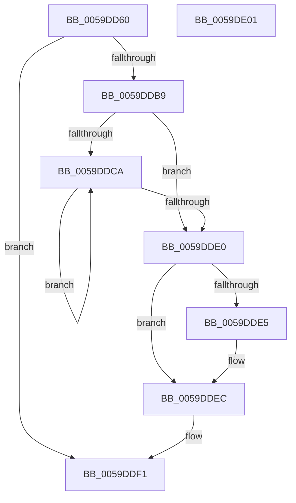

# IopLiveDumpQueryIOSpaceRanges

- RVA: `0x0059DD60`–`0x0059DE02` (길이 `162` bytes)
- VA: `0x000000014059DD60`
- 실행 섹션: `.text`
- PDB 이름 있음: `예`; PDB Function 태그: `아니요`
- unwind 정보 RVA: `0x000BE5B4`
- 디코드: `47`개 명령, `162/162` bytes 표시
- 미해석 바이트: `0` (있으면 어셈블리에 `.byte`로 보존)

> 이 문서는 커널 이미지의 기계어와 PDB 기호를 분석해 생성했습니다. 4번과 5번은 함수 원형과 자료형을 바이너리 사용 방식에서 추정한 C 해석이며 원본 소스 복구 결과는 아닙니다.

## 1. Dependencies

- 직접 호출 지점: **2**; 고유 호출 대상: **2**
- 직접 호출자로 확인된 함수: **1**
- RIP 상대 이미지 참조: **0**

### Outgoing calls
- `0x0059DDB0` → [MmQueryMemoryRanges](../../page/7F/MmQueryMemoryRanges_function_007FC3A0.md) (function, `0x007FC3A0`)
- `0x0059DDE7` → [ExFreePoolWithTag](../../poolcode/B8/ExFreePoolWithTag_function_00B82870.md) (function, `0x00B82870`)

### Direct callers
- [IopLiveDumpAllocateFromIOSpace](IopLiveDumpAllocateFromIOSpace_function_00599DEC.md) at `0x00599E7A`

### Static image references
- 디코드된 RIP-relative 메모리 참조가 없습니다.

## 2. Other-region calls and transfers

- 다른 실행 섹션으로 향하는 call: **2**
  - `0x0059DDB0` → [MmQueryMemoryRanges](../../page/7F/MmQueryMemoryRanges_function_007FC3A0.md) (`.text` → `PAGE`)
  - `0x0059DDE7` → [ExFreePoolWithTag](../../poolcode/B8/ExFreePoolWithTag_function_00B82870.md) (`.text` → `POOLCODE`)
- 별도 외부 분기/꼬리 이동을 확인하지 못했습니다.

## 3. Assembly (complete function range)

```asm
0059DD60  48 89 5C 24 08                  mov qword ptr [rsp + 8], rbx
0059DD65  48 89 7C 24 10                  mov qword ptr [rsp + 0x10], rdi
0059DD6A  55                              push rbp
0059DD6B  48 8B EC                        mov rbp, rsp
0059DD6E  48 83 EC 60                     sub rsp, 0x60
0059DD72  49 83 20 00                     and qword ptr [r8], 0
0059DD76  0F 57 C0                        xorps xmm0, xmm0
0059DD79  0F 11 45 C0                     movups xmmword ptr [rbp - 0x40], xmm0
0059DD7D  83 4D C4 07                     or dword ptr [rbp - 0x3c], 7
0059DD81  33 C0                           xor eax, eax
0059DD83  48 89 4D C8                     mov qword ptr [rbp - 0x38], rcx
0059DD87  49 8B F8                        mov rdi, r8
0059DD8A  0F 11 45 D0                     movups xmmword ptr [rbp - 0x30], xmm0
0059DD8E  48 8D 4D C0                     lea rcx, [rbp - 0x40]
0059DD92  48 89 45 F0                     mov qword ptr [rbp - 0x10], rax
0059DD96  0F 11 45 E0                     movups xmmword ptr [rbp - 0x20], xmm0
0059DD9A  C7 45 C0 01 00 00 00            mov dword ptr [rbp - 0x40], 1
0059DDA1  48 C7 45 D8 00 00 00 40         mov qword ptr [rbp - 0x28], 0x40000000
0059DDA9  C7 45 E0 00 00 00 80            mov dword ptr [rbp - 0x20], 0x80000000
0059DDB0  E8 EB E5 25 00                  call 0x1407fc3a0
0059DDB5  85 C0                           test eax, eax
0059DDB7  78 38                           js 0x14059ddf1
0059DDB9  4C 8B 45 E8                     mov r8, qword ptr [rbp - 0x18]
0059DDBD  33 DB                           xor ebx, ebx
0059DDBF  48 8B 4D F0                     mov rcx, qword ptr [rbp - 0x10]
0059DDC3  33 D2                           xor edx, edx
0059DDC5  4D 85 C0                        test r8, r8
0059DDC8  74 16                           je 0x14059dde0
0059DDCA  8B 04 D1                        mov eax, dword ptr [rcx + rdx*8]
0059DDCD  48 FF C3                        inc rbx
0059DDD0  25 FF FF FF 3F                  and eax, 0x3fffffff
0059DDD5  48 FF C2                        inc rdx
0059DDD8  48 03 D8                        add rbx, rax
0059DDDB  49 3B D0                        cmp rdx, r8
0059DDDE  72 EA                           jb 0x14059ddca
0059DDE0  48 85 C9                        test rcx, rcx
0059DDE3  74 07                           je 0x14059ddec
0059DDE5  33 D2                           xor edx, edx
0059DDE7  E8 84 4A 5E 00                  call 0x140b82870
0059DDEC  48 89 1F                        mov qword ptr [rdi], rbx
0059DDEF  33 C0                           xor eax, eax
0059DDF1  48 8B 5C 24 70                  mov rbx, qword ptr [rsp + 0x70]
0059DDF6  48 8B 7C 24 78                  mov rdi, qword ptr [rsp + 0x78]
0059DDFB  48 83 C4 60                     add rsp, 0x60
0059DDFF  5D                              pop rbp
0059DE00  C3                              ret
0059DE01  CC                              int3
```

## 4. C-style interpretation (structured pseudocode)

```c
__int64 __fastcall IopLiveDumpQueryIOSpaceRanges(__int64 a1, int a2, __int64 a3)
{
    __int64 result;
    __int64 v_rbx;
    __int64 v_rsp;
    unsigned __int64 v_stack_m18;
    unsigned __int64 v_stack_m20;
    unsigned __int64 v_stack_m28;
    unsigned __int64 v_stack_m30;
    unsigned __int64 v_stack_m38;
    unsigned __int64 v_stack_m40;
    unsigned int v_stack_m44;
    unsigned __int64 v_stack_m48;
    unsigned __int64 v_stack_p10;
    unsigned __int64 v_stack_p8;

    v_stack_p8 = v_rbx;
    v_stack_p10 = v_rdi;
    v_rsp = (v_rsp) - (96);
    v_stack_m48 = v_xmm0;
    result = 0;
    v_stack_m40 = a1;
    v_stack_m38 = v_xmm0;
    v_stack_m18 = 0;
    v_stack_m28 = v_xmm0;
    v_stack_m48 = 1;
    v_stack_m30 = 0x40000000ULL;
    v_stack_m28 = 0x80000000ULL;
    result = MmQueryMemoryRanges(v_stack_m48, a2, a3, a4);
    if (sign_flag) goto loc_0059DDF1;
    v_rbx = 0;
    a2 = 0;
    if (v_stack_m20 == 0) goto loc_0059DDE0;
loc_0059DDCA:
    v_rbx = (v_rbx) + 1;
    result = (unsigned int)(((unsigned int)(*(unsigned int *)(v_stack_m18 + a2 * 8))) & (0x3FFFFFFFULL));
    a2 = (a2) + 1;
    v_rbx = (v_rbx) + (result);
    if (a2 < v_stack_m20) goto loc_0059DDCA;
loc_0059DDE0:
    if (v_stack_m18 != 0) {
        a2 = 0;
        result = ExFreePoolWithTag(v_stack_m18, a2, v_stack_m20, a4);
    }
    *(unsigned __int64 *)(a3) = v_rbx;
    result = 0;
loc_0059DDF1:
    v_rsp = (v_rsp) + (96);
    return result;
}
```

## 5. (Beta) C Style

```c
int64_t IopLiveDumpQueryIOSpaceRanges(int64_t Arg1, int32_t Arg2, void *Arg3)
{
    uint8_t *arg3 = (uint8_t *)Arg3;

    int64_t result;
    int64_t local_rbx;
    int64_t local_rsp;
    uint64_t v_stack_m18;
    uint64_t v_stack_m20;
    uint64_t v_stack_m28;
    uint64_t v_stack_m30;
    uint64_t v_stack_m38;
    uint64_t v_stack_m40;
    uint32_t v_stack_m44;
    uint64_t v_stack_m48;
    uint64_t v_stack_p10;
    uint64_t v_stack_p8;

    v_stack_p8 = local_rbx;
    v_stack_p10 = local_rdi;
    local_rsp = (local_rsp) - (96);
    v_stack_m48 = v_xmm0;
    result = 0;
    v_stack_m40 = Arg1;
    v_stack_m38 = v_xmm0;
    v_stack_m18 = 0;
    v_stack_m28 = v_xmm0;
    v_stack_m48 = 1;
    v_stack_m30 = 0x40000000ULL;
    v_stack_m28 = 0x80000000ULL;
    result = MmQueryMemoryRanges(v_stack_m48, Arg2, Arg3, a4);
    if (sign_flag) goto loc_0059DDF1;
    local_rbx = 0;
    Arg2 = 0;
    if (v_stack_m20 == 0) goto loc_0059DDE0;
loc_0059DDCA:
    local_rbx = (local_rbx) + 1;
    result = (uint32_t)(((uint32_t)(*(uint32_t *)(v_stack_m18 + Arg2 * 8))) & (0x3FFFFFFFULL));
    Arg2 = (Arg2) + 1;
    local_rbx = (local_rbx) + (result);
    if (Arg2 < v_stack_m20) goto loc_0059DDCA;
loc_0059DDE0:
    if (v_stack_m18 != 0) {
        Arg2 = 0;
        result = ExFreePoolWithTag(v_stack_m18, Arg2, v_stack_m20, a4);
    }
    *(uint64_t *)(arg3) = local_rbx;
    result = 0;
loc_0059DDF1:
    local_rsp = (local_rsp) + (96);
    return result;
}
```

### 관측된 메모리 오프셋

구조체 형식이 확인되지 않은 접근은 인자 기준의 오프셋으로만 기록했습니다.

| 기준 인자 | 오프셋 표현 | 폭 (bit) | 접근 |
|---|---:|---:|---|
| `Arg3` | `+ 0x0` | `64` | `R/W` |
| `Arg3` | `+ 0x0` | `64` | `W` |

## 6. Execution-region graph

[열기: 2D/3D 그래프와 함수 탐색 컨트롤 패널](../../../control-panel.html?section=text&rva=0x0059DD60&view=graph)

- 2D 그래프는 위에서 아래로 흐르고, 3D 그래프는 빈 공간을 드래그해 회전합니다. Shift+드래그는 이동, 휠은 확대·축소, 함수 노드 선택은 대상 보고서 이동입니다.

### Static fallback


