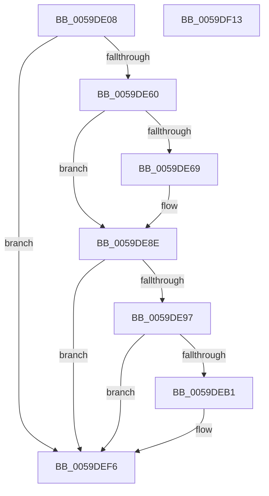

# IopLiveDumpRegisterWnfNotificationCallback

- RVA: `0x0059DE08`–`0x0059DF14` (길이 `268` bytes)
- VA: `0x000000014059DE08`
- 실행 섹션: `.text`
- PDB 이름 있음: `예`; PDB Function 태그: `아니요`
- unwind 정보 RVA: `0x000C7C58`
- 디코드: `59`개 명령, `268/268` bytes 표시
- 미해석 바이트: `0` (있으면 어셈블리에 `.byte`로 보존)

> 이 문서는 커널 이미지의 기계어와 PDB 기호를 분석해 생성했습니다. 4번과 5번은 함수 원형과 자료형을 바이너리 사용 방식에서 추정한 C 해석이며 원본 소스 복구 결과는 아닙니다.

## 1. Dependencies

- 직접 호출 지점: **6**; 고유 호출 대상: **6**
- 직접 호출자로 확인된 함수: **1**
- RIP 상대 이미지 참조: **7**

### Outgoing calls
- `0x0059DE53` → [ExSubscribeWnfStateChange](../../page/9D/ExSubscribeWnfStateChange_function_009D4BC0.md) (function, `0x009D4BC0`)
- `0x0059DE60` → [IopLiveDumpIsTracingEnabled](../4F/IopLiveDumpIsTracingEnabled_function_004FC5AC.md) (function, `0x004FC5AC`)
- `0x0059DE89` → [IopLiveDumpTrace](../5A/IopLiveDumpTrace_function_005A4070.md) (function, `0x005A4070`)
- `0x0059DEA8` → [tlgKeywordOn](../42/tlgKeywordOn_function_0042EAA0.md) (function, `0x0042EAA0`)
- `0x0059DEF1` → [tlgWriteTransfer_EtwWriteTransfer](../42/tlgWriteTransfer_EtwWriteTransfer_function_004260E0.md) (function, `0x004260E0`)
- `0x0059DEFD` → [_security_check_cookie](../6A/_security_check_cookie_function_006AC640.md) (function, `0x006AC640`)

### Direct callers
- [IopInitializeDumpPolicySettings](../../page/71/IopInitializeDumpPolicySettings_function_0071A444.md) at `0x0071A707`

### Static image references
- `0x0059DE18` → RVA `0x00E0A740` (`.data`; read)
- `0x0059DE28` → RVA `0x00020AC0` (`.rdata`; read)
- `0x0059DE40` → RVA `0x0059D6E0` (`IopLiveDumpPolicyChangeWnfCallback`; read)
- `0x0059DE6D` → RVA `0x006CA370` (` ?? ::FNODOBFM::`string'`; read)
- `0x0059DE82` → RVA `0x00021A40` (`.rdata`; read)
- `0x0059DE8E` → RVA `0x00E06EA0` (`.data`; read)
- `0x0059DEBD` → RVA `0x00045FB5` (`.rdata`; read)

## 2. Other-region calls and transfers

- 다른 실행 섹션으로 향하는 call: **1**
  - `0x0059DE53` → [ExSubscribeWnfStateChange](../../page/9D/ExSubscribeWnfStateChange_function_009D4BC0.md) (`.text` → `PAGE`)
- 별도 외부 분기/꼬리 이동을 확인하지 못했습니다.

## 3. Assembly (complete function range)

```asm
0059DE08  48 89 74 24 08                  mov qword ptr [rsp + 8], rsi
0059DE0D  55                              push rbp
0059DE0E  48 8B EC                        mov rbp, rsp
0059DE11  48 81 EC 80 00 00 00            sub rsp, 0x80
0059DE18  48 8B 05 21 C9 86 00            mov rax, qword ptr [rip + 0x86c921]
0059DE1F  48 33 C4                        xor rax, rsp
0059DE22  48 89 45 F8                     mov qword ptr [rbp - 8], rax
0059DE26  33 C0                           xor eax, eax
0059DE28  48 8D 15 91 2C A8 FF            lea rdx, [rip - 0x57d36f]
0059DE2F  48 21 44 24 28                  and qword ptr [rsp + 0x28], rax
0059DE34  48 8D 4D B0                     lea rcx, [rbp - 0x50]
0059DE38  89 45 BC                        mov dword ptr [rbp - 0x44], eax
0059DE3B  BE 38 00 00 00                  mov esi, 0x38
0059DE40  48 8D 05 99 F8 FF FF            lea rax, [rip - 0x767]
0059DE47  45 33 C9                        xor r9d, r9d
0059DE4A  48 89 44 24 20                  mov qword ptr [rsp + 0x20], rax
0059DE4F  44 8D 46 C9                     lea r8d, [rsi - 0x37]
0059DE53  E8 68 6D 43 00                  call 0x1409d4bc0
0059DE58  85 C0                           test eax, eax
0059DE5A  0F 89 96 00 00 00               jns 0x14059def6
0059DE60  E8 47 E7 F5 FF                  call 0x1404fc5ac
0059DE65  84 C0                           test al, al
0059DE67  74 25                           je 0x14059de8e
0059DE69  83 65 C4 00                     and dword ptr [rbp - 0x3c], 0
0059DE6D  48 8D 05 FC C4 12 00            lea rax, [rip + 0x12c4fc]
0059DE74  4C 8D 45 B8                     lea r8, [rbp - 0x48]
0059DE78  48 89 45 B8                     mov qword ptr [rbp - 0x48], rax
0059DE7C  8D 56 C9                        lea edx, [rsi - 0x37]
0059DE7F  89 75 C0                        mov dword ptr [rbp - 0x40], esi
0059DE82  48 8D 0D B7 3B A8 FF            lea rcx, [rip - 0x57c449]
0059DE89  E8 E2 61 00 00                  call 0x1405a4070
0059DE8E  83 3D 0B 90 86 00 05            cmp dword ptr [rip + 0x86900b], 5
0059DE95  76 5F                           jbe 0x14059def6
0059DE97  48 BA 00 00 00 00 00 40 00 00   movabs rdx, 0x400000000000
0059DEA1  48 8D 0D F8 8F 86 00            lea rcx, [rip + 0x868ff8]
0059DEA8  E8 F3 0B E9 FF                  call 0x14042eaa0
0059DEAD  84 C0                           test al, al
0059DEAF  74 45                           je 0x14059def6
0059DEB1  83 65 F4 00                     and dword ptr [rbp - 0xc], 0
0059DEB5  48 8D 45 B0                     lea rax, [rbp - 0x50]
0059DEB9  48 89 45 E8                     mov qword ptr [rbp - 0x18], rax
0059DEBD  48 8D 15 F1 80 AA FF            lea rdx, [rip - 0x557f0f]
0059DEC4  48 8D 45 C8                     lea rax, [rbp - 0x38]
0059DEC8  48 C7 45 B0 00 00 00 01         mov qword ptr [rbp - 0x50], 0x1000000
0059DED0  48 89 44 24 28                  mov qword ptr [rsp + 0x28], rax
0059DED5  48 8D 0D C4 8F 86 00            lea rcx, [rip + 0x868fc4]
0059DEDC  45 33 C9                        xor r9d, r9d
0059DEDF  C7 44 24 20 03 00 00 00         mov dword ptr [rsp + 0x20], 3
0059DEE7  45 33 C0                        xor r8d, r8d
0059DEEA  C7 45 F0 08 00 00 00            mov dword ptr [rbp - 0x10], 8
0059DEF1  E8 EA 81 E8 FF                  call 0x1404260e0
0059DEF6  48 8B 4D F8                     mov rcx, qword ptr [rbp - 8]
0059DEFA  48 33 CC                        xor rcx, rsp
0059DEFD  E8 3E E7 10 00                  call 0x1406ac640
0059DF02  48 8B B4 24 90 00 00 00         mov rsi, qword ptr [rsp + 0x90]
0059DF0A  48 81 C4 80 00 00 00            add rsp, 0x80
0059DF11  5D                              pop rbp
0059DF12  C3                              ret
0059DF13  CC                              int3
```

## 4. C-style interpretation (structured pseudocode)

```c
__int64 __fastcall IopLiveDumpRegisterWnfNotificationCallback(__int64 a1, __int64 a2, __int64 a3, int a4)
{
    __int64 result;
    __int64 v_rsp;
    unsigned __int64 v_stack_m10;
    unsigned int v_stack_m14;
    unsigned int v_stack_m18;
    unsigned __int64 v_stack_m20;
    unsigned __int64 v_stack_m40;
    unsigned int v_stack_m44;
    unsigned int v_stack_m48;
    unsigned int v_stack_m4C;
    unsigned __int64 v_stack_m50;
    unsigned __int64 v_stack_m58;
    unsigned __int64 v_stack_m60;
    unsigned __int64 v_stack_m68;
    unsigned __int64 v_stack_p8;

    v_stack_p8 = v_rsi;
    v_rsp = (v_rsp) - (128);
    result = (*(unsigned __int64 *)(v_rip + 8833313)) ^ (v_rsp);
    v_stack_m10 = result;
    result = 0;
    v_stack_m4C = 0;
    a4 = 0;
    v_stack_m68 = v_rip - 1895;
    result = ExSubscribeWnfStateChange(v_stack_m58, v_rip - 5755759, 56 - 55, a4);
    if (!sign_flag) goto loc_0059DEF6;
    result = IopLiveDumpIsTracingEnabled(v_stack_m58, v_rip - 5755759, 56 - 55, a4);
    if ((unsigned __int8)(result) != 0) {
        result = v_rip + 1230076;
        a3 = v_stack_m50;
        v_stack_m50 = result;
        a2 = 56 - 55;
        v_stack_m48 = 56;
        a1 = v_rip - 5751881;
        result = IopLiveDumpTrace(a1, a2, a3, a4);
    }
    if ((*(unsigned int *)(v_rip + 8818699)) <= 5) goto loc_0059DEF6;
    result = tlgKeywordOn(v_rip + 8818680, a2, a3, a4);
    if ((unsigned __int8)(result) != 0) {
        result = v_stack_m58;
        v_stack_m20 = result;
        a2 = v_rip - 5603087;
        result = v_stack_m40;
        v_stack_m58 = 0x1000000ULL;
        v_stack_m60 = result;
        a1 = v_rip + 8818628;
        a4 = 0;
        v_stack_m68 = 3;
        a3 = 0;
        v_stack_m18 = 8;
        result = tlgWriteTransfer_EtwWriteTransfer(a1, a2, a3, a4);
    }
    a1 = (v_stack_m10) ^ (v_rsp);
    result = _security_check_cookie(a1, a2, a3, a4);
    v_rsp = (v_rsp) + (128);
    return result;
}
```

## 5. (Beta) C Style

```c
int64_t IopLiveDumpRegisterWnfNotificationCallback(int64_t Arg1, int64_t Arg2, int64_t Arg3, int32_t Arg4)
{
    int64_t result;
    int64_t local_rsp;
    uint64_t v_stack_m10;
    uint32_t v_stack_m14;
    uint32_t v_stack_m18;
    uint64_t v_stack_m20;
    uint64_t v_stack_m40;
    uint32_t v_stack_m44;
    uint32_t v_stack_m48;
    uint32_t v_stack_m4C;
    uint64_t v_stack_m50;
    uint64_t v_stack_m58;
    uint64_t v_stack_m60;
    uint64_t v_stack_m68;
    uint64_t v_stack_p8;

    v_stack_p8 = local_rsi;
    local_rsp = (local_rsp) - (128);
    result = (*(uint64_t *)(v_rip + 0x86C921)) ^ (local_rsp);
    v_stack_m10 = result;
    result = 0;
    v_stack_m4C = 0;
    Arg4 = 0;
    v_stack_m68 = v_rip - 1895;
    result = ExSubscribeWnfStateChange(v_stack_m58, v_rip - 5755759, 56 - 55, Arg4);
    if (!sign_flag) goto loc_0059DEF6;
    result = IopLiveDumpIsTracingEnabled(v_stack_m58, v_rip - 5755759, 56 - 55, Arg4);
    if ((uint8_t)(result) != 0) {
        result = v_rip + 1230076;
        Arg3 = v_stack_m50;
        v_stack_m50 = result;
        Arg2 = 56 - 55;
        v_stack_m48 = 56;
        Arg1 = v_rip - 5751881;
        result = IopLiveDumpTrace(Arg1, Arg2, Arg3, Arg4);
    }
    if ((*(uint32_t *)(v_rip + 0x86900B)) <= 5) goto loc_0059DEF6;
    result = tlgKeywordOn(v_rip + 8818680, Arg2, Arg3, Arg4);
    if ((uint8_t)(result) != 0) {
        result = v_stack_m58;
        v_stack_m20 = result;
        Arg2 = v_rip - 5603087;
        result = v_stack_m40;
        v_stack_m58 = 0x1000000ULL;
        v_stack_m60 = result;
        Arg1 = v_rip + 8818628;
        Arg4 = 0;
        v_stack_m68 = 3;
        Arg3 = 0;
        v_stack_m18 = 8;
        result = tlgWriteTransfer_EtwWriteTransfer(Arg1, Arg2, Arg3, Arg4);
    }
    Arg1 = (v_stack_m10) ^ (local_rsp);
    result = _security_check_cookie(Arg1, Arg2, Arg3, Arg4);
    local_rsp = (local_rsp) + (128);
    return result;
}
```

## 6. Execution-region graph

[열기: 2D/3D 그래프와 함수 탐색 컨트롤 패널](../../../control-panel.html?section=text&rva=0x0059DE08&view=graph)

- 2D 그래프는 위에서 아래로 흐르고, 3D 그래프는 빈 공간을 드래그해 회전합니다. Shift+드래그는 이동, 휠은 확대·축소, 함수 노드 선택은 대상 보고서 이동입니다.

### Static fallback


