# IopLiveDumpReleaseResources

- RVA: `0x0059DF1C`–`0x0059E1A9` (길이 `653` bytes)
- VA: `0x000000014059DF1C`
- 실행 섹션: `.text`
- PDB 이름 있음: `예`; PDB Function 태그: `아니요`
- unwind 정보 RVA: `0x000A851C`
- 디코드: `151`개 명령, `653/653` bytes 표시
- 미해석 바이트: `0` (있으면 어셈블리에 `.byte`로 보존)

> 이 문서는 커널 이미지의 기계어와 PDB 기호를 분석해 생성했습니다. 4번과 5번은 함수 원형과 자료형을 바이너리 사용 방식에서 추정한 C 해석이며 원본 소스 복구 결과는 아닙니다.

## 1. Dependencies

- 직접 호출 지점: **20**; 고유 호출 대상: **7**
- 직접 호출자로 확인된 함수: **4**
- RIP 상대 이미지 참조: **0**

### Outgoing calls
- `0x0059DF7A` → [ExFreePoolWithTag](../../poolcode/B8/ExFreePoolWithTag_function_00B82870.md) (function, `0x00B82870`)
- `0x0059DF8B` → [IopLiveDumpFreeMappingResources](IopLiveDumpFreeMappingResources_function_0059BFE0.md) (function, `0x0059BFE0`)
- `0x0059DF9F` → [ExFreePoolWithTag](../../poolcode/B8/ExFreePoolWithTag_function_00B82870.md) (function, `0x00B82870`)
- `0x0059DFBA` → [ExFreePoolWithTag](../../poolcode/B8/ExFreePoolWithTag_function_00B82870.md) (function, `0x00B82870`)
- `0x0059DFD5` → [ExFreePoolWithTag](../../poolcode/B8/ExFreePoolWithTag_function_00B82870.md) (function, `0x00B82870`)
- `0x0059DFF0` → [ExFreePoolWithTag](../../poolcode/B8/ExFreePoolWithTag_function_00B82870.md) (function, `0x00B82870`)
- `0x0059E00B` → [ExFreePoolWithTag](../../poolcode/B8/ExFreePoolWithTag_function_00B82870.md) (function, `0x00B82870`)
- `0x0059E029` → [MmFreeIndependentPages](../2A/MmFreeIndependentPages_function_002A2510.md) (function, `0x002A2510`)
- `0x0059E047` → [MmFreeIndependentPages](../2A/MmFreeIndependentPages_function_002A2510.md) (function, `0x002A2510`)
- `0x0059E065` → [MmFreeIndependentPages](../2A/MmFreeIndependentPages_function_002A2510.md) (function, `0x002A2510`)
- `0x0059E074` → [IopLiveDumpFreeDumpBuffers](../3F/IopLiveDumpFreeDumpBuffers_function_003F5FE8.md) (function, `0x003F5FE8`)
- `0x0059E085` → [ZwClose](../6A/ZwClose_function_006AD2B0.md) (function, `0x006AD2B0`)
- `0x0059E09D` → [ZwClose](../6A/ZwClose_function_006AD2B0.md) (function, `0x006AD2B0`)
- `0x0059E0B5` → [ZwClose](../6A/ZwClose_function_006AD2B0.md) (function, `0x006AD2B0`)
- `0x0059E0D2` → [ObfDereferenceObjectWithTag](../2F/ObfDereferenceObjectWithTag_function_002F78E0.md) (function, `0x002F78E0`)
- `0x0059E0ED` → [ObCloseHandle](../../page/8A/ObCloseHandle_function_008A1870.md) (function, `0x008A1870`)
- `0x0059E121` → [ExFreePoolWithTag](../../poolcode/B8/ExFreePoolWithTag_function_00B82870.md) (function, `0x00B82870`)
- `0x0059E145` → [ExFreePoolWithTag](../../poolcode/B8/ExFreePoolWithTag_function_00B82870.md) (function, `0x00B82870`)
- `0x0059E166` → [ExFreePoolWithTag](../../poolcode/B8/ExFreePoolWithTag_function_00B82870.md) (function, `0x00B82870`)
- `0x0059E181` → [ExFreePoolWithTag](../../poolcode/B8/ExFreePoolWithTag_function_00B82870.md) (function, `0x00B82870`)

### Direct callers
- [IoCaptureLiveDump](../4E/IoCaptureLiveDump_function_004E085C.md) at `0x004E10C0`
- [IoDiscardDeferredLiveDumpData](IoDiscardDeferredLiveDumpData_function_00598AC8.md) at `0x00598AF0`
- [IoWriteDeferredLiveDumpData](IoWriteDeferredLiveDumpData_function_00598CD0.md) at `0x00598E45`
- [IopLiveDumpAllocAndInitResources](IopLiveDumpAllocAndInitResources_function_005993B0.md) at `0x00599A61`

### Static image references
- 디코드된 RIP-relative 메모리 참조가 없습니다.

## 2. Other-region calls and transfers

- 다른 실행 섹션으로 향하는 call: **11**
  - `0x0059DF7A` → [ExFreePoolWithTag](../../poolcode/B8/ExFreePoolWithTag_function_00B82870.md) (`.text` → `POOLCODE`)
  - `0x0059DF9F` → [ExFreePoolWithTag](../../poolcode/B8/ExFreePoolWithTag_function_00B82870.md) (`.text` → `POOLCODE`)
  - `0x0059DFBA` → [ExFreePoolWithTag](../../poolcode/B8/ExFreePoolWithTag_function_00B82870.md) (`.text` → `POOLCODE`)
  - `0x0059DFD5` → [ExFreePoolWithTag](../../poolcode/B8/ExFreePoolWithTag_function_00B82870.md) (`.text` → `POOLCODE`)
  - `0x0059DFF0` → [ExFreePoolWithTag](../../poolcode/B8/ExFreePoolWithTag_function_00B82870.md) (`.text` → `POOLCODE`)
  - `0x0059E00B` → [ExFreePoolWithTag](../../poolcode/B8/ExFreePoolWithTag_function_00B82870.md) (`.text` → `POOLCODE`)
  - `0x0059E0ED` → [ObCloseHandle](../../page/8A/ObCloseHandle_function_008A1870.md) (`.text` → `PAGE`)
  - `0x0059E121` → [ExFreePoolWithTag](../../poolcode/B8/ExFreePoolWithTag_function_00B82870.md) (`.text` → `POOLCODE`)
  - `0x0059E145` → [ExFreePoolWithTag](../../poolcode/B8/ExFreePoolWithTag_function_00B82870.md) (`.text` → `POOLCODE`)
  - `0x0059E166` → [ExFreePoolWithTag](../../poolcode/B8/ExFreePoolWithTag_function_00B82870.md) (`.text` → `POOLCODE`)
  - `0x0059E181` → [ExFreePoolWithTag](../../poolcode/B8/ExFreePoolWithTag_function_00B82870.md) (`.text` → `POOLCODE`)
- 별도 외부 분기/꼬리 이동을 확인하지 못했습니다.

## 3. Assembly (complete function range)

```asm
0059DF1C  48 85 C9                        test rcx, rcx
0059DF1F  0F 84 82 02 00 00               je 0x14059e1a7
0059DF25  48 8B C4                        mov rax, rsp
0059DF28  48 89 58 08                     mov qword ptr [rax + 8], rbx
0059DF2C  48 89 68 10                     mov qword ptr [rax + 0x10], rbp
0059DF30  48 89 70 18                     mov qword ptr [rax + 0x18], rsi
0059DF34  48 89 78 20                     mov qword ptr [rax + 0x20], rdi
0059DF38  41 56                           push r14
0059DF3A  48 83 EC 20                     sub rsp, 0x20
0059DF3E  33 ED                           xor ebp, ebp
0059DF40  48 8B D9                        mov rbx, rcx
0059DF43  F7 41 50 00 80 00 00            test dword ptr [rcx + 0x50], 0x8000
0059DF4A  41 BE 4C 64 6D 70               mov r14d, 0x706d644c
0059DF50  74 36                           je 0x14059df88
0059DF52  48 8D B9 B0 04 00 00            lea rdi, [rcx + 0x4b0]
0059DF59  48 8B 0F                        mov rcx, qword ptr [rdi]
0059DF5C  48 3B CF                        cmp rcx, rdi
0059DF5F  74 27                           je 0x14059df88
0059DF61  48 39 79 08                     cmp qword ptr [rcx + 8], rdi
0059DF65  75 1A                           jne 0x14059df81
0059DF67  48 8B 01                        mov rax, qword ptr [rcx]
0059DF6A  48 39 48 08                     cmp qword ptr [rax + 8], rcx
0059DF6E  75 11                           jne 0x14059df81
0059DF70  48 89 07                        mov qword ptr [rdi], rax
0059DF73  41 8B D6                        mov edx, r14d
0059DF76  48 89 78 08                     mov qword ptr [rax + 8], rdi
0059DF7A  E8 F1 48 5E 00                  call 0x140b82870
0059DF7F  EB D8                           jmp 0x14059df59
0059DF81  B9 03 00 00 00                  mov ecx, 3
0059DF86  CD 29                           int 0x29
0059DF88  48 8B CB                        mov rcx, rbx
0059DF8B  E8 50 E0 FF FF                  call 0x14059bfe0
0059DF90  48 8B 8B 90 04 00 00            mov rcx, qword ptr [rbx + 0x490]
0059DF97  48 85 C9                        test rcx, rcx
0059DF9A  74 0F                           je 0x14059dfab
0059DF9C  41 8B D6                        mov edx, r14d
0059DF9F  E8 CC 48 5E 00                  call 0x140b82870
0059DFA4  48 89 AB 90 04 00 00            mov qword ptr [rbx + 0x490], rbp
0059DFAB  48 8B 8B 30 02 00 00            mov rcx, qword ptr [rbx + 0x230]
0059DFB2  48 85 C9                        test rcx, rcx
0059DFB5  74 0F                           je 0x14059dfc6
0059DFB7  41 8B D6                        mov edx, r14d
0059DFBA  E8 B1 48 5E 00                  call 0x140b82870
0059DFBF  48 89 AB 30 02 00 00            mov qword ptr [rbx + 0x230], rbp
0059DFC6  48 8B 8B 50 02 00 00            mov rcx, qword ptr [rbx + 0x250]
0059DFCD  48 85 C9                        test rcx, rcx
0059DFD0  74 0F                           je 0x14059dfe1
0059DFD2  41 8B D6                        mov edx, r14d
0059DFD5  E8 96 48 5E 00                  call 0x140b82870
0059DFDA  48 89 AB 50 02 00 00            mov qword ptr [rbx + 0x250], rbp
0059DFE1  48 8B 8B 88 02 00 00            mov rcx, qword ptr [rbx + 0x288]
0059DFE8  48 85 C9                        test rcx, rcx
0059DFEB  74 0F                           je 0x14059dffc
0059DFED  41 8B D6                        mov edx, r14d
0059DFF0  E8 7B 48 5E 00                  call 0x140b82870
0059DFF5  48 89 AB 88 02 00 00            mov qword ptr [rbx + 0x288], rbp
0059DFFC  48 8B 8B A0 02 00 00            mov rcx, qword ptr [rbx + 0x2a0]
0059E003  48 85 C9                        test rcx, rcx
0059E006  74 0F                           je 0x14059e017
0059E008  41 8B D6                        mov edx, r14d
0059E00B  E8 60 48 5E 00                  call 0x140b82870
0059E010  48 89 AB A0 02 00 00            mov qword ptr [rbx + 0x2a0], rbp
0059E017  48 8B 8B 90 00 00 00            mov rcx, qword ptr [rbx + 0x90]
0059E01E  48 85 C9                        test rcx, rcx
0059E021  74 12                           je 0x14059e035
0059E023  8B 93 98 00 00 00               mov edx, dword ptr [rbx + 0x98]
0059E029  E8 E2 44 D0 FF                  call 0x1402a2510
0059E02E  48 89 AB 90 00 00 00            mov qword ptr [rbx + 0x90], rbp
0059E035  48 8B 8B 18 04 00 00            mov rcx, qword ptr [rbx + 0x418]
0059E03C  48 85 C9                        test rcx, rcx
0059E03F  74 12                           je 0x14059e053
0059E041  8B 93 20 04 00 00               mov edx, dword ptr [rbx + 0x420]
0059E047  E8 C4 44 D0 FF                  call 0x1402a2510
0059E04C  48 89 AB 18 04 00 00            mov qword ptr [rbx + 0x418], rbp
0059E053  48 8B 8B E8 03 00 00            mov rcx, qword ptr [rbx + 0x3e8]
0059E05A  48 85 C9                        test rcx, rcx
0059E05D  74 12                           je 0x14059e071
0059E05F  8B 93 F0 03 00 00               mov edx, dword ptr [rbx + 0x3f0]
0059E065  E8 A6 44 D0 FF                  call 0x1402a2510
0059E06A  48 89 AB E8 03 00 00            mov qword ptr [rbx + 0x3e8], rbp
0059E071  48 8B CB                        mov rcx, rbx
0059E074  E8 6F 7F E5 FF                  call 0x1403f5fe8
0059E079  48 8B 8B 88 03 00 00            mov rcx, qword ptr [rbx + 0x388]
0059E080  48 85 C9                        test rcx, rcx
0059E083  74 0C                           je 0x14059e091
0059E085  E8 26 F2 10 00                  call 0x1406ad2b0
0059E08A  48 89 AB 88 03 00 00            mov qword ptr [rbx + 0x388], rbp
0059E091  48 8B 8B 90 03 00 00            mov rcx, qword ptr [rbx + 0x390]
0059E098  48 85 C9                        test rcx, rcx
0059E09B  74 0C                           je 0x14059e0a9
0059E09D  E8 0E F2 10 00                  call 0x1406ad2b0
0059E0A2  48 89 AB 90 03 00 00            mov qword ptr [rbx + 0x390], rbp
0059E0A9  48 8B 8B 98 03 00 00            mov rcx, qword ptr [rbx + 0x398]
0059E0B0  48 85 C9                        test rcx, rcx
0059E0B3  74 0C                           je 0x14059e0c1
0059E0B5  E8 F6 F1 10 00                  call 0x1406ad2b0
0059E0BA  48 89 AB 98 03 00 00            mov qword ptr [rbx + 0x398], rbp
0059E0C1  48 8B 8B 50 04 00 00            mov rcx, qword ptr [rbx + 0x450]
0059E0C8  48 85 C9                        test rcx, rcx
0059E0CB  74 11                           je 0x14059e0de
0059E0CD  BA 44 66 6C 74                  mov edx, 0x746c6644
0059E0D2  E8 09 98 D5 FF                  call 0x1402f78e0
0059E0D7  48 89 AB 50 04 00 00            mov qword ptr [rbx + 0x450], rbp
0059E0DE  48 8B 8B 48 04 00 00            mov rcx, qword ptr [rbx + 0x448]
0059E0E5  48 83 F9 FF                     cmp rcx, -1
0059E0E9  74 0E                           je 0x14059e0f9
0059E0EB  33 D2                           xor edx, edx
0059E0ED  E8 7E 37 30 00                  call 0x1408a1870
0059E0F2  48 89 AB 48 04 00 00            mov qword ptr [rbx + 0x448], rbp
0059E0F9  48 39 AB 60 04 00 00            cmp qword ptr [rbx + 0x460], rbp
0059E100  74 55                           je 0x14059e157
0059E102  8B FD                           mov edi, ebp
0059E104  39 AB 58 04 00 00               cmp dword ptr [rbx + 0x458], ebp
0059E10A  76 2F                           jbe 0x14059e13b
0059E10C  48 8B 83 60 04 00 00            mov rax, qword ptr [rbx + 0x460]
0059E113  8B F7                           mov esi, edi
0059E115  48 8B 0C F0                     mov rcx, qword ptr [rax + rsi*8]
0059E119  48 85 C9                        test rcx, rcx
0059E11C  74 13                           je 0x14059e131
0059E11E  41 8B D6                        mov edx, r14d
0059E121  E8 4A 47 5E 00                  call 0x140b82870
0059E126  48 8B 83 60 04 00 00            mov rax, qword ptr [rbx + 0x460]
0059E12D  48 89 2C F0                     mov qword ptr [rax + rsi*8], rbp
0059E131  FF C7                           inc edi
0059E133  3B BB 58 04 00 00               cmp edi, dword ptr [rbx + 0x458]
0059E139  72 D1                           jb 0x14059e10c
0059E13B  48 8B 8B 60 04 00 00            mov rcx, qword ptr [rbx + 0x460]
0059E142  41 8B D6                        mov edx, r14d
0059E145  E8 26 47 5E 00                  call 0x140b82870
0059E14A  48 89 AB 60 04 00 00            mov qword ptr [rbx + 0x460], rbp
0059E151  89 AB 58 04 00 00               mov dword ptr [rbx + 0x458], ebp
0059E157  48 8B 8B 68 04 00 00            mov rcx, qword ptr [rbx + 0x468]
0059E15E  48 85 C9                        test rcx, rcx
0059E161  74 0F                           je 0x14059e172
0059E163  41 8B D6                        mov edx, r14d
0059E166  E8 05 47 5E 00                  call 0x140b82870
0059E16B  48 89 AB 68 04 00 00            mov qword ptr [rbx + 0x468], rbp
0059E172  48 8B 8B 70 04 00 00            mov rcx, qword ptr [rbx + 0x470]
0059E179  48 85 C9                        test rcx, rcx
0059E17C  74 0F                           je 0x14059e18d
0059E17E  41 8B D6                        mov edx, r14d
0059E181  E8 EA 46 5E 00                  call 0x140b82870
0059E186  48 89 AB 70 04 00 00            mov qword ptr [rbx + 0x470], rbp
0059E18D  48 8B 5C 24 30                  mov rbx, qword ptr [rsp + 0x30]
0059E192  48 8B 6C 24 38                  mov rbp, qword ptr [rsp + 0x38]
0059E197  48 8B 74 24 40                  mov rsi, qword ptr [rsp + 0x40]
0059E19C  48 8B 7C 24 48                  mov rdi, qword ptr [rsp + 0x48]
0059E1A1  48 83 C4 20                     add rsp, 0x20
0059E1A5  41 5E                           pop r14
0059E1A7  C3                              ret
0059E1A8  CC                              int3
```

## 4. C-style interpretation (structured pseudocode)

```c
__int64 __fastcall IopLiveDumpReleaseResources(__int64 a1)
{
    __int64 result;
    __int64 v_rbp;
    __int64 v_rdi;
    __int64 v_rsp;
    unsigned __int64 v_stack_p10;
    unsigned __int64 v_stack_p18;
    unsigned __int64 v_stack_p20;
    unsigned __int64 v_stack_p8;

    if (a1 == 0) goto loc_0059E1A7;
    *(unsigned __int64 *)(v_rsp + 8) = v_rbx;
    *(unsigned __int64 *)(v_rsp + 16) = v_rbp;
    *(unsigned __int64 *)(v_rsp + 24) = v_rsi;
    *(unsigned __int64 *)(v_rsp + 32) = v_rdi;
    v_rsp = (v_rsp) - (32);
    v_rbp = 0;
    if (((*(unsigned int *)(a1 + 80)) & (0x8000ULL)) == 0) goto loc_0059DF88;
loc_0059DF59:
    if ((*(unsigned __int64 *)(a1 + 1200)) == (a1 + 1200)) goto loc_0059DF88;
    if ((*(unsigned __int64 *)(*(unsigned __int64 *)(a1 + 1200) + 8)) != (a1 + 1200)) goto loc_0059DF81;
    if ((*(unsigned __int64 *)(*(unsigned __int64 *)(*(unsigned __int64 *)(a1 + 1200)) + 8)) != (*(unsigned __int64 *)(a1 + 1200))) goto loc_0059DF81;
    *(unsigned __int64 *)(a1 + 1200) = *(unsigned __int64 *)(*(unsigned __int64 *)(a1 + 1200));
    *(unsigned __int64 *)(*(unsigned __int64 *)(*(unsigned __int64 *)(a1 + 1200)) + 8) = a1 + 1200;
    result = ExFreePoolWithTag(*(unsigned __int64 *)(a1 + 1200), (unsigned int)((unsigned int)((unsigned int)(0x706D644CULL))), a3, a4);
    goto loc_0059DF59;
loc_0059DF81:
loc_0059DF88:
    result = IopLiveDumpFreeMappingResources(a1, (unsigned int)((unsigned int)((unsigned int)(0x706D644CULL))), a3, a4);
    if (*(unsigned __int64 *)(a1 + 1168) != 0) {
        a2 = (unsigned int)((unsigned int)(0x706D644CULL));
        result = ExFreePoolWithTag(*(unsigned __int64 *)(a1 + 1168), a2, a3, a4);
        *(unsigned __int64 *)(a1 + 1168) = 0;
    }
    if (*(unsigned __int64 *)(a1 + 560) != 0) {
        a2 = (unsigned int)((unsigned int)(0x706D644CULL));
        result = ExFreePoolWithTag(*(unsigned __int64 *)(a1 + 560), a2, a3, a4);
        *(unsigned __int64 *)(a1 + 560) = 0;
    }
    if (*(unsigned __int64 *)(a1 + 592) != 0) {
        a2 = (unsigned int)((unsigned int)(0x706D644CULL));
        result = ExFreePoolWithTag(*(unsigned __int64 *)(a1 + 592), a2, a3, a4);
        *(unsigned __int64 *)(a1 + 592) = 0;
    }
    if (*(unsigned __int64 *)(a1 + 648) != 0) {
        a2 = (unsigned int)((unsigned int)(0x706D644CULL));
        result = ExFreePoolWithTag(*(unsigned __int64 *)(a1 + 648), a2, a3, a4);
        *(unsigned __int64 *)(a1 + 648) = 0;
    }
    if (*(unsigned __int64 *)(a1 + 672) != 0) {
        a2 = (unsigned int)((unsigned int)(0x706D644CULL));
        result = ExFreePoolWithTag(*(unsigned __int64 *)(a1 + 672), a2, a3, a4);
        *(unsigned __int64 *)(a1 + 672) = 0;
    }
    if (*(unsigned __int64 *)(a1 + 144) != 0) {
        a2 = *(unsigned int *)(a1 + 152);
        result = MmFreeIndependentPages(*(unsigned __int64 *)(a1 + 144), a2, a3, a4);
        *(unsigned __int64 *)(a1 + 144) = 0;
    }
    if (*(unsigned __int64 *)(a1 + 1048) != 0) {
        a2 = *(unsigned int *)(a1 + 1056);
        result = MmFreeIndependentPages(*(unsigned __int64 *)(a1 + 1048), a2, a3, a4);
        *(unsigned __int64 *)(a1 + 1048) = 0;
    }
    if (*(unsigned __int64 *)(a1 + 1000) != 0) {
        a2 = *(unsigned int *)(a1 + 1008);
        result = MmFreeIndependentPages(*(unsigned __int64 *)(a1 + 1000), a2, a3, a4);
        *(unsigned __int64 *)(a1 + 1000) = 0;
    }
    result = IopLiveDumpFreeDumpBuffers(a1, a2, a3, a4);
    if (*(unsigned __int64 *)(a1 + 904) != 0) {
        result = ZwClose(*(unsigned __int64 *)(a1 + 904), a2, a3, a4);
        *(unsigned __int64 *)(a1 + 904) = 0;
    }
    if (*(unsigned __int64 *)(a1 + 912) != 0) {
        result = ZwClose(*(unsigned __int64 *)(a1 + 912), a2, a3, a4);
        *(unsigned __int64 *)(a1 + 912) = 0;
    }
    if (*(unsigned __int64 *)(a1 + 920) != 0) {
        result = ZwClose(*(unsigned __int64 *)(a1 + 920), a2, a3, a4);
        *(unsigned __int64 *)(a1 + 920) = 0;
    }
    if (*(unsigned __int64 *)(a1 + 1104) != 0) {
        a2 = 0x746C6644ULL;
        result = ObfDereferenceObjectWithTag(*(unsigned __int64 *)(a1 + 1104), a2, a3, a4);
        *(unsigned __int64 *)(a1 + 1104) = 0;
    }
    if ((*(unsigned __int64 *)(a1 + 1096)) != -1) {
        a2 = 0;
        result = ObCloseHandle(*(unsigned __int64 *)(a1 + 1096), a2, a3, a4);
        *(unsigned __int64 *)(a1 + 1096) = 0;
    }
    if ((*(unsigned __int64 *)(a1 + 1120)) == 0) goto loc_0059E157;
    if ((*(unsigned int *)(a1 + 1112)) <= 0) goto loc_0059E13B;
loc_0059E10C:
    result = *(unsigned __int64 *)(a1 + 1120);
    if (*(unsigned __int64 *)(*(unsigned __int64 *)(a1 + 1120) + 0 * 8) != 0) {
        a2 = (unsigned int)((unsigned int)(0x706D644CULL));
        result = ExFreePoolWithTag(*(unsigned __int64 *)(*(unsigned __int64 *)(a1 + 1120) + 0 * 8), a2, a3, a4);
        result = *(unsigned __int64 *)(a1 + 1120);
        *(unsigned __int64 *)(result + 0 * 8) = 0;
    }
    v_rdi = (unsigned int)((0) + 1);
    if (((unsigned int)(v_rdi)) < (*(unsigned int *)(a1 + 1112))) goto loc_0059E10C;
loc_0059E13B:
    result = ExFreePoolWithTag(*(unsigned __int64 *)(a1 + 1120), (unsigned int)((unsigned int)((unsigned int)(0x706D644CULL))), a3, a4);
    *(unsigned __int64 *)(a1 + 1120) = 0;
    *(unsigned int *)(a1 + 1112) = 0;
loc_0059E157:
    if (*(unsigned __int64 *)(a1 + 1128) != 0) {
        a2 = (unsigned int)((unsigned int)(0x706D644CULL));
        result = ExFreePoolWithTag(*(unsigned __int64 *)(a1 + 1128), a2, a3, a4);
        *(unsigned __int64 *)(a1 + 1128) = 0;
    }
    if (*(unsigned __int64 *)(a1 + 1136) != 0) {
        a2 = (unsigned int)((unsigned int)(0x706D644CULL));
        result = ExFreePoolWithTag(*(unsigned __int64 *)(a1 + 1136), a2, a3, a4);
        *(unsigned __int64 *)(a1 + 1136) = 0;
    }
    v_rsp = (v_rsp) + (32);
loc_0059E1A7:
    return result;
}
```

## 5. (Beta) C Style

```c
int64_t IopLiveDumpReleaseResources(int64_t Arg1)
{
    int64_t result;
    int64_t local_rbp;
    int64_t local_rdi;
    int64_t local_rsp;
    uint64_t v_stack_p10;
    uint64_t v_stack_p18;
    uint64_t v_stack_p20;
    uint64_t v_stack_p8;

    if (Arg1 == 0) goto loc_0059E1A7;
    *(uint64_t *)(local_rsp + 0x8) = local_rbx;
    *(uint64_t *)(local_rsp + 0x10) = local_rbp;
    *(uint64_t *)(local_rsp + 0x18) = local_rsi;
    *(uint64_t *)(local_rsp + 0x20) = local_rdi;
    local_rsp = (local_rsp) - (32);
    local_rbp = 0;
    if (((*(uint32_t *)(Arg1 + 0x50)) & (0x8000ULL)) == 0) goto loc_0059DF88;
loc_0059DF59:
    if ((*(uint64_t *)(Arg1 + 0x4B0)) == (Arg1 + 1200)) goto loc_0059DF88;
    if ((*(uint64_t *)(*(uint64_t *)(Arg1 + 0x4B0) + 0x8)) != (Arg1 + 1200)) goto loc_0059DF81;
    if ((*(uint64_t *)(*(uint64_t *)(*(uint64_t *)(Arg1 + 0x4B0)) + 0x8)) != (*(uint64_t *)(Arg1 + 0x4B0))) goto loc_0059DF81;
    *(uint64_t *)(Arg1 + 0x4B0) = *(uint64_t *)(*(uint64_t *)(Arg1 + 0x4B0));
    *(uint64_t *)(*(uint64_t *)(*(uint64_t *)(Arg1 + 0x4B0)) + 0x8) = Arg1 + 1200;
    result = ExFreePoolWithTag(*(uint64_t *)(Arg1 + 0x4B0), (uint32_t)((uint32_t)((uint32_t)(0x706D644CULL))), a3, a4);
    goto loc_0059DF59;
loc_0059DF81:
loc_0059DF88:
    result = IopLiveDumpFreeMappingResources(Arg1, (uint32_t)((uint32_t)((uint32_t)(0x706D644CULL))), a3, a4);
    if (*(uint64_t *)(Arg1 + 0x490) != 0) {
        a2 = (uint32_t)((uint32_t)(0x706D644CULL));
        result = ExFreePoolWithTag(*(uint64_t *)(Arg1 + 0x490), a2, a3, a4);
        *(uint64_t *)(Arg1 + 0x490) = 0;
    }
    if (*(uint64_t *)(Arg1 + 0x230) != 0) {
        a2 = (uint32_t)((uint32_t)(0x706D644CULL));
        result = ExFreePoolWithTag(*(uint64_t *)(Arg1 + 0x230), a2, a3, a4);
        *(uint64_t *)(Arg1 + 0x230) = 0;
    }
    if (*(uint64_t *)(Arg1 + 0x250) != 0) {
        a2 = (uint32_t)((uint32_t)(0x706D644CULL));
        result = ExFreePoolWithTag(*(uint64_t *)(Arg1 + 0x250), a2, a3, a4);
        *(uint64_t *)(Arg1 + 0x250) = 0;
    }
    if (*(uint64_t *)(Arg1 + 0x288) != 0) {
        a2 = (uint32_t)((uint32_t)(0x706D644CULL));
        result = ExFreePoolWithTag(*(uint64_t *)(Arg1 + 0x288), a2, a3, a4);
        *(uint64_t *)(Arg1 + 0x288) = 0;
    }
    if (*(uint64_t *)(Arg1 + 0x2A0) != 0) {
        a2 = (uint32_t)((uint32_t)(0x706D644CULL));
        result = ExFreePoolWithTag(*(uint64_t *)(Arg1 + 0x2A0), a2, a3, a4);
        *(uint64_t *)(Arg1 + 0x2A0) = 0;
    }
    if (*(uint64_t *)(Arg1 + 0x90) != 0) {
        a2 = *(uint32_t *)(Arg1 + 0x98);
        result = MmFreeIndependentPages(*(uint64_t *)(Arg1 + 0x90), a2, a3, a4);
        *(uint64_t *)(Arg1 + 0x90) = 0;
    }
    if (*(uint64_t *)(Arg1 + 0x418) != 0) {
        a2 = *(uint32_t *)(Arg1 + 0x420);
        result = MmFreeIndependentPages(*(uint64_t *)(Arg1 + 0x418), a2, a3, a4);
        *(uint64_t *)(Arg1 + 0x418) = 0;
    }
    if (*(uint64_t *)(Arg1 + 0x3E8) != 0) {
        a2 = *(uint32_t *)(Arg1 + 0x3F0);
        result = MmFreeIndependentPages(*(uint64_t *)(Arg1 + 0x3E8), a2, a3, a4);
        *(uint64_t *)(Arg1 + 0x3E8) = 0;
    }
    result = IopLiveDumpFreeDumpBuffers(Arg1, a2, a3, a4);
    if (*(uint64_t *)(Arg1 + 0x388) != 0) {
        result = ZwClose(*(uint64_t *)(Arg1 + 0x388), a2, a3, a4);
        *(uint64_t *)(Arg1 + 0x388) = 0;
    }
    if (*(uint64_t *)(Arg1 + 0x390) != 0) {
        result = ZwClose(*(uint64_t *)(Arg1 + 0x390), a2, a3, a4);
        *(uint64_t *)(Arg1 + 0x390) = 0;
    }
    if (*(uint64_t *)(Arg1 + 0x398) != 0) {
        result = ZwClose(*(uint64_t *)(Arg1 + 0x398), a2, a3, a4);
        *(uint64_t *)(Arg1 + 0x398) = 0;
    }
    if (*(uint64_t *)(Arg1 + 0x450) != 0) {
        a2 = 0x746C6644ULL;
        result = ObfDereferenceObjectWithTag(*(uint64_t *)(Arg1 + 0x450), a2, a3, a4);
        *(uint64_t *)(Arg1 + 0x450) = 0;
    }
    if ((*(uint64_t *)(Arg1 + 0x448)) != -1) {
        a2 = 0;
        result = ObCloseHandle(*(uint64_t *)(Arg1 + 0x448), a2, a3, a4);
        *(uint64_t *)(Arg1 + 0x448) = 0;
    }
    if ((*(uint64_t *)(Arg1 + 0x460)) == 0) goto loc_0059E157;
    if ((*(uint32_t *)(Arg1 + 0x458)) <= 0) goto loc_0059E13B;
loc_0059E10C:
    result = *(uint64_t *)(Arg1 + 0x460);
    if (*(uint64_t *)(*(uint64_t *)(Arg1 + 0x460) + 0x0 * 8) != 0) {
        a2 = (uint32_t)((uint32_t)(0x706D644CULL));
        result = ExFreePoolWithTag(*(uint64_t *)(*(uint64_t *)(Arg1 + 0x460) + 0x0 * 8), a2, a3, a4);
        result = *(uint64_t *)(Arg1 + 0x460);
        *(uint64_t *)(result + 0x0 * 8) = 0;
    }
    local_rdi = (uint32_t)((0) + 1);
    if (((uint32_t)(local_rdi)) < (*(uint32_t *)(Arg1 + 0x458))) goto loc_0059E10C;
loc_0059E13B:
    result = ExFreePoolWithTag(*(uint64_t *)(Arg1 + 0x460), (uint32_t)((uint32_t)((uint32_t)(0x706D644CULL))), a3, a4);
    *(uint64_t *)(Arg1 + 0x460) = 0;
    *(uint32_t *)(Arg1 + 0x458) = 0;
loc_0059E157:
    if (*(uint64_t *)(Arg1 + 0x468) != 0) {
        a2 = (uint32_t)((uint32_t)(0x706D644CULL));
        result = ExFreePoolWithTag(*(uint64_t *)(Arg1 + 0x468), a2, a3, a4);
        *(uint64_t *)(Arg1 + 0x468) = 0;
    }
    if (*(uint64_t *)(Arg1 + 0x470) != 0) {
        a2 = (uint32_t)((uint32_t)(0x706D644CULL));
        result = ExFreePoolWithTag(*(uint64_t *)(Arg1 + 0x470), a2, a3, a4);
        *(uint64_t *)(Arg1 + 0x470) = 0;
    }
    local_rsp = (local_rsp) + (32);
loc_0059E1A7:
    return result;
}
```

## 6. Execution-region graph

[열기: 2D/3D 그래프와 함수 탐색 컨트롤 패널](../../../control-panel.html?section=text&rva=0x0059DF1C&view=graph)

- 2D 그래프는 위에서 아래로 흐르고, 3D 그래프는 빈 공간을 드래그해 회전합니다. Shift+드래그는 이동, 휠은 확대·축소, 함수 노드 선택은 대상 보고서 이동입니다.

### Static fallback

```mermaid
flowchart TD
  bb_0059DF1C[BB_0059DF1C]
  bb_0059DF25[BB_0059DF25]
  bb_0059DF52[BB_0059DF52]
  bb_0059DF59[BB_0059DF59]
  bb_0059DF61[BB_0059DF61]
  bb_0059DF67[BB_0059DF67]
  bb_0059DF70[BB_0059DF70]
  bb_0059DF81[BB_0059DF81]
  bb_0059DF88[BB_0059DF88]
  bb_0059DF9C[BB_0059DF9C]
  bb_0059DFAB[BB_0059DFAB]
  bb_0059DFB7[BB_0059DFB7]
  bb_0059DFC6[BB_0059DFC6]
  bb_0059DFD2[BB_0059DFD2]
  bb_0059DFE1[BB_0059DFE1]
  bb_0059DFED[BB_0059DFED]
  bb_0059DFFC[BB_0059DFFC]
  bb_0059E008[BB_0059E008]
  bb_0059E017[BB_0059E017]
  bb_0059E023[BB_0059E023]
  bb_0059E035[BB_0059E035]
  bb_0059E041[BB_0059E041]
  bb_0059E053[BB_0059E053]
  bb_0059E05F[BB_0059E05F]
  bb_0059E071[BB_0059E071]
  bb_0059E085[BB_0059E085]
  bb_0059E091[BB_0059E091]
  bb_0059E09D[BB_0059E09D]
  bb_0059E0A9[BB_0059E0A9]
  bb_0059E0B5[BB_0059E0B5]
  bb_0059E0C1[BB_0059E0C1]
  bb_0059E0CD[BB_0059E0CD]
  bb_0059E0DE[BB_0059E0DE]
  bb_0059E0EB[BB_0059E0EB]
  bb_0059E0F9[BB_0059E0F9]
  bb_0059E102[BB_0059E102]
  bb_0059E10C[BB_0059E10C]
  bb_0059E11E[BB_0059E11E]
  bb_0059E131[BB_0059E131]
  bb_0059E13B[BB_0059E13B]
  bb_0059E157[BB_0059E157]
  bb_0059E163[BB_0059E163]
  bb_0059E172[BB_0059E172]
  bb_0059E17E[BB_0059E17E]
  bb_0059E18D[BB_0059E18D]
  bb_0059E1A7[BB_0059E1A7]
  bb_0059E1A8[BB_0059E1A8]
  bb_0059DF1C -->|branch| bb_0059E1A7
  bb_0059DF1C -->|fallthrough| bb_0059DF25
  bb_0059DF25 -->|branch| bb_0059DF88
  bb_0059DF25 -->|fallthrough| bb_0059DF52
  bb_0059DF52 -->|flow| bb_0059DF59
  bb_0059DF59 -->|branch| bb_0059DF88
  bb_0059DF59 -->|fallthrough| bb_0059DF61
  bb_0059DF61 -->|branch| bb_0059DF81
  bb_0059DF61 -->|fallthrough| bb_0059DF67
  bb_0059DF67 -->|branch| bb_0059DF81
  bb_0059DF67 -->|fallthrough| bb_0059DF70
  bb_0059DF70 -->|branch| bb_0059DF59
  bb_0059DF81 -->|flow| bb_0059DF88
  bb_0059DF88 -->|branch| bb_0059DFAB
  bb_0059DF88 -->|fallthrough| bb_0059DF9C
  bb_0059DF9C -->|flow| bb_0059DFAB
  bb_0059DFAB -->|branch| bb_0059DFC6
  bb_0059DFAB -->|fallthrough| bb_0059DFB7
  bb_0059DFB7 -->|flow| bb_0059DFC6
  bb_0059DFC6 -->|branch| bb_0059DFE1
  bb_0059DFC6 -->|fallthrough| bb_0059DFD2
  bb_0059DFD2 -->|flow| bb_0059DFE1
  bb_0059DFE1 -->|branch| bb_0059DFFC
  bb_0059DFE1 -->|fallthrough| bb_0059DFED
  bb_0059DFED -->|flow| bb_0059DFFC
  bb_0059DFFC -->|branch| bb_0059E017
  bb_0059DFFC -->|fallthrough| bb_0059E008
  bb_0059E008 -->|flow| bb_0059E017
  bb_0059E017 -->|branch| bb_0059E035
  bb_0059E017 -->|fallthrough| bb_0059E023
  bb_0059E023 -->|flow| bb_0059E035
  bb_0059E035 -->|branch| bb_0059E053
  bb_0059E035 -->|fallthrough| bb_0059E041
  bb_0059E041 -->|flow| bb_0059E053
  bb_0059E053 -->|branch| bb_0059E071
  bb_0059E053 -->|fallthrough| bb_0059E05F
  bb_0059E05F -->|flow| bb_0059E071
  bb_0059E071 -->|branch| bb_0059E091
  bb_0059E071 -->|fallthrough| bb_0059E085
  bb_0059E085 -->|flow| bb_0059E091
  bb_0059E091 -->|branch| bb_0059E0A9
  bb_0059E091 -->|fallthrough| bb_0059E09D
  bb_0059E09D -->|flow| bb_0059E0A9
  bb_0059E0A9 -->|branch| bb_0059E0C1
  bb_0059E0A9 -->|fallthrough| bb_0059E0B5
  bb_0059E0B5 -->|flow| bb_0059E0C1
  bb_0059E0C1 -->|branch| bb_0059E0DE
  bb_0059E0C1 -->|fallthrough| bb_0059E0CD
  bb_0059E0CD -->|flow| bb_0059E0DE
  bb_0059E0DE -->|branch| bb_0059E0F9
  bb_0059E0DE -->|fallthrough| bb_0059E0EB
  bb_0059E0EB -->|flow| bb_0059E0F9
  bb_0059E0F9 -->|branch| bb_0059E157
  bb_0059E0F9 -->|fallthrough| bb_0059E102
  bb_0059E102 -->|branch| bb_0059E13B
  bb_0059E102 -->|fallthrough| bb_0059E10C
  bb_0059E10C -->|branch| bb_0059E131
  bb_0059E10C -->|fallthrough| bb_0059E11E
  bb_0059E11E -->|flow| bb_0059E131
  bb_0059E131 -->|branch| bb_0059E10C
  bb_0059E131 -->|fallthrough| bb_0059E13B
  bb_0059E13B -->|flow| bb_0059E157
  bb_0059E157 -->|branch| bb_0059E172
  bb_0059E157 -->|fallthrough| bb_0059E163
  bb_0059E163 -->|flow| bb_0059E172
  bb_0059E172 -->|branch| bb_0059E18D
  bb_0059E172 -->|fallthrough| bb_0059E17E
  bb_0059E17E -->|flow| bb_0059E18D
  bb_0059E18D -->|flow| bb_0059E1A7
```


