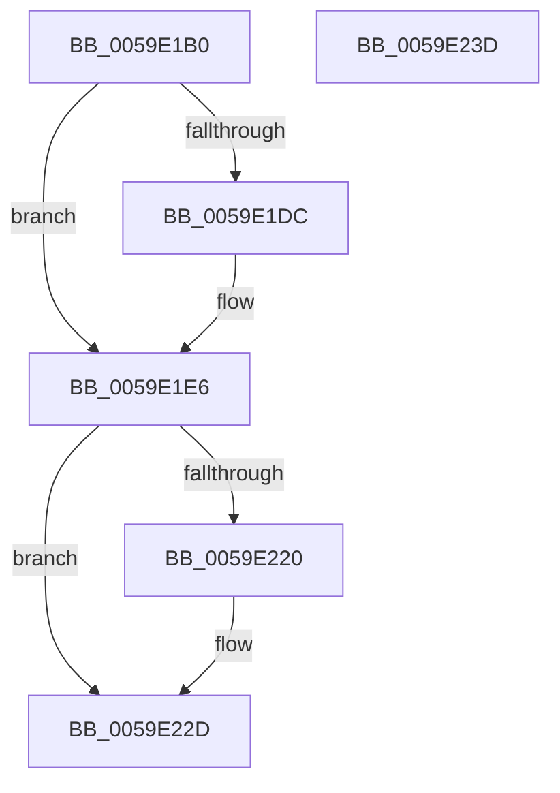

# IopLiveDumpRemoveSystemCacheFromDump

- RVA: `0x0059E1B0`–`0x0059E23E` (길이 `142` bytes)
- VA: `0x000000014059E1B0`
- 실행 섹션: `.text`
- PDB 이름 있음: `예`; PDB Function 태그: `아니요`
- unwind 정보 RVA: `0x0007F83C`
- 디코드: `39`개 명령, `142/142` bytes 표시
- 미해석 바이트: `0` (있으면 어셈블리에 `.byte`로 보존)

> 이 문서는 커널 이미지의 기계어와 PDB 기호를 분석해 생성했습니다. 4번과 5번은 함수 원형과 자료형을 바이너리 사용 방식에서 추정한 C 해석이며 원본 소스 복구 결과는 아닙니다.

## 1. Dependencies

- 직접 호출 지점: **3**; 고유 호출 대상: **2**
- 직접 호출자로 확인된 함수: **1**
- RIP 상대 이미지 참조: **1**

### Outgoing calls
- `0x0059E1DE` → [IopLiveDumpGetMillisecondCounter](../3F/IopLiveDumpGetMillisecondCounter_function_003F5964.md) (function, `0x003F5964`)
- `0x0059E214` → [MmRemoveSystemCacheFromDump](../67/MmRemoveSystemCacheFromDump_function_0067DD58.md) (function, `0x0067DD58`)
- `0x0059E222` → [IopLiveDumpGetMillisecondCounter](../3F/IopLiveDumpGetMillisecondCounter_function_003F5964.md) (function, `0x003F5964`)

### Direct callers
- [IopLiveDumpPopulateBitmapForDump](IopLiveDumpPopulateBitmapForDump_function_0059D9B0.md) at `0x0059DA0E`

### Static image references
- `0x0059E1F9` → RVA `0x005927B0` (`IoFreeDumpRange`; read)

## 2. Other-region calls and transfers

- 다른 실행 섹션으로 향하는 call: **0**
- 별도 외부 분기/꼬리 이동을 확인하지 못했습니다.

## 3. Assembly (complete function range)

```asm
0059E1B0  48 8B C4                        mov rax, rsp
0059E1B3  48 89 58 08                     mov qword ptr [rax + 8], rbx
0059E1B7  48 89 70 10                     mov qword ptr [rax + 0x10], rsi
0059E1BB  57                              push rdi
0059E1BC  48 83 EC 50                     sub rsp, 0x50
0059E1C0  48 83 60 E0 00                  and qword ptr [rax - 0x20], 0
0059E1C5  33 DB                           xor ebx, ebx
0059E1C7  48 83 60 F0 00                  and qword ptr [rax - 0x10], 0
0059E1CC  49 8B F0                        mov rsi, r8
0059E1CF  49 21 18                        and qword ptr [r8], rbx
0059E1D2  48 8B F9                        mov rdi, rcx
0059E1D5  8B 41 50                        mov eax, dword ptr [rcx + 0x50]
0059E1D8  84 C0                           test al, al
0059E1DA  79 0A                           jns 0x14059e1e6
0059E1DC  33 C9                           xor ecx, ecx
0059E1DE  E8 81 77 E5 FF                  call 0x1403f5964
0059E1E3  48 8B D8                        mov rbx, rax
0059E1E6  48 83 64 24 40 00               and qword ptr [rsp + 0x40], 0
0059E1EC  48 8D 8F 58 02 00 00            lea rcx, [rdi + 0x258]
0059E1F3  48 83 64 24 20 00               and qword ptr [rsp + 0x20], 0
0059E1F9  48 8D 05 B0 45 FF FF            lea rax, [rip - 0xba50]
0059E200  83 4C 24 48 01                  or dword ptr [rsp + 0x48], 1
0059E205  48 89 4C 24 30                  mov qword ptr [rsp + 0x30], rcx
0059E20A  48 8D 4C 24 20                  lea rcx, [rsp + 0x20]
0059E20F  48 89 44 24 28                  mov qword ptr [rsp + 0x28], rax
0059E214  E8 3F FB 0D 00                  call 0x14067dd58
0059E219  8B 4F 50                        mov ecx, dword ptr [rdi + 0x50]
0059E21C  84 C9                           test cl, cl
0059E21E  79 0D                           jns 0x14059e22d
0059E220  33 C9                           xor ecx, ecx
0059E222  E8 3D 77 E5 FF                  call 0x1403f5964
0059E227  48 2B C3                        sub rax, rbx
0059E22A  48 89 06                        mov qword ptr [rsi], rax
0059E22D  48 8B 5C 24 60                  mov rbx, qword ptr [rsp + 0x60]
0059E232  48 8B 74 24 68                  mov rsi, qword ptr [rsp + 0x68]
0059E237  48 83 C4 50                     add rsp, 0x50
0059E23B  5F                              pop rdi
0059E23C  C3                              ret
0059E23D  CC                              int3
```

## 4. C-style interpretation (structured pseudocode)

```c
__int64 __fastcall IopLiveDumpRemoveSystemCacheFromDump(__int64 a1, __int64 a2, __int64 a3)
{
    __int64 result;
    __int64 v_rbx;
    __int64 v_rsp;
    unsigned int v_stack_m10;
    unsigned __int64 v_stack_m18;
    unsigned __int64 v_stack_m28;
    unsigned __int64 v_stack_m30;
    unsigned __int64 v_stack_m38;
    unsigned __int64 v_stack_p10;
    unsigned __int64 v_stack_p8;

    *(unsigned __int64 *)(v_rsp + 8) = v_rbx;
    *(unsigned __int64 *)(v_rsp + 16) = v_rsi;
    v_rsp = (v_rsp) - (80);
    v_rbx = 0;
    result = (unsigned int)(*(unsigned int *)(a1 + 80));
    if (sign_flag) {
        a1 = 0;
        result = IopLiveDumpGetMillisecondCounter(a1, a2, a3, a4);
        v_rbx = result;
    }
    v_stack_m28 = a1 + 600;
    v_stack_m30 = v_rip - 47696;
    result = MmRemoveSystemCacheFromDump(v_stack_m38, a2, a3, a4);
    if (sign_flag) {
        a1 = 0;
        result = IopLiveDumpGetMillisecondCounter(a1, a2, a3, a4);
        result = (result) - (v_rbx);
        *(unsigned __int64 *)(a3) = result;
    }
    v_rsp = (v_rsp) + (80);
    return result;
}
```

## 5. (Beta) C Style

```c
int64_t IopLiveDumpRemoveSystemCacheFromDump(void *Arg1, int64_t Arg2, void *Arg3)
{
    uint8_t *arg1 = (uint8_t *)Arg1;
    uint8_t *arg3 = (uint8_t *)Arg3;

    int64_t result;
    int64_t local_rbx;
    int64_t local_rsp;
    uint32_t v_stack_m10;
    uint64_t v_stack_m18;
    uint64_t v_stack_m28;
    uint64_t v_stack_m30;
    uint64_t v_stack_m38;
    uint64_t v_stack_p10;
    uint64_t v_stack_p8;

    *(uint64_t *)(local_rsp + 0x8) = local_rbx;
    *(uint64_t *)(local_rsp + 0x10) = local_rsi;
    local_rsp = (local_rsp) - (80);
    local_rbx = 0;
    result = (uint32_t)(*(uint32_t *)(arg1 + 0x50));
    if (sign_flag) {
        Arg1 = 0;
        result = IopLiveDumpGetMillisecondCounter(Arg1, Arg2, Arg3, a4);
        local_rbx = result;
    }
    v_stack_m28 = Arg1 + 600;
    v_stack_m30 = v_rip - 47696;
    result = MmRemoveSystemCacheFromDump(v_stack_m38, Arg2, Arg3, a4);
    if (sign_flag) {
        Arg1 = 0;
        result = IopLiveDumpGetMillisecondCounter(Arg1, Arg2, Arg3, a4);
        result = (result) - (local_rbx);
        *(uint64_t *)(arg3) = result;
    }
    local_rsp = (local_rsp) + (80);
    return result;
}
```

### 관측된 메모리 오프셋

구조체 형식이 확인되지 않은 접근은 인자 기준의 오프셋으로만 기록했습니다.

| 기준 인자 | 오프셋 표현 | 폭 (bit) | 접근 |
|---|---:|---:|---|
| `Arg1` | `+ 0x50` | `32` | `R` |
| `Arg1` | `+ 0x258` | `64` | `R` |
| `Arg3` | `+ 0x0` | `64` | `R/W` |
| `Arg3` | `+ 0x0` | `64` | `W` |

## 6. Execution-region graph

[열기: 2D/3D 그래프와 함수 탐색 컨트롤 패널](../../../control-panel.html?section=text&rva=0x0059E1B0&view=graph)

- 2D 그래프는 위에서 아래로 흐르고, 3D 그래프는 빈 공간을 드래그해 회전합니다. Shift+드래그는 이동, 휠은 확대·축소, 함수 노드 선택은 대상 보고서 이동입니다.

### Static fallback


