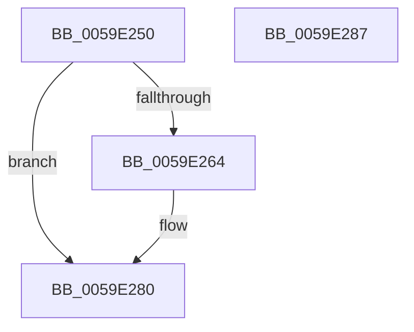

# IopLiveDumpStartMirroringCallback

- RVA: `0x0059E250`–`0x0059E288` (길이 `56` bytes)
- VA: `0x000000014059E250`
- 실행 섹션: `.text`
- PDB 이름 있음: `예`; PDB Function 태그: `아니요`
- unwind 정보 RVA: `0x0005C788`
- 디코드: `15`개 명령, `56/56` bytes 표시
- 미해석 바이트: `0` (있으면 어셈블리에 `.byte`로 보존)

> 이 문서는 커널 이미지의 기계어와 PDB 기호를 분석해 생성했습니다. 4번과 5번은 함수 원형과 자료형을 바이너리 사용 방식에서 추정한 C 해석이며 원본 소스 복구 결과는 아닙니다.

## 1. Dependencies

- 직접 호출 지점: **2**; 고유 호출 대상: **2**
- 직접 호출자로 확인된 함수: **0**
- RIP 상대 이미지 참조: **3**

### Outgoing calls
- `0x0059E25B` → [IopLiveDumpIsTracingEnabled](../4F/IopLiveDumpIsTracingEnabled_function_004FC5AC.md) (function, `0x004FC5AC`)
- `0x0059E27B` → [IopLiveDumpTraceNoArgs](../5A/IopLiveDumpTraceNoArgs_function_005A43C0.md) (function, `0x005A43C0`)

### Direct callers
- 이 함수 시작 RVA로 연결되는 직접 call은 확인되지 않았습니다. 간접 호출은 완전히 역산할 수 없습니다.

### Static image references
- `0x0059E254` → RVA `0x00E66188` (`.data`; read)
- `0x0059E269` → RVA `0x00020C38` (`.rdata`; read)
- `0x0059E270` → RVA `0x000226E8` (`.rdata`; read)

## 2. Other-region calls and transfers

- 다른 실행 섹션으로 향하는 call: **0**
- 별도 외부 분기/꼬리 이동을 확인하지 못했습니다.

## 3. Assembly (complete function range)

```asm
0059E250  48 83 EC 28                     sub rsp, 0x28
0059E254  48 8B 0D 2D 7F 8C 00            mov rcx, qword ptr [rip + 0x8c7f2d]
0059E25B  E8 4C E3 F5 FF                  call 0x1404fc5ac
0059E260  84 C0                           test al, al
0059E262  74 1C                           je 0x14059e280
0059E264  8B 41 50                        mov eax, dword ptr [rcx + 0x50]
0059E267  A8 01                           test al, 1
0059E269  48 8D 05 C8 29 A8 FF            lea rax, [rip - 0x57d638]
0059E270  48 8D 0D 71 44 A8 FF            lea rcx, [rip - 0x57bb8f]
0059E277  48 0F 44 C8                     cmove rcx, rax
0059E27B  E8 40 61 00 00                  call 0x1405a43c0
0059E280  33 C0                           xor eax, eax
0059E282  48 83 C4 28                     add rsp, 0x28
0059E286  C3                              ret
0059E287  CC                              int3
```

## 4. C-style interpretation (structured pseudocode)

```c
__int64 __fastcall IopLiveDumpStartMirroringCallback(void)
{
    __int64 result;
    __int64 v_rsp;

    v_rsp = (v_rsp) - (40);
    result = IopLiveDumpIsTracingEnabled(*(unsigned __int64 *)(v_rip + 9207597), a2, a3, a4);
    if ((unsigned __int8)(result) != 0) {
        result = *(unsigned int *)(*(unsigned __int64 *)(v_rip + 9207597) + 80);
        result = v_rip - 5756472;
        a1 = v_rip - 5749647;
        if ((((unsigned __int8)(result)) & (1)) == 0) { a1 = result; }
        result = IopLiveDumpTraceNoArgs(a1, a2, a3, a4);
    }
    result = 0;
    v_rsp = (v_rsp) + (40);
    return result;
}
```

## 5. (Beta) C Style

```c
void IopLiveDumpStartMirroringCallback(void)
{
    int64_t result;
    int64_t local_rsp;

    local_rsp = (local_rsp) - (40);
    result = IopLiveDumpIsTracingEnabled(*(uint64_t *)(v_rip + 0x8C7F2D), a2, a3, a4);
    if ((uint8_t)(result) != 0) {
        result = *(uint32_t *)(*(uint64_t *)(v_rip + 0x8C7F2D) + 0x50);
        result = v_rip - 5756472;
        a1 = v_rip - 5749647;
        if ((((uint8_t)(result)) & (1)) == 0) { a1 = result; }
        result = IopLiveDumpTraceNoArgs(a1, a2, a3, a4);
    }
    result = 0;
    local_rsp = (local_rsp) + (40);
    return result;
}
```

## 6. Execution-region graph

[열기: 2D/3D 그래프와 함수 탐색 컨트롤 패널](../../../control-panel.html?section=text&rva=0x0059E250&view=graph)

- 2D 그래프는 위에서 아래로 흐르고, 3D 그래프는 빈 공간을 드래그해 회전합니다. Shift+드래그는 이동, 휠은 확대·축소, 함수 노드 선택은 대상 보고서 이동입니다.

### Static fallback


