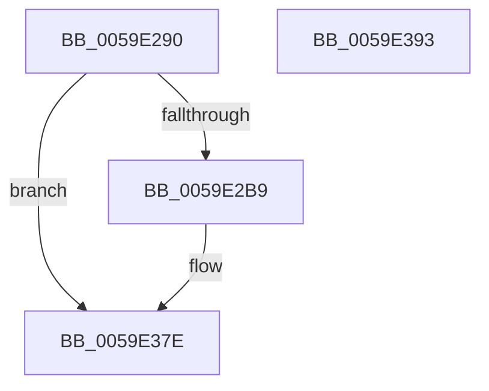

# IopLiveDumpTraceBufferAllocation

- RVA: `0x0059E290`–`0x0059E394` (길이 `260` bytes)
- VA: `0x000000014059E290`
- 실행 섹션: `.text`
- PDB 이름 있음: `예`; PDB Function 태그: `아니요`
- unwind 정보 RVA: `0x000AC058`
- 디코드: `52`개 명령, `260/260` bytes 표시
- 미해석 바이트: `0` (있으면 어셈블리에 `.byte`로 보존)

> 이 문서는 커널 이미지의 기계어와 PDB 기호를 분석해 생성했습니다. 4번과 5번은 함수 원형과 자료형을 바이너리 사용 방식에서 추정한 C 해석이며 원본 소스 복구 결과는 아닙니다.

## 1. Dependencies

- 직접 호출 지점: **3**; 고유 호출 대상: **3**
- 직접 호출자로 확인된 함수: **1**
- RIP 상대 이미지 참조: **2**

### Outgoing calls
- `0x0059E2AC` → [IopLiveDumpIsTracingEnabled](../4F/IopLiveDumpIsTracingEnabled_function_004FC5AC.md) (function, `0x004FC5AC`)
- `0x0059E379` → [IopLiveDumpTrace](../5A/IopLiveDumpTrace_function_005A4070.md) (function, `0x005A4070`)
- `0x0059E385` → [_security_check_cookie](../6A/_security_check_cookie_function_006AC640.md) (function, `0x006AC640`)

### Direct callers
- [IopLiveDumpAllocAndInitResources](IopLiveDumpAllocAndInitResources_function_005993B0.md) at `0x00599797`

### Static image references
- `0x0059E29E` → RVA `0x00E0A740` (`.data`; read)
- `0x0059E336` → RVA `0x00021F70` (`.rdata`; read)

## 2. Other-region calls and transfers

- 다른 실행 섹션으로 향하는 call: **0**
- 별도 외부 분기/꼬리 이동을 확인하지 못했습니다.

## 3. Assembly (complete function range)

```asm
0059E290  40 55                           push rbp
0059E292  48 8D 6C 24 A9                  lea rbp, [rsp - 0x57]
0059E297  48 81 EC C0 00 00 00            sub rsp, 0xc0
0059E29E  48 8B 05 9B C4 86 00            mov rax, qword ptr [rip + 0x86c49b]
0059E2A5  48 33 C4                        xor rax, rsp
0059E2A8  48 89 45 47                     mov qword ptr [rbp + 0x47], rax
0059E2AC  E8 FB E2 F5 FF                  call 0x1404fc5ac
0059E2B1  84 C0                           test al, al
0059E2B3  0F 84 C5 00 00 00               je 0x14059e37e
0059E2B9  48 8B 81 B0 02 00 00            mov rax, qword ptr [rcx + 0x2b0]
0059E2C0  4C 8D 45 D7                     lea r8, [rbp - 0x29]
0059E2C4  48 C1 E0 0C                     shl rax, 0xc
0059E2C8  BA 07 00 00 00                  mov edx, 7
0059E2CD  48 89 45 B7                     mov qword ptr [rbp - 0x49], rax
0059E2D1  48 8B 81 B8 02 00 00            mov rax, qword ptr [rcx + 0x2b8]
0059E2D8  48 C1 E0 0C                     shl rax, 0xc
0059E2DC  48 89 45 BF                     mov qword ptr [rbp - 0x41], rax
0059E2E0  48 8B 81 C0 02 00 00            mov rax, qword ptr [rcx + 0x2c0]
0059E2E7  48 C1 E0 0C                     shl rax, 0xc
0059E2EB  48 89 45 CF                     mov qword ptr [rbp - 0x31], rax
0059E2EF  8B 81 98 00 00 00               mov eax, dword ptr [rcx + 0x98]
0059E2F5  48 89 45 C7                     mov qword ptr [rbp - 0x39], rax
0059E2F9  48 8D 45 B7                     lea rax, [rbp - 0x49]
0059E2FD  48 89 45 D7                     mov qword ptr [rbp - 0x29], rax
0059E301  48 8D 45 BF                     lea rax, [rbp - 0x41]
0059E305  48 89 45 E7                     mov qword ptr [rbp - 0x19], rax
0059E309  48 8D 45 C7                     lea rax, [rbp - 0x39]
0059E30D  48 89 45 F7                     mov qword ptr [rbp - 9], rax
0059E311  48 8D 45 CF                     lea rax, [rbp - 0x31]
0059E315  48 89 45 07                     mov qword ptr [rbp + 7], rax
0059E319  48 8D 81 00 03 00 00            lea rax, [rcx + 0x300]
0059E320  48 89 45 17                     mov qword ptr [rbp + 0x17], rax
0059E324  48 8D 81 08 03 00 00            lea rax, [rcx + 0x308]
0059E32B  48 89 45 27                     mov qword ptr [rbp + 0x27], rax
0059E32F  48 8D 81 28 01 00 00            lea rax, [rcx + 0x128]
0059E336  48 8D 0D 33 3C A8 FF            lea rcx, [rip - 0x57c3cd]
0059E33D  48 89 45 37                     mov qword ptr [rbp + 0x37], rax
0059E341  48 C7 45 DF 08 00 00 00         mov qword ptr [rbp - 0x21], 8
0059E349  48 C7 45 EF 08 00 00 00         mov qword ptr [rbp - 0x11], 8
0059E351  48 C7 45 FF 08 00 00 00         mov qword ptr [rbp - 1], 8
0059E359  48 C7 45 0F 08 00 00 00         mov qword ptr [rbp + 0xf], 8
0059E361  48 C7 45 1F 08 00 00 00         mov qword ptr [rbp + 0x1f], 8
0059E369  48 C7 45 2F 08 00 00 00         mov qword ptr [rbp + 0x2f], 8
0059E371  48 C7 45 3F 08 00 00 00         mov qword ptr [rbp + 0x3f], 8
0059E379  E8 F2 5C 00 00                  call 0x1405a4070
0059E37E  48 8B 4D 47                     mov rcx, qword ptr [rbp + 0x47]
0059E382  48 33 CC                        xor rcx, rsp
0059E385  E8 B6 E2 10 00                  call 0x1406ac640
0059E38A  48 81 C4 C0 00 00 00            add rsp, 0xc0
0059E391  5D                              pop rbp
0059E392  C3                              ret
0059E393  CC                              int3
```

## 4. C-style interpretation (structured pseudocode)

```c
__int64 __fastcall IopLiveDumpTraceBufferAllocation(__int64 a1)
{
    __int64 result;
    __int64 v_rsp;
    unsigned __int64 v_stack_m18;
    unsigned __int64 v_stack_m20;
    unsigned __int64 v_stack_m28;
    unsigned __int64 v_stack_m30;
    unsigned __int64 v_stack_m38;
    unsigned __int64 v_stack_m40;
    unsigned __int64 v_stack_m48;
    unsigned __int64 v_stack_m50;
    unsigned __int64 v_stack_m58;
    unsigned __int64 v_stack_m5F;
    unsigned __int64 v_stack_m60;
    unsigned __int64 v_stack_m68;
    unsigned __int64 v_stack_m70;
    unsigned __int64 v_stack_m78;
    unsigned __int64 v_stack_m80;
    unsigned __int64 v_stack_m88;
    unsigned __int64 v_stack_m90;
    unsigned __int64 v_stack_m98;
    unsigned __int64 v_stack_mA0;
    unsigned __int64 v_stack_mA8;

    v_rsp = (v_rsp) - (192);
    result = (*(unsigned __int64 *)(v_rip + 8832155)) ^ (v_rsp);
    v_stack_m18 = result;
    result = IopLiveDumpIsTracingEnabled(a1, a2, a3, a4);
    if ((unsigned __int8)(result) != 0) {
        result = *(unsigned __int64 *)(a1 + 688);
        a3 = v_stack_m88;
        result = (result) << (12);
        a2 = 7;
        v_stack_mA8 = result;
        result = *(unsigned __int64 *)(a1 + 696);
        result = (result) << (12);
        v_stack_mA0 = result;
        result = *(unsigned __int64 *)(a1 + 704);
        result = (result) << (12);
        v_stack_m90 = result;
        result = *(unsigned int *)(a1 + 152);
        v_stack_m98 = result;
        result = v_stack_mA8;
        v_stack_m88 = result;
        result = v_stack_mA0;
        v_stack_m78 = result;
        result = v_stack_m98;
        v_stack_m68 = result;
        result = v_stack_m90;
        v_stack_m58 = result;
        result = a1 + 768;
        v_stack_m48 = result;
        result = a1 + 776;
        v_stack_m38 = result;
        result = a1 + 296;
        a1 = v_rip - 5751757;
        v_stack_m28 = result;
        v_stack_m80 = 8;
        v_stack_m70 = 8;
        v_stack_m60 = 8;
        v_stack_m50 = 8;
        v_stack_m40 = 8;
        v_stack_m30 = 8;
        v_stack_m20 = 8;
        result = IopLiveDumpTrace(a1, a2, a3, a4);
    }
    a1 = (v_stack_m18) ^ (v_rsp);
    result = _security_check_cookie(a1, a2, a3, a4);
    v_rsp = (v_rsp) + (192);
    return result;
}
```

## 5. (Beta) C Style

```c
int64_t IopLiveDumpTraceBufferAllocation(int64_t Arg1)
{
    int64_t result;
    int64_t local_rsp;
    uint64_t v_stack_m18;
    uint64_t v_stack_m20;
    uint64_t v_stack_m28;
    uint64_t v_stack_m30;
    uint64_t v_stack_m38;
    uint64_t v_stack_m40;
    uint64_t v_stack_m48;
    uint64_t v_stack_m50;
    uint64_t v_stack_m58;
    uint64_t v_stack_m5F;
    uint64_t v_stack_m60;
    uint64_t v_stack_m68;
    uint64_t v_stack_m70;
    uint64_t v_stack_m78;
    uint64_t v_stack_m80;
    uint64_t v_stack_m88;
    uint64_t v_stack_m90;
    uint64_t v_stack_m98;
    uint64_t v_stack_mA0;
    uint64_t v_stack_mA8;

    local_rsp = (local_rsp) - (192);
    result = (*(uint64_t *)(v_rip + 0x86C49B)) ^ (local_rsp);
    v_stack_m18 = result;
    result = IopLiveDumpIsTracingEnabled(Arg1, a2, a3, a4);
    if ((uint8_t)(result) != 0) {
        result = *(uint64_t *)(Arg1 + 0x2B0);
        a3 = v_stack_m88;
        result = (result) << (12);
        a2 = 7;
        v_stack_mA8 = result;
        result = *(uint64_t *)(Arg1 + 0x2B8);
        result = (result) << (12);
        v_stack_mA0 = result;
        result = *(uint64_t *)(Arg1 + 0x2C0);
        result = (result) << (12);
        v_stack_m90 = result;
        result = *(uint32_t *)(Arg1 + 0x98);
        v_stack_m98 = result;
        result = v_stack_mA8;
        v_stack_m88 = result;
        result = v_stack_mA0;
        v_stack_m78 = result;
        result = v_stack_m98;
        v_stack_m68 = result;
        result = v_stack_m90;
        v_stack_m58 = result;
        result = Arg1 + 768;
        v_stack_m48 = result;
        result = Arg1 + 776;
        v_stack_m38 = result;
        result = Arg1 + 296;
        Arg1 = v_rip - 5751757;
        v_stack_m28 = result;
        v_stack_m80 = 8;
        v_stack_m70 = 8;
        v_stack_m60 = 8;
        v_stack_m50 = 8;
        v_stack_m40 = 8;
        v_stack_m30 = 8;
        v_stack_m20 = 8;
        result = IopLiveDumpTrace(Arg1, a2, a3, a4);
    }
    Arg1 = (v_stack_m18) ^ (local_rsp);
    result = _security_check_cookie(Arg1, a2, a3, a4);
    local_rsp = (local_rsp) + (192);
    return result;
}
```

## 6. Execution-region graph

[열기: 2D/3D 그래프와 함수 탐색 컨트롤 패널](../../../control-panel.html?section=text&rva=0x0059E290&view=graph)

- 2D 그래프는 위에서 아래로 흐르고, 3D 그래프는 빈 공간을 드래그해 회전합니다. Shift+드래그는 이동, 휠은 확대·축소, 함수 노드 선택은 대상 보고서 이동입니다.

### Static fallback


