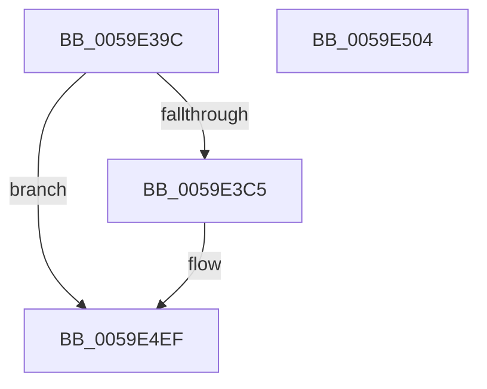

# IopLiveDumpTraceBufferEstimation

- RVA: `0x0059E39C`–`0x0059E505` (길이 `361` bytes)
- VA: `0x000000014059E39C`
- 실행 섹션: `.text`
- PDB 이름 있음: `예`; PDB Function 태그: `아니요`
- unwind 정보 RVA: `0x00073684`
- 디코드: `68`개 명령, `361/361` bytes 표시
- 미해석 바이트: `0` (있으면 어셈블리에 `.byte`로 보존)

> 이 문서는 커널 이미지의 기계어와 PDB 기호를 분석해 생성했습니다. 4번과 5번은 함수 원형과 자료형을 바이너리 사용 방식에서 추정한 C 해석이며 원본 소스 복구 결과는 아닙니다.

## 1. Dependencies

- 직접 호출 지점: **3**; 고유 호출 대상: **3**
- 직접 호출자로 확인된 함수: **1**
- RIP 상대 이미지 참조: **2**

### Outgoing calls
- `0x0059E3B8` → [IopLiveDumpIsTracingEnabled](../4F/IopLiveDumpIsTracingEnabled_function_004FC5AC.md) (function, `0x004FC5AC`)
- `0x0059E4EA` → [IopLiveDumpTrace](../5A/IopLiveDumpTrace_function_005A4070.md) (function, `0x005A4070`)
- `0x0059E4F6` → [_security_check_cookie](../6A/_security_check_cookie_function_006AC640.md) (function, `0x006AC640`)

### Direct callers
- [IopLiveDumpEstimateMemoryPages](IopLiveDumpEstimateMemoryPages_function_0059BA80.md) at `0x0059BD07`

### Static image references
- `0x0059E3AA` → RVA `0x00E0A740` (`.data`; read)
- `0x0059E484` → RVA `0x00020F80` (`.rdata`; read)

## 2. Other-region calls and transfers

- 다른 실행 섹션으로 향하는 call: **0**
- 별도 외부 분기/꼬리 이동을 확인하지 못했습니다.

## 3. Assembly (complete function range)

```asm
0059E39C  40 55                           push rbp
0059E39E  48 8D 6C 24 F0                  lea rbp, [rsp - 0x10]
0059E3A3  48 81 EC 10 01 00 00            sub rsp, 0x110
0059E3AA  48 8B 05 8F C3 86 00            mov rax, qword ptr [rip + 0x86c38f]
0059E3B1  48 33 C4                        xor rax, rsp
0059E3B4  48 89 45 00                     mov qword ptr [rbp], rax
0059E3B8  E8 EF E1 F5 FF                  call 0x1404fc5ac
0059E3BD  84 C0                           test al, al
0059E3BF  0F 84 2A 01 00 00               je 0x14059e4ef
0059E3C5  48 8B 41 68                     mov rax, qword ptr [rcx + 0x68]
0059E3C9  4C 8D 44 24 50                  lea r8, [rsp + 0x50]
0059E3CE  48 C1 E0 0C                     shl rax, 0xc
0059E3D2  BA 0B 00 00 00                  mov edx, 0xb
0059E3D7  48 89 44 24 20                  mov qword ptr [rsp + 0x20], rax
0059E3DC  48 8B 41 60                     mov rax, qword ptr [rcx + 0x60]
0059E3E0  48 C1 E0 0C                     shl rax, 0xc
0059E3E4  48 89 44 24 28                  mov qword ptr [rsp + 0x28], rax
0059E3E9  48 8B 41 78                     mov rax, qword ptr [rcx + 0x78]
0059E3ED  48 C1 E0 0C                     shl rax, 0xc
0059E3F1  48 89 44 24 30                  mov qword ptr [rsp + 0x30], rax
0059E3F6  48 8B 81 80 00 00 00            mov rax, qword ptr [rcx + 0x80]
0059E3FD  48 C1 E0 0C                     shl rax, 0xc
0059E401  48 89 44 24 40                  mov qword ptr [rsp + 0x40], rax
0059E406  48 8B 81 88 00 00 00            mov rax, qword ptr [rcx + 0x88]
0059E40D  48 C1 E0 0C                     shl rax, 0xc
0059E411  48 89 44 24 38                  mov qword ptr [rsp + 0x38], rax
0059E416  48 8D 44 24 20                  lea rax, [rsp + 0x20]
0059E41B  48 89 44 24 50                  mov qword ptr [rsp + 0x50], rax
0059E420  48 8D 44 24 28                  lea rax, [rsp + 0x28]
0059E425  48 89 44 24 60                  mov qword ptr [rsp + 0x60], rax
0059E42A  48 8D 44 24 30                  lea rax, [rsp + 0x30]
0059E42F  48 89 44 24 70                  mov qword ptr [rsp + 0x70], rax
0059E434  48 8D 44 24 38                  lea rax, [rsp + 0x38]
0059E439  48 89 45 80                     mov qword ptr [rbp - 0x80], rax
0059E43D  48 8D 44 24 40                  lea rax, [rsp + 0x40]
0059E442  48 89 45 90                     mov qword ptr [rbp - 0x70], rax
0059E446  48 8D 81 B8 01 00 00            lea rax, [rcx + 0x1b8]
0059E44D  48 89 45 A0                     mov qword ptr [rbp - 0x60], rax
0059E451  48 8D 81 C0 01 00 00            lea rax, [rcx + 0x1c0]
0059E458  48 89 45 B0                     mov qword ptr [rbp - 0x50], rax
0059E45C  48 8D 81 C8 01 00 00            lea rax, [rcx + 0x1c8]
0059E463  48 89 45 C0                     mov qword ptr [rbp - 0x40], rax
0059E467  48 8D 81 D0 01 00 00            lea rax, [rcx + 0x1d0]
0059E46E  48 89 45 D0                     mov qword ptr [rbp - 0x30], rax
0059E472  48 8D 81 D8 01 00 00            lea rax, [rcx + 0x1d8]
0059E479  48 89 45 E0                     mov qword ptr [rbp - 0x20], rax
0059E47D  48 8D 81 20 01 00 00            lea rax, [rcx + 0x120]
0059E484  48 8D 0D F5 2A A8 FF            lea rcx, [rip - 0x57d50b]
0059E48B  48 89 45 F0                     mov qword ptr [rbp - 0x10], rax
0059E48F  48 C7 44 24 58 08 00 00 00      mov qword ptr [rsp + 0x58], 8
0059E498  48 C7 44 24 68 08 00 00 00      mov qword ptr [rsp + 0x68], 8
0059E4A1  48 C7 44 24 78 08 00 00 00      mov qword ptr [rsp + 0x78], 8
0059E4AA  48 C7 45 88 08 00 00 00         mov qword ptr [rbp - 0x78], 8
0059E4B2  48 C7 45 98 08 00 00 00         mov qword ptr [rbp - 0x68], 8
0059E4BA  48 C7 45 A8 08 00 00 00         mov qword ptr [rbp - 0x58], 8
0059E4C2  48 C7 45 B8 08 00 00 00         mov qword ptr [rbp - 0x48], 8
0059E4CA  48 C7 45 C8 08 00 00 00         mov qword ptr [rbp - 0x38], 8
0059E4D2  48 C7 45 D8 08 00 00 00         mov qword ptr [rbp - 0x28], 8
0059E4DA  48 C7 45 E8 08 00 00 00         mov qword ptr [rbp - 0x18], 8
0059E4E2  48 C7 45 F8 08 00 00 00         mov qword ptr [rbp - 8], 8
0059E4EA  E8 81 5B 00 00                  call 0x1405a4070
0059E4EF  48 8B 4D 00                     mov rcx, qword ptr [rbp]
0059E4F3  48 33 CC                        xor rcx, rsp
0059E4F6  E8 45 E1 10 00                  call 0x1406ac640
0059E4FB  48 81 C4 10 01 00 00            add rsp, 0x110
0059E502  5D                              pop rbp
0059E503  C3                              ret
0059E504  CC                              int3
```

## 4. C-style interpretation (structured pseudocode)

```c
__int64 __fastcall IopLiveDumpTraceBufferEstimation(__int64 a1)
{
    __int64 result;
    __int64 v_rsp;
    unsigned __int64 v_stack_m18;
    unsigned __int64 v_stack_m20;
    unsigned __int64 v_stack_m28;
    unsigned __int64 v_stack_m30;
    unsigned __int64 v_stack_m38;
    unsigned __int64 v_stack_m40;
    unsigned __int64 v_stack_m48;
    unsigned __int64 v_stack_m50;
    unsigned __int64 v_stack_m58;
    unsigned __int64 v_stack_m60;
    unsigned __int64 v_stack_m68;
    unsigned __int64 v_stack_m70;
    unsigned __int64 v_stack_m78;
    unsigned __int64 v_stack_m80;
    unsigned __int64 v_stack_m88;
    unsigned __int64 v_stack_m90;
    unsigned __int64 v_stack_m98;
    unsigned __int64 v_stack_mA0;
    unsigned __int64 v_stack_mA8;
    unsigned __int64 v_stack_mB0;
    unsigned __int64 v_stack_mB8;
    unsigned __int64 v_stack_mC0;
    unsigned __int64 v_stack_mC8;
    unsigned __int64 v_stack_mD8;
    unsigned __int64 v_stack_mE0;
    unsigned __int64 v_stack_mE8;
    unsigned __int64 v_stack_mF0;
    unsigned __int64 v_stack_mF8;

    v_rsp = (v_rsp) - (272);
    result = (*(unsigned __int64 *)(v_rip + 8831887)) ^ (v_rsp);
    v_stack_m18 = result;
    result = IopLiveDumpIsTracingEnabled(a1, a2, a3, a4);
    if ((unsigned __int8)(result) != 0) {
        result = *(unsigned __int64 *)(a1 + 104);
        a3 = v_stack_mC8;
        result = (result) << (12);
        a2 = 11;
        v_stack_mF8 = result;
        result = *(unsigned __int64 *)(a1 + 96);
        result = (result) << (12);
        v_stack_mF0 = result;
        result = *(unsigned __int64 *)(a1 + 120);
        result = (result) << (12);
        v_stack_mE8 = result;
        result = *(unsigned __int64 *)(a1 + 128);
        result = (result) << (12);
        v_stack_mD8 = result;
        result = *(unsigned __int64 *)(a1 + 136);
        result = (result) << (12);
        v_stack_mE0 = result;
        result = v_stack_mF8;
        v_stack_mC8 = result;
        result = v_stack_mF0;
        v_stack_mB8 = result;
        result = v_stack_mE8;
        v_stack_mA8 = result;
        result = v_stack_mE0;
        v_stack_m98 = result;
        result = v_stack_mD8;
        v_stack_m88 = result;
        result = a1 + 440;
        v_stack_m78 = result;
        result = a1 + 448;
        v_stack_m68 = result;
        result = a1 + 456;
        v_stack_m58 = result;
        result = a1 + 464;
        v_stack_m48 = result;
        result = a1 + 472;
        v_stack_m38 = result;
        result = a1 + 288;
        a1 = v_rip - 5756171;
        v_stack_m28 = result;
        v_stack_mC0 = 8;
        v_stack_mB0 = 8;
        v_stack_mA0 = 8;
        v_stack_m90 = 8;
        v_stack_m80 = 8;
        v_stack_m70 = 8;
        v_stack_m60 = 8;
        v_stack_m50 = 8;
        v_stack_m40 = 8;
        v_stack_m30 = 8;
        v_stack_m20 = 8;
        result = IopLiveDumpTrace(a1, a2, a3, a4);
    }
    a1 = (v_stack_m18) ^ (v_rsp);
    result = _security_check_cookie(a1, a2, a3, a4);
    v_rsp = (v_rsp) + (272);
    return result;
}
```

## 5. (Beta) C Style

```c
int64_t IopLiveDumpTraceBufferEstimation(int64_t Arg1)
{
    int64_t result;
    int64_t local_rsp;
    uint64_t v_stack_m18;
    uint64_t v_stack_m20;
    uint64_t v_stack_m28;
    uint64_t v_stack_m30;
    uint64_t v_stack_m38;
    uint64_t v_stack_m40;
    uint64_t v_stack_m48;
    uint64_t v_stack_m50;
    uint64_t v_stack_m58;
    uint64_t v_stack_m60;
    uint64_t v_stack_m68;
    uint64_t v_stack_m70;
    uint64_t v_stack_m78;
    uint64_t v_stack_m80;
    uint64_t v_stack_m88;
    uint64_t v_stack_m90;
    uint64_t v_stack_m98;
    uint64_t v_stack_mA0;
    uint64_t v_stack_mA8;
    uint64_t v_stack_mB0;
    uint64_t v_stack_mB8;
    uint64_t v_stack_mC0;
    uint64_t v_stack_mC8;
    uint64_t v_stack_mD8;
    uint64_t v_stack_mE0;
    uint64_t v_stack_mE8;
    uint64_t v_stack_mF0;
    uint64_t v_stack_mF8;

    local_rsp = (local_rsp) - (272);
    result = (*(uint64_t *)(v_rip + 0x86C38F)) ^ (local_rsp);
    v_stack_m18 = result;
    result = IopLiveDumpIsTracingEnabled(Arg1, a2, a3, a4);
    if ((uint8_t)(result) != 0) {
        result = *(uint64_t *)(Arg1 + 0x68);
        a3 = v_stack_mC8;
        result = (result) << (12);
        a2 = 11;
        v_stack_mF8 = result;
        result = *(uint64_t *)(Arg1 + 0x60);
        result = (result) << (12);
        v_stack_mF0 = result;
        result = *(uint64_t *)(Arg1 + 0x78);
        result = (result) << (12);
        v_stack_mE8 = result;
        result = *(uint64_t *)(Arg1 + 0x80);
        result = (result) << (12);
        v_stack_mD8 = result;
        result = *(uint64_t *)(Arg1 + 0x88);
        result = (result) << (12);
        v_stack_mE0 = result;
        result = v_stack_mF8;
        v_stack_mC8 = result;
        result = v_stack_mF0;
        v_stack_mB8 = result;
        result = v_stack_mE8;
        v_stack_mA8 = result;
        result = v_stack_mE0;
        v_stack_m98 = result;
        result = v_stack_mD8;
        v_stack_m88 = result;
        result = Arg1 + 440;
        v_stack_m78 = result;
        result = Arg1 + 448;
        v_stack_m68 = result;
        result = Arg1 + 456;
        v_stack_m58 = result;
        result = Arg1 + 464;
        v_stack_m48 = result;
        result = Arg1 + 472;
        v_stack_m38 = result;
        result = Arg1 + 288;
        Arg1 = v_rip - 5756171;
        v_stack_m28 = result;
        v_stack_mC0 = 8;
        v_stack_mB0 = 8;
        v_stack_mA0 = 8;
        v_stack_m90 = 8;
        v_stack_m80 = 8;
        v_stack_m70 = 8;
        v_stack_m60 = 8;
        v_stack_m50 = 8;
        v_stack_m40 = 8;
        v_stack_m30 = 8;
        v_stack_m20 = 8;
        result = IopLiveDumpTrace(Arg1, a2, a3, a4);
    }
    Arg1 = (v_stack_m18) ^ (local_rsp);
    result = _security_check_cookie(Arg1, a2, a3, a4);
    local_rsp = (local_rsp) + (272);
    return result;
}
```

## 6. Execution-region graph

[열기: 2D/3D 그래프와 함수 탐색 컨트롤 패널](../../../control-panel.html?section=text&rva=0x0059E39C&view=graph)

- 2D 그래프는 위에서 아래로 흐르고, 3D 그래프는 빈 공간을 드래그해 회전합니다. Shift+드래그는 이동, 휠은 확대·축소, 함수 노드 선택은 대상 보고서 이동입니다.

### Static fallback


