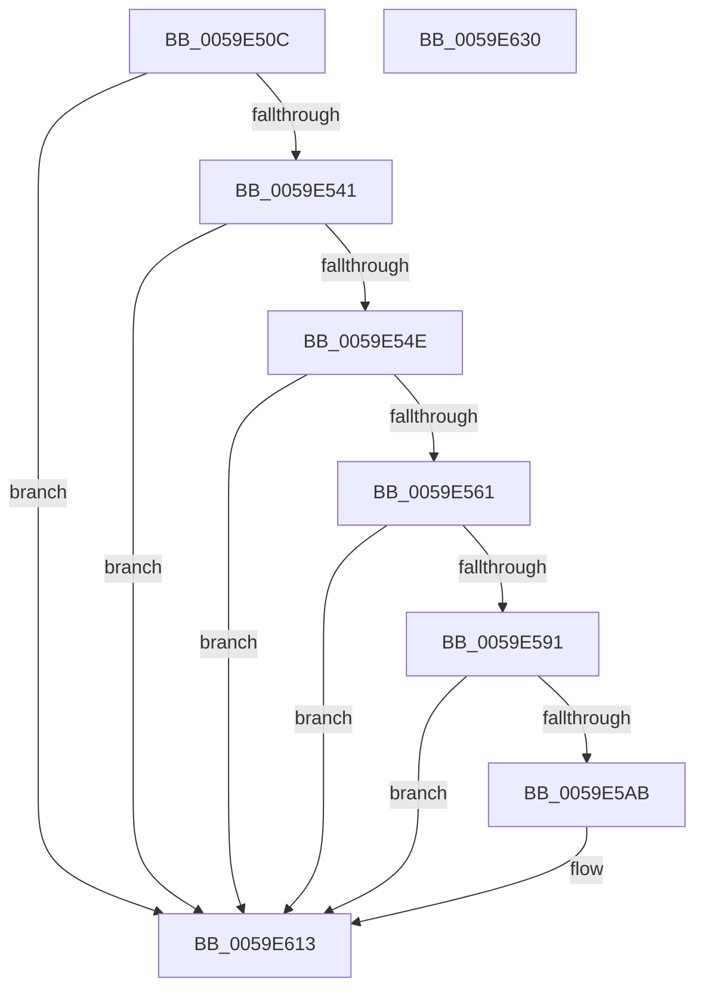

# IopLiveDumpTraceCaptureGenerateIptSecondaryDataDuration

- RVA: `0x0059E50C`–`0x0059E631` (길이 `293` bytes)
- VA: `0x000000014059E50C`
- 실행 섹션: `.text`
- PDB 이름 있음: `예`; PDB Function 태그: `아니요`
- unwind 정보 RVA: `0x000C7A74`
- 디코드: `59`개 명령, `293/293` bytes 표시
- 미해석 바이트: `0` (있으면 어셈블리에 `.byte`로 보존)

> 이 문서는 커널 이미지의 기계어와 PDB 기호를 분석해 생성했습니다. 4번과 5번은 함수 원형과 자료형을 바이너리 사용 방식에서 추정한 C 해석이며 원본 소스 복구 결과는 아닙니다.

## 1. Dependencies

- 직접 호출 지점: **5**; 고유 호출 대상: **5**
- 직접 호출자로 확인된 함수: **1**
- RIP 상대 이미지 참조: **4**

### Outgoing calls
- `0x0059E534` → [IopLiveDumpIsTracingEnabled](../4F/IopLiveDumpIsTracingEnabled_function_004FC5AC.md) (function, `0x004FC5AC`)
- `0x0059E57F` → [IopLiveDumpTrace](../5A/IopLiveDumpTrace_function_005A4070.md) (function, `0x005A4070`)
- `0x0059E5A2` → [tlgKeywordOn](../42/tlgKeywordOn_function_0042EAA0.md) (function, `0x0042EAA0`)
- `0x0059E60E` → [tlgWriteTransfer_EtwWriteTransfer](../42/tlgWriteTransfer_EtwWriteTransfer_function_004260E0.md) (function, `0x004260E0`)
- `0x0059E61A` → [_security_check_cookie](../6A/_security_check_cookie_function_006AC640.md) (function, `0x006AC640`)

### Direct callers
- [IopLiveDumpGenerateIptSecondaryData](IopLiveDumpGenerateIptSecondaryData_function_0059C074.md) at `0x0059C231`

### Static image references
- `0x0059E523` → RVA `0x00E0A740` (`.data`; read)
- `0x0059E571` → RVA `0x00020DE8` (`.rdata`; read)
- `0x0059E584` → RVA `0x00E06EA0` (`.data`; read)
- `0x0059E5CD` → RVA `0x00046457` (`.rdata`; read)

## 2. Other-region calls and transfers

- 다른 실행 섹션으로 향하는 call: **0**
- 별도 외부 분기/꼬리 이동을 확인하지 못했습니다.

## 3. Assembly (complete function range)

```asm
0059E50C  48 89 5C 24 18                  mov qword ptr [rsp + 0x18], rbx
0059E511  48 89 54 24 10                  mov qword ptr [rsp + 0x10], rdx
0059E516  55                              push rbp
0059E517  48 8D 6C 24 A9                  lea rbp, [rsp - 0x57]
0059E51C  48 81 EC A0 00 00 00            sub rsp, 0xa0
0059E523  48 8B 05 16 C2 86 00            mov rax, qword ptr [rip + 0x86c216]
0059E52A  48 33 C4                        xor rax, rsp
0059E52D  48 89 45 47                     mov qword ptr [rbp + 0x47], rax
0059E531  48 8B D9                        mov rbx, rcx
0059E534  E8 73 E0 F5 FF                  call 0x1404fc5ac
0059E539  84 C0                           test al, al
0059E53B  0F 84 D2 00 00 00               je 0x14059e613
0059E541  83 B9 A8 01 00 00 00            cmp dword ptr [rcx + 0x1a8], 0
0059E548  0F 85 C5 00 00 00               jne 0x14059e613
0059E54E  8B 81 40 01 00 00               mov eax, dword ptr [rcx + 0x140]
0059E554  BA 01 00 00 00                  mov edx, 1
0059E559  84 C2                           test dl, al
0059E55B  0F 84 B2 00 00 00               je 0x14059e613
0059E561  83 65 03 00                     and dword ptr [rbp + 3], 0
0059E565  48 8D 45 6F                     lea rax, [rbp + 0x6f]
0059E569  4C 8D 45 F7                     lea r8, [rbp - 9]
0059E56D  48 89 45 F7                     mov qword ptr [rbp - 9], rax
0059E571  48 8D 0D 70 28 A8 FF            lea rcx, [rip - 0x57d790]
0059E578  C7 45 FF 08 00 00 00            mov dword ptr [rbp - 1], 8
0059E57F  E8 EC 5A 00 00                  call 0x1405a4070
0059E584  83 3D 15 89 86 00 05            cmp dword ptr [rip + 0x868915], 5
0059E58B  0F 86 82 00 00 00               jbe 0x14059e613
0059E591  48 BA 00 00 00 00 00 40 00 00   movabs rdx, 0x400000000000
0059E59B  48 8D 0D FE 88 86 00            lea rcx, [rip + 0x8688fe]
0059E5A2  E8 F9 04 E9 FF                  call 0x14042eaa0
0059E5A7  84 C0                           test al, al
0059E5A9  74 68                           je 0x14059e613
0059E5AB  83 65 33 00                     and dword ptr [rbp + 0x33], 0
0059E5AF  48 8D 45 E7                     lea rax, [rbp - 0x19]
0059E5B3  83 65 43 00                     and dword ptr [rbp + 0x43], 0
0059E5B7  4C 8D 8B B8 03 00 00            lea r9, [rbx + 0x3b8]
0059E5BE  48 89 45 27                     mov qword ptr [rbp + 0x27], rax
0059E5C2  4C 8D 83 C8 03 00 00            lea r8, [rbx + 0x3c8]
0059E5C9  48 8B 45 6F                     mov rax, qword ptr [rbp + 0x6f]
0059E5CD  48 8D 15 83 7E AA FF            lea rdx, [rip - 0x55817d]
0059E5D4  48 89 45 EF                     mov qword ptr [rbp - 0x11], rax
0059E5D8  48 8D 0D C1 88 86 00            lea rcx, [rip + 0x8688c1]
0059E5DF  48 8D 45 EF                     lea rax, [rbp - 0x11]
0059E5E3  48 C7 45 E7 00 00 00 01         mov qword ptr [rbp - 0x19], 0x1000000
0059E5EB  48 89 45 37                     mov qword ptr [rbp + 0x37], rax
0059E5EF  48 8D 45 07                     lea rax, [rbp + 7]
0059E5F3  48 89 44 24 28                  mov qword ptr [rsp + 0x28], rax
0059E5F8  C7 44 24 20 04 00 00 00         mov dword ptr [rsp + 0x20], 4
0059E600  C7 45 2F 08 00 00 00            mov dword ptr [rbp + 0x2f], 8
0059E607  C7 45 3F 08 00 00 00            mov dword ptr [rbp + 0x3f], 8
0059E60E  E8 CD 7A E8 FF                  call 0x1404260e0
0059E613  48 8B 4D 47                     mov rcx, qword ptr [rbp + 0x47]
0059E617  48 33 CC                        xor rcx, rsp
0059E61A  E8 21 E0 10 00                  call 0x1406ac640
0059E61F  48 8B 9C 24 C0 00 00 00         mov rbx, qword ptr [rsp + 0xc0]
0059E627  48 81 C4 A0 00 00 00            add rsp, 0xa0
0059E62E  5D                              pop rbp
0059E62F  C3                              ret
0059E630  CC                              int3
```

## 4. C-style interpretation (structured pseudocode)

```c
__int64 __fastcall IopLiveDumpTraceCaptureGenerateIptSecondaryDataDuration(__int64 a1, __int64 a2)
{
    __int64 result;
    __int64 v_rsp;
    unsigned __int64 v_stack_m18;
    unsigned int v_stack_m1C;
    unsigned int v_stack_m20;
    unsigned __int64 v_stack_m28;
    unsigned int v_stack_m2C;
    unsigned int v_stack_m30;
    unsigned __int64 v_stack_m38;
    unsigned __int64 v_stack_m58;
    unsigned int v_stack_m5C;
    unsigned __int64 v_stack_m5F;
    unsigned int v_stack_m60;
    unsigned __int64 v_stack_m68;
    unsigned __int64 v_stack_m70;
    unsigned __int64 v_stack_m78;
    unsigned __int64 v_stack_m80;
    unsigned int v_stack_m88;
    unsigned __int64 v_stack_p10;
    unsigned __int64 v_stack_p18;

    v_stack_p18 = v_rbx;
    v_stack_p10 = a2;
    v_rsp = (v_rsp) - (160);
    result = (*(unsigned __int64 *)(v_rip + 8831510)) ^ (v_rsp);
    v_stack_m18 = result;
    result = IopLiveDumpIsTracingEnabled(a1, a2, a3, a4);
    if ((unsigned __int8)(result) == 0) goto loc_0059E613;
    if ((*(unsigned int *)(a1 + 424)) != 0) goto loc_0059E613;
    if (((1) & ((unsigned __int8)((unsigned int)(*(unsigned int *)(a1 + 320))))) == 0) goto loc_0059E613;
    v_stack_m68 = v_stack_p10;
    v_stack_m60 = 8;
    result = IopLiveDumpTrace(v_rip - 5756816, 1, v_stack_m68, a4);
    if ((*(unsigned int *)(v_rip + 8816917)) <= 5) goto loc_0059E613;
    result = tlgKeywordOn(v_rip + 8816894, 1, v_stack_m68, a4);
    if ((unsigned __int8)(result) != 0) {
        result = v_stack_m78;
        a4 = a1 + 952;
        v_stack_m38 = result;
        a3 = a1 + 968;
        result = v_stack_p10;
        a2 = v_rip - 5603709;
        v_stack_m70 = result;
        a1 = v_rip + 8816833;
        result = v_stack_m70;
        v_stack_m78 = 0x1000000ULL;
        v_stack_m28 = result;
        result = v_stack_m58;
        v_stack_m80 = result;
        v_stack_m88 = 4;
        v_stack_m30 = 8;
        v_stack_m20 = 8;
        result = tlgWriteTransfer_EtwWriteTransfer(a1, a2, a3, a4);
    }
    a1 = (v_stack_m18) ^ (v_rsp);
    result = _security_check_cookie(a1, a2, a3, a4);
    v_rsp = (v_rsp) + (160);
    return result;
}
```

## 5. (Beta) C Style

```c
int64_t IopLiveDumpTraceCaptureGenerateIptSecondaryDataDuration(void *Arg1, int64_t Arg2)
{
    uint8_t *arg1 = (uint8_t *)Arg1;

    int64_t result;
    int64_t local_rsp;
    uint64_t v_stack_m18;
    uint32_t v_stack_m1C;
    uint32_t v_stack_m20;
    uint64_t v_stack_m28;
    uint32_t v_stack_m2C;
    uint32_t v_stack_m30;
    uint64_t v_stack_m38;
    uint64_t v_stack_m58;
    uint32_t v_stack_m5C;
    uint64_t v_stack_m5F;
    uint32_t v_stack_m60;
    uint64_t v_stack_m68;
    uint64_t v_stack_m70;
    uint64_t v_stack_m78;
    uint64_t v_stack_m80;
    uint32_t v_stack_m88;
    uint64_t v_stack_p10;
    uint64_t v_stack_p18;

    v_stack_p18 = local_rbx;
    v_stack_p10 = Arg2;
    local_rsp = (local_rsp) - (160);
    result = (*(uint64_t *)(v_rip + 0x86C216)) ^ (local_rsp);
    v_stack_m18 = result;
    result = IopLiveDumpIsTracingEnabled(Arg1, Arg2, a3, a4);
    if ((uint8_t)(result) == 0) goto loc_0059E613;
    if ((*(uint32_t *)(arg1 + 0x1A8)) != 0) goto loc_0059E613;
    if (((1) & ((uint8_t)((uint32_t)(*(uint32_t *)(arg1 + 0x140))))) == 0) goto loc_0059E613;
    v_stack_m68 = v_stack_p10;
    v_stack_m60 = 8;
    result = IopLiveDumpTrace(v_rip - 5756816, 1, v_stack_m68, a4);
    if ((*(uint32_t *)(v_rip + 0x868915)) <= 5) goto loc_0059E613;
    result = tlgKeywordOn(v_rip + 8816894, 1, v_stack_m68, a4);
    if ((uint8_t)(result) != 0) {
        result = v_stack_m78;
        a4 = Arg1 + 952;
        v_stack_m38 = result;
        a3 = Arg1 + 968;
        result = v_stack_p10;
        Arg2 = v_rip - 5603709;
        v_stack_m70 = result;
        Arg1 = v_rip + 8816833;
        result = v_stack_m70;
        v_stack_m78 = 0x1000000ULL;
        v_stack_m28 = result;
        result = v_stack_m58;
        v_stack_m80 = result;
        v_stack_m88 = 4;
        v_stack_m30 = 8;
        v_stack_m20 = 8;
        result = tlgWriteTransfer_EtwWriteTransfer(Arg1, Arg2, a3, a4);
    }
    Arg1 = (v_stack_m18) ^ (local_rsp);
    result = _security_check_cookie(Arg1, Arg2, a3, a4);
    local_rsp = (local_rsp) + (160);
    return result;
}
```

### 관측된 메모리 오프셋

구조체 형식이 확인되지 않은 접근은 인자 기준의 오프셋으로만 기록했습니다.

| 기준 인자 | 오프셋 표현 | 폭 (bit) | 접근 |
|---|---:|---:|---|
| `Arg1` | `+ 0x3B8` | `64` | `R` |
| `Arg1` | `+ 0x3C8` | `64` | `R` |

## 6. Execution-region graph

[열기: 2D/3D 그래프와 함수 탐색 컨트롤 패널](../../../control-panel.html?section=text&rva=0x0059E50C&view=graph)

- 2D 그래프는 위에서 아래로 흐르고, 3D 그래프는 빈 공간을 드래그해 회전합니다. Shift+드래그는 이동, 휠은 확대·축소, 함수 노드 선택은 대상 보고서 이동입니다.

### Static fallback


