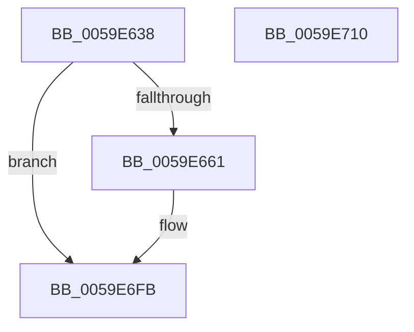

# IopLiveDumpTraceCaptureMemoryPages

- RVA: `0x0059E638`–`0x0059E711` (길이 `217` bytes)
- VA: `0x000000014059E638`
- 실행 섹션: `.text`
- PDB 이름 있음: `예`; PDB Function 태그: `아니요`
- unwind 정보 RVA: `0x0009EA9C`
- 디코드: `41`개 명령, `217/217` bytes 표시
- 미해석 바이트: `0` (있으면 어셈블리에 `.byte`로 보존)

> 이 문서는 커널 이미지의 기계어와 PDB 기호를 분석해 생성했습니다. 4번과 5번은 함수 원형과 자료형을 바이너리 사용 방식에서 추정한 C 해석이며 원본 소스 복구 결과는 아닙니다.

## 1. Dependencies

- 직접 호출 지점: **3**; 고유 호출 대상: **3**
- 직접 호출자로 확인된 함수: **1**
- RIP 상대 이미지 참조: **2**

### Outgoing calls
- `0x0059E654` → [IopLiveDumpIsTracingEnabled](../4F/IopLiveDumpIsTracingEnabled_function_004FC5AC.md) (function, `0x004FC5AC`)
- `0x0059E6F6` → [IopLiveDumpTrace](../5A/IopLiveDumpTrace_function_005A4070.md) (function, `0x005A4070`)
- `0x0059E702` → [_security_check_cookie](../6A/_security_check_cookie_function_006AC640.md) (function, `0x006AC640`)

### Direct callers
- [IopLiveDumpCaptureMemoryPages](IopLiveDumpCaptureMemoryPages_function_0059B0A0.md) at `0x0059B179`

### Static image references
- `0x0059E646` → RVA `0x00E0A740` (`.data`; read)
- `0x0059E6CB` → RVA `0x00023460` (`.rdata`; read)

## 2. Other-region calls and transfers

- 다른 실행 섹션으로 향하는 call: **0**
- 별도 외부 분기/꼬리 이동을 확인하지 못했습니다.

## 3. Assembly (complete function range)

```asm
0059E638  40 55                           push rbp
0059E63A  48 8D 6C 24 A9                  lea rbp, [rsp - 0x57]
0059E63F  48 81 EC A0 00 00 00            sub rsp, 0xa0
0059E646  48 8B 05 F3 C0 86 00            mov rax, qword ptr [rip + 0x86c0f3]
0059E64D  48 33 C4                        xor rax, rsp
0059E650  48 89 45 47                     mov qword ptr [rbp + 0x47], rax
0059E654  E8 53 DF F5 FF                  call 0x1404fc5ac
0059E659  84 C0                           test al, al
0059E65B  0F 84 9A 00 00 00               je 0x14059e6fb
0059E661  48 8D 81 E0 01 00 00            lea rax, [rcx + 0x1e0]
0059E668  48 C7 45 DF 08 00 00 00         mov qword ptr [rbp - 0x21], 8
0059E670  48 89 45 D7                     mov qword ptr [rbp - 0x29], rax
0059E674  4C 8D 45 D7                     lea r8, [rbp - 0x29]
0059E678  48 8D 81 E8 01 00 00            lea rax, [rcx + 0x1e8]
0059E67F  48 C7 45 EF 08 00 00 00         mov qword ptr [rbp - 0x11], 8
0059E687  48 89 45 E7                     mov qword ptr [rbp - 0x19], rax
0059E68B  BA 07 00 00 00                  mov edx, 7
0059E690  48 8D 81 F0 01 00 00            lea rax, [rcx + 0x1f0]
0059E697  48 C7 45 FF 08 00 00 00         mov qword ptr [rbp - 1], 8
0059E69F  48 89 45 F7                     mov qword ptr [rbp - 9], rax
0059E6A3  48 8D 81 F8 01 00 00            lea rax, [rcx + 0x1f8]
0059E6AA  48 89 45 07                     mov qword ptr [rbp + 7], rax
0059E6AE  48 8D 81 00 02 00 00            lea rax, [rcx + 0x200]
0059E6B5  48 89 45 17                     mov qword ptr [rbp + 0x17], rax
0059E6B9  48 8D 81 08 02 00 00            lea rax, [rcx + 0x208]
0059E6C0  48 89 45 27                     mov qword ptr [rbp + 0x27], rax
0059E6C4  48 8D 81 10 02 00 00            lea rax, [rcx + 0x210]
0059E6CB  48 8D 0D 8E 4D A8 FF            lea rcx, [rip - 0x57b272]
0059E6D2  48 89 45 37                     mov qword ptr [rbp + 0x37], rax
0059E6D6  48 C7 45 0F 08 00 00 00         mov qword ptr [rbp + 0xf], 8
0059E6DE  48 C7 45 1F 08 00 00 00         mov qword ptr [rbp + 0x1f], 8
0059E6E6  48 C7 45 2F 08 00 00 00         mov qword ptr [rbp + 0x2f], 8
0059E6EE  48 C7 45 3F 08 00 00 00         mov qword ptr [rbp + 0x3f], 8
0059E6F6  E8 75 59 00 00                  call 0x1405a4070
0059E6FB  48 8B 4D 47                     mov rcx, qword ptr [rbp + 0x47]
0059E6FF  48 33 CC                        xor rcx, rsp
0059E702  E8 39 DF 10 00                  call 0x1406ac640
0059E707  48 81 C4 A0 00 00 00            add rsp, 0xa0
0059E70E  5D                              pop rbp
0059E70F  C3                              ret
0059E710  CC                              int3
```

## 4. C-style interpretation (structured pseudocode)

```c
__int64 __fastcall IopLiveDumpTraceCaptureMemoryPages(__int64 a1)
{
    __int64 result;
    __int64 v_rsp;
    unsigned __int64 v_stack_m18;
    unsigned __int64 v_stack_m20;
    unsigned __int64 v_stack_m28;
    unsigned __int64 v_stack_m30;
    unsigned __int64 v_stack_m38;
    unsigned __int64 v_stack_m40;
    unsigned __int64 v_stack_m48;
    unsigned __int64 v_stack_m50;
    unsigned __int64 v_stack_m58;
    unsigned __int64 v_stack_m5F;
    unsigned __int64 v_stack_m60;
    unsigned __int64 v_stack_m68;
    unsigned __int64 v_stack_m70;
    unsigned __int64 v_stack_m78;
    unsigned __int64 v_stack_m80;
    unsigned __int64 v_stack_m88;

    v_rsp = (v_rsp) - (160);
    result = (*(unsigned __int64 *)(v_rip + 8831219)) ^ (v_rsp);
    v_stack_m18 = result;
    result = IopLiveDumpIsTracingEnabled(a1, a2, a3, a4);
    if ((unsigned __int8)(result) != 0) {
        result = a1 + 480;
        v_stack_m80 = 8;
        v_stack_m88 = result;
        a3 = v_stack_m88;
        result = a1 + 488;
        v_stack_m70 = 8;
        v_stack_m78 = result;
        a2 = 7;
        result = a1 + 496;
        v_stack_m60 = 8;
        v_stack_m68 = result;
        result = a1 + 504;
        v_stack_m58 = result;
        result = a1 + 512;
        v_stack_m48 = result;
        result = a1 + 520;
        v_stack_m38 = result;
        result = a1 + 528;
        a1 = v_rip - 5747314;
        v_stack_m28 = result;
        v_stack_m50 = 8;
        v_stack_m40 = 8;
        v_stack_m30 = 8;
        v_stack_m20 = 8;
        result = IopLiveDumpTrace(a1, a2, a3, a4);
    }
    a1 = (v_stack_m18) ^ (v_rsp);
    result = _security_check_cookie(a1, a2, a3, a4);
    v_rsp = (v_rsp) + (160);
    return result;
}
```

## 5. (Beta) C Style

```c
int64_t IopLiveDumpTraceCaptureMemoryPages(int64_t Arg1)
{
    int64_t result;
    int64_t local_rsp;
    uint64_t v_stack_m18;
    uint64_t v_stack_m20;
    uint64_t v_stack_m28;
    uint64_t v_stack_m30;
    uint64_t v_stack_m38;
    uint64_t v_stack_m40;
    uint64_t v_stack_m48;
    uint64_t v_stack_m50;
    uint64_t v_stack_m58;
    uint64_t v_stack_m5F;
    uint64_t v_stack_m60;
    uint64_t v_stack_m68;
    uint64_t v_stack_m70;
    uint64_t v_stack_m78;
    uint64_t v_stack_m80;
    uint64_t v_stack_m88;

    local_rsp = (local_rsp) - (160);
    result = (*(uint64_t *)(v_rip + 0x86C0F3)) ^ (local_rsp);
    v_stack_m18 = result;
    result = IopLiveDumpIsTracingEnabled(Arg1, a2, a3, a4);
    if ((uint8_t)(result) != 0) {
        result = Arg1 + 480;
        v_stack_m80 = 8;
        v_stack_m88 = result;
        a3 = v_stack_m88;
        result = Arg1 + 488;
        v_stack_m70 = 8;
        v_stack_m78 = result;
        a2 = 7;
        result = Arg1 + 496;
        v_stack_m60 = 8;
        v_stack_m68 = result;
        result = Arg1 + 504;
        v_stack_m58 = result;
        result = Arg1 + 512;
        v_stack_m48 = result;
        result = Arg1 + 520;
        v_stack_m38 = result;
        result = Arg1 + 528;
        Arg1 = v_rip - 5747314;
        v_stack_m28 = result;
        v_stack_m50 = 8;
        v_stack_m40 = 8;
        v_stack_m30 = 8;
        v_stack_m20 = 8;
        result = IopLiveDumpTrace(Arg1, a2, a3, a4);
    }
    Arg1 = (v_stack_m18) ^ (local_rsp);
    result = _security_check_cookie(Arg1, a2, a3, a4);
    local_rsp = (local_rsp) + (160);
    return result;
}
```

## 6. Execution-region graph

[열기: 2D/3D 그래프와 함수 탐색 컨트롤 패널](../../../control-panel.html?section=text&rva=0x0059E638&view=graph)

- 2D 그래프는 위에서 아래로 흐르고, 3D 그래프는 빈 공간을 드래그해 회전합니다. Shift+드래그는 이동, 휠은 확대·축소, 함수 노드 선택은 대상 보고서 이동입니다.

### Static fallback


