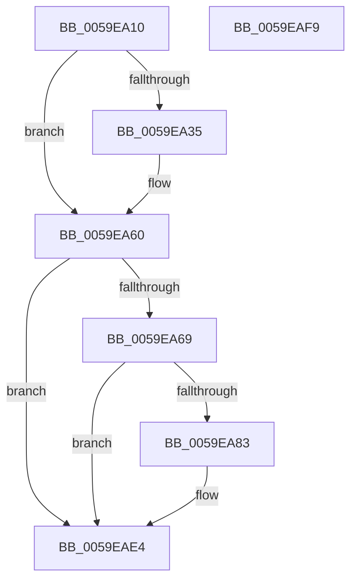

# IopLiveDumpTraceDumpDisabledOnBoot

- RVA: `0x0059EA10`–`0x0059EAFA` (길이 `234` bytes)
- VA: `0x000000014059EA10`
- 실행 섹션: `.text`
- PDB 이름 있음: `예`; PDB Function 태그: `아니요`
- unwind 정보 RVA: `0x0009EA9C`
- 디코드: `50`개 명령, `234/234` bytes 표시
- 미해석 바이트: `0` (있으면 어셈블리에 `.byte`로 보존)

> 이 문서는 커널 이미지의 기계어와 PDB 기호를 분석해 생성했습니다. 4번과 5번은 함수 원형과 자료형을 바이너리 사용 방식에서 추정한 C 해석이며 원본 소스 복구 결과는 아닙니다.

## 1. Dependencies

- 직접 호출 지점: **5**; 고유 호출 대상: **5**
- 직접 호출자로 확인된 함수: **1**
- RIP 상대 이미지 참조: **5**

### Outgoing calls
- `0x0059EA2C` → [IopLiveDumpIsTracingEnabled](../4F/IopLiveDumpIsTracingEnabled_function_004FC5AC.md) (function, `0x004FC5AC`)
- `0x0059EA5B` → [IopLiveDumpTrace](../5A/IopLiveDumpTrace_function_005A4070.md) (function, `0x005A4070`)
- `0x0059EA7A` → [tlgKeywordOn](../42/tlgKeywordOn_function_0042EAA0.md) (function, `0x0042EAA0`)
- `0x0059EADF` → [tlgWriteTransfer_EtwWriteTransfer](../42/tlgWriteTransfer_EtwWriteTransfer_function_004260E0.md) (function, `0x004260E0`)
- `0x0059EAEB` → [_security_check_cookie](../6A/_security_check_cookie_function_006AC640.md) (function, `0x006AC640`)

### Direct callers
- [IoInitSystemPreDrivers](../../init/C2/IoInitSystemPreDrivers_function_00C2AC3C.md) at `0x00C2BC85`

### Static image references
- `0x0059EA1E` → RVA `0x00E0A740` (`.data`; read)
- `0x0059EA39` → RVA `0x00E0A9B8` (`.data`; read)
- `0x0059EA54` → RVA `0x00023150` (`.rdata`; read)
- `0x0059EA60` → RVA `0x00E06EA0` (`.data`; read)
- `0x0059EA8F` → RVA `0x00045F6C` (`.rdata`; read)

## 2. Other-region calls and transfers

- 다른 실행 섹션으로 향하는 call: **0**
- 별도 외부 분기/꼬리 이동을 확인하지 못했습니다.

## 3. Assembly (complete function range)

```asm
0059EA10  40 55                           push rbp
0059EA12  48 8D 6C 24 A9                  lea rbp, [rsp - 0x57]
0059EA17  48 81 EC A0 00 00 00            sub rsp, 0xa0
0059EA1E  48 8B 05 1B BD 86 00            mov rax, qword ptr [rip + 0x86bd1b]
0059EA25  48 33 C4                        xor rax, rsp
0059EA28  48 89 45 47                     mov qword ptr [rbp + 0x47], rax
0059EA2C  E8 7B DB F5 FF                  call 0x1404fc5ac
0059EA31  84 C0                           test al, al
0059EA33  74 2B                           je 0x14059ea60
0059EA35  83 65 03 00                     and dword ptr [rbp + 3], 0
0059EA39  48 8D 05 78 BF 86 00            lea rax, [rip + 0x86bf78]
0059EA40  4C 8D 45 F7                     lea r8, [rbp - 9]
0059EA44  48 89 45 F7                     mov qword ptr [rbp - 9], rax
0059EA48  BA 01 00 00 00                  mov edx, 1
0059EA4D  C7 45 FF 04 00 00 00            mov dword ptr [rbp - 1], 4
0059EA54  48 8D 0D F5 46 A8 FF            lea rcx, [rip - 0x57b90b]
0059EA5B  E8 10 56 00 00                  call 0x1405a4070
0059EA60  83 3D 39 84 86 00 05            cmp dword ptr [rip + 0x868439], 5
0059EA67  76 7B                           jbe 0x14059eae4
0059EA69  48 BA 00 00 00 00 00 40 00 00   movabs rdx, 0x400000000000
0059EA73  48 8D 0D 26 84 86 00            lea rcx, [rip + 0x868426]
0059EA7A  E8 21 00 E9 FF                  call 0x14042eaa0
0059EA7F  84 C0                           test al, al
0059EA81  74 61                           je 0x14059eae4
0059EA83  83 65 33 00                     and dword ptr [rbp + 0x33], 0
0059EA87  48 8D 45 EF                     lea rax, [rbp - 0x11]
0059EA8B  83 65 43 00                     and dword ptr [rbp + 0x43], 0
0059EA8F  48 8D 15 D6 74 AA FF            lea rdx, [rip - 0x558b2a]
0059EA96  48 89 45 27                     mov qword ptr [rbp + 0x27], rax
0059EA9A  48 8D 0D FF 83 86 00            lea rcx, [rip + 0x8683ff]
0059EAA1  8A 05 11 BF 86 00               mov al, byte ptr [rip + 0x86bf11]
0059EAA7  45 33 C9                        xor r9d, r9d
0059EAAA  88 45 E7                        mov byte ptr [rbp - 0x19], al
0059EAAD  45 33 C0                        xor r8d, r8d
0059EAB0  48 8D 45 E7                     lea rax, [rbp - 0x19]
0059EAB4  48 C7 45 EF 00 00 00 01         mov qword ptr [rbp - 0x11], 0x1000000
0059EABC  48 89 45 37                     mov qword ptr [rbp + 0x37], rax
0059EAC0  48 8D 45 07                     lea rax, [rbp + 7]
0059EAC4  48 89 44 24 28                  mov qword ptr [rsp + 0x28], rax
0059EAC9  C7 44 24 20 04 00 00 00         mov dword ptr [rsp + 0x20], 4
0059EAD1  C7 45 2F 08 00 00 00            mov dword ptr [rbp + 0x2f], 8
0059EAD8  C7 45 3F 01 00 00 00            mov dword ptr [rbp + 0x3f], 1
0059EADF  E8 FC 75 E8 FF                  call 0x1404260e0
0059EAE4  48 8B 4D 47                     mov rcx, qword ptr [rbp + 0x47]
0059EAE8  48 33 CC                        xor rcx, rsp
0059EAEB  E8 50 DB 10 00                  call 0x1406ac640
0059EAF0  48 81 C4 A0 00 00 00            add rsp, 0xa0
0059EAF7  5D                              pop rbp
0059EAF8  C3                              ret
0059EAF9  CC                              int3
```

## 4. C-style interpretation (structured pseudocode)

```c
__int64 __fastcall IopLiveDumpTraceDumpDisabledOnBoot(__int64 a1, __int64 a2, __int64 a3, int a4)
{
    __int64 result;
    __int64 v_rsp;
    unsigned __int64 v_stack_m18;
    unsigned int v_stack_m1C;
    unsigned int v_stack_m20;
    unsigned __int64 v_stack_m28;
    unsigned int v_stack_m2C;
    unsigned int v_stack_m30;
    unsigned __int64 v_stack_m38;
    unsigned __int64 v_stack_m58;
    unsigned int v_stack_m5C;
    unsigned __int64 v_stack_m5F;
    unsigned int v_stack_m60;
    unsigned __int64 v_stack_m68;
    unsigned __int64 v_stack_m70;
    unsigned __int8 v_stack_m78;
    unsigned __int64 v_stack_m80;
    unsigned int v_stack_m88;

    v_rsp = (v_rsp) - (160);
    result = (*(unsigned __int64 *)(v_rip + 8830235)) ^ (v_rsp);
    v_stack_m18 = result;
    result = IopLiveDumpIsTracingEnabled(a1, a2, a3, a4);
    if ((unsigned __int8)(result) != 0) {
        result = v_rip + 8830840;
        a3 = v_stack_m68;
        v_stack_m68 = result;
        a2 = 1;
        v_stack_m60 = 4;
        a1 = v_rip - 5749003;
        result = IopLiveDumpTrace(a1, a2, a3, a4);
    }
    if ((*(unsigned int *)(v_rip + 8815673)) <= 5) goto loc_0059EAE4;
    result = tlgKeywordOn(v_rip + 8815654, a2, a3, a4);
    if ((unsigned __int8)(result) != 0) {
        result = v_stack_m70;
        a2 = v_rip - 5606186;
        v_stack_m38 = result;
        a1 = v_rip + 8815615;
        result = *(unsigned __int8 *)(v_rip + 8830737);
        a4 = 0;
        v_stack_m78 = (unsigned __int8)(result);
        a3 = 0;
        result = v_stack_m78;
        v_stack_m70 = 0x1000000ULL;
        v_stack_m28 = result;
        result = v_stack_m58;
        v_stack_m80 = result;
        v_stack_m88 = 4;
        v_stack_m30 = 8;
        v_stack_m20 = 1;
        result = tlgWriteTransfer_EtwWriteTransfer(a1, a2, a3, a4);
    }
    a1 = (v_stack_m18) ^ (v_rsp);
    result = _security_check_cookie(a1, a2, a3, a4);
    v_rsp = (v_rsp) + (160);
    return result;
}
```

## 5. (Beta) C Style

```c
int64_t IopLiveDumpTraceDumpDisabledOnBoot(int64_t Arg1, int64_t Arg2, int64_t Arg3, int32_t Arg4)
{
    int64_t result;
    int64_t local_rsp;
    uint64_t v_stack_m18;
    uint32_t v_stack_m1C;
    uint32_t v_stack_m20;
    uint64_t v_stack_m28;
    uint32_t v_stack_m2C;
    uint32_t v_stack_m30;
    uint64_t v_stack_m38;
    uint64_t v_stack_m58;
    uint32_t v_stack_m5C;
    uint64_t v_stack_m5F;
    uint32_t v_stack_m60;
    uint64_t v_stack_m68;
    uint64_t v_stack_m70;
    uint8_t v_stack_m78;
    uint64_t v_stack_m80;
    uint32_t v_stack_m88;

    local_rsp = (local_rsp) - (160);
    result = (*(uint64_t *)(v_rip + 0x86BD1B)) ^ (local_rsp);
    v_stack_m18 = result;
    result = IopLiveDumpIsTracingEnabled(Arg1, Arg2, Arg3, Arg4);
    if ((uint8_t)(result) != 0) {
        result = v_rip + 8830840;
        Arg3 = v_stack_m68;
        v_stack_m68 = result;
        Arg2 = 1;
        v_stack_m60 = 4;
        Arg1 = v_rip - 5749003;
        result = IopLiveDumpTrace(Arg1, Arg2, Arg3, Arg4);
    }
    if ((*(uint32_t *)(v_rip + 0x868439)) <= 5) goto loc_0059EAE4;
    result = tlgKeywordOn(v_rip + 8815654, Arg2, Arg3, Arg4);
    if ((uint8_t)(result) != 0) {
        result = v_stack_m70;
        Arg2 = v_rip - 5606186;
        v_stack_m38 = result;
        Arg1 = v_rip + 8815615;
        result = *(uint8_t *)(v_rip + 0x86BF11);
        Arg4 = 0;
        v_stack_m78 = (uint8_t)(result);
        Arg3 = 0;
        result = v_stack_m78;
        v_stack_m70 = 0x1000000ULL;
        v_stack_m28 = result;
        result = v_stack_m58;
        v_stack_m80 = result;
        v_stack_m88 = 4;
        v_stack_m30 = 8;
        v_stack_m20 = 1;
        result = tlgWriteTransfer_EtwWriteTransfer(Arg1, Arg2, Arg3, Arg4);
    }
    Arg1 = (v_stack_m18) ^ (local_rsp);
    result = _security_check_cookie(Arg1, Arg2, Arg3, Arg4);
    local_rsp = (local_rsp) + (160);
    return result;
}
```

## 6. Execution-region graph

[열기: 2D/3D 그래프와 함수 탐색 컨트롤 패널](../../../control-panel.html?section=text&rva=0x0059EA10&view=graph)

- 2D 그래프는 위에서 아래로 흐르고, 3D 그래프는 빈 공간을 드래그해 회전합니다. Shift+드래그는 이동, 휠은 확대·축소, 함수 노드 선택은 대상 보고서 이동입니다.

### Static fallback


