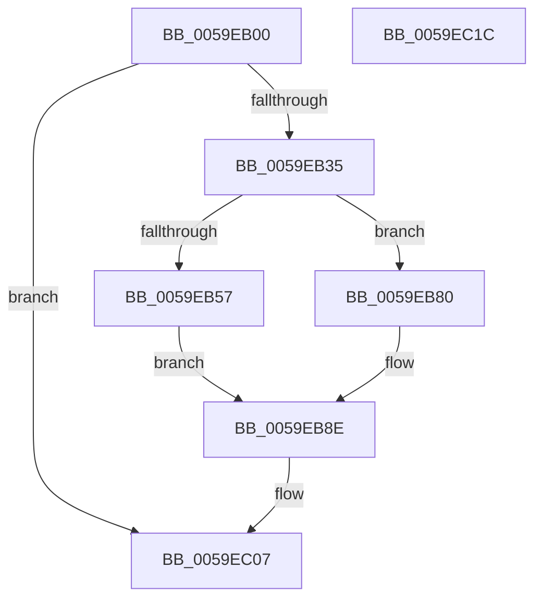

# IopLiveDumpTraceDumpFileWriteEnd

- RVA: `0x0059EB00`–`0x0059EC1D` (길이 `285` bytes)
- VA: `0x000000014059EB00`
- 실행 섹션: `.text`
- PDB 이름 있음: `예`; PDB Function 태그: `아니요`
- unwind 정보 RVA: `0x000B4EB4`
- 디코드: `63`개 명령, `285/285` bytes 표시
- 미해석 바이트: `0` (있으면 어셈블리에 `.byte`로 보존)

> 이 문서는 커널 이미지의 기계어와 PDB 기호를 분석해 생성했습니다. 4번과 5번은 함수 원형과 자료형을 바이너리 사용 방식에서 추정한 C 해석이며 원본 소스 복구 결과는 아닙니다.

## 1. Dependencies

- 직접 호출 지점: **3**; 고유 호출 대상: **3**
- 직접 호출자로 확인된 함수: **2**
- RIP 상대 이미지 참조: **3**

### Outgoing calls
- `0x0059EB25` → [IopLiveDumpIsTracingEnabled](../4F/IopLiveDumpIsTracingEnabled_function_004FC5AC.md) (function, `0x004FC5AC`)
- `0x0059EC02` → [IopLiveDumpTrace](../5A/IopLiveDumpTrace_function_005A4070.md) (function, `0x005A4070`)
- `0x0059EC0E` → [_security_check_cookie](../6A/_security_check_cookie_function_006AC640.md) (function, `0x006AC640`)

### Direct callers
- [IoCaptureLiveDump](../4E/IoCaptureLiveDump_function_004E085C.md) at `0x004E0EA2`
- [IoWriteDeferredLiveDumpData](IoWriteDeferredLiveDumpData_function_00598CD0.md) at `0x00598D50`

### Static image references
- `0x0059EB17` → RVA `0x00E0A740` (`.data`; read)
- `0x0059EB3C` → RVA `0x00021EB0` (`.rdata`; read)
- `0x0059EB46` → RVA `0x00023518` (`.rdata`; read)

## 2. Other-region calls and transfers

- 다른 실행 섹션으로 향하는 call: **0**
- 별도 외부 분기/꼬리 이동을 확인하지 못했습니다.

## 3. Assembly (complete function range)

```asm
0059EB00  44 89 4C 24 20                  mov dword ptr [rsp + 0x20], r9d
0059EB05  48 89 54 24 10                  mov qword ptr [rsp + 0x10], rdx
0059EB0A  55                              push rbp
0059EB0B  48 8D 6C 24 A9                  lea rbp, [rsp - 0x57]
0059EB10  48 81 EC B0 00 00 00            sub rsp, 0xb0
0059EB17  48 8B 05 22 BC 86 00            mov rax, qword ptr [rip + 0x86bc22]
0059EB1E  48 33 C4                        xor rax, rsp
0059EB21  48 89 45 47                     mov qword ptr [rbp + 0x47], rax
0059EB25  E8 82 DA F5 FF                  call 0x1404fc5ac
0059EB2A  45 33 D2                        xor r10d, r10d
0059EB2D  84 C0                           test al, al
0059EB2F  0F 84 D2 00 00 00               je 0x14059ec07
0059EB35  48 8B 91 30 02 00 00            mov rdx, qword ptr [rcx + 0x230]
0059EB3C  48 8D 05 6D 33 A8 FF            lea rax, [rip - 0x57cc93]
0059EB43  45 85 C0                        test r8d, r8d
0059EB46  4C 8D 0D CB 49 A8 FF            lea r9, [rip - 0x57b635]
0059EB4D  4C 0F 45 C8                     cmovne r9, rax
0059EB51  44 39 55 7F                     cmp dword ptr [rbp + 0x7f], r10d
0059EB55  7C 29                           jl 0x14059eb80
0059EB57  48 8B 8A A0 0F 00 00            mov rcx, qword ptr [rdx + 0xfa0]
0059EB5E  48 89 4D C7                     mov qword ptr [rbp - 0x39], rcx
0059EB62  48 8B 82 20 20 00 00            mov rax, qword ptr [rdx + 0x2020]
0059EB69  48 89 45 CF                     mov qword ptr [rbp - 0x31], rax
0059EB6D  48 8B 92 28 20 00 00            mov rdx, qword ptr [rdx + 0x2028]
0059EB74  48 C1 E2 0C                     shl rdx, 0xc
0059EB78  48 2B CA                        sub rcx, rdx
0059EB7B  48 2B C8                        sub rcx, rax
0059EB7E  EB 0E                           jmp 0x14059eb8e
0059EB80  4C 89 55 C7                     mov qword ptr [rbp - 0x39], r10
0059EB84  49 8B CA                        mov rcx, r10
0059EB87  4C 89 55 CF                     mov qword ptr [rbp - 0x31], r10
0059EB8B  49 8B D2                        mov rdx, r10
0059EB8E  48 8D 45 7F                     lea rax, [rbp + 0x7f]
0059EB92  48 89 55 D7                     mov qword ptr [rbp - 0x29], rdx
0059EB96  48 89 45 E7                     mov qword ptr [rbp - 0x19], rax
0059EB9A  4C 8D 45 E7                     lea r8, [rbp - 0x19]
0059EB9E  48 8D 45 C7                     lea rax, [rbp - 0x39]
0059EBA2  48 89 4D DF                     mov qword ptr [rbp - 0x21], rcx
0059EBA6  48 89 45 F7                     mov qword ptr [rbp - 9], rax
0059EBAA  BA 06 00 00 00                  mov edx, 6
0059EBAF  48 8D 45 CF                     lea rax, [rbp - 0x31]
0059EBB3  48 C7 45 EF 04 00 00 00         mov qword ptr [rbp - 0x11], 4
0059EBBB  48 89 45 07                     mov qword ptr [rbp + 7], rax
0059EBBF  49 8B C9                        mov rcx, r9
0059EBC2  48 8D 45 D7                     lea rax, [rbp - 0x29]
0059EBC6  48 C7 45 FF 08 00 00 00         mov qword ptr [rbp - 1], 8
0059EBCE  48 89 45 17                     mov qword ptr [rbp + 0x17], rax
0059EBD2  48 8D 45 DF                     lea rax, [rbp - 0x21]
0059EBD6  48 89 45 27                     mov qword ptr [rbp + 0x27], rax
0059EBDA  48 8D 45 6F                     lea rax, [rbp + 0x6f]
0059EBDE  48 89 45 37                     mov qword ptr [rbp + 0x37], rax
0059EBE2  48 C7 45 0F 08 00 00 00         mov qword ptr [rbp + 0xf], 8
0059EBEA  48 C7 45 1F 08 00 00 00         mov qword ptr [rbp + 0x1f], 8
0059EBF2  48 C7 45 2F 08 00 00 00         mov qword ptr [rbp + 0x2f], 8
0059EBFA  48 C7 45 3F 08 00 00 00         mov qword ptr [rbp + 0x3f], 8
0059EC02  E8 69 54 00 00                  call 0x1405a4070
0059EC07  48 8B 4D 47                     mov rcx, qword ptr [rbp + 0x47]
0059EC0B  48 33 CC                        xor rcx, rsp
0059EC0E  E8 2D DA 10 00                  call 0x1406ac640
0059EC13  48 81 C4 B0 00 00 00            add rsp, 0xb0
0059EC1A  5D                              pop rbp
0059EC1B  C3                              ret
0059EC1C  CC                              int3
```

## 4. C-style interpretation (structured pseudocode)

```c
__int64 __fastcall IopLiveDumpTraceDumpFileWriteEnd(__int64 a1, __int64 a2, int a3, int a4)
{
    __int64 result;
    __int64 v_r10;
    __int64 v_rsp;
    unsigned __int64 v_stack_m18;
    unsigned __int64 v_stack_m20;
    unsigned __int64 v_stack_m28;
    unsigned __int64 v_stack_m30;
    unsigned __int64 v_stack_m38;
    unsigned __int64 v_stack_m40;
    unsigned __int64 v_stack_m48;
    unsigned __int64 v_stack_m50;
    unsigned __int64 v_stack_m58;
    unsigned __int64 v_stack_m5F;
    unsigned __int64 v_stack_m60;
    unsigned __int64 v_stack_m68;
    unsigned __int64 v_stack_m70;
    unsigned __int64 v_stack_m78;
    unsigned __int64 v_stack_m80;
    unsigned __int64 v_stack_m88;
    unsigned __int64 v_stack_m90;
    unsigned __int64 v_stack_m98;
    unsigned __int64 v_stack_p10;
    unsigned int v_stack_p20;

    v_stack_p20 = a4;
    v_stack_p10 = a2;
    v_rsp = (v_rsp) - (176);
    result = (*(unsigned __int64 *)(v_rip + 8829986)) ^ (v_rsp);
    v_stack_m18 = result;
    result = IopLiveDumpIsTracingEnabled(a1, a2, a3, a4);
    v_r10 = 0;
    if ((unsigned __int8)(result) == 0) goto loc_0059EC07;
    a4 = v_rip - 5748277;
    if (a3 != 0) { a4 = v_rip - 5754003; }
    if (v_stack_p20 < 0) goto loc_0059EB80;
    v_stack_m98 = *(unsigned __int64 *)(*(unsigned __int64 *)(a1 + 560) + 4000);
    v_stack_m90 = *(unsigned __int64 *)(*(unsigned __int64 *)(a1 + 560) + 8224);
    a2 = (*(unsigned __int64 *)(*(unsigned __int64 *)(a1 + 560) + 8232)) << (12);
    a1 = (*(unsigned __int64 *)(*(unsigned __int64 *)(a1 + 560) + 4000)) - (a2);
    a1 = (a1) - (*(unsigned __int64 *)(*(unsigned __int64 *)(a1 + 560) + 8224));
    goto loc_0059EB8E;
loc_0059EB80:
    v_stack_m98 = 0;
    v_stack_m90 = 0;
loc_0059EB8E:
    v_stack_m88 = 0;
    v_stack_m78 = v_stack_p20;
    v_stack_m80 = 0;
    v_stack_m68 = v_stack_m98;
    v_stack_m70 = 4;
    v_stack_m58 = v_stack_m90;
    v_stack_m60 = 8;
    v_stack_m48 = v_stack_m88;
    v_stack_m38 = v_stack_m80;
    v_stack_m28 = v_stack_p10;
    v_stack_m50 = 8;
    v_stack_m40 = 8;
    v_stack_m30 = 8;
    v_stack_m20 = 8;
    result = IopLiveDumpTrace(a4, 6, v_stack_m78, a4);
loc_0059EC07:
    a1 = (v_stack_m18) ^ (v_rsp);
    result = _security_check_cookie(a1, 6, v_stack_m78, a4);
    v_rsp = (v_rsp) + (176);
    return result;
}
```

## 5. (Beta) C Style

```c
int64_t IopLiveDumpTraceDumpFileWriteEnd(int64_t Arg1, int64_t Arg2, int32_t Arg3, int32_t Arg4)
{
    int64_t result;
    int64_t local_r10;
    int64_t local_rsp;
    uint64_t v_stack_m18;
    uint64_t v_stack_m20;
    uint64_t v_stack_m28;
    uint64_t v_stack_m30;
    uint64_t v_stack_m38;
    uint64_t v_stack_m40;
    uint64_t v_stack_m48;
    uint64_t v_stack_m50;
    uint64_t v_stack_m58;
    uint64_t v_stack_m5F;
    uint64_t v_stack_m60;
    uint64_t v_stack_m68;
    uint64_t v_stack_m70;
    uint64_t v_stack_m78;
    uint64_t v_stack_m80;
    uint64_t v_stack_m88;
    uint64_t v_stack_m90;
    uint64_t v_stack_m98;
    uint64_t v_stack_p10;
    uint32_t v_stack_p20;

    v_stack_p20 = Arg4;
    v_stack_p10 = Arg2;
    local_rsp = (local_rsp) - (176);
    result = (*(uint64_t *)(v_rip + 0x86BC22)) ^ (local_rsp);
    v_stack_m18 = result;
    result = IopLiveDumpIsTracingEnabled(Arg1, Arg2, Arg3, Arg4);
    local_r10 = 0;
    if ((uint8_t)(result) == 0) goto loc_0059EC07;
    Arg4 = v_rip - 5748277;
    if (Arg3 != 0) { Arg4 = v_rip - 5754003; }
    if (v_stack_p20 < 0) goto loc_0059EB80;
    v_stack_m98 = *(uint64_t *)(*(uint64_t *)(Arg1 + 0x230) + 0xFA0);
    v_stack_m90 = *(uint64_t *)(*(uint64_t *)(Arg1 + 0x230) + 0x2020);
    Arg2 = (*(uint64_t *)(*(uint64_t *)(Arg1 + 0x230) + 0x2028)) << (12);
    Arg1 = (*(uint64_t *)(*(uint64_t *)(Arg1 + 0x230) + 0xFA0)) - (Arg2);
    Arg1 = (Arg1) - (*(uint64_t *)(*(uint64_t *)(Arg1 + 0x230) + 0x2020));
    goto loc_0059EB8E;
loc_0059EB80:
    v_stack_m98 = 0;
    v_stack_m90 = 0;
loc_0059EB8E:
    v_stack_m88 = 0;
    v_stack_m78 = v_stack_p20;
    v_stack_m80 = 0;
    v_stack_m68 = v_stack_m98;
    v_stack_m70 = 4;
    v_stack_m58 = v_stack_m90;
    v_stack_m60 = 8;
    v_stack_m48 = v_stack_m88;
    v_stack_m38 = v_stack_m80;
    v_stack_m28 = v_stack_p10;
    v_stack_m50 = 8;
    v_stack_m40 = 8;
    v_stack_m30 = 8;
    v_stack_m20 = 8;
    result = IopLiveDumpTrace(Arg4, 6, v_stack_m78, Arg4);
loc_0059EC07:
    Arg1 = (v_stack_m18) ^ (local_rsp);
    result = _security_check_cookie(Arg1, 6, v_stack_m78, Arg4);
    local_rsp = (local_rsp) + (176);
    return result;
}
```

## 6. Execution-region graph

[열기: 2D/3D 그래프와 함수 탐색 컨트롤 패널](../../../control-panel.html?section=text&rva=0x0059EB00&view=graph)

- 2D 그래프는 위에서 아래로 흐르고, 3D 그래프는 빈 공간을 드래그해 회전합니다. Shift+드래그는 이동, 휠은 확대·축소, 함수 노드 선택은 대상 보고서 이동입니다.

### Static fallback


