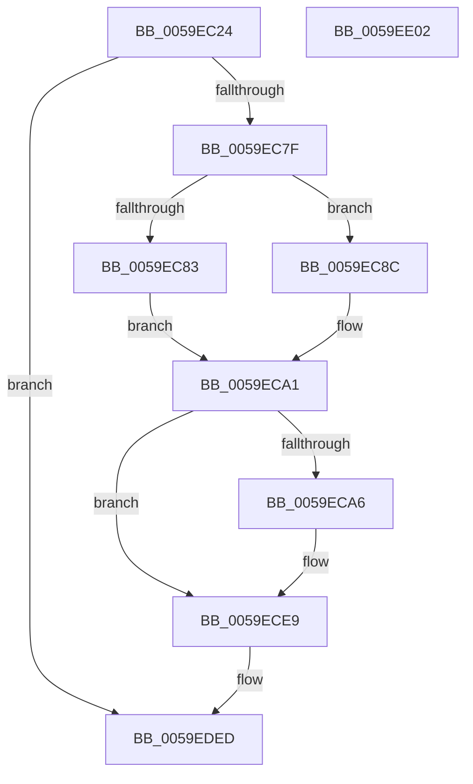

# IopLiveDumpTraceInterfaceEnd

- RVA: `0x0059EC24`–`0x0059EE03` (길이 `479` bytes)
- VA: `0x000000014059EC24`
- 실행 섹션: `.text`
- PDB 이름 있음: `예`; PDB Function 태그: `아니요`
- unwind 정보 RVA: `0x000A0434`
- 디코드: `100`개 명령, `479/479` bytes 표시
- 미해석 바이트: `0` (있으면 어셈블리에 `.byte`로 보존)

> 이 문서는 커널 이미지의 기계어와 PDB 기호를 분석해 생성했습니다. 4번과 5번은 함수 원형과 자료형을 바이너리 사용 방식에서 추정한 C 해석이며 원본 소스 복구 결과는 아닙니다.

## 1. Dependencies

- 직접 호출 지점: **3**; 고유 호출 대상: **3**
- 직접 호출자로 확인된 함수: **3**
- RIP 상대 이미지 참조: **5**

### Outgoing calls
- `0x0059EC72` → [IopLiveDumpIsTracingEnabled](../4F/IopLiveDumpIsTracingEnabled_function_004FC5AC.md) (function, `0x004FC5AC`)
- `0x0059EDE8` → [IopLiveDumpTrace](../5A/IopLiveDumpTrace_function_005A4070.md) (function, `0x005A4070`)
- `0x0059EDF4` → [_security_check_cookie](../6A/_security_check_cookie_function_006AC640.md) (function, `0x006AC640`)

### Direct callers
- [IoCaptureLiveDump](../4E/IoCaptureLiveDump_function_004E085C.md) at `0x004E0ED7`
- [IoDiscardDeferredLiveDumpData](IoDiscardDeferredLiveDumpData_function_00598AC8.md) at `0x00598AE8`
- [IoWriteDeferredLiveDumpData](IoWriteDeferredLiveDumpData_function_00598CD0.md) at `0x00598D73`

### Static image references
- `0x0059EC3B` → RVA `0x00E0A740` (`.data`; read)
- `0x0059EC83` → RVA `0x00020E98` (`.rdata`; read)
- `0x0059EC8F` → RVA `0x00021DE0` (`.rdata`; read)
- `0x0059EC96` → RVA `0x000231B8` (`.rdata`; read)
- `0x0059ECE9` → RVA `0x00E66181` (`.data`; read)

## 2. Other-region calls and transfers

- 다른 실행 섹션으로 향하는 call: **0**
- 별도 외부 분기/꼬리 이동을 확인하지 못했습니다.

## 3. Assembly (complete function range)

```asm
0059EC24  4C 89 4C 24 20                  mov qword ptr [rsp + 0x20], r9
0059EC29  44 89 44 24 18                  mov dword ptr [rsp + 0x18], r8d
0059EC2E  55                              push rbp
0059EC2F  48 8D 6C 24 D0                  lea rbp, [rsp - 0x30]
0059EC34  48 81 EC 30 01 00 00            sub rsp, 0x130
0059EC3B  48 8B 05 FE BA 86 00            mov rax, qword ptr [rip + 0x86bafe]
0059EC42  48 33 C4                        xor rax, rsp
0059EC45  48 89 45 20                     mov qword ptr [rbp + 0x20], rax
0059EC49  45 33 D2                        xor r10d, r10d
0059EC4C  4C 8B C1                        mov r8, rcx
0059EC4F  44 89 54 24 24                  mov dword ptr [rsp + 0x24], r10d
0059EC54  44 89 54 24 20                  mov dword ptr [rsp + 0x20], r10d
0059EC59  4C 89 54 24 30                  mov qword ptr [rsp + 0x30], r10
0059EC5E  4C 89 54 24 38                  mov qword ptr [rsp + 0x38], r10
0059EC63  4C 89 54 24 40                  mov qword ptr [rsp + 0x40], r10
0059EC68  4C 89 54 24 48                  mov qword ptr [rsp + 0x48], r10
0059EC6D  44 89 54 24 28                  mov dword ptr [rsp + 0x28], r10d
0059EC72  E8 35 D9 F5 FF                  call 0x1404fc5ac
0059EC77  84 C0                           test al, al
0059EC79  0F 84 6E 01 00 00               je 0x14059eded
0059EC7F  85 D2                           test edx, edx
0059EC81  75 09                           jne 0x14059ec8c
0059EC83  4C 8D 0D 0E 22 A8 FF            lea r9, [rip - 0x57ddf2]
0059EC8A  EB 15                           jmp 0x14059eca1
0059EC8C  83 FA 01                        cmp edx, 1
0059EC8F  4C 8D 0D 4A 31 A8 FF            lea r9, [rip - 0x57ceb6]
0059EC96  48 8D 05 1B 45 A8 FF            lea rax, [rip - 0x57bae5]
0059EC9D  4C 0F 45 C8                     cmovne r9, rax
0059ECA1  4D 85 C0                        test r8, r8
0059ECA4  74 43                           je 0x14059ece9
0059ECA6  8B 01                           mov eax, dword ptr [rcx]
0059ECA8  89 44 24 20                     mov dword ptr [rsp + 0x20], eax
0059ECAC  48 8B 41 08                     mov rax, qword ptr [rcx + 8]
0059ECB0  48 89 44 24 30                  mov qword ptr [rsp + 0x30], rax
0059ECB5  48 8B 41 10                     mov rax, qword ptr [rcx + 0x10]
0059ECB9  48 89 44 24 38                  mov qword ptr [rsp + 0x38], rax
0059ECBE  48 8B 41 18                     mov rax, qword ptr [rcx + 0x18]
0059ECC2  48 89 44 24 40                  mov qword ptr [rsp + 0x40], rax
0059ECC7  48 8B 41 20                     mov rax, qword ptr [rcx + 0x20]
0059ECCB  8B 49 28                        mov ecx, dword ptr [rcx + 0x28]
0059ECCE  48 89 44 24 48                  mov qword ptr [rsp + 0x48], rax
0059ECD3  8B C1                           mov eax, ecx
0059ECD5  C1 E8 04                        shr eax, 4
0059ECD8  83 E0 01                        and eax, 1
0059ECDB  C1 E9 05                        shr ecx, 5
0059ECDE  83 E1 01                        and ecx, 1
0059ECE1  89 44 24 24                     mov dword ptr [rsp + 0x24], eax
0059ECE5  89 4C 24 28                     mov dword ptr [rsp + 0x28], ecx
0059ECE9  0F B6 05 91 74 8C 00            movzx eax, byte ptr [rip + 0x8c7491]
0059ECF0  BA 0D 00 00 00                  mov edx, 0xd
0059ECF5  89 44 24 2C                     mov dword ptr [rsp + 0x2c], eax
0059ECF9  49 8B C9                        mov rcx, r9
0059ECFC  48 8D 45 50                     lea rax, [rbp + 0x50]
0059ED00  48 C7 44 24 58 04 00 00 00      mov qword ptr [rsp + 0x58], 4
0059ED09  48 89 44 24 50                  mov qword ptr [rsp + 0x50], rax
0059ED0E  48 8D 44 24 20                  lea rax, [rsp + 0x20]
0059ED13  48 89 44 24 60                  mov qword ptr [rsp + 0x60], rax
0059ED18  48 8D 44 24 30                  lea rax, [rsp + 0x30]
0059ED1D  48 89 44 24 70                  mov qword ptr [rsp + 0x70], rax
0059ED22  48 8D 44 24 38                  lea rax, [rsp + 0x38]
0059ED27  48 89 45 80                     mov qword ptr [rbp - 0x80], rax
0059ED2B  48 8D 44 24 40                  lea rax, [rsp + 0x40]
0059ED30  48 89 45 90                     mov qword ptr [rbp - 0x70], rax
0059ED34  48 8D 44 24 48                  lea rax, [rsp + 0x48]
0059ED39  48 89 45 A0                     mov qword ptr [rbp - 0x60], rax
0059ED3D  48 8D 44 24 24                  lea rax, [rsp + 0x24]
0059ED42  48 89 45 B0                     mov qword ptr [rbp - 0x50], rax
0059ED46  48 8D 45 58                     lea rax, [rbp + 0x58]
0059ED4A  48 89 45 C0                     mov qword ptr [rbp - 0x40], rax
0059ED4E  48 8D 44 24 28                  lea rax, [rsp + 0x28]
0059ED53  48 89 45 D0                     mov qword ptr [rbp - 0x30], rax
0059ED57  49 8D 80 98 04 00 00            lea rax, [r8 + 0x498]
0059ED5E  48 89 45 E0                     mov qword ptr [rbp - 0x20], rax
0059ED62  49 8D 80 A0 04 00 00            lea rax, [r8 + 0x4a0]
0059ED69  48 89 45 F0                     mov qword ptr [rbp - 0x10], rax
0059ED6D  49 8D 80 A8 04 00 00            lea rax, [r8 + 0x4a8]
0059ED74  48 89 45 00                     mov qword ptr [rbp], rax
0059ED78  4C 8D 44 24 50                  lea r8, [rsp + 0x50]
0059ED7D  48 8D 44 24 2C                  lea rax, [rsp + 0x2c]
0059ED82  48 C7 44 24 68 04 00 00 00      mov qword ptr [rsp + 0x68], 4
0059ED8B  48 89 45 10                     mov qword ptr [rbp + 0x10], rax
0059ED8F  48 C7 44 24 78 08 00 00 00      mov qword ptr [rsp + 0x78], 8
0059ED98  48 C7 45 88 08 00 00 00         mov qword ptr [rbp - 0x78], 8
0059EDA0  48 C7 45 98 08 00 00 00         mov qword ptr [rbp - 0x68], 8
0059EDA8  48 C7 45 A8 08 00 00 00         mov qword ptr [rbp - 0x58], 8
0059EDB0  48 C7 45 B8 04 00 00 00         mov qword ptr [rbp - 0x48], 4
0059EDB8  48 C7 45 C8 08 00 00 00         mov qword ptr [rbp - 0x38], 8
0059EDC0  48 C7 45 D8 04 00 00 00         mov qword ptr [rbp - 0x28], 4
0059EDC8  48 C7 45 E8 08 00 00 00         mov qword ptr [rbp - 0x18], 8
0059EDD0  48 C7 45 F8 08 00 00 00         mov qword ptr [rbp - 8], 8
0059EDD8  48 C7 45 08 08 00 00 00         mov qword ptr [rbp + 8], 8
0059EDE0  48 C7 45 18 04 00 00 00         mov qword ptr [rbp + 0x18], 4
0059EDE8  E8 83 52 00 00                  call 0x1405a4070
0059EDED  48 8B 4D 20                     mov rcx, qword ptr [rbp + 0x20]
0059EDF1  48 33 CC                        xor rcx, rsp
0059EDF4  E8 47 D8 10 00                  call 0x1406ac640
0059EDF9  48 81 C4 30 01 00 00            add rsp, 0x130
0059EE00  5D                              pop rbp
0059EE01  C3                              ret
0059EE02  CC                              int3
```

## 4. C-style interpretation (structured pseudocode)

```c
__int64 __fastcall IopLiveDumpTraceInterfaceEnd(__int64 a1, int a2, int a3, __int64 a4)
{
    __int64 result;
    __int64 v_r10;
    __int64 v_rsp;
    unsigned __int64 v_stack_m100;
    unsigned __int64 v_stack_m108;
    unsigned int v_stack_m10C;
    unsigned int v_stack_m110;
    unsigned int v_stack_m114;
    unsigned int v_stack_m118;
    unsigned __int64 v_stack_m18;
    unsigned __int64 v_stack_m20;
    unsigned __int64 v_stack_m28;
    unsigned __int64 v_stack_m30;
    unsigned __int64 v_stack_m38;
    unsigned __int64 v_stack_m40;
    unsigned __int64 v_stack_m48;
    unsigned __int64 v_stack_m50;
    unsigned __int64 v_stack_m58;
    unsigned __int64 v_stack_m60;
    unsigned __int64 v_stack_m68;
    unsigned __int64 v_stack_m70;
    unsigned __int64 v_stack_m78;
    unsigned __int64 v_stack_m80;
    unsigned __int64 v_stack_m88;
    unsigned __int64 v_stack_m90;
    unsigned __int64 v_stack_m98;
    unsigned __int64 v_stack_mA0;
    unsigned __int64 v_stack_mA8;
    unsigned __int64 v_stack_mB0;
    unsigned __int64 v_stack_mB8;
    unsigned __int64 v_stack_mC0;
    unsigned __int64 v_stack_mC8;
    unsigned __int64 v_stack_mD0;
    unsigned __int64 v_stack_mD8;
    unsigned __int64 v_stack_mE0;
    unsigned __int64 v_stack_mE8;
    unsigned __int64 v_stack_mF0;
    unsigned __int64 v_stack_mF8;
    unsigned int v_stack_p18;
    unsigned __int64 v_stack_p20;

    v_stack_p20 = a4;
    v_stack_p18 = a3;
    v_rsp = (v_rsp) - (304);
    result = (*(unsigned __int64 *)(v_rip + 8829694)) ^ (v_rsp);
    v_stack_m18 = result;
    v_r10 = 0;
    v_stack_m114 = 0;
    v_stack_m118 = 0;
    v_stack_m108 = 0;
    v_stack_m100 = 0;
    v_stack_mF8 = 0;
    v_stack_mF0 = 0;
    v_stack_m110 = 0;
    result = IopLiveDumpIsTracingEnabled(a1, a2, a1, a4);
    if ((unsigned __int8)(result) == 0) goto loc_0059EDED;
    if (a2 != 0) goto loc_0059EC8C;
    goto loc_0059ECA1;
loc_0059EC8C:
    a4 = v_rip - 5754550;
    if (a2 != 1) { a4 = v_rip - 5749477; }
loc_0059ECA1:
    result = v_rip - 5749477;
    if (a1 != 0) {
        result = *(unsigned int *)(a1);
        v_stack_m118 = (unsigned int)(result);
        result = *(unsigned __int64 *)(a1 + 8);
        v_stack_m108 = result;
        result = *(unsigned __int64 *)(a1 + 16);
        v_stack_m100 = result;
        result = *(unsigned __int64 *)(a1 + 24);
        v_stack_mF8 = result;
        result = *(unsigned __int64 *)(a1 + 32);
        a1 = *(unsigned int *)(a1 + 40);
        v_stack_mF0 = result;
        result = (unsigned int)(a1);
        result = (unsigned int)((result) >> (4));
        result = (unsigned int)((result) & (1));
        a1 = (unsigned int)((a1) >> (5));
        a1 = (unsigned int)((a1) & (1));
        v_stack_m114 = (unsigned int)(result);
        v_stack_m110 = (unsigned int)(a1);
    }
    v_stack_m10C = (unsigned int)(*(unsigned __int8 *)(v_rip + 9204881));
    v_stack_mE0 = 4;
    v_stack_mE8 = v_stack_p18;
    v_stack_mD8 = v_stack_m118;
    v_stack_mC8 = v_stack_m108;
    v_stack_mB8 = v_stack_m100;
    v_stack_mA8 = v_stack_mF8;
    v_stack_m98 = v_stack_mF0;
    v_stack_m88 = v_stack_m114;
    v_stack_m78 = v_stack_p20;
    v_stack_m68 = v_stack_m110;
    v_stack_m58 = a1 + 1176;
    v_stack_m48 = a1 + 1184;
    v_stack_m38 = a1 + 1192;
    v_stack_mD0 = 4;
    v_stack_m28 = v_stack_m10C;
    v_stack_mC0 = 8;
    v_stack_mB0 = 8;
    v_stack_mA0 = 8;
    v_stack_m90 = 8;
    v_stack_m80 = 4;
    v_stack_m70 = 8;
    v_stack_m60 = 4;
    v_stack_m50 = 8;
    v_stack_m40 = 8;
    v_stack_m30 = 8;
    v_stack_m20 = 4;
    result = IopLiveDumpTrace(a4, 13, v_stack_mE8, a4);
loc_0059EDED:
    a1 = (v_stack_m18) ^ (v_rsp);
    result = _security_check_cookie(a1, 13, v_stack_mE8, a4);
    v_rsp = (v_rsp) + (304);
    return result;
}
```

## 5. (Beta) C Style

```c
int64_t IopLiveDumpTraceInterfaceEnd(int64_t Arg1, int32_t Arg2, int32_t Arg3, int64_t Arg4)
{
    int64_t result;
    int64_t local_r10;
    int64_t local_rsp;
    uint64_t v_stack_m100;
    uint64_t v_stack_m108;
    uint32_t v_stack_m10C;
    uint32_t v_stack_m110;
    uint32_t v_stack_m114;
    uint32_t v_stack_m118;
    uint64_t v_stack_m18;
    uint64_t v_stack_m20;
    uint64_t v_stack_m28;
    uint64_t v_stack_m30;
    uint64_t v_stack_m38;
    uint64_t v_stack_m40;
    uint64_t v_stack_m48;
    uint64_t v_stack_m50;
    uint64_t v_stack_m58;
    uint64_t v_stack_m60;
    uint64_t v_stack_m68;
    uint64_t v_stack_m70;
    uint64_t v_stack_m78;
    uint64_t v_stack_m80;
    uint64_t v_stack_m88;
    uint64_t v_stack_m90;
    uint64_t v_stack_m98;
    uint64_t v_stack_mA0;
    uint64_t v_stack_mA8;
    uint64_t v_stack_mB0;
    uint64_t v_stack_mB8;
    uint64_t v_stack_mC0;
    uint64_t v_stack_mC8;
    uint64_t v_stack_mD0;
    uint64_t v_stack_mD8;
    uint64_t v_stack_mE0;
    uint64_t v_stack_mE8;
    uint64_t v_stack_mF0;
    uint64_t v_stack_mF8;
    uint32_t v_stack_p18;
    uint64_t v_stack_p20;

    v_stack_p20 = Arg4;
    v_stack_p18 = Arg3;
    local_rsp = (local_rsp) - (304);
    result = (*(uint64_t *)(v_rip + 0x86BAFE)) ^ (local_rsp);
    v_stack_m18 = result;
    local_r10 = 0;
    v_stack_m114 = 0;
    v_stack_m118 = 0;
    v_stack_m108 = 0;
    v_stack_m100 = 0;
    v_stack_mF8 = 0;
    v_stack_mF0 = 0;
    v_stack_m110 = 0;
    result = IopLiveDumpIsTracingEnabled(Arg1, Arg2, Arg1, Arg4);
    if ((uint8_t)(result) == 0) goto loc_0059EDED;
    if (Arg2 != 0) goto loc_0059EC8C;
    goto loc_0059ECA1;
loc_0059EC8C:
    Arg4 = v_rip - 5754550;
    if (Arg2 != 1) { Arg4 = v_rip - 5749477; }
loc_0059ECA1:
    result = v_rip - 5749477;
    if (Arg1 != 0) {
        result = *(uint32_t *)(Arg1);
        v_stack_m118 = (uint32_t)(result);
        result = *(uint64_t *)(Arg1 + 0x8);
        v_stack_m108 = result;
        result = *(uint64_t *)(Arg1 + 0x10);
        v_stack_m100 = result;
        result = *(uint64_t *)(Arg1 + 0x18);
        v_stack_mF8 = result;
        result = *(uint64_t *)(Arg1 + 0x20);
        Arg1 = *(uint32_t *)(Arg1 + 0x28);
        v_stack_mF0 = result;
        result = (uint32_t)(Arg1);
        result = (uint32_t)((result) >> (4));
        result = (uint32_t)((result) & (1));
        Arg1 = (uint32_t)((Arg1) >> (5));
        Arg1 = (uint32_t)((Arg1) & (1));
        v_stack_m114 = (uint32_t)(result);
        v_stack_m110 = (uint32_t)(Arg1);
    }
    v_stack_m10C = (uint32_t)(*(uint8_t *)(v_rip + 0x8C7491));
    v_stack_mE0 = 4;
    v_stack_mE8 = v_stack_p18;
    v_stack_mD8 = v_stack_m118;
    v_stack_mC8 = v_stack_m108;
    v_stack_mB8 = v_stack_m100;
    v_stack_mA8 = v_stack_mF8;
    v_stack_m98 = v_stack_mF0;
    v_stack_m88 = v_stack_m114;
    v_stack_m78 = v_stack_p20;
    v_stack_m68 = v_stack_m110;
    v_stack_m58 = Arg1 + 1176;
    v_stack_m48 = Arg1 + 1184;
    v_stack_m38 = Arg1 + 1192;
    v_stack_mD0 = 4;
    v_stack_m28 = v_stack_m10C;
    v_stack_mC0 = 8;
    v_stack_mB0 = 8;
    v_stack_mA0 = 8;
    v_stack_m90 = 8;
    v_stack_m80 = 4;
    v_stack_m70 = 8;
    v_stack_m60 = 4;
    v_stack_m50 = 8;
    v_stack_m40 = 8;
    v_stack_m30 = 8;
    v_stack_m20 = 4;
    result = IopLiveDumpTrace(Arg4, 13, v_stack_mE8, Arg4);
loc_0059EDED:
    Arg1 = (v_stack_m18) ^ (local_rsp);
    result = _security_check_cookie(Arg1, 13, v_stack_mE8, Arg4);
    local_rsp = (local_rsp) + (304);
    return result;
}
```

## 6. Execution-region graph

[열기: 2D/3D 그래프와 함수 탐색 컨트롤 패널](../../../control-panel.html?section=text&rva=0x0059EC24&view=graph)

- 2D 그래프는 위에서 아래로 흐르고, 3D 그래프는 빈 공간을 드래그해 회전합니다. Shift+드래그는 이동, 휠은 확대·축소, 함수 노드 선택은 대상 보고서 이동입니다.

### Static fallback


