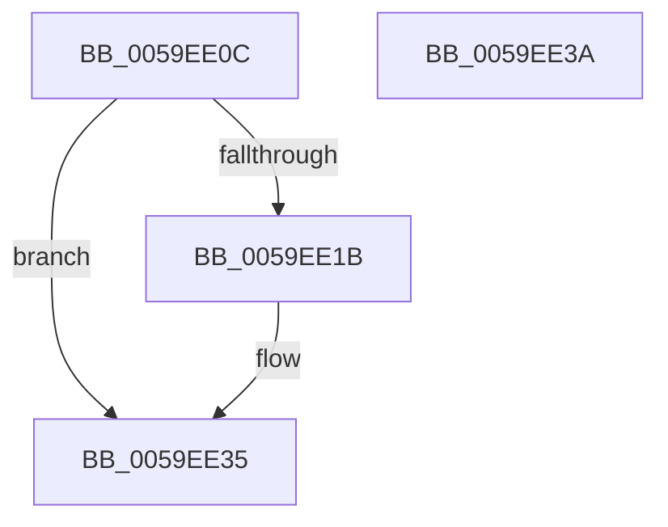

# IopLiveDumpTraceInterfaceStart

- RVA: `0x0059EE0C`–`0x0059EE3B` (길이 `47` bytes)
- VA: `0x000000014059EE0C`
- 실행 섹션: `.text`
- PDB 이름 있음: `예`; PDB Function 태그: `아니요`
- unwind 정보 RVA: `0x0005C788`
- 디코드: `13`개 명령, `47/47` bytes 표시
- 미해석 바이트: `0` (있으면 어셈블리에 `.byte`로 보존)

> 이 문서는 커널 이미지의 기계어와 PDB 기호를 분석해 생성했습니다. 4번과 5번은 함수 원형과 자료형을 바이너리 사용 방식에서 추정한 C 해석이며 원본 소스 복구 결과는 아닙니다.

## 1. Dependencies

- 직접 호출 지점: **2**; 고유 호출 대상: **2**
- 직접 호출자로 확인된 함수: **2**
- RIP 상대 이미지 참조: **2**

### Outgoing calls
- `0x0059EE12` → [IopLiveDumpIsTracingEnabled](../4F/IopLiveDumpIsTracingEnabled_function_004FC5AC.md) (function, `0x004FC5AC`)
- `0x0059EE30` → [IopLiveDumpTraceNoArgs](../5A/IopLiveDumpTraceNoArgs_function_005A43C0.md) (function, `0x005A43C0`)

### Direct callers
- [IoDiscardDeferredLiveDumpData](IoDiscardDeferredLiveDumpData_function_00598AC8.md) at `0x00598AD6`
- [IoWriteDeferredLiveDumpData](IoWriteDeferredLiveDumpData_function_00598CD0.md) at `0x00598D02`

### Static image references
- `0x0059EE1E` → RVA `0x00021730` (`.rdata`; read)
- `0x0059EE25` → RVA `0x00021B08` (`.rdata`; read)

## 2. Other-region calls and transfers

- 다른 실행 섹션으로 향하는 call: **0**
- 별도 외부 분기/꼬리 이동을 확인하지 못했습니다.

## 3. Assembly (complete function range)

```asm
0059EE0C  48 83 EC 28                     sub rsp, 0x28
0059EE10  8B D1                           mov edx, ecx
0059EE12  E8 95 D7 F5 FF                  call 0x1404fc5ac
0059EE17  84 C0                           test al, al
0059EE19  74 1A                           je 0x14059ee35
0059EE1B  83 FA 01                        cmp edx, 1
0059EE1E  48 8D 05 0B 29 A8 FF            lea rax, [rip - 0x57d6f5]
0059EE25  48 8D 0D DC 2C A8 FF            lea rcx, [rip - 0x57d324]
0059EE2C  48 0F 45 C8                     cmovne rcx, rax
0059EE30  E8 8B 55 00 00                  call 0x1405a43c0
0059EE35  48 83 C4 28                     add rsp, 0x28
0059EE39  C3                              ret
0059EE3A  CC                              int3
```

## 4. C-style interpretation (structured pseudocode)

```c
__int64 __fastcall IopLiveDumpTraceInterfaceStart(int a1)
{
    __int64 result;
    __int64 v_rsp;

    v_rsp = (v_rsp) - (40);
    result = IopLiveDumpIsTracingEnabled(a1, (unsigned int)(a1), a3, a4);
    if ((unsigned __int8)(result) != 0) {
        result = v_rip - 5756661;
        a1 = v_rip - 5755684;
        if (((unsigned int)((unsigned int)(a1))) != 1) { a1 = result; }
        result = IopLiveDumpTraceNoArgs(a1, (unsigned int)(a1), a3, a4);
    }
    v_rsp = (v_rsp) + (40);
    return result;
}
```

## 5. (Beta) C Style

```c
int64_t IopLiveDumpTraceInterfaceStart(int32_t Arg1)
{
    int64_t result;
    int64_t local_rsp;

    local_rsp = (local_rsp) - (40);
    result = IopLiveDumpIsTracingEnabled(Arg1, (uint32_t)(Arg1), a3, a4);
    if ((uint8_t)(result) != 0) {
        result = v_rip - 5756661;
        Arg1 = v_rip - 5755684;
        if (((uint32_t)((uint32_t)(Arg1))) != 1) { Arg1 = result; }
        result = IopLiveDumpTraceNoArgs(Arg1, (uint32_t)(Arg1), a3, a4);
    }
    local_rsp = (local_rsp) + (40);
    return result;
}
```

## 6. Execution-region graph

[열기: 2D/3D 그래프와 함수 탐색 컨트롤 패널](../../../control-panel.html?section=text&rva=0x0059EE0C&view=graph)

- 2D 그래프는 위에서 아래로 흐르고, 3D 그래프는 빈 공간을 드래그해 회전합니다. Shift+드래그는 이동, 휠은 확대·축소, 함수 노드 선택은 대상 보고서 이동입니다.

### Static fallback


