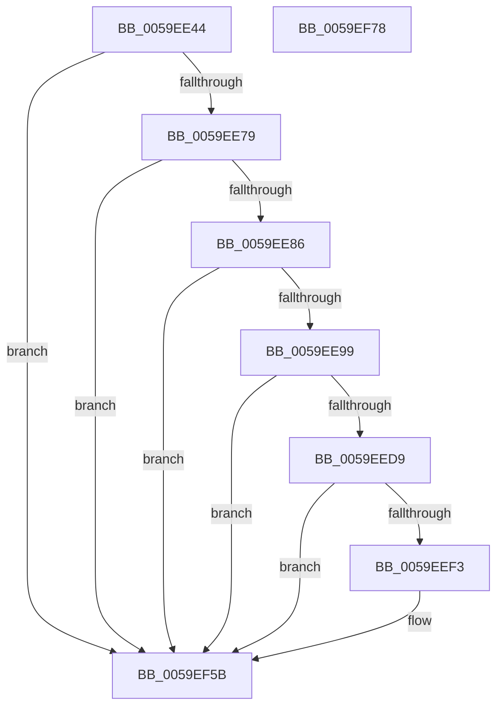

# IopLiveDumpTraceMarkImportantDumpDataDuration

- RVA: `0x0059EE44`–`0x0059EF79` (길이 `309` bytes)
- VA: `0x000000014059EE44`
- 실행 섹션: `.text`
- PDB 이름 있음: `예`; PDB Function 태그: `아니요`
- unwind 정보 RVA: `0x000C7A74`
- 디코드: `63`개 명령, `309/309` bytes 표시
- 미해석 바이트: `0` (있으면 어셈블리에 `.byte`로 보존)

> 이 문서는 커널 이미지의 기계어와 PDB 기호를 분석해 생성했습니다. 4번과 5번은 함수 원형과 자료형을 바이너리 사용 방식에서 추정한 C 해석이며 원본 소스 복구 결과는 아닙니다.

## 1. Dependencies

- 직접 호출 지점: **5**; 고유 호출 대상: **5**
- 직접 호출자로 확인된 함수: **1**
- RIP 상대 이미지 참조: **5**

### Outgoing calls
- `0x0059EE6C` → [IopLiveDumpIsTracingEnabled](../4F/IopLiveDumpIsTracingEnabled_function_004FC5AC.md) (function, `0x004FC5AC`)
- `0x0059EEC7` → [IopLiveDumpTrace](../5A/IopLiveDumpTrace_function_005A4070.md) (function, `0x005A4070`)
- `0x0059EEEA` → [tlgKeywordOn](../42/tlgKeywordOn_function_0042EAA0.md) (function, `0x0042EAA0`)
- `0x0059EF56` → [tlgWriteTransfer_EtwWriteTransfer](../42/tlgWriteTransfer_EtwWriteTransfer_function_004260E0.md) (function, `0x004260E0`)
- `0x0059EF62` → [_security_check_cookie](../6A/_security_check_cookie_function_006AC640.md) (function, `0x006AC640`)

### Direct callers
- [IopLiveDumpMarkImportantDumpData](IopLiveDumpMarkImportantDumpData_function_0059CCA4.md) at `0x0059CDE4`

### Static image references
- `0x0059EE5B` → RVA `0x00E0A740` (`.data`; read)
- `0x0059EEAE` → RVA `0x000212C0` (`.rdata`; read)
- `0x0059EEBC` → RVA `0x00022918` (`.rdata`; read)
- `0x0059EECC` → RVA `0x00E06EA0` (`.data`; read)
- `0x0059EF15` → RVA `0x000464B5` (`.rdata`; read)

## 2. Other-region calls and transfers

- 다른 실행 섹션으로 향하는 call: **0**
- 별도 외부 분기/꼬리 이동을 확인하지 못했습니다.

## 3. Assembly (complete function range)

```asm
0059EE44  48 89 5C 24 18                  mov qword ptr [rsp + 0x18], rbx
0059EE49  48 89 54 24 10                  mov qword ptr [rsp + 0x10], rdx
0059EE4E  55                              push rbp
0059EE4F  48 8D 6C 24 A9                  lea rbp, [rsp - 0x57]
0059EE54  48 81 EC A0 00 00 00            sub rsp, 0xa0
0059EE5B  48 8B 05 DE B8 86 00            mov rax, qword ptr [rip + 0x86b8de]
0059EE62  48 33 C4                        xor rax, rsp
0059EE65  48 89 45 47                     mov qword ptr [rbp + 0x47], rax
0059EE69  48 8B D9                        mov rbx, rcx
0059EE6C  E8 3B D7 F5 FF                  call 0x1404fc5ac
0059EE71  84 C0                           test al, al
0059EE73  0F 84 E2 00 00 00               je 0x14059ef5b
0059EE79  83 B9 A8 01 00 00 00            cmp dword ptr [rcx + 0x1a8], 0
0059EE80  0F 85 D5 00 00 00               jne 0x14059ef5b
0059EE86  8B 81 40 01 00 00               mov eax, dword ptr [rcx + 0x140]
0059EE8C  BA 01 00 00 00                  mov edx, 1
0059EE91  84 C2                           test dl, al
0059EE93  0F 84 C2 00 00 00               je 0x14059ef5b
0059EE99  83 65 03 00                     and dword ptr [rbp + 3], 0
0059EE9D  48 8D 45 6F                     lea rax, [rbp + 0x6f]
0059EEA1  48 89 45 F7                     mov qword ptr [rbp - 9], rax
0059EEA5  4C 8D 45 F7                     lea r8, [rbp - 9]
0059EEA9  8B 41 50                        mov eax, dword ptr [rcx + 0x50]
0059EEAC  84 C2                           test dl, al
0059EEAE  48 8D 05 0B 24 A8 FF            lea rax, [rip - 0x57dbf5]
0059EEB5  C7 45 FF 08 00 00 00            mov dword ptr [rbp - 1], 8
0059EEBC  48 8D 0D 55 3A A8 FF            lea rcx, [rip - 0x57c5ab]
0059EEC3  48 0F 44 C8                     cmove rcx, rax
0059EEC7  E8 A4 51 00 00                  call 0x1405a4070
0059EECC  83 3D CD 7F 86 00 05            cmp dword ptr [rip + 0x867fcd], 5
0059EED3  0F 86 82 00 00 00               jbe 0x14059ef5b
0059EED9  48 BA 00 00 00 00 00 40 00 00   movabs rdx, 0x400000000000
0059EEE3  48 8D 0D B6 7F 86 00            lea rcx, [rip + 0x867fb6]
0059EEEA  E8 B1 FB E8 FF                  call 0x14042eaa0
0059EEEF  84 C0                           test al, al
0059EEF1  74 68                           je 0x14059ef5b
0059EEF3  83 65 33 00                     and dword ptr [rbp + 0x33], 0
0059EEF7  48 8D 45 E7                     lea rax, [rbp - 0x19]
0059EEFB  83 65 43 00                     and dword ptr [rbp + 0x43], 0
0059EEFF  4C 8D 8B B8 03 00 00            lea r9, [rbx + 0x3b8]
0059EF06  48 89 45 27                     mov qword ptr [rbp + 0x27], rax
0059EF0A  4C 8D 83 C8 03 00 00            lea r8, [rbx + 0x3c8]
0059EF11  48 8B 45 6F                     mov rax, qword ptr [rbp + 0x6f]
0059EF15  48 8D 15 99 75 AA FF            lea rdx, [rip - 0x558a67]
0059EF1C  48 89 45 EF                     mov qword ptr [rbp - 0x11], rax
0059EF20  48 8D 0D 79 7F 86 00            lea rcx, [rip + 0x867f79]
0059EF27  48 8D 45 EF                     lea rax, [rbp - 0x11]
0059EF2B  48 C7 45 E7 00 00 00 01         mov qword ptr [rbp - 0x19], 0x1000000
0059EF33  48 89 45 37                     mov qword ptr [rbp + 0x37], rax
0059EF37  48 8D 45 07                     lea rax, [rbp + 7]
0059EF3B  48 89 44 24 28                  mov qword ptr [rsp + 0x28], rax
0059EF40  C7 44 24 20 04 00 00 00         mov dword ptr [rsp + 0x20], 4
0059EF48  C7 45 2F 08 00 00 00            mov dword ptr [rbp + 0x2f], 8
0059EF4F  C7 45 3F 08 00 00 00            mov dword ptr [rbp + 0x3f], 8
0059EF56  E8 85 71 E8 FF                  call 0x1404260e0
0059EF5B  48 8B 4D 47                     mov rcx, qword ptr [rbp + 0x47]
0059EF5F  48 33 CC                        xor rcx, rsp
0059EF62  E8 D9 D6 10 00                  call 0x1406ac640
0059EF67  48 8B 9C 24 C0 00 00 00         mov rbx, qword ptr [rsp + 0xc0]
0059EF6F  48 81 C4 A0 00 00 00            add rsp, 0xa0
0059EF76  5D                              pop rbp
0059EF77  C3                              ret
0059EF78  CC                              int3
```

## 4. C-style interpretation (structured pseudocode)

```c
__int64 __fastcall IopLiveDumpTraceMarkImportantDumpDataDuration(__int64 a1, __int64 a2)
{
    __int64 result;
    __int64 v_rsp;
    unsigned __int64 v_stack_m18;
    unsigned int v_stack_m1C;
    unsigned int v_stack_m20;
    unsigned __int64 v_stack_m28;
    unsigned int v_stack_m2C;
    unsigned int v_stack_m30;
    unsigned __int64 v_stack_m38;
    unsigned __int64 v_stack_m58;
    unsigned int v_stack_m5C;
    unsigned __int64 v_stack_m5F;
    unsigned int v_stack_m60;
    unsigned __int64 v_stack_m68;
    unsigned __int64 v_stack_m70;
    unsigned __int64 v_stack_m78;
    unsigned __int64 v_stack_m80;
    unsigned int v_stack_m88;
    unsigned __int64 v_stack_p10;
    unsigned __int64 v_stack_p18;

    v_stack_p18 = v_rbx;
    v_stack_p10 = a2;
    v_rsp = (v_rsp) - (160);
    result = (*(unsigned __int64 *)(v_rip + 8829150)) ^ (v_rsp);
    v_stack_m18 = result;
    result = IopLiveDumpIsTracingEnabled(a1, a2, a3, a4);
    if ((unsigned __int8)(result) == 0) goto loc_0059EF5B;
    if ((*(unsigned int *)(a1 + 424)) != 0) goto loc_0059EF5B;
    if (((1) & ((unsigned __int8)((unsigned int)(*(unsigned int *)(a1 + 320))))) == 0) goto loc_0059EF5B;
    v_stack_m68 = v_stack_p10;
    v_stack_m60 = 8;
    a1 = v_rip - 5752235;
    if (((1) & ((unsigned __int8)((unsigned int)(*(unsigned int *)(a1 + 80))))) == 0) { a1 = v_rip - 5757941; }
    result = IopLiveDumpTrace(a1, 1, v_stack_m68, a4);
    if ((*(unsigned int *)(v_rip + 8814541)) <= 5) goto loc_0059EF5B;
    result = tlgKeywordOn(v_rip + 8814518, 1, v_stack_m68, a4);
    if ((unsigned __int8)(result) != 0) {
        result = v_stack_m78;
        a4 = a1 + 952;
        v_stack_m38 = result;
        a3 = a1 + 968;
        result = v_stack_p10;
        a2 = v_rip - 5605991;
        v_stack_m70 = result;
        a1 = v_rip + 8814457;
        result = v_stack_m70;
        v_stack_m78 = 0x1000000ULL;
        v_stack_m28 = result;
        result = v_stack_m58;
        v_stack_m80 = result;
        v_stack_m88 = 4;
        v_stack_m30 = 8;
        v_stack_m20 = 8;
        result = tlgWriteTransfer_EtwWriteTransfer(a1, a2, a3, a4);
    }
    a1 = (v_stack_m18) ^ (v_rsp);
    result = _security_check_cookie(a1, a2, a3, a4);
    v_rsp = (v_rsp) + (160);
    return result;
}
```

## 5. (Beta) C Style

```c
int64_t IopLiveDumpTraceMarkImportantDumpDataDuration(void *Arg1, int64_t Arg2)
{
    uint8_t *arg1 = (uint8_t *)Arg1;

    int64_t result;
    int64_t local_rsp;
    uint64_t v_stack_m18;
    uint32_t v_stack_m1C;
    uint32_t v_stack_m20;
    uint64_t v_stack_m28;
    uint32_t v_stack_m2C;
    uint32_t v_stack_m30;
    uint64_t v_stack_m38;
    uint64_t v_stack_m58;
    uint32_t v_stack_m5C;
    uint64_t v_stack_m5F;
    uint32_t v_stack_m60;
    uint64_t v_stack_m68;
    uint64_t v_stack_m70;
    uint64_t v_stack_m78;
    uint64_t v_stack_m80;
    uint32_t v_stack_m88;
    uint64_t v_stack_p10;
    uint64_t v_stack_p18;

    v_stack_p18 = local_rbx;
    v_stack_p10 = Arg2;
    local_rsp = (local_rsp) - (160);
    result = (*(uint64_t *)(v_rip + 0x86B8DE)) ^ (local_rsp);
    v_stack_m18 = result;
    result = IopLiveDumpIsTracingEnabled(Arg1, Arg2, a3, a4);
    if ((uint8_t)(result) == 0) goto loc_0059EF5B;
    if ((*(uint32_t *)(arg1 + 0x1A8)) != 0) goto loc_0059EF5B;
    if (((1) & ((uint8_t)((uint32_t)(*(uint32_t *)(arg1 + 0x140))))) == 0) goto loc_0059EF5B;
    v_stack_m68 = v_stack_p10;
    v_stack_m60 = 8;
    Arg1 = v_rip - 5752235;
    if (((1) & ((uint8_t)((uint32_t)(*(uint32_t *)(arg1 + 0x50))))) == 0) { Arg1 = v_rip - 5757941; }
    result = IopLiveDumpTrace(Arg1, 1, v_stack_m68, a4);
    if ((*(uint32_t *)(v_rip + 0x867FCD)) <= 5) goto loc_0059EF5B;
    result = tlgKeywordOn(v_rip + 8814518, 1, v_stack_m68, a4);
    if ((uint8_t)(result) != 0) {
        result = v_stack_m78;
        a4 = Arg1 + 952;
        v_stack_m38 = result;
        a3 = Arg1 + 968;
        result = v_stack_p10;
        Arg2 = v_rip - 5605991;
        v_stack_m70 = result;
        Arg1 = v_rip + 8814457;
        result = v_stack_m70;
        v_stack_m78 = 0x1000000ULL;
        v_stack_m28 = result;
        result = v_stack_m58;
        v_stack_m80 = result;
        v_stack_m88 = 4;
        v_stack_m30 = 8;
        v_stack_m20 = 8;
        result = tlgWriteTransfer_EtwWriteTransfer(Arg1, Arg2, a3, a4);
    }
    Arg1 = (v_stack_m18) ^ (local_rsp);
    result = _security_check_cookie(Arg1, Arg2, a3, a4);
    local_rsp = (local_rsp) + (160);
    return result;
}
```

### 관측된 메모리 오프셋

구조체 형식이 확인되지 않은 접근은 인자 기준의 오프셋으로만 기록했습니다.

| 기준 인자 | 오프셋 표현 | 폭 (bit) | 접근 |
|---|---:|---:|---|
| `Arg1` | `+ 0x3B8` | `64` | `R` |
| `Arg1` | `+ 0x3C8` | `64` | `R` |

## 6. Execution-region graph

[열기: 2D/3D 그래프와 함수 탐색 컨트롤 패널](../../../control-panel.html?section=text&rva=0x0059EE44&view=graph)

- 2D 그래프는 위에서 아래로 흐르고, 3D 그래프는 빈 공간을 드래그해 회전합니다. Shift+드래그는 이동, 휠은 확대·축소, 함수 노드 선택은 대상 보고서 이동입니다.

### Static fallback


