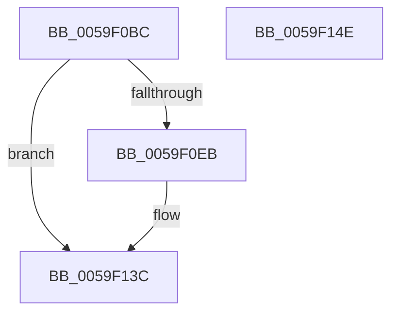

# IopLiveDumpTraceMmDuplicateMemoryFailure

- RVA: `0x0059F0BC`–`0x0059F14F` (길이 `147` bytes)
- VA: `0x000000014059F0BC`
- 실행 섹션: `.text`
- PDB 이름 있음: `예`; PDB Function 태그: `아니요`
- unwind 정보 RVA: `0x000C7A28`
- 디코드: `35`개 명령, `147/147` bytes 표시
- 미해석 바이트: `0` (있으면 어셈블리에 `.byte`로 보존)

> 이 문서는 커널 이미지의 기계어와 PDB 기호를 분석해 생성했습니다. 4번과 5번은 함수 원형과 자료형을 바이너리 사용 방식에서 추정한 C 해석이며 원본 소스 복구 결과는 아닙니다.

## 1. Dependencies

- 직접 호출 지점: **3**; 고유 호출 대상: **3**
- 직접 호출자로 확인된 함수: **2**
- RIP 상대 이미지 참조: **3**

### Outgoing calls
- `0x0059F0E2` → [IopLiveDumpIsTracingEnabled](../4F/IopLiveDumpIsTracingEnabled_function_004FC5AC.md) (function, `0x004FC5AC`)
- `0x0059F137` → [IopLiveDumpTrace](../5A/IopLiveDumpTrace_function_005A4070.md) (function, `0x005A4070`)
- `0x0059F144` → [_security_check_cookie](../6A/_security_check_cookie_function_006AC640.md) (function, `0x006AC640`)

### Direct callers
- [IopLiveDumpCaptureMemoryPages](IopLiveDumpCaptureMemoryPages_function_0059B0A0.md) at `0x0059B196`
- [IopLiveDumpEstimateMemoryPages](IopLiveDumpEstimateMemoryPages_function_0059BA80.md) at `0x0059BCE0`

### Static image references
- `0x0059F0C4` → RVA `0x00E0A740` (`.data`; read)
- `0x0059F11C` → RVA `0x00022450` (`.rdata`; read)
- `0x0059F127` → RVA `0x000228F0` (`.rdata`; read)

## 2. Other-region calls and transfers

- 다른 실행 섹션으로 향하는 call: **0**
- 별도 외부 분기/꼬리 이동을 확인하지 못했습니다.

## 3. Assembly (complete function range)

```asm
0059F0BC  89 54 24 10                     mov dword ptr [rsp + 0x10], edx
0059F0C0  48 83 EC 58                     sub rsp, 0x58
0059F0C4  48 8B 05 75 B6 86 00            mov rax, qword ptr [rip + 0x86b675]
0059F0CB  48 33 C4                        xor rax, rsp
0059F0CE  48 89 44 24 48                  mov qword ptr [rsp + 0x48], rax
0059F0D3  33 C0                           xor eax, eax
0059F0D5  81 FA 02 01 00 00               cmp edx, 0x102
0059F0DB  0F 94 C0                        sete al
0059F0DE  89 44 24 20                     mov dword ptr [rsp + 0x20], eax
0059F0E2  E8 C5 D4 F5 FF                  call 0x1404fc5ac
0059F0E7  84 C0                           test al, al
0059F0E9  74 51                           je 0x14059f13c
0059F0EB  83 64 24 34 00                  and dword ptr [rsp + 0x34], 0
0059F0F0  48 8D 44 24 68                  lea rax, [rsp + 0x68]
0059F0F5  83 64 24 44 00                  and dword ptr [rsp + 0x44], 0
0059F0FA  4C 8D 44 24 28                  lea r8, [rsp + 0x28]
0059F0FF  48 89 44 24 28                  mov qword ptr [rsp + 0x28], rax
0059F104  BA 04 00 00 00                  mov edx, 4
0059F109  48 8D 44 24 20                  lea rax, [rsp + 0x20]
0059F10E  89 54 24 30                     mov dword ptr [rsp + 0x30], edx
0059F112  48 89 44 24 38                  mov qword ptr [rsp + 0x38], rax
0059F117  8B 41 50                        mov eax, dword ptr [rcx + 0x50]
0059F11A  A8 01                           test al, 1
0059F11C  48 8D 05 2D 33 A8 FF            lea rax, [rip - 0x57ccd3]
0059F123  89 54 24 40                     mov dword ptr [rsp + 0x40], edx
0059F127  48 8D 0D C2 37 A8 FF            lea rcx, [rip - 0x57c83e]
0059F12E  BA 02 00 00 00                  mov edx, 2
0059F133  48 0F 44 C8                     cmove rcx, rax
0059F137  E8 34 4F 00 00                  call 0x1405a4070
0059F13C  48 8B 4C 24 48                  mov rcx, qword ptr [rsp + 0x48]
0059F141  48 33 CC                        xor rcx, rsp
0059F144  E8 F7 D4 10 00                  call 0x1406ac640
0059F149  48 83 C4 58                     add rsp, 0x58
0059F14D  C3                              ret
0059F14E  CC                              int3
```

## 4. C-style interpretation (structured pseudocode)

```c
__int64 __fastcall IopLiveDumpTraceMmDuplicateMemoryFailure(__int64 a1, int a2)
{
    __int64 result;
    __int64 v_rsp;
    unsigned __int64 v_stack_m10;
    unsigned int v_stack_m14;
    unsigned int v_stack_m18;
    unsigned __int64 v_stack_m20;
    unsigned int v_stack_m24;
    unsigned int v_stack_m28;
    unsigned __int64 v_stack_m30;
    unsigned int v_stack_m38;
    unsigned int v_stack_p10;

    v_stack_p10 = a2;
    v_rsp = (v_rsp) - (88);
    result = (*(unsigned __int64 *)(v_rip + 8828533)) ^ (v_rsp);
    v_stack_m10 = result;
    result = 0;
    result = (a2 == 258) ? 1 : 0;
    v_stack_m38 = (unsigned int)(result);
    result = IopLiveDumpIsTracingEnabled(a1, a2, a3, a4);
    if ((unsigned __int8)(result) != 0) {
        result = v_stack_p10;
        a3 = v_stack_m30;
        v_stack_m30 = result;
        a2 = 4;
        result = v_stack_m38;
        v_stack_m28 = a2;
        v_stack_m20 = result;
        result = *(unsigned int *)(a1 + 80);
        result = v_rip - 5754067;
        v_stack_m18 = a2;
        a1 = v_rip - 5752894;
        a2 = 2;
        if ((((unsigned __int8)(result)) & (1)) == 0) { a1 = result; }
        result = IopLiveDumpTrace(a1, a2, a3, a4);
    }
    a1 = (v_stack_m10) ^ (v_rsp);
    result = _security_check_cookie(a1, a2, a3, a4);
    v_rsp = (v_rsp) + (88);
    return result;
}
```

## 5. (Beta) C Style

```c
int64_t IopLiveDumpTraceMmDuplicateMemoryFailure(int64_t Arg1, int32_t Arg2)
{
    int64_t result;
    int64_t local_rsp;
    uint64_t v_stack_m10;
    uint32_t v_stack_m14;
    uint32_t v_stack_m18;
    uint64_t v_stack_m20;
    uint32_t v_stack_m24;
    uint32_t v_stack_m28;
    uint64_t v_stack_m30;
    uint32_t v_stack_m38;
    uint32_t v_stack_p10;

    v_stack_p10 = Arg2;
    local_rsp = (local_rsp) - (88);
    result = (*(uint64_t *)(v_rip + 0x86B675)) ^ (local_rsp);
    v_stack_m10 = result;
    result = 0;
    result = (Arg2 == 258) ? 1 : 0;
    v_stack_m38 = (uint32_t)(result);
    result = IopLiveDumpIsTracingEnabled(Arg1, Arg2, a3, a4);
    if ((uint8_t)(result) != 0) {
        result = v_stack_p10;
        a3 = v_stack_m30;
        v_stack_m30 = result;
        Arg2 = 4;
        result = v_stack_m38;
        v_stack_m28 = Arg2;
        v_stack_m20 = result;
        result = *(uint32_t *)(Arg1 + 0x50);
        result = v_rip - 5754067;
        v_stack_m18 = Arg2;
        Arg1 = v_rip - 5752894;
        Arg2 = 2;
        if ((((uint8_t)(result)) & (1)) == 0) { Arg1 = result; }
        result = IopLiveDumpTrace(Arg1, Arg2, a3, a4);
    }
    Arg1 = (v_stack_m10) ^ (local_rsp);
    result = _security_check_cookie(Arg1, Arg2, a3, a4);
    local_rsp = (local_rsp) + (88);
    return result;
}
```

## 6. Execution-region graph

[열기: 2D/3D 그래프와 함수 탐색 컨트롤 패널](../../../control-panel.html?section=text&rva=0x0059F0BC&view=graph)

- 2D 그래프는 위에서 아래로 흐르고, 3D 그래프는 빈 공간을 드래그해 회전합니다. Shift+드래그는 이동, 휠은 확대·축소, 함수 노드 선택은 대상 보고서 이동입니다.

### Static fallback


