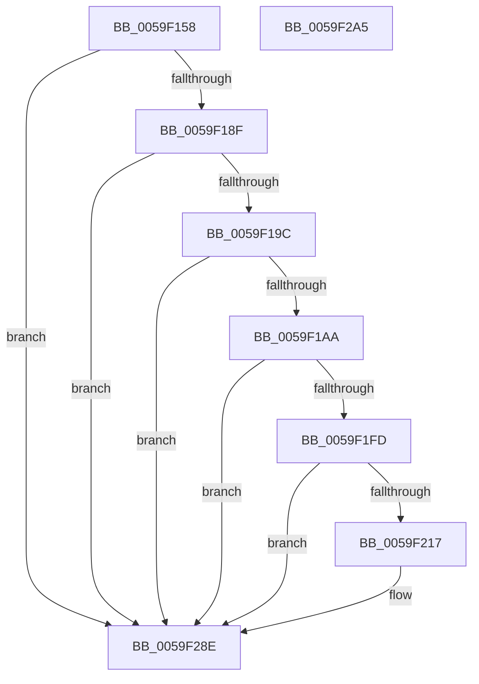

# IopLiveDumpTracePopulateBitmapForDumpDuration

- RVA: `0x0059F158`–`0x0059F2A6` (길이 `334` bytes)
- VA: `0x000000014059F158`
- 실행 섹션: `.text`
- PDB 이름 있음: `예`; PDB Function 태그: `아니요`
- unwind 정보 RVA: `0x000C7A58`
- 디코드: `77`개 명령, `334/334` bytes 표시
- 미해석 바이트: `0` (있으면 어셈블리에 `.byte`로 보존)

> 이 문서는 커널 이미지의 기계어와 PDB 기호를 분석해 생성했습니다. 4번과 5번은 함수 원형과 자료형을 바이너리 사용 방식에서 추정한 C 해석이며 원본 소스 복구 결과는 아닙니다.

## 1. Dependencies

- 직접 호출 지점: **5**; 고유 호출 대상: **5**
- 직접 호출자로 확인된 함수: **1**
- RIP 상대 이미지 참조: **5**

### Outgoing calls
- `0x0059F182` → [IopLiveDumpIsTracingEnabled](../4F/IopLiveDumpIsTracingEnabled_function_004FC5AC.md) (function, `0x004FC5AC`)
- `0x0059F1EB` → [IopLiveDumpTrace](../5A/IopLiveDumpTrace_function_005A4070.md) (function, `0x005A4070`)
- `0x0059F20E` → [tlgKeywordOn](../42/tlgKeywordOn_function_0042EAA0.md) (function, `0x0042EAA0`)
- `0x0059F289` → [tlgWriteTransfer_EtwWriteTransfer](../42/tlgWriteTransfer_EtwWriteTransfer_function_004260E0.md) (function, `0x004260E0`)
- `0x0059F295` → [_security_check_cookie](../6A/_security_check_cookie_function_006AC640.md) (function, `0x006AC640`)

### Direct callers
- [IopLiveDumpPopulateBitmapForDump](IopLiveDumpPopulateBitmapForDump_function_0059D9B0.md) at `0x0059DD41`

### Static image references
- `0x0059F171` → RVA `0x00E0A740` (`.data`; read)
- `0x0059F1D3` → RVA `0x00022D78` (`.rdata`; read)
- `0x0059F1DD` → RVA `0x000212E8` (`.rdata`; read)
- `0x0059F1F0` → RVA `0x00E06EA0` (`.data`; read)
- `0x0059F239` → RVA `0x000462D8` (`.rdata`; read)

## 2. Other-region calls and transfers

- 다른 실행 섹션으로 향하는 call: **0**
- 별도 외부 분기/꼬리 이동을 확인하지 못했습니다.

## 3. Assembly (complete function range)

```asm
0059F158  4C 89 44 24 18                  mov qword ptr [rsp + 0x18], r8
0059F15D  48 89 54 24 10                  mov qword ptr [rsp + 0x10], rdx
0059F162  55                              push rbp
0059F163  53                              push rbx
0059F164  56                              push rsi
0059F165  48 8D 6C 24 B9                  lea rbp, [rsp - 0x47]
0059F16A  48 81 EC D0 00 00 00            sub rsp, 0xd0
0059F171  48 8B 05 C8 B5 86 00            mov rax, qword ptr [rip + 0x86b5c8]
0059F178  48 33 C4                        xor rax, rsp
0059F17B  48 89 45 37                     mov qword ptr [rbp + 0x37], rax
0059F17F  48 8B D9                        mov rbx, rcx
0059F182  E8 25 D4 F5 FF                  call 0x1404fc5ac
0059F187  84 C0                           test al, al
0059F189  0F 84 FF 00 00 00               je 0x14059f28e
0059F18F  83 B9 A8 01 00 00 00            cmp dword ptr [rcx + 0x1a8], 0
0059F196  0F 85 F2 00 00 00               jne 0x14059f28e
0059F19C  8B 81 40 01 00 00               mov eax, dword ptr [rcx + 0x140]
0059F1A2  A8 01                           test al, 1
0059F1A4  0F 84 E4 00 00 00               je 0x14059f28e
0059F1AA  83 65 CB 00                     and dword ptr [rbp - 0x35], 0
0059F1AE  48 8D 45 6F                     lea rax, [rbp + 0x6f]
0059F1B2  83 65 DB 00                     and dword ptr [rbp - 0x25], 0
0059F1B6  4C 8D 45 BF                     lea r8, [rbp - 0x41]
0059F1BA  48 89 45 BF                     mov qword ptr [rbp - 0x41], rax
0059F1BE  BE 08 00 00 00                  mov esi, 8
0059F1C3  48 8D 45 77                     lea rax, [rbp + 0x77]
0059F1C7  89 75 C7                        mov dword ptr [rbp - 0x39], esi
0059F1CA  48 89 45 CF                     mov qword ptr [rbp - 0x31], rax
0059F1CE  8B 41 50                        mov eax, dword ptr [rcx + 0x50]
0059F1D1  A8 01                           test al, 1
0059F1D3  48 8D 05 9E 3B A8 FF            lea rax, [rip - 0x57c462]
0059F1DA  89 75 D7                        mov dword ptr [rbp - 0x29], esi
0059F1DD  48 8D 0D 04 21 A8 FF            lea rcx, [rip - 0x57defc]
0059F1E4  48 0F 44 C8                     cmove rcx, rax
0059F1E8  8D 56 FA                        lea edx, [rsi - 6]
0059F1EB  E8 80 4E 00 00                  call 0x1405a4070
0059F1F0  83 3D A9 7C 86 00 05            cmp dword ptr [rip + 0x867ca9], 5
0059F1F7  0F 86 91 00 00 00               jbe 0x14059f28e
0059F1FD  48 BA 00 00 00 00 00 40 00 00   movabs rdx, 0x400000000000
0059F207  48 8D 0D 92 7C 86 00            lea rcx, [rip + 0x867c92]
0059F20E  E8 8D F8 E8 FF                  call 0x14042eaa0
0059F213  84 C0                           test al, al
0059F215  74 77                           je 0x14059f28e
0059F217  83 65 13 00                     and dword ptr [rbp + 0x13], 0
0059F21B  48 8D 45 A7                     lea rax, [rbp - 0x59]
0059F21F  83 65 23 00                     and dword ptr [rbp + 0x23], 0
0059F223  4C 8D 8B B8 03 00 00            lea r9, [rbx + 0x3b8]
0059F22A  83 65 33 00                     and dword ptr [rbp + 0x33], 0
0059F22E  4C 8D 83 C8 03 00 00            lea r8, [rbx + 0x3c8]
0059F235  48 89 45 07                     mov qword ptr [rbp + 7], rax
0059F239  48 8D 15 98 70 AA FF            lea rdx, [rip - 0x558f68]
0059F240  48 8B 45 6F                     mov rax, qword ptr [rbp + 0x6f]
0059F244  48 8D 0D 55 7C 86 00            lea rcx, [rip + 0x867c55]
0059F24B  48 89 45 AF                     mov qword ptr [rbp - 0x51], rax
0059F24F  48 8D 45 AF                     lea rax, [rbp - 0x51]
0059F253  48 89 45 17                     mov qword ptr [rbp + 0x17], rax
0059F257  48 8B 45 77                     mov rax, qword ptr [rbp + 0x77]
0059F25B  48 89 45 B7                     mov qword ptr [rbp - 0x49], rax
0059F25F  48 8D 45 B7                     lea rax, [rbp - 0x49]
0059F263  48 89 45 27                     mov qword ptr [rbp + 0x27], rax
0059F267  48 8D 45 E7                     lea rax, [rbp - 0x19]
0059F26B  48 89 44 24 28                  mov qword ptr [rsp + 0x28], rax
0059F270  C7 44 24 20 05 00 00 00         mov dword ptr [rsp + 0x20], 5
0059F278  48 C7 45 A7 00 00 00 01         mov qword ptr [rbp - 0x59], 0x1000000
0059F280  89 75 0F                        mov dword ptr [rbp + 0xf], esi
0059F283  89 75 1F                        mov dword ptr [rbp + 0x1f], esi
0059F286  89 75 2F                        mov dword ptr [rbp + 0x2f], esi
0059F289  E8 52 6E E8 FF                  call 0x1404260e0
0059F28E  48 8B 4D 37                     mov rcx, qword ptr [rbp + 0x37]
0059F292  48 33 CC                        xor rcx, rsp
0059F295  E8 A6 D3 10 00                  call 0x1406ac640
0059F29A  48 81 C4 D0 00 00 00            add rsp, 0xd0
0059F2A1  5E                              pop rsi
0059F2A2  5B                              pop rbx
0059F2A3  5D                              pop rbp
0059F2A4  C3                              ret
0059F2A5  CC                              int3
```

## 4. C-style interpretation (structured pseudocode)

```c
__int64 __fastcall IopLiveDumpTracePopulateBitmapForDumpDuration(__int64 a1, __int64 a2, __int64 a3)
{
    __int64 result;
    __int64 v_rsp;
    unsigned __int64 v_stack_m28;
    unsigned int v_stack_m2C;
    unsigned int v_stack_m30;
    unsigned __int64 v_stack_m38;
    unsigned int v_stack_m3C;
    unsigned int v_stack_m40;
    unsigned __int64 v_stack_m48;
    unsigned int v_stack_m4C;
    unsigned int v_stack_m50;
    unsigned __int64 v_stack_m58;
    unsigned __int64 v_stack_m5F;
    unsigned __int64 v_stack_m78;
    unsigned int v_stack_m84;
    unsigned int v_stack_m88;
    unsigned __int64 v_stack_m90;
    unsigned int v_stack_m94;
    unsigned int v_stack_m98;
    unsigned __int64 v_stack_mA0;
    unsigned __int64 v_stack_mA8;
    unsigned __int64 v_stack_mB0;
    unsigned __int64 v_stack_mB8;
    unsigned __int64 v_stack_mC0;
    unsigned int v_stack_mC8;
    unsigned __int64 v_stack_p10;
    unsigned __int64 v_stack_p18;

    v_stack_p18 = a3;
    v_stack_p10 = a2;
    v_rsp = (v_rsp) - (208);
    result = (*(unsigned __int64 *)(v_rip + 8828360)) ^ (v_rsp);
    v_stack_m28 = result;
    result = IopLiveDumpIsTracingEnabled(a1, a2, a3, a4);
    if ((unsigned __int8)(result) == 0) goto loc_0059F28E;
    if ((*(unsigned int *)(a1 + 424)) != 0) goto loc_0059F28E;
    if ((((unsigned __int8)((unsigned int)(*(unsigned int *)(a1 + 320)))) & (1)) == 0) goto loc_0059F28E;
    v_stack_mA0 = v_stack_p10;
    v_stack_m98 = 8;
    v_stack_m90 = v_stack_p18;
    v_stack_m88 = 8;
    a1 = v_rip - 5758716;
    if ((((unsigned __int8)((unsigned int)(*(unsigned int *)(a1 + 80)))) & (1)) == 0) { a1 = v_rip - 5751906; }
    result = IopLiveDumpTrace(a1, 8 - 6, v_stack_mA0, a4);
    if ((*(unsigned int *)(v_rip + 8813737)) <= 5) goto loc_0059F28E;
    result = tlgKeywordOn(v_rip + 8813714, 8 - 6, v_stack_mA0, a4);
    if ((unsigned __int8)(result) != 0) {
        result = v_stack_mB8;
        a4 = a1 + 952;
        a3 = a1 + 968;
        v_stack_m58 = result;
        a2 = v_rip - 5607272;
        result = v_stack_p10;
        a1 = v_rip + 8813653;
        v_stack_mB0 = result;
        result = v_stack_mB0;
        v_stack_m48 = result;
        result = v_stack_p18;
        v_stack_mA8 = result;
        result = v_stack_mA8;
        v_stack_m38 = result;
        result = v_stack_m78;
        v_stack_mC0 = result;
        v_stack_mC8 = 5;
        v_stack_mB8 = 0x1000000ULL;
        v_stack_m50 = 8;
        v_stack_m40 = 8;
        v_stack_m30 = 8;
        result = tlgWriteTransfer_EtwWriteTransfer(a1, a2, a3, a4);
    }
    a1 = (v_stack_m28) ^ (v_rsp);
    result = _security_check_cookie(a1, a2, a3, a4);
    v_rsp = (v_rsp) + (208);
    return result;
}
```

## 5. (Beta) C Style

```c
int64_t IopLiveDumpTracePopulateBitmapForDumpDuration(void *Arg1, int64_t Arg2, int64_t Arg3)
{
    uint8_t *arg1 = (uint8_t *)Arg1;

    int64_t result;
    int64_t local_rsp;
    uint64_t v_stack_m28;
    uint32_t v_stack_m2C;
    uint32_t v_stack_m30;
    uint64_t v_stack_m38;
    uint32_t v_stack_m3C;
    uint32_t v_stack_m40;
    uint64_t v_stack_m48;
    uint32_t v_stack_m4C;
    uint32_t v_stack_m50;
    uint64_t v_stack_m58;
    uint64_t v_stack_m5F;
    uint64_t v_stack_m78;
    uint32_t v_stack_m84;
    uint32_t v_stack_m88;
    uint64_t v_stack_m90;
    uint32_t v_stack_m94;
    uint32_t v_stack_m98;
    uint64_t v_stack_mA0;
    uint64_t v_stack_mA8;
    uint64_t v_stack_mB0;
    uint64_t v_stack_mB8;
    uint64_t v_stack_mC0;
    uint32_t v_stack_mC8;
    uint64_t v_stack_p10;
    uint64_t v_stack_p18;

    v_stack_p18 = Arg3;
    v_stack_p10 = Arg2;
    local_rsp = (local_rsp) - (208);
    result = (*(uint64_t *)(v_rip + 0x86B5C8)) ^ (local_rsp);
    v_stack_m28 = result;
    result = IopLiveDumpIsTracingEnabled(Arg1, Arg2, Arg3, a4);
    if ((uint8_t)(result) == 0) goto loc_0059F28E;
    if ((*(uint32_t *)(arg1 + 0x1A8)) != 0) goto loc_0059F28E;
    if ((((uint8_t)((uint32_t)(*(uint32_t *)(arg1 + 0x140)))) & (1)) == 0) goto loc_0059F28E;
    v_stack_mA0 = v_stack_p10;
    v_stack_m98 = 8;
    v_stack_m90 = v_stack_p18;
    v_stack_m88 = 8;
    Arg1 = v_rip - 5758716;
    if ((((uint8_t)((uint32_t)(*(uint32_t *)(arg1 + 0x50)))) & (1)) == 0) { Arg1 = v_rip - 5751906; }
    result = IopLiveDumpTrace(Arg1, 8 - 6, v_stack_mA0, a4);
    if ((*(uint32_t *)(v_rip + 0x867CA9)) <= 5) goto loc_0059F28E;
    result = tlgKeywordOn(v_rip + 8813714, 8 - 6, v_stack_mA0, a4);
    if ((uint8_t)(result) != 0) {
        result = v_stack_mB8;
        a4 = Arg1 + 952;
        Arg3 = Arg1 + 968;
        v_stack_m58 = result;
        Arg2 = v_rip - 5607272;
        result = v_stack_p10;
        Arg1 = v_rip + 8813653;
        v_stack_mB0 = result;
        result = v_stack_mB0;
        v_stack_m48 = result;
        result = v_stack_p18;
        v_stack_mA8 = result;
        result = v_stack_mA8;
        v_stack_m38 = result;
        result = v_stack_m78;
        v_stack_mC0 = result;
        v_stack_mC8 = 5;
        v_stack_mB8 = 0x1000000ULL;
        v_stack_m50 = 8;
        v_stack_m40 = 8;
        v_stack_m30 = 8;
        result = tlgWriteTransfer_EtwWriteTransfer(Arg1, Arg2, Arg3, a4);
    }
    Arg1 = (v_stack_m28) ^ (local_rsp);
    result = _security_check_cookie(Arg1, Arg2, Arg3, a4);
    local_rsp = (local_rsp) + (208);
    return result;
}
```

### 관측된 메모리 오프셋

구조체 형식이 확인되지 않은 접근은 인자 기준의 오프셋으로만 기록했습니다.

| 기준 인자 | 오프셋 표현 | 폭 (bit) | 접근 |
|---|---:|---:|---|
| `Arg1` | `+ 0x3B8` | `64` | `R` |
| `Arg1` | `+ 0x3C8` | `64` | `R` |

## 6. Execution-region graph

[열기: 2D/3D 그래프와 함수 탐색 컨트롤 패널](../../../control-panel.html?section=text&rva=0x0059F158&view=graph)

- 2D 그래프는 위에서 아래로 흐르고, 3D 그래프는 빈 공간을 드래그해 회전합니다. Shift+드래그는 이동, 휠은 확대·축소, 함수 노드 선택은 대상 보고서 이동입니다.

### Static fallback


