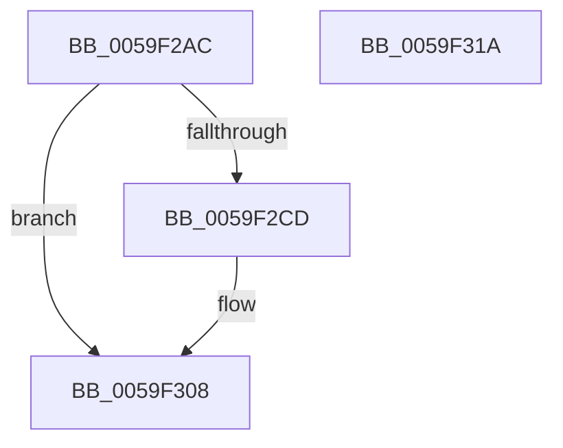

# IopLiveDumpTraceRemovePagesCallbackFailure

- RVA: `0x0059F2AC`–`0x0059F31B` (길이 `111` bytes)
- VA: `0x000000014059F2AC`
- 실행 섹션: `.text`
- PDB 이름 있음: `예`; PDB Function 태그: `아니요`
- unwind 정보 RVA: `0x0008A3CC`
- 디코드: `25`개 명령, `111/111` bytes 표시
- 미해석 바이트: `0` (있으면 어셈블리에 `.byte`로 보존)

> 이 문서는 커널 이미지의 기계어와 PDB 기호를 분석해 생성했습니다. 4번과 5번은 함수 원형과 자료형을 바이너리 사용 방식에서 추정한 C 해석이며 원본 소스 복구 결과는 아닙니다.

## 1. Dependencies

- 직접 호출 지점: **3**; 고유 호출 대상: **3**
- 직접 호출자로 확인된 함수: **1**
- RIP 상대 이미지 참조: **2**

### Outgoing calls
- `0x0059F2C4` → [IopLiveDumpIsTracingEnabled](../4F/IopLiveDumpIsTracingEnabled_function_004FC5AC.md) (function, `0x004FC5AC`)
- `0x0059F303` → [IopLiveDumpTrace](../5A/IopLiveDumpTrace_function_005A4070.md) (function, `0x005A4070`)
- `0x0059F310` → [_security_check_cookie](../6A/_security_check_cookie_function_006AC640.md) (function, `0x006AC640`)

### Direct callers
- [IopLiveDumpCallRemovePagesCallbacks](IopLiveDumpCallRemovePagesCallbacks_function_0059AC28.md) at `0x0059AED0`
- [IopLiveDumpCallRemovePagesCallbacks](IopLiveDumpCallRemovePagesCallbacks_function_0059AC28.md) at `0x0059AEEE`

### Static image references
- `0x0059F2B5` → RVA `0x00E0A740` (`.data`; read)
- `0x0059F2E6` → RVA `0x00023280` (`.rdata`; read)

## 2. Other-region calls and transfers

- 다른 실행 섹션으로 향하는 call: **0**
- 별도 외부 분기/꼬리 이동을 확인하지 못했습니다.

## 3. Assembly (complete function range)

```asm
0059F2AC  44 89 44 24 18                  mov dword ptr [rsp + 0x18], r8d
0059F2B1  48 83 EC 58                     sub rsp, 0x58
0059F2B5  48 8B 05 84 B4 86 00            mov rax, qword ptr [rip + 0x86b484]
0059F2BC  48 33 C4                        xor rax, rsp
0059F2BF  48 89 44 24 40                  mov qword ptr [rsp + 0x40], rax
0059F2C4  E8 E3 D2 F5 FF                  call 0x1404fc5ac
0059F2C9  84 C0                           test al, al
0059F2CB  74 3B                           je 0x14059f308
0059F2CD  83 64 24 2C 00                  and dword ptr [rsp + 0x2c], 0
0059F2D2  48 8D 44 24 70                  lea rax, [rsp + 0x70]
0059F2D7  83 64 24 3C 00                  and dword ptr [rsp + 0x3c], 0
0059F2DC  4C 8D 44 24 20                  lea r8, [rsp + 0x20]
0059F2E1  48 89 4C 24 20                  mov qword ptr [rsp + 0x20], rcx
0059F2E6  48 8D 0D 93 3F A8 FF            lea rcx, [rip - 0x57c06d]
0059F2ED  89 54 24 28                     mov dword ptr [rsp + 0x28], edx
0059F2F1  BA 02 00 00 00                  mov edx, 2
0059F2F6  48 89 44 24 30                  mov qword ptr [rsp + 0x30], rax
0059F2FB  C7 44 24 38 04 00 00 00         mov dword ptr [rsp + 0x38], 4
0059F303  E8 68 4D 00 00                  call 0x1405a4070
0059F308  48 8B 4C 24 40                  mov rcx, qword ptr [rsp + 0x40]
0059F30D  48 33 CC                        xor rcx, rsp
0059F310  E8 2B D3 10 00                  call 0x1406ac640
0059F315  48 83 C4 58                     add rsp, 0x58
0059F319  C3                              ret
0059F31A  CC                              int3
```

## 4. C-style interpretation (structured pseudocode)

```c
__int64 __fastcall IopLiveDumpTraceRemovePagesCallbackFailure(__int64 a1, int a2, int a3)
{
    __int64 result;
    __int64 v_rsp;
    unsigned __int64 v_stack_m18;
    unsigned int v_stack_m1C;
    unsigned int v_stack_m20;
    unsigned __int64 v_stack_m28;
    unsigned int v_stack_m2C;
    unsigned int v_stack_m30;
    unsigned __int64 v_stack_m38;
    unsigned int v_stack_p18;

    v_stack_p18 = a3;
    v_rsp = (v_rsp) - (88);
    result = (*(unsigned __int64 *)(v_rip + 8828036)) ^ (v_rsp);
    v_stack_m18 = result;
    result = IopLiveDumpIsTracingEnabled(a1, a2, a3, a4);
    if ((unsigned __int8)(result) != 0) {
        result = v_stack_p18;
        a3 = v_stack_m38;
        v_stack_m38 = a1;
        a1 = v_rip - 5750893;
        v_stack_m30 = a2;
        a2 = 2;
        v_stack_m28 = result;
        v_stack_m20 = 4;
        result = IopLiveDumpTrace(a1, a2, a3, a4);
    }
    a1 = (v_stack_m18) ^ (v_rsp);
    result = _security_check_cookie(a1, a2, a3, a4);
    v_rsp = (v_rsp) + (88);
    return result;
}
```

## 5. (Beta) C Style

```c
int64_t IopLiveDumpTraceRemovePagesCallbackFailure(int64_t Arg1, int32_t Arg2, int32_t Arg3)
{
    int64_t result;
    int64_t local_rsp;
    uint64_t v_stack_m18;
    uint32_t v_stack_m1C;
    uint32_t v_stack_m20;
    uint64_t v_stack_m28;
    uint32_t v_stack_m2C;
    uint32_t v_stack_m30;
    uint64_t v_stack_m38;
    uint32_t v_stack_p18;

    v_stack_p18 = Arg3;
    local_rsp = (local_rsp) - (88);
    result = (*(uint64_t *)(v_rip + 0x86B484)) ^ (local_rsp);
    v_stack_m18 = result;
    result = IopLiveDumpIsTracingEnabled(Arg1, Arg2, Arg3, a4);
    if ((uint8_t)(result) != 0) {
        result = v_stack_p18;
        Arg3 = v_stack_m38;
        v_stack_m38 = Arg1;
        Arg1 = v_rip - 5750893;
        v_stack_m30 = Arg2;
        Arg2 = 2;
        v_stack_m28 = result;
        v_stack_m20 = 4;
        result = IopLiveDumpTrace(Arg1, Arg2, Arg3, a4);
    }
    Arg1 = (v_stack_m18) ^ (local_rsp);
    result = _security_check_cookie(Arg1, Arg2, Arg3, a4);
    local_rsp = (local_rsp) + (88);
    return result;
}
```

## 6. Execution-region graph

[열기: 2D/3D 그래프와 함수 탐색 컨트롤 패널](../../../control-panel.html?section=text&rva=0x0059F2AC&view=graph)

- 2D 그래프는 위에서 아래로 흐르고, 3D 그래프는 빈 공간을 드래그해 회전합니다. Shift+드래그는 이동, 휠은 확대·축소, 함수 노드 선택은 대상 보고서 이동입니다.

### Static fallback


