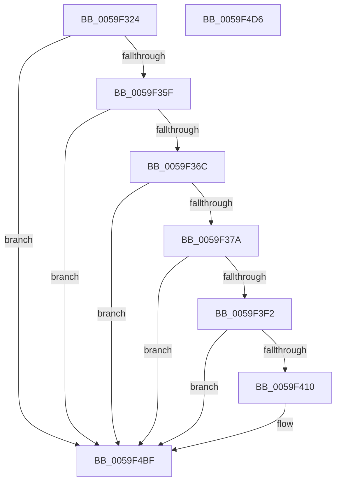

# IopLiveDumpTraceUncorralProcessorsDuration

- RVA: `0x0059F324`–`0x0059F4D7` (길이 `435` bytes)
- VA: `0x000000014059F324`
- 실행 섹션: `.text`
- PDB 이름 있음: `예`; PDB Function 태그: `아니요`
- unwind 정보 RVA: `0x000C7A3C`
- 디코드: `99`개 명령, `435/435` bytes 표시
- 미해석 바이트: `0` (있으면 어셈블리에 `.byte`로 보존)

> 이 문서는 커널 이미지의 기계어와 PDB 기호를 분석해 생성했습니다. 4번과 5번은 함수 원형과 자료형을 바이너리 사용 방식에서 추정한 C 해석이며 원본 소스 복구 결과는 아닙니다.

## 1. Dependencies

- 직접 호출 지점: **5**; 고유 호출 대상: **5**
- 직접 호출자로 확인된 함수: **1**
- RIP 상대 이미지 참조: **5**

### Outgoing calls
- `0x0059F352` → [IopLiveDumpIsTracingEnabled](../4F/IopLiveDumpIsTracingEnabled_function_004FC5AC.md) (function, `0x004FC5AC`)
- `0x0059F3E0` → [IopLiveDumpTrace](../5A/IopLiveDumpTrace_function_005A4070.md) (function, `0x005A4070`)
- `0x0059F403` → [tlgKeywordOn](../42/tlgKeywordOn_function_0042EAA0.md) (function, `0x0042EAA0`)
- `0x0059F4BA` → [tlgWriteTransfer_EtwWriteTransfer](../42/tlgWriteTransfer_EtwWriteTransfer_function_004260E0.md) (function, `0x004260E0`)
- `0x0059F4C6` → [_security_check_cookie](../6A/_security_check_cookie_function_006AC640.md) (function, `0x006AC640`)

### Direct callers
- [IopLiveDumpUncorralProcessors](IopLiveDumpUncorralProcessors_function_0059F4E0.md) at `0x0059F5D4`

### Static image references
- `0x0059F341` → RVA `0x00E0A740` (`.data`; read)
- `0x0059F3C4` → RVA `0x00021BF0` (`.rdata`; read)
- `0x0059F3CF` → RVA `0x00022D08` (`.rdata`; read)
- `0x0059F3E5` → RVA `0x00E06EA0` (`.data`; read)
- `0x0059F433` → RVA `0x00046356` (`.rdata`; read)

## 2. Other-region calls and transfers

- 다른 실행 섹션으로 향하는 call: **0**
- 별도 외부 분기/꼬리 이동을 확인하지 못했습니다.

## 3. Assembly (complete function range)

```asm
0059F324  48 8B C4                        mov rax, rsp
0059F327  4C 89 48 20                     mov qword ptr [rax + 0x20], r9
0059F32B  4C 89 40 18                     mov qword ptr [rax + 0x18], r8
0059F32F  48 89 50 10                     mov qword ptr [rax + 0x10], rdx
0059F333  55                              push rbp
0059F334  53                              push rbx
0059F335  56                              push rsi
0059F336  48 8D 68 C8                     lea rbp, [rax - 0x38]
0059F33A  48 81 EC 20 01 00 00            sub rsp, 0x120
0059F341  48 8B 05 F8 B3 86 00            mov rax, qword ptr [rip + 0x86b3f8]
0059F348  48 33 C4                        xor rax, rsp
0059F34B  48 89 45 10                     mov qword ptr [rbp + 0x10], rax
0059F34F  48 8B D9                        mov rbx, rcx
0059F352  E8 55 D2 F5 FF                  call 0x1404fc5ac
0059F357  84 C0                           test al, al
0059F359  0F 84 60 01 00 00               je 0x14059f4bf
0059F35F  83 B9 A8 01 00 00 00            cmp dword ptr [rcx + 0x1a8], 0
0059F366  0F 85 53 01 00 00               jne 0x14059f4bf
0059F36C  8B 81 40 01 00 00               mov eax, dword ptr [rcx + 0x140]
0059F372  A8 01                           test al, 1
0059F374  0F 84 45 01 00 00               je 0x14059f4bf
0059F37A  83 64 24 6C 00                  and dword ptr [rsp + 0x6c], 0
0059F37F  48 8D 45 48                     lea rax, [rbp + 0x48]
0059F383  83 64 24 7C 00                  and dword ptr [rsp + 0x7c], 0
0059F388  4C 8D 44 24 60                  lea r8, [rsp + 0x60]
0059F38D  83 65 8C 00                     and dword ptr [rbp - 0x74], 0
0059F391  BE 08 00 00 00                  mov esi, 8
0059F396  83 65 9C 00                     and dword ptr [rbp - 0x64], 0
0059F39A  48 89 44 24 60                  mov qword ptr [rsp + 0x60], rax
0059F39F  48 8D 45 50                     lea rax, [rbp + 0x50]
0059F3A3  48 89 44 24 70                  mov qword ptr [rsp + 0x70], rax
0059F3A8  48 8D 45 58                     lea rax, [rbp + 0x58]
0059F3AC  48 89 45 80                     mov qword ptr [rbp - 0x80], rax
0059F3B0  8D 56 FC                        lea edx, [rsi - 4]
0059F3B3  48 8D 45 60                     lea rax, [rbp + 0x60]
0059F3B7  89 74 24 68                     mov dword ptr [rsp + 0x68], esi
0059F3BB  48 89 45 90                     mov qword ptr [rbp - 0x70], rax
0059F3BF  8B 41 50                        mov eax, dword ptr [rcx + 0x50]
0059F3C2  A8 01                           test al, 1
0059F3C4  48 8D 05 25 28 A8 FF            lea rax, [rip - 0x57d7db]
0059F3CB  89 74 24 78                     mov dword ptr [rsp + 0x78], esi
0059F3CF  48 8D 0D 32 39 A8 FF            lea rcx, [rip - 0x57c6ce]
0059F3D6  89 75 88                        mov dword ptr [rbp - 0x78], esi
0059F3D9  48 0F 44 C8                     cmove rcx, rax
0059F3DD  89 75 98                        mov dword ptr [rbp - 0x68], esi
0059F3E0  E8 8B 4C 00 00                  call 0x1405a4070
0059F3E5  83 3D B4 7A 86 00 05            cmp dword ptr [rip + 0x867ab4], 5
0059F3EC  0F 86 CD 00 00 00               jbe 0x14059f4bf
0059F3F2  48 BA 00 00 00 00 00 40 00 00   movabs rdx, 0x400000000000
0059F3FC  48 8D 0D 9D 7A 86 00            lea rcx, [rip + 0x867a9d]
0059F403  E8 98 F6 E8 FF                  call 0x14042eaa0
0059F408  84 C0                           test al, al
0059F40A  0F 84 AF 00 00 00               je 0x14059f4bf
0059F410  83 65 CC 00                     and dword ptr [rbp - 0x34], 0
0059F414  48 8D 44 24 30                  lea rax, [rsp + 0x30]
0059F419  83 65 DC 00                     and dword ptr [rbp - 0x24], 0
0059F41D  4C 8D 8B B8 03 00 00            lea r9, [rbx + 0x3b8]
0059F424  83 65 EC 00                     and dword ptr [rbp - 0x14], 0
0059F428  4C 8D 83 C8 03 00 00            lea r8, [rbx + 0x3c8]
0059F42F  83 65 FC 00                     and dword ptr [rbp - 4], 0
0059F433  48 8D 15 1C 6F AA FF            lea rdx, [rip - 0x5590e4]
0059F43A  83 65 0C 00                     and dword ptr [rbp + 0xc], 0
0059F43E  48 8D 0D 5B 7A 86 00            lea rcx, [rip + 0x867a5b]
0059F445  48 89 45 C0                     mov qword ptr [rbp - 0x40], rax
0059F449  48 8B 45 48                     mov rax, qword ptr [rbp + 0x48]
0059F44D  48 89 44 24 38                  mov qword ptr [rsp + 0x38], rax
0059F452  48 8D 44 24 38                  lea rax, [rsp + 0x38]
0059F457  48 89 45 D0                     mov qword ptr [rbp - 0x30], rax
0059F45B  48 8B 45 50                     mov rax, qword ptr [rbp + 0x50]
0059F45F  48 89 44 24 40                  mov qword ptr [rsp + 0x40], rax
0059F464  48 8D 44 24 40                  lea rax, [rsp + 0x40]
0059F469  48 89 45 E0                     mov qword ptr [rbp - 0x20], rax
0059F46D  48 8B 45 58                     mov rax, qword ptr [rbp + 0x58]
0059F471  48 89 44 24 48                  mov qword ptr [rsp + 0x48], rax
0059F476  48 8D 44 24 48                  lea rax, [rsp + 0x48]
0059F47B  48 89 45 F0                     mov qword ptr [rbp - 0x10], rax
0059F47F  48 8B 45 60                     mov rax, qword ptr [rbp + 0x60]
0059F483  48 89 44 24 50                  mov qword ptr [rsp + 0x50], rax
0059F488  48 8D 44 24 50                  lea rax, [rsp + 0x50]
0059F48D  48 89 45 00                     mov qword ptr [rbp], rax
0059F491  48 8D 45 A0                     lea rax, [rbp - 0x60]
0059F495  48 89 44 24 28                  mov qword ptr [rsp + 0x28], rax
0059F49A  C7 44 24 20 07 00 00 00         mov dword ptr [rsp + 0x20], 7
0059F4A2  48 C7 44 24 30 00 00 00 01      mov qword ptr [rsp + 0x30], 0x1000000
0059F4AB  89 75 C8                        mov dword ptr [rbp - 0x38], esi
0059F4AE  89 75 D8                        mov dword ptr [rbp - 0x28], esi
0059F4B1  89 75 E8                        mov dword ptr [rbp - 0x18], esi
0059F4B4  89 75 F8                        mov dword ptr [rbp - 8], esi
0059F4B7  89 75 08                        mov dword ptr [rbp + 8], esi
0059F4BA  E8 21 6C E8 FF                  call 0x1404260e0
0059F4BF  48 8B 4D 10                     mov rcx, qword ptr [rbp + 0x10]
0059F4C3  48 33 CC                        xor rcx, rsp
0059F4C6  E8 75 D1 10 00                  call 0x1406ac640
0059F4CB  48 81 C4 20 01 00 00            add rsp, 0x120
0059F4D2  5E                              pop rsi
0059F4D3  5B                              pop rbx
0059F4D4  5D                              pop rbp
0059F4D5  C3                              ret
0059F4D6  CC                              int3
```

## 4. C-style interpretation (structured pseudocode)

```c
__int64 __fastcall IopLiveDumpTraceUncorralProcessorsDuration(__int64 a1, __int64 a2, __int64 a3, __int64 a4)
{
    __int64 result;
    __int64 v_rsp;
    unsigned __int64 v_stack_m100;
    unsigned __int64 v_stack_m108;
    unsigned __int64 v_stack_m110;
    unsigned int v_stack_m118;
    unsigned int v_stack_mBC;
    unsigned int v_stack_mC0;
    unsigned __int64 v_stack_mC8;
    unsigned int v_stack_mCC;
    unsigned int v_stack_mD0;
    unsigned __int64 v_stack_mD8;
    unsigned __int64 v_stack_mE8;
    unsigned __int64 v_stack_mF0;
    unsigned __int64 v_stack_mF8;

    *(unsigned __int64 *)(v_rsp + 32) = a4;
    *(unsigned __int64 *)(v_rsp + 24) = a3;
    *(unsigned __int64 *)(v_rsp + 16) = a2;
    v_rsp = (v_rsp) - (288);
    result = (*(unsigned __int64 *)(v_rip + 8827896)) ^ (v_rsp);
    *(unsigned __int64 *)(v_rsp - 56 + 16) = result;
    result = IopLiveDumpIsTracingEnabled(a1, a2, a3, a4);
    if ((unsigned __int8)(result) == 0) goto loc_0059F4BF;
    if ((*(unsigned int *)(a1 + 424)) != 0) goto loc_0059F4BF;
    if ((((unsigned __int8)((unsigned int)(*(unsigned int *)(a1 + 320)))) & (1)) == 0) goto loc_0059F4BF;
    v_stack_mD8 = v_rsp - 56 + 72;
    v_stack_mC8 = v_rsp - 56 + 80;
    *(unsigned __int64 *)(v_rsp - 56 - 128) = v_rsp - 56 + 88;
    v_stack_mD0 = 8;
    *(unsigned __int64 *)(v_rsp - 56 - 112) = v_rsp - 56 + 96;
    v_stack_mC0 = 8;
    *(unsigned int *)(v_rsp - 56 - 120) = 8;
    a1 = v_rip - 5752526;
    if ((((unsigned __int8)((unsigned int)(*(unsigned int *)(a1 + 80)))) & (1)) == 0) { a1 = v_rip - 5756891; }
    *(unsigned int *)(v_rsp - 56 - 104) = 8;
    result = IopLiveDumpTrace(a1, 8 - 4, v_stack_mD8, a4);
    if ((*(unsigned int *)(v_rip + 8813236)) <= 5) goto loc_0059F4BF;
    result = tlgKeywordOn(v_rip + 8813213, 8 - 4, v_stack_mD8, a4);
    if ((unsigned __int8)(result) != 0) {
        result = v_stack_m108;
        a4 = a1 + 952;
        a3 = a1 + 968;
        a2 = v_rip - 5607652;
        a1 = v_rip + 8813147;
        *(unsigned __int64 *)(v_rsp - 56 - 64) = result;
        result = *(unsigned __int64 *)(v_rsp - 56 + 72);
        v_stack_m100 = result;
        result = v_stack_m100;
        *(unsigned __int64 *)(v_rsp - 56 - 48) = result;
        result = *(unsigned __int64 *)(v_rsp - 56 + 80);
        v_stack_mF8 = result;
        result = v_stack_mF8;
        *(unsigned __int64 *)(v_rsp - 56 - 32) = result;
        result = *(unsigned __int64 *)(v_rsp - 56 + 88);
        v_stack_mF0 = result;
        result = v_stack_mF0;
        *(unsigned __int64 *)(v_rsp - 56 - 16) = result;
        result = *(unsigned __int64 *)(v_rsp - 56 + 96);
        v_stack_mE8 = result;
        result = v_stack_mE8;
        *(unsigned __int64 *)(v_rsp - 56) = result;
        result = v_rsp - 56 - 96;
        v_stack_m110 = result;
        v_stack_m118 = 7;
        v_stack_m108 = 0x1000000ULL;
        *(unsigned int *)(v_rsp - 56 - 56) = 8;
        *(unsigned int *)(v_rsp - 56 - 40) = 8;
        *(unsigned int *)(v_rsp - 56 - 24) = 8;
        *(unsigned int *)(v_rsp - 56 - 8) = 8;
        *(unsigned int *)(v_rsp - 56 + 8) = 8;
        result = tlgWriteTransfer_EtwWriteTransfer(a1, a2, a3, a4);
    }
    a1 = (*(unsigned __int64 *)(v_rsp - 56 + 16)) ^ (v_rsp);
    result = _security_check_cookie(a1, a2, a3, a4);
    v_rsp = (v_rsp) + (288);
    return result;
}
```

## 5. (Beta) C Style

```c
int64_t IopLiveDumpTraceUncorralProcessorsDuration(void *Arg1, int64_t Arg2, int64_t Arg3, int64_t Arg4)
{
    uint8_t *arg1 = (uint8_t *)Arg1;

    int64_t result;
    int64_t local_rsp;
    uint64_t v_stack_m100;
    uint64_t v_stack_m108;
    uint64_t v_stack_m110;
    uint32_t v_stack_m118;
    uint32_t v_stack_mBC;
    uint32_t v_stack_mC0;
    uint64_t v_stack_mC8;
    uint32_t v_stack_mCC;
    uint32_t v_stack_mD0;
    uint64_t v_stack_mD8;
    uint64_t v_stack_mE8;
    uint64_t v_stack_mF0;
    uint64_t v_stack_mF8;

    *(uint64_t *)(local_rsp + 0x20) = Arg4;
    *(uint64_t *)(local_rsp + 0x18) = Arg3;
    *(uint64_t *)(local_rsp + 0x10) = Arg2;
    local_rsp = (local_rsp) - (288);
    result = (*(uint64_t *)(v_rip + 0x86B3F8)) ^ (local_rsp);
    *(uint64_t *)(local_rsp - 0x38 + 0x10) = result;
    result = IopLiveDumpIsTracingEnabled(Arg1, Arg2, Arg3, Arg4);
    if ((uint8_t)(result) == 0) goto loc_0059F4BF;
    if ((*(uint32_t *)(arg1 + 0x1A8)) != 0) goto loc_0059F4BF;
    if ((((uint8_t)((uint32_t)(*(uint32_t *)(arg1 + 0x140)))) & (1)) == 0) goto loc_0059F4BF;
    v_stack_mD8 = local_rsp - 56 + 72;
    v_stack_mC8 = local_rsp - 56 + 80;
    *(uint64_t *)(local_rsp - 0x38 - 0x80) = local_rsp - 56 + 88;
    v_stack_mD0 = 8;
    *(uint64_t *)(local_rsp - 0x38 - 0x70) = local_rsp - 56 + 96;
    v_stack_mC0 = 8;
    *(uint32_t *)(local_rsp - 0x38 - 0x78) = 8;
    Arg1 = v_rip - 5752526;
    if ((((uint8_t)((uint32_t)(*(uint32_t *)(arg1 + 0x50)))) & (1)) == 0) { Arg1 = v_rip - 5756891; }
    *(uint32_t *)(local_rsp - 0x38 - 0x68) = 8;
    result = IopLiveDumpTrace(Arg1, 8 - 4, v_stack_mD8, Arg4);
    if ((*(uint32_t *)(v_rip + 0x867AB4)) <= 5) goto loc_0059F4BF;
    result = tlgKeywordOn(v_rip + 8813213, 8 - 4, v_stack_mD8, Arg4);
    if ((uint8_t)(result) != 0) {
        result = v_stack_m108;
        Arg4 = Arg1 + 952;
        Arg3 = Arg1 + 968;
        Arg2 = v_rip - 5607652;
        Arg1 = v_rip + 8813147;
        *(uint64_t *)(local_rsp - 0x38 - 0x40) = result;
        result = *(uint64_t *)(local_rsp - 0x38 + 0x48);
        v_stack_m100 = result;
        result = v_stack_m100;
        *(uint64_t *)(local_rsp - 0x38 - 0x30) = result;
        result = *(uint64_t *)(local_rsp - 0x38 + 0x50);
        v_stack_mF8 = result;
        result = v_stack_mF8;
        *(uint64_t *)(local_rsp - 0x38 - 0x20) = result;
        result = *(uint64_t *)(local_rsp - 0x38 + 0x58);
        v_stack_mF0 = result;
        result = v_stack_mF0;
        *(uint64_t *)(local_rsp - 0x38 - 0x10) = result;
        result = *(uint64_t *)(local_rsp - 0x38 + 0x60);
        v_stack_mE8 = result;
        result = v_stack_mE8;
        *(uint64_t *)(local_rsp - 0x38) = result;
        result = local_rsp - 56 - 96;
        v_stack_m110 = result;
        v_stack_m118 = 7;
        v_stack_m108 = 0x1000000ULL;
        *(uint32_t *)(local_rsp - 0x38 - 0x38) = 8;
        *(uint32_t *)(local_rsp - 0x38 - 0x28) = 8;
        *(uint32_t *)(local_rsp - 0x38 - 0x18) = 8;
        *(uint32_t *)(local_rsp - 0x38 - 0x8) = 8;
        *(uint32_t *)(local_rsp - 0x38 + 0x8) = 8;
        result = tlgWriteTransfer_EtwWriteTransfer(Arg1, Arg2, Arg3, Arg4);
    }
    Arg1 = (*(uint64_t *)(local_rsp - 0x38 + 0x10)) ^ (local_rsp);
    result = _security_check_cookie(Arg1, Arg2, Arg3, Arg4);
    local_rsp = (local_rsp) + (288);
    return result;
}
```

### 관측된 메모리 오프셋

구조체 형식이 확인되지 않은 접근은 인자 기준의 오프셋으로만 기록했습니다.

| 기준 인자 | 오프셋 표현 | 폭 (bit) | 접근 |
|---|---:|---:|---|
| `Arg1` | `+ 0x3B8` | `64` | `R` |
| `Arg1` | `+ 0x3C8` | `64` | `R` |

## 6. Execution-region graph

[열기: 2D/3D 그래프와 함수 탐색 컨트롤 패널](../../../control-panel.html?section=text&rva=0x0059F324&view=graph)

- 2D 그래프는 위에서 아래로 흐르고, 3D 그래프는 빈 공간을 드래그해 회전합니다. Shift+드래그는 이동, 휠은 확대·축소, 함수 노드 선택은 대상 보고서 이동입니다.

### Static fallback


