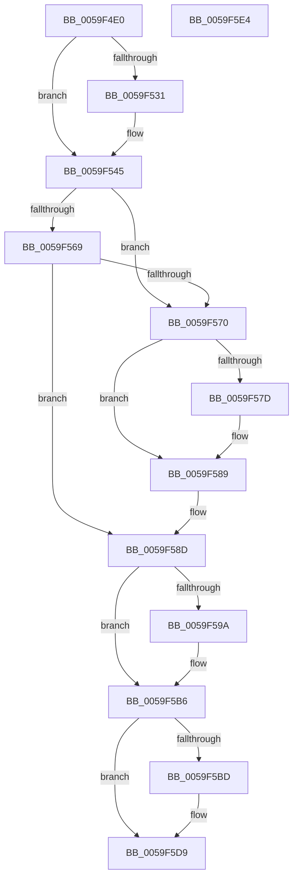

# IopLiveDumpUncorralProcessors

- RVA: `0x0059F4E0`–`0x0059F5E5` (길이 `261` bytes)
- VA: `0x000000014059F4E0`
- 실행 섹션: `.text`
- PDB 이름 있음: `예`; PDB Function 태그: `아니요`
- unwind 정보 RVA: `0x000C7C1C`
- 디코드: `76`개 명령, `261/261` bytes 표시
- 미해석 바이트: `0` (있으면 어셈블리에 `.byte`로 보존)

> 이 문서는 커널 이미지의 기계어와 PDB 기호를 분석해 생성했습니다. 4번과 5번은 함수 원형과 자료형을 바이너리 사용 방식에서 추정한 C 해석이며 원본 소스 복구 결과는 아닙니다.

## 1. Dependencies

- 직접 호출 지점: **9**; 고유 호출 대상: **6**
- 직접 호출자로 확인된 함수: **3**
- RIP 상대 이미지 참조: **4**

### Outgoing calls
- `0x0059F513` → [IopLiveDumpInitiateCorralStateChange](IopLiveDumpInitiateCorralStateChange_function_0059CA5C.md) (function, `0x0059CA5C`)
- `0x0059F523` → [IopLiveDumpInitiateCorralStateChange](IopLiveDumpInitiateCorralStateChange_function_0059CA5C.md) (function, `0x0059CA5C`)
- `0x0059F53C` → [IopLiveDumpInitiateCorralStateChange](IopLiveDumpInitiateCorralStateChange_function_0059CA5C.md) (function, `0x0059CA5C`)
- `0x0059F556` → [IopLiveDumpInitiateCorralStateChange](IopLiveDumpInitiateCorralStateChange_function_0059CA5C.md) (function, `0x0059CA5C`)
- `0x0059F55F` → [KeRevertToUserGroupAffinityThread](../39/KeRevertToUserGroupAffinityThread_function_00398EC0.md) (function, `0x00398EC0`)
- `0x0059F584` → [KiLowerIrqlProcessIrqlFlags](../4F/KiLowerIrqlProcessIrqlFlags_function_004F5698.md) (function, `0x004F5698`)
- `0x0059F591` → [IopLiveDumpIsTracingEnabled](../4F/IopLiveDumpIsTracingEnabled_function_004FC5AC.md) (function, `0x004FC5AC`)
- `0x0059F5B1` → [IopLiveDumpTraceNoArgs](../5A/IopLiveDumpTraceNoArgs_function_005A43C0.md) (function, `0x005A43C0`)
- `0x0059F5D4` → [IopLiveDumpTraceUncorralProcessorsDuration](IopLiveDumpTraceUncorralProcessorsDuration_function_0059F324.md) (function, `0x0059F324`)

### Direct callers
- [IopLiveDumpCaptureMemoryPages](IopLiveDumpCaptureMemoryPages_function_0059B0A0.md) at `0x0059B18C`
- [IopLiveDumpCollectPages](IopLiveDumpCollectPages_function_0059B328.md) at `0x0059B65E`
- [IopLiveDumpEstimateMemoryPages](IopLiveDumpEstimateMemoryPages_function_0059BA80.md) at `0x0059BCC0`

### Static image references
- `0x0059F549` → RVA `0x00F0BD23` (`.data`; write)
- `0x0059F570` → RVA `0x00FC6D20` (`ALMOSTRO`; read)
- `0x0059F59D` → RVA `0x00021810` (`.rdata`; read)
- `0x0059F5A6` → RVA `0x00023590` (`.rdata`; read)

## 2. Other-region calls and transfers

- 다른 실행 섹션으로 향하는 call: **0**
- 별도 외부 분기/꼬리 이동을 확인하지 못했습니다.

## 3. Assembly (complete function range)

```asm
0059F4E0  40 55                           push rbp
0059F4E2  53                              push rbx
0059F4E3  56                              push rsi
0059F4E4  57                              push rdi
0059F4E5  41 56                           push r14
0059F4E7  48 8B EC                        mov rbp, rsp
0059F4EA  48 83 EC 40                     sub rsp, 0x40
0059F4EE  48 83 65 F0 00                  and qword ptr [rbp - 0x10], 0
0059F4F3  4C 8D 45 40                     lea r8, [rbp + 0x40]
0059F4F7  48 8B 39                        mov rdi, qword ptr [rcx]
0059F4FA  45 33 F6                        xor r14d, r14d
0059F4FD  4C 21 75 48                     and qword ptr [rbp + 0x48], r14
0059F501  40 8A F2                        mov sil, dl
0059F504  4C 21 75 40                     and qword ptr [rbp + 0x40], r14
0059F508  48 8B D9                        mov rbx, rcx
0059F50B  4C 89 75 30                     mov qword ptr [rbp + 0x30], r14
0059F50F  41 8D 56 05                     lea edx, [r14 + 5]
0059F513  E8 44 D5 FF FF                  call 0x14059ca5c
0059F518  4C 8D 45 48                     lea r8, [rbp + 0x48]
0059F51C  48 8B CB                        mov rcx, rbx
0059F51F  41 8D 56 08                     lea edx, [r14 + 8]
0059F523  E8 34 D5 FF FF                  call 0x14059ca5c
0059F528  F7 47 50 00 01 00 00            test dword ptr [rdi + 0x50], 0x100
0059F52F  75 14                           jne 0x14059f545
0059F531  4C 8D 45 30                     lea r8, [rbp + 0x30]
0059F535  48 8B CB                        mov rcx, rbx
0059F538  41 8D 56 06                     lea edx, [r14 + 6]
0059F53C  E8 1B D5 FF FF                  call 0x14059ca5c
0059F541  4C 8B 75 30                     mov r14, qword ptr [rbp + 0x30]
0059F545  4C 8D 45 F0                     lea r8, [rbp - 0x10]
0059F549  C6 05 D3 C7 96 00 00            mov byte ptr [rip + 0x96c7d3], 0
0059F550  83 CA FF                        or edx, 0xffffffff
0059F553  48 8B CB                        mov rcx, rbx
0059F556  E8 01 D5 FF FF                  call 0x14059ca5c
0059F55B  48 8D 4B 60                     lea rcx, [rbx + 0x60]
0059F55F  E8 5C 99 DF FF                  call 0x140398ec0
0059F564  40 84 F6                        test sil, sil
0059F567  75 07                           jne 0x14059f570
0059F569  8B 47 28                        mov eax, dword ptr [rdi + 0x28]
0059F56C  A8 20                           test al, 0x20
0059F56E  74 1D                           je 0x14059f58d
0059F570  83 3D A9 77 A2 00 00            cmp dword ptr [rip + 0xa277a9], 0
0059F577  0F B6 73 58                     movzx esi, byte ptr [rbx + 0x58]
0059F57B  74 0C                           je 0x14059f589
0059F57D  44 0F 20 C1                     mov rcx, cr8
0059F581  40 8A D6                        mov dl, sil
0059F584  E8 0F 61 F5 FF                  call 0x1404f5698
0059F589  44 0F 22 C6                     mov cr8, rsi
0059F58D  83 63 08 FE                     and dword ptr [rbx + 8], 0xfffffffe
0059F591  E8 16 D0 F5 FF                  call 0x1404fc5ac
0059F596  84 C0                           test al, al
0059F598  74 1C                           je 0x14059f5b6
0059F59A  8B 47 50                        mov eax, dword ptr [rdi + 0x50]
0059F59D  48 8D 0D 6C 22 A8 FF            lea rcx, [rip - 0x57dd94]
0059F5A4  A8 01                           test al, 1
0059F5A6  48 8D 05 E3 3F A8 FF            lea rax, [rip - 0x57c01d]
0059F5AD  48 0F 44 C8                     cmove rcx, rax
0059F5B1  E8 0A 4E 00 00                  call 0x1405a43c0
0059F5B6  8B 47 50                        mov eax, dword ptr [rdi + 0x50]
0059F5B9  84 C0                           test al, al
0059F5BB  79 1C                           jns 0x14059f5d9
0059F5BD  48 8B 45 40                     mov rax, qword ptr [rbp + 0x40]
0059F5C1  4D 8B C6                        mov r8, r14
0059F5C4  4C 8B 4D 48                     mov r9, qword ptr [rbp + 0x48]
0059F5C8  48 8B 55 F0                     mov rdx, qword ptr [rbp - 0x10]
0059F5CC  48 8B 0B                        mov rcx, qword ptr [rbx]
0059F5CF  48 89 44 24 20                  mov qword ptr [rsp + 0x20], rax
0059F5D4  E8 4B FD FF FF                  call 0x14059f324
0059F5D9  48 83 C4 40                     add rsp, 0x40
0059F5DD  41 5E                           pop r14
0059F5DF  5F                              pop rdi
0059F5E0  5E                              pop rsi
0059F5E1  5B                              pop rbx
0059F5E2  5D                              pop rbp
0059F5E3  C3                              ret
0059F5E4  CC                              int3
```

## 4. C-style interpretation (structured pseudocode)

```c
__int64 __fastcall IopLiveDumpUncorralProcessors(__int64 a1, unsigned __int8 a2)
{
    __int64 result;
    __int64 v_r14;
    __int64 v_rsp;
    unsigned __int64 v_stack_m38;
    unsigned __int64 v_stack_m48;
    unsigned __int64 v_stack_p18;
    unsigned __int64 v_stack_p20;
    unsigned __int64 v_stack_p8;

    v_rsp = (v_rsp) - (64);
    v_r14 = 0;
    v_stack_p8 = 0;
    result = IopLiveDumpInitiateCorralStateChange(a1, v_r14 + 5, v_stack_p18, a4);
    result = IopLiveDumpInitiateCorralStateChange(a1, v_r14 + 8, v_stack_p20, a4);
    if (((*(unsigned int *)(*(unsigned __int64 *)(a1) + 80)) & (256)) == 0) {
        a3 = v_stack_p8;
        a1 = a1;
        a2 = v_r14 + 6;
        result = IopLiveDumpInitiateCorralStateChange(a1, a2, a3, a4);
        v_r14 = v_stack_p8;
    }
    *(unsigned __int8 *)(v_rip + 9881555) = 0;
    a2 = (unsigned int)((a2) | (0xFFFFFFFFULL));
    result = IopLiveDumpInitiateCorralStateChange(a1, a2, v_stack_m38, a4);
    result = KeRevertToUserGroupAffinityThread(a1 + 96, a2, v_stack_m38, a4);
    if (a2 != 0) goto loc_0059F570;
    if ((((unsigned __int8)((unsigned int)(*(unsigned int *)(*(unsigned __int64 *)(a1) + 40)))) & (32)) == 0) goto loc_0059F58D;
loc_0059F570:
    result = (unsigned int)(*(unsigned int *)(*(unsigned __int64 *)(a1) + 40));
    if ((*(unsigned int *)(v_rip + 10647465)) != 0) {
        a1 = v_cr8;
        a2 = (unsigned __int8)(*(unsigned __int8 *)(a1 + 88));
        result = KiLowerIrqlProcessIrqlFlags(a1, a2, v_stack_m38, a4);
    }
loc_0059F58D:
    result = IopLiveDumpIsTracingEnabled(a1, a2, v_stack_m38, a4);
    if ((unsigned __int8)(result) != 0) {
        result = *(unsigned int *)(*(unsigned __int64 *)(a1) + 80);
        a1 = v_rip - 5758356;
        result = v_rip - 5750813;
        if ((((unsigned __int8)(result)) & (1)) == 0) { a1 = result; }
        result = IopLiveDumpTraceNoArgs(a1, a2, v_stack_m38, a4);
    }
    result = (unsigned int)(*(unsigned int *)(*(unsigned __int64 *)(a1) + 80));
    if (sign_flag) {
        result = v_stack_p18;
        a3 = v_r14;
        a4 = v_stack_p20;
        a2 = v_stack_m38;
        a1 = *(unsigned __int64 *)(a1);
        v_stack_m48 = result;
        result = IopLiveDumpTraceUncorralProcessorsDuration(a1, a2, a3, a4);
    }
    v_rsp = (v_rsp) + (64);
    return result;
}
```

## 5. (Beta) C Style

```c
int64_t IopLiveDumpUncorralProcessors(void *Arg1, uint8_t Arg2)
{
    uint8_t *arg1 = (uint8_t *)Arg1;

    int64_t result;
    int64_t local_r14;
    int64_t local_rsp;
    uint64_t v_stack_m38;
    uint64_t v_stack_m48;
    uint64_t v_stack_p18;
    uint64_t v_stack_p20;
    uint64_t v_stack_p8;

    local_rsp = (local_rsp) - (64);
    local_r14 = 0;
    v_stack_p8 = 0;
    result = IopLiveDumpInitiateCorralStateChange(Arg1, local_r14 + 5, v_stack_p18, a4);
    result = IopLiveDumpInitiateCorralStateChange(Arg1, local_r14 + 8, v_stack_p20, a4);
    if (((*(uint32_t *)(*(uint64_t *)(arg1) + 0x50)) & (256)) == 0) {
        a3 = v_stack_p8;
        Arg1 = Arg1;
        Arg2 = local_r14 + 6;
        result = IopLiveDumpInitiateCorralStateChange(Arg1, Arg2, a3, a4);
        local_r14 = v_stack_p8;
    }
    *(uint8_t *)(v_rip + 0x96C7D3) = 0;
    Arg2 = (uint32_t)((Arg2) | (0xFFFFFFFFULL));
    result = IopLiveDumpInitiateCorralStateChange(Arg1, Arg2, v_stack_m38, a4);
    result = KeRevertToUserGroupAffinityThread(Arg1 + 96, Arg2, v_stack_m38, a4);
    if (Arg2 != 0) goto loc_0059F570;
    if ((((uint8_t)((uint32_t)(*(uint32_t *)(*(uint64_t *)(arg1) + 0x28)))) & (32)) == 0) goto loc_0059F58D;
loc_0059F570:
    result = (uint32_t)(*(uint32_t *)(*(uint64_t *)(arg1) + 0x28));
    if ((*(uint32_t *)(v_rip + 0xA277A9)) != 0) {
        Arg1 = v_cr8;
        Arg2 = (uint8_t)(*(uint8_t *)(arg1 + 0x58));
        result = KiLowerIrqlProcessIrqlFlags(Arg1, Arg2, v_stack_m38, a4);
    }
loc_0059F58D:
    result = IopLiveDumpIsTracingEnabled(Arg1, Arg2, v_stack_m38, a4);
    if ((uint8_t)(result) != 0) {
        result = *(uint32_t *)(*(uint64_t *)(arg1) + 0x50);
        Arg1 = v_rip - 5758356;
        result = v_rip - 5750813;
        if ((((uint8_t)(result)) & (1)) == 0) { Arg1 = result; }
        result = IopLiveDumpTraceNoArgs(Arg1, Arg2, v_stack_m38, a4);
    }
    result = (uint32_t)(*(uint32_t *)(*(uint64_t *)(arg1) + 0x50));
    if (sign_flag) {
        result = v_stack_p18;
        a3 = local_r14;
        a4 = v_stack_p20;
        Arg2 = v_stack_m38;
        Arg1 = *(uint64_t *)(arg1);
        v_stack_m48 = result;
        result = IopLiveDumpTraceUncorralProcessorsDuration(Arg1, Arg2, a3, a4);
    }
    local_rsp = (local_rsp) + (64);
    return result;
}
```

### 관측된 메모리 오프셋

구조체 형식이 확인되지 않은 접근은 인자 기준의 오프셋으로만 기록했습니다.

| 기준 인자 | 오프셋 표현 | 폭 (bit) | 접근 |
|---|---:|---:|---|
| `Arg1` | `+ 0x0` | `64` | `R` |
| `Arg1` | `+ 0x8` | `32` | `R/W` |
| `Arg1` | `+ 0x58` | `8` | `R` |
| `Arg1` | `+ 0x60` | `64` | `R` |

## 6. Execution-region graph

[열기: 2D/3D 그래프와 함수 탐색 컨트롤 패널](../../../control-panel.html?section=text&rva=0x0059F4E0&view=graph)

- 2D 그래프는 위에서 아래로 흐르고, 3D 그래프는 빈 공간을 드래그해 회전합니다. Shift+드래그는 이동, 휠은 확대·축소, 함수 노드 선택은 대상 보고서 이동입니다.

### Static fallback


