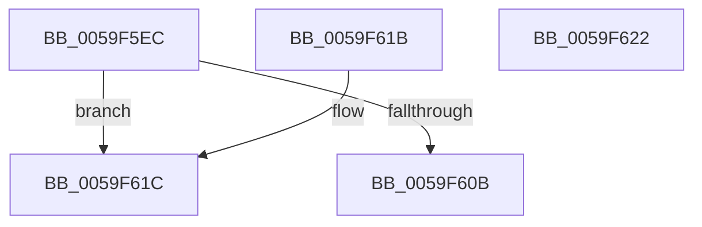

# IopLiveDumpUnpackMemoryRun

- RVA: `0x0059F5EC`–`0x0059F623` (길이 `55` bytes)
- VA: `0x000000014059F5EC`
- 실행 섹션: `.text`
- PDB 이름 있음: `예`; PDB Function 태그: `아니요`
- unwind 정보 RVA: `0x000DB714`
- 디코드: `18`개 명령, `55/55` bytes 표시
- 미해석 바이트: `0` (있으면 어셈블리에 `.byte`로 보존)

> 이 문서는 커널 이미지의 기계어와 PDB 기호를 분석해 생성했습니다. 4번과 5번은 함수 원형과 자료형을 바이너리 사용 방식에서 추정한 C 해석이며 원본 소스 복구 결과는 아닙니다.

## 1. Dependencies

- 직접 호출 지점: **0**; 고유 호출 대상: **0**
- 직접 호출자로 확인된 함수: **2**
- RIP 상대 이미지 참조: **0**

### Outgoing calls
- 직접 디코드된 call 명령이 없습니다.

### Direct callers
- [IopLiveDumpAllocateFromIOSpace](IopLiveDumpAllocateFromIOSpace_function_00599DEC.md) at `0x00599F66`
- [IopLiveDumpFreeIoSpaceRanges](IopLiveDumpFreeIoSpaceRanges_function_0059BEE4.md) at `0x0059BF68`

### Static image references
- 디코드된 RIP-relative 메모리 참조가 없습니다.

## 2. Other-region calls and transfers

- 다른 실행 섹션으로 향하는 call: **0**
- 별도 외부 분기/꼬리 이동을 확인하지 못했습니다.

## 3. Assembly (complete function range)

```asm
0059F5EC  4C 8B C9                        mov r9, rcx
0059F5EF  48 B8 FF FF FF FF FF 00 00 00   movabs rax, 0xffffffffff
0059F5F9  4C 23 C8                        and r9, rax
0059F5FC  48 C1 E9 28                     shr rcx, 0x28
0059F600  4C 89 0A                        mov qword ptr [rdx], r9
0059F603  41 89 08                        mov dword ptr [r8], ecx
0059F606  4D 85 C9                        test r9, r9
0059F609  74 11                           je 0x14059f61c
0059F60B  8B C1                           mov eax, ecx
0059F60D  49 03 C1                        add rax, r9
0059F610  49 3B C1                        cmp rax, r9
0059F613  1B C0                           sbb eax, eax
0059F615  25 0D 00 00 C0                  and eax, 0xc000000d
0059F61A  C3                              ret
0059F61B  CC                              int3
0059F61C  B8 0D 00 00 C0                  mov eax, 0xc000000d
0059F621  C3                              ret
0059F622  CC                              int3
```

## 4. C-style interpretation (structured pseudocode)

```c
__int64 __fastcall IopLiveDumpUnpackMemoryRun(__int64 a1, __int64 a2, __int64 a3)
{
    __int64 result;

    a4 = (a1) & (result);
    a1 = (a1) >> (40);
    *(unsigned __int64 *)(a2) = a4;
    *(unsigned int *)(a3) = (unsigned int)(a1);
    if (a4 == 0) goto loc_0059F61C;
    result = ((unsigned int)((unsigned int)(a1))) + (a4);
    result = (unsigned int)((result) & (0xC000000DULL));
    return result;
loc_0059F61C:
    return (unsigned int)(0xC000000DULL);
}
```

## 5. (Beta) C Style

```c
int64_t IopLiveDumpUnpackMemoryRun(int64_t Arg1, void *Arg2, void *Arg3)
{
    uint8_t *arg2 = (uint8_t *)Arg2;
    uint8_t *arg3 = (uint8_t *)Arg3;

    int64_t result;

    a4 = (Arg1) & (result);
    Arg1 = (Arg1) >> (40);
    *(uint64_t *)(arg2) = a4;
    *(uint32_t *)(arg3) = (uint32_t)(Arg1);
    if (a4 == 0) goto loc_0059F61C;
    result = ((uint32_t)((uint32_t)(Arg1))) + (a4);
    result = (uint32_t)((result) & (0xC000000DULL));
    return result;
loc_0059F61C:
    return (uint32_t)(0xC000000DULL);
}
```

### 관측된 메모리 오프셋

구조체 형식이 확인되지 않은 접근은 인자 기준의 오프셋으로만 기록했습니다.

| 기준 인자 | 오프셋 표현 | 폭 (bit) | 접근 |
|---|---:|---:|---|
| `Arg2` | `+ 0x0` | `64` | `W` |
| `Arg3` | `+ 0x0` | `32` | `W` |

## 6. Execution-region graph

[열기: 2D/3D 그래프와 함수 탐색 컨트롤 패널](../../../control-panel.html?section=text&rva=0x0059F5EC&view=graph)

- 2D 그래프는 위에서 아래로 흐르고, 3D 그래프는 빈 공간을 드래그해 회전합니다. Shift+드래그는 이동, 휠은 확대·축소, 함수 노드 선택은 대상 보고서 이동입니다.

### Static fallback


