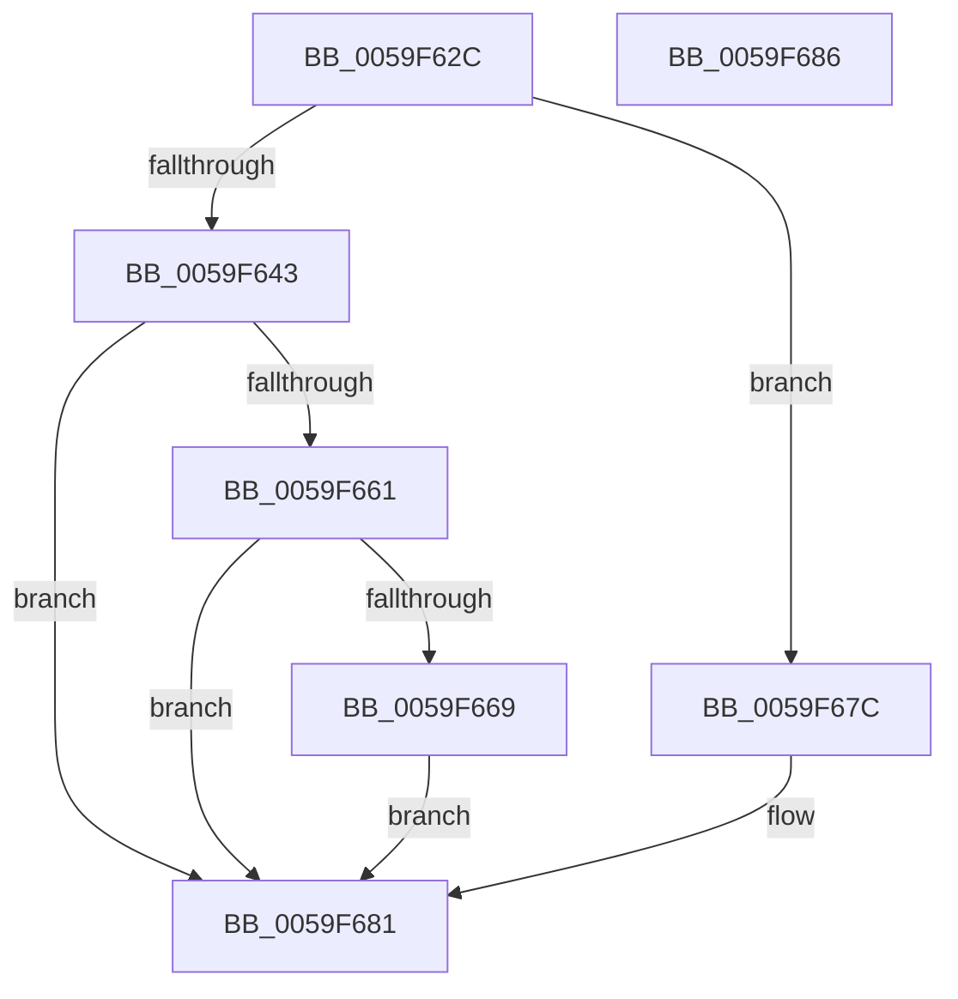

# IopLiveDumpValidateDumpFileHandle

- RVA: `0x0059F62C`–`0x0059F687` (길이 `91` bytes)
- VA: `0x000000014059F62C`
- 실행 섹션: `.text`
- PDB 이름 있음: `예`; PDB Function 태그: `아니요`
- unwind 정보 RVA: `0x00082420`
- 디코드: `28`개 명령, `91/91` bytes 표시
- 미해석 바이트: `0` (있으면 어셈블리에 `.byte`로 보존)

> 이 문서는 커널 이미지의 기계어와 PDB 기호를 분석해 생성했습니다. 4번과 5번은 함수 원형과 자료형을 바이너리 사용 방식에서 추정한 C 해석이며 원본 소스 복구 결과는 아닙니다.

## 1. Dependencies

- 직접 호출 지점: **1**; 고유 호출 대상: **1**
- 직접 호출자로 확인된 함수: **2**
- RIP 상대 이미지 참조: **0**

### Outgoing calls
- `0x0059F658` → [ZwQueryInformationFile](../6A/ZwQueryInformationFile_function_006AD2F0.md) (function, `0x006AD2F0`)

### Direct callers
- [IoSetDeferredLiveDumpFileHandle](IoSetDeferredLiveDumpFileHandle_function_00598C30.md) at `0x00598C85`
- [IopLiveDumpValidateParameters](IopLiveDumpValidateParameters_function_0059F690.md) at `0x0059F78E`

### Static image references
- 디코드된 RIP-relative 메모리 참조가 없습니다.

## 2. Other-region calls and transfers

- 다른 실행 섹션으로 향하는 call: **0**
- 별도 외부 분기/꼬리 이동을 확인하지 못했습니다.

## 3. Assembly (complete function range)

```asm
0059F62C  48 8B C4                        mov rax, rsp
0059F62F  48 83 EC 48                     sub rsp, 0x48
0059F633  83 60 08 00                     and dword ptr [rax + 8], 0
0059F637  0F 57 C0                        xorps xmm0, xmm0
0059F63A  0F 11 40 E8                     movups xmmword ptr [rax - 0x18], xmm0
0059F63E  48 85 C9                        test rcx, rcx
0059F641  74 39                           je 0x14059f67c
0059F643  41 B9 04 00 00 00               mov r9d, 4
0059F649  C7 40 D8 10 00 00 00            mov dword ptr [rax - 0x28], 0x10
0059F650  4C 8D 40 08                     lea r8, [rax + 8]
0059F654  48 8D 50 E8                     lea rdx, [rax - 0x18]
0059F658  E8 93 DC 10 00                  call 0x1406ad2f0
0059F65D  85 C0                           test eax, eax
0059F65F  78 20                           js 0x14059f681
0059F661  8B 44 24 30                     mov eax, dword ptr [rsp + 0x30]
0059F665  85 C0                           test eax, eax
0059F667  78 18                           js 0x14059f681
0059F669  8B 44 24 50                     mov eax, dword ptr [rsp + 0x50]
0059F66D  24 30                           and al, 0x30
0059F66F  F6 D8                           neg al
0059F671  1B C0                           sbb eax, eax
0059F673  F7 D0                           not eax
0059F675  25 0D 00 00 C0                  and eax, 0xc000000d
0059F67A  EB 05                           jmp 0x14059f681
0059F67C  B8 0D 00 00 C0                  mov eax, 0xc000000d
0059F681  48 83 C4 48                     add rsp, 0x48
0059F685  C3                              ret
0059F686  CC                              int3
```

## 4. C-style interpretation (structured pseudocode)

```c
__int64 __fastcall IopLiveDumpValidateDumpFileHandle(__int64 a1)
{
    __int64 result;
    __int64 v_rsp;
    unsigned int v_stack_m18;
    unsigned int v_stack_p8;

    v_rsp = (v_rsp) - (72);
    *(unsigned __int64 *)(v_rsp - 24) = v_xmm0;
    if (a1 == 0) goto loc_0059F67C;
    *(unsigned int *)(v_rsp - 40) = 16;
    result = ZwQueryInformationFile(a1, v_rsp - 24, v_rsp + 8, 4);
    if (sign_flag) goto loc_0059F681;
    if (sign_flag) goto loc_0059F681;
    result = (unsigned __int8)(((unsigned int)(v_stack_p8)) & (48));
    result = (unsigned __int8)(-(result));
    result = (unsigned int)(~(result));
    result = (unsigned int)((result) & (0xC000000DULL));
    goto loc_0059F681;
loc_0059F67C:
loc_0059F681:
    v_rsp = (v_rsp) + (72);
    return (unsigned int)(0xC000000DULL);
}
```

## 5. (Beta) C Style

```c
int64_t IopLiveDumpValidateDumpFileHandle(int64_t Arg1)
{
    int64_t result;
    int64_t local_rsp;
    uint32_t v_stack_m18;
    uint32_t v_stack_p8;

    local_rsp = (local_rsp) - (72);
    *(uint64_t *)(local_rsp - 0x18) = v_xmm0;
    if (Arg1 == 0) goto loc_0059F67C;
    *(uint32_t *)(local_rsp - 0x28) = 16;
    result = ZwQueryInformationFile(Arg1, local_rsp - 24, local_rsp + 8, 4);
    if (sign_flag) goto loc_0059F681;
    if (sign_flag) goto loc_0059F681;
    result = (uint8_t)(((uint32_t)(v_stack_p8)) & (48));
    result = (uint8_t)(-(result));
    result = (uint32_t)(~(result));
    result = (uint32_t)((result) & (0xC000000DULL));
    goto loc_0059F681;
loc_0059F67C:
loc_0059F681:
    local_rsp = (local_rsp) + (72);
    return (uint32_t)(0xC000000DULL);
}
```

## 6. Execution-region graph

[열기: 2D/3D 그래프와 함수 탐색 컨트롤 패널](../../../control-panel.html?section=text&rva=0x0059F62C&view=graph)

- 2D 그래프는 위에서 아래로 흐르고, 3D 그래프는 빈 공간을 드래그해 회전합니다. Shift+드래그는 이동, 휠은 확대·축소, 함수 노드 선택은 대상 보고서 이동입니다.

### Static fallback


