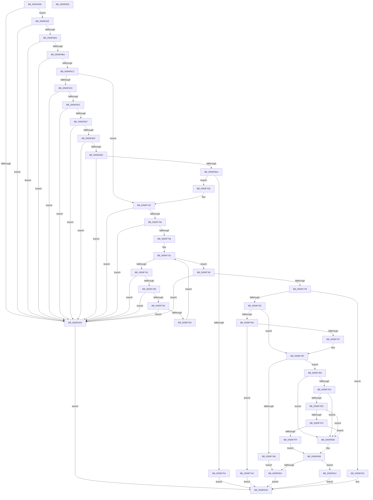

# IopLiveDumpValidateParameters

- RVA: `0x0059F690`–`0x0059F82A` (길이 `410` bytes)
- VA: `0x000000014059F690`
- 실행 섹션: `.text`
- PDB 이름 있음: `예`; PDB Function 태그: `아니요`
- unwind 정보 RVA: `0x0005CAAC`
- 디코드: `115`개 명령, `410/410` bytes 표시
- 미해석 바이트: `0` (있으면 어셈블리에 `.byte`로 보존)

> 이 문서는 커널 이미지의 기계어와 PDB 기호를 분석해 생성했습니다. 4번과 5번은 함수 원형과 자료형을 바이너리 사용 방식에서 추정한 C 해석이며 원본 소스 복구 결과는 아닙니다.

## 1. Dependencies

- 직접 호출 지점: **3**; 고유 호출 대상: **3**
- 직접 호출자로 확인된 함수: **1**
- RIP 상대 이미지 참조: **6**

### Outgoing calls
- `0x0059F6F3` → [ExAllocatePool2](../../poolcode/B8/ExAllocatePool2_function_00B820F0.md) (function, `0x00B820F0`)
- `0x0059F719` → [memcpy](../6C/memcpy_function_006C6840.md) (function, `0x006C6840`)
- `0x0059F78E` → [IopLiveDumpValidateDumpFileHandle](IopLiveDumpValidateDumpFileHandle_function_0059F62C.md) (function, `0x0059F62C`)

### Direct callers
- [IoCaptureLiveDump](../4E/IoCaptureLiveDump_function_004E085C.md) at `0x004E0C38`

### Static image references
- `0x0059F7C6` → RVA `0x00FC6E4C` (`ALMOSTRO`; read)
- `0x0059F7D0` → RVA `0x00FC7800` (`ALMOSTRO`; read)
- `0x0059F7DB` → RVA `0x00FC6B80` (`ALMOSTRO`; read)
- `0x0059F7E4` → RVA `0x00FC6A98` (`ALMOSTRO`; read)
- `0x0059F7ED` → RVA `0x00FC6AC8` (`ALMOSTRO`; read)
- `0x0059F7F6` → RVA `0x00FC6D98` (`ALMOSTRO`; read)

## 2. Other-region calls and transfers

- 다른 실행 섹션으로 향하는 call: **1**
  - `0x0059F6F3` → [ExAllocatePool2](../../poolcode/B8/ExAllocatePool2_function_00B820F0.md) (`.text` → `POOLCODE`)
- 별도 외부 분기/꼬리 이동을 확인하지 못했습니다.

## 3. Assembly (complete function range)

```asm
0059F690  48 89 5C 24 08                  mov qword ptr [rsp + 8], rbx
0059F695  57                              push rdi
0059F696  48 83 EC 20                     sub rsp, 0x20
0059F69A  48 8B DA                        mov rbx, rdx
0059F69D  48 8B F9                        mov rdi, rcx
0059F6A0  48 85 D2                        test rdx, rdx
0059F6A3  75 0A                           jne 0x14059f6af
0059F6A5  B8 0D 00 00 C0                  mov eax, 0xc000000d
0059F6AA  E9 6F 01 00 00                  jmp 0x14059f81e
0059F6AF  83 3A 02                        cmp dword ptr [rdx], 2
0059F6B2  75 F1                           jne 0x14059f6a5
0059F6B4  83 7A 04 38                     cmp dword ptr [rdx + 4], 0x38
0059F6B8  72 EB                           jb 0x14059f6a5
0059F6BA  8B 4A 1C                        mov ecx, dword ptr [rdx + 0x1c]
0059F6BD  83 F9 04                        cmp ecx, 4
0059F6C0  73 E3                           jae 0x14059f6a5
0059F6C2  8B 42 18                        mov eax, dword ptr [rdx + 0x18]
0059F6C5  A8 20                           test al, 0x20
0059F6C7  74 55                           je 0x14059f71e
0059F6C9  48 8B 42 30                     mov rax, qword ptr [rdx + 0x30]
0059F6CD  48 85 C0                        test rax, rax
0059F6D0  74 D3                           je 0x14059f6a5
0059F6D2  83 38 01                        cmp dword ptr [rax], 1
0059F6D5  75 CE                           jne 0x14059f6a5
0059F6D7  8B 50 04                        mov edx, dword ptr [rax + 4]
0059F6DA  83 FA 30                        cmp edx, 0x30
0059F6DD  75 C6                           jne 0x14059f6a5
0059F6DF  48 83 78 08 02                  cmp qword ptr [rax + 8], 2
0059F6E4  73 BF                           jae 0x14059f6a5
0059F6E6  85 C9                           test ecx, ecx
0059F6E8  75 BB                           jne 0x14059f6a5
0059F6EA  8D 4A 10                        lea ecx, [rdx + 0x10]
0059F6ED  41 B8 4C 64 6D 70               mov r8d, 0x706d644c
0059F6F3  E8 F8 29 5E 00                  call 0x140b820f0
0059F6F8  48 89 87 90 04 00 00            mov qword ptr [rdi + 0x490], rax
0059F6FF  48 85 C0                        test rax, rax
0059F702  75 0A                           jne 0x14059f70e
0059F704  B8 17 00 00 C0                  mov eax, 0xc0000017
0059F709  E9 10 01 00 00                  jmp 0x14059f81e
0059F70E  48 8B 53 30                     mov rdx, qword ptr [rbx + 0x30]
0059F712  48 8B C8                        mov rcx, rax
0059F715  44 8B 42 04                     mov r8d, dword ptr [rdx + 4]
0059F719  E8 22 71 12 00                  call 0x1406c6840
0059F71E  8B 43 1C                        mov eax, dword ptr [rbx + 0x1c]
0059F721  89 47 2C                        mov dword ptr [rdi + 0x2c], eax
0059F724  83 7B 24 00                     cmp dword ptr [rbx + 0x24], 0
0059F728  0F 85 77 FF FF FF               jne 0x14059f6a5
0059F72E  83 7B 20 00                     cmp dword ptr [rbx + 0x20], 0
0059F732  0F 85 6D FF FF FF               jne 0x14059f6a5
0059F738  48 8B 43 28                     mov rax, qword ptr [rbx + 0x28]
0059F73C  48 85 C0                        test rax, rax
0059F73F  74 25                           je 0x14059f766
0059F741  83 78 1C 00                     cmp dword ptr [rax + 0x1c], 0
0059F745  0F 85 5A FF FF FF               jne 0x14059f6a5
0059F74B  48 83 78 10 00                  cmp qword ptr [rax + 0x10], 0
0059F750  0F 84 4F FF FF FF               je 0x14059f6a5
0059F756  83 78 18 00                     cmp dword ptr [rax + 0x18], 0
0059F75A  0F 84 45 FF FF FF               je 0x14059f6a5
0059F760  48 8B 40 20                     mov rax, qword ptr [rax + 0x20]
0059F764  EB D6                           jmp 0x14059f73c
0059F766  0F 10 43 20                     movups xmm0, xmmword ptr [rbx + 0x20]
0059F76A  F3 0F 7F 47 30                  movdqu xmmword ptr [rdi + 0x30], xmm0
0059F76F  8B 43 18                        mov eax, dword ptr [rbx + 0x18]
0059F772  83 F8 40                        cmp eax, 0x40
0059F775  0F 83 2A FF FF FF               jae 0x14059f6a5
0059F77B  A8 03                           test al, 3
0059F77D  0F 85 96 00 00 00               jne 0x14059f819
0059F783  89 47 28                        mov dword ptr [rdi + 0x28], eax
0059F786  A8 08                           test al, 8
0059F788  75 15                           jne 0x14059f79f
0059F78A  48 8B 4B 08                     mov rcx, qword ptr [rbx + 8]
0059F78E  E8 99 FE FF FF                  call 0x14059f62c
0059F793  85 C0                           test eax, eax
0059F795  78 15                           js 0x14059f7ac
0059F797  48 8B 43 08                     mov rax, qword ptr [rbx + 8]
0059F79B  48 89 47 40                     mov qword ptr [rdi + 0x40], rax
0059F79F  4C 8B 43 10                     mov r8, qword ptr [rbx + 0x10]
0059F7A3  4D 85 C0                        test r8, r8
0059F7A6  75 0B                           jne 0x14059f7b3
0059F7A8  33 C0                           xor eax, eax
0059F7AA  EB 60                           jmp 0x14059f80c
0059F7AC  48 83 67 40 00                  and qword ptr [rdi + 0x40], 0
0059F7B1  EB 6B                           jmp 0x14059f81e
0059F7B3  49 8D 40 D0                     lea rax, [r8 - 0x30]
0059F7B7  48 C1 E8 08                     shr rax, 8
0059F7BB  0F B6 D0                        movzx edx, al
0059F7BE  41 0F B6 40 E8                  movzx eax, byte ptr [r8 - 0x18]
0059F7C3  48 33 D0                        xor rdx, rax
0059F7C6  0F B6 05 7F 76 A2 00            movzx eax, byte ptr [rip + 0xa2767f]
0059F7CD  48 33 D0                        xor rdx, rax
0059F7D0  48 8D 05 29 80 A2 00            lea rax, [rip + 0xa28029]
0059F7D7  48 8B 04 D0                     mov rax, qword ptr [rax + rdx*8]
0059F7DB  48 3B 05 9E 73 A2 00            cmp rax, qword ptr [rip + 0xa2739e]
0059F7E2  74 22                           je 0x14059f806
0059F7E4  48 3B 05 AD 72 A2 00            cmp rax, qword ptr [rip + 0xa272ad]
0059F7EB  74 19                           je 0x14059f806
0059F7ED  48 3B 05 D4 72 A2 00            cmp rax, qword ptr [rip + 0xa272d4]
0059F7F4  74 10                           je 0x14059f806
0059F7F6  48 3B 05 9B 75 A2 00            cmp rax, qword ptr [rip + 0xa2759b]
0059F7FD  74 07                           je 0x14059f806
0059F7FF  B8 0D 00 00 C0                  mov eax, 0xc000000d
0059F804  EB 02                           jmp 0x14059f808
0059F806  33 C0                           xor eax, eax
0059F808  85 C0                           test eax, eax
0059F80A  78 06                           js 0x14059f812
0059F80C  4C 89 47 48                     mov qword ptr [rdi + 0x48], r8
0059F810  EB 0C                           jmp 0x14059f81e
0059F812  48 83 67 48 00                  and qword ptr [rdi + 0x48], 0
0059F817  EB 05                           jmp 0x14059f81e
0059F819  B8 02 00 00 C0                  mov eax, 0xc0000002
0059F81E  48 8B 5C 24 30                  mov rbx, qword ptr [rsp + 0x30]
0059F823  48 83 C4 20                     add rsp, 0x20
0059F827  5F                              pop rdi
0059F828  C3                              ret
0059F829  CC                              int3
```

## 4. C-style interpretation (structured pseudocode)

```c
__int64 __fastcall IopLiveDumpValidateParameters(__int64 a1, __int64 a2)
{
    __int64 result;
    __int64 v_rsp;
    unsigned __int64 v_stack_p8;

    v_stack_p8 = v_rbx;
    v_rsp = (v_rsp) - (32);
    if (a2 != 0) goto loc_0059F6AF;
loc_0059F6A5:
    goto loc_0059F81E;
loc_0059F6AF:
    if ((*(unsigned int *)(a2)) != 2) goto loc_0059F6A5;
    if ((*(unsigned int *)(a2 + 4)) < 56) goto loc_0059F6A5;
    if (((unsigned int)((unsigned int)(*(unsigned int *)(a2 + 28)))) >= 4) goto loc_0059F6A5;
    if ((((unsigned __int8)((unsigned int)(*(unsigned int *)(a2 + 24)))) & (32)) == 0) goto loc_0059F71E;
    if (*(unsigned __int64 *)(a2 + 48) == 0) goto loc_0059F6A5;
    if ((*(unsigned int *)(*(unsigned __int64 *)(a2 + 48))) != 1) goto loc_0059F6A5;
    if (((unsigned int)((unsigned int)(*(unsigned int *)(*(unsigned __int64 *)(a2 + 48) + 4)))) != 48) goto loc_0059F6A5;
    if ((*(unsigned __int64 *)(*(unsigned __int64 *)(a2 + 48) + 8)) >= 2) goto loc_0059F6A5;
    if ((unsigned int)((unsigned int)(*(unsigned int *)(a2 + 28))) != 0) goto loc_0059F6A5;
    result = ExAllocatePool2((unsigned int)(*(unsigned int *)(*(unsigned __int64 *)(a2 + 48) + 4)) + 16, (unsigned int)(*(unsigned int *)(*(unsigned __int64 *)(a2 + 48) + 4)), (unsigned int)(0x706D644CULL), a4);
    *(unsigned __int64 *)(a1 + 1168) = result;
    if (result != 0) goto loc_0059F70E;
    goto loc_0059F81E;
loc_0059F70E:
    result = memcpy((unsigned int)(0xC0000017ULL), *(unsigned __int64 *)(a2 + 48), (unsigned int)(*(unsigned int *)(*(unsigned __int64 *)(a2 + 48) + 4)), a4);
loc_0059F71E:
    *(unsigned int *)(a1 + 44) = (unsigned int)((unsigned int)(*(unsigned int *)(a2 + 28)));
    if ((*(unsigned int *)(a2 + 36)) != 0) goto loc_0059F6A5;
    if ((*(unsigned int *)(a2 + 32)) != 0) goto loc_0059F6A5;
loc_0059F73C:
    if (*(unsigned __int64 *)(a2 + 40) == 0) goto loc_0059F766;
    if ((*(unsigned int *)(*(unsigned __int64 *)(a2 + 40) + 28)) != 0) goto loc_0059F6A5;
    if ((*(unsigned __int64 *)(*(unsigned __int64 *)(a2 + 40) + 16)) == 0) goto loc_0059F6A5;
    if ((*(unsigned int *)(*(unsigned __int64 *)(a2 + 40) + 24)) == 0) goto loc_0059F6A5;
    goto loc_0059F73C;
loc_0059F766:
    *(unsigned __int64 *)(a1 + 48) = v_xmm0;
    if (((unsigned int)((unsigned int)(*(unsigned int *)(a2 + 24)))) >= 64) goto loc_0059F6A5;
    if ((((unsigned __int8)((unsigned int)(*(unsigned int *)(a2 + 24)))) & (3)) != 0) goto loc_0059F819;
    *(unsigned int *)(a1 + 40) = (unsigned int)((unsigned int)(*(unsigned int *)(a2 + 24)));
    if ((((unsigned __int8)((unsigned int)(*(unsigned int *)(a2 + 24)))) & (8)) != 0) goto loc_0059F79F;
    result = IopLiveDumpValidateDumpFileHandle(*(unsigned __int64 *)(a2 + 8), *(unsigned __int64 *)(a2 + 48), (unsigned int)(*(unsigned int *)(*(unsigned __int64 *)(a2 + 48) + 4)), a4);
    if (sign_flag) goto loc_0059F7AC;
    *(unsigned __int64 *)(a1 + 64) = *(unsigned __int64 *)(a2 + 8);
loc_0059F79F:
    if (*(unsigned __int64 *)(a2 + 16) != 0) goto loc_0059F7B3;
    result = 0;
    goto loc_0059F80C;
loc_0059F7AC:
    goto loc_0059F81E;
loc_0059F7B3:
    result = (*(unsigned __int64 *)(a2 + 16) - 48) >> (8);
    a2 = ((unsigned __int8)(result)) ^ (*(unsigned __int8 *)(*(unsigned __int64 *)(a2 + 16) - 24));
    a2 = (a2) ^ (*(unsigned __int8 *)(v_rip + 10647167));
    if ((*(unsigned __int64 *)(v_rip + 10649641 + a2 * 8)) == (*(unsigned __int64 *)(v_rip + 10646430))) goto loc_0059F806;
    if ((*(unsigned __int64 *)(v_rip + 10649641 + a2 * 8)) == (*(unsigned __int64 *)(v_rip + 10646189))) goto loc_0059F806;
    if ((*(unsigned __int64 *)(v_rip + 10649641 + a2 * 8)) == (*(unsigned __int64 *)(v_rip + 10646228))) goto loc_0059F806;
    if ((*(unsigned __int64 *)(v_rip + 10649641 + a2 * 8)) == (*(unsigned __int64 *)(v_rip + 10646939))) goto loc_0059F806;
    goto loc_0059F808;
loc_0059F806:
    result = 0;
loc_0059F808:
    if (sign_flag) goto loc_0059F812;
loc_0059F80C:
    *(unsigned __int64 *)(a1 + 72) = *(unsigned __int64 *)(a2 + 16);
    goto loc_0059F81E;
loc_0059F812:
    goto loc_0059F81E;
loc_0059F819:
loc_0059F81E:
    v_rsp = (v_rsp) + (32);
    return (unsigned int)(0xC0000002ULL);
}
```

## 5. (Beta) C Style

```c
int64_t IopLiveDumpValidateParameters(void *Arg1, void *Arg2)
{
    uint8_t *arg1 = (uint8_t *)Arg1;
    uint8_t *arg2 = (uint8_t *)Arg2;

    int64_t result;
    int64_t local_rsp;
    uint64_t v_stack_p8;

    v_stack_p8 = local_rbx;
    local_rsp = (local_rsp) - (32);
    if (Arg2 != NULL) goto loc_0059F6AF;
loc_0059F6A5:
    goto loc_0059F81E;
loc_0059F6AF:
    if ((*(uint32_t *)(arg2)) != 2) goto loc_0059F6A5;
    if ((*(uint32_t *)(arg2 + 0x4)) < 56) goto loc_0059F6A5;
    if (((uint32_t)((uint32_t)(*(uint32_t *)(arg2 + 0x1C)))) >= 4) goto loc_0059F6A5;
    if ((((uint8_t)((uint32_t)(*(uint32_t *)(arg2 + 0x18)))) & (32)) == 0) goto loc_0059F71E;
    if (*(uint64_t *)(arg2 + 0x30) == 0) goto loc_0059F6A5;
    if ((*(uint32_t *)(*(uint64_t *)(arg2 + 0x30))) != 1) goto loc_0059F6A5;
    if (((uint32_t)((uint32_t)(*(uint32_t *)(*(uint64_t *)(arg2 + 0x30) + 0x4)))) != 48) goto loc_0059F6A5;
    if ((*(uint64_t *)(*(uint64_t *)(arg2 + 0x30) + 0x8)) >= 2) goto loc_0059F6A5;
    if ((uint32_t)((uint32_t)(*(uint32_t *)(arg2 + 0x1C))) != 0) goto loc_0059F6A5;
    result = ExAllocatePool2((uint32_t)(*(uint32_t *)(*(uint64_t *)(arg2 + 0x30) + 0x4)) + 16, (uint32_t)(*(uint32_t *)(*(uint64_t *)(arg2 + 0x30) + 0x4)), (uint32_t)(0x706D644CULL), a4);
    *(uint64_t *)(arg1 + 0x490) = result;
    if (result != 0) goto loc_0059F70E;
    goto loc_0059F81E;
loc_0059F70E:
    result = memcpy((uint32_t)(0xC0000017ULL), *(uint64_t *)(arg2 + 0x30), (uint32_t)(*(uint32_t *)(*(uint64_t *)(arg2 + 0x30) + 0x4)), a4);
loc_0059F71E:
    *(uint32_t *)(arg1 + 0x2C) = (uint32_t)((uint32_t)(*(uint32_t *)(arg2 + 0x1C)));
    if ((*(uint32_t *)(arg2 + 0x24)) != 0) goto loc_0059F6A5;
    if ((*(uint32_t *)(arg2 + 0x20)) != 0) goto loc_0059F6A5;
loc_0059F73C:
    if (*(uint64_t *)(arg2 + 0x28) == 0) goto loc_0059F766;
    if ((*(uint32_t *)(*(uint64_t *)(arg2 + 0x28) + 0x1C)) != 0) goto loc_0059F6A5;
    if ((*(uint64_t *)(*(uint64_t *)(arg2 + 0x28) + 0x10)) == 0) goto loc_0059F6A5;
    if ((*(uint32_t *)(*(uint64_t *)(arg2 + 0x28) + 0x18)) == 0) goto loc_0059F6A5;
    goto loc_0059F73C;
loc_0059F766:
    *(uint64_t *)(arg1 + 0x30) = v_xmm0;
    if (((uint32_t)((uint32_t)(*(uint32_t *)(arg2 + 0x18)))) >= 64) goto loc_0059F6A5;
    if ((((uint8_t)((uint32_t)(*(uint32_t *)(arg2 + 0x18)))) & (3)) != 0) goto loc_0059F819;
    *(uint32_t *)(arg1 + 0x28) = (uint32_t)((uint32_t)(*(uint32_t *)(arg2 + 0x18)));
    if ((((uint8_t)((uint32_t)(*(uint32_t *)(arg2 + 0x18)))) & (8)) != 0) goto loc_0059F79F;
    result = IopLiveDumpValidateDumpFileHandle(*(uint64_t *)(arg2 + 0x8), *(uint64_t *)(arg2 + 0x30), (uint32_t)(*(uint32_t *)(*(uint64_t *)(arg2 + 0x30) + 0x4)), a4);
    if (sign_flag) goto loc_0059F7AC;
    *(uint64_t *)(arg1 + 0x40) = *(uint64_t *)(arg2 + 0x8);
loc_0059F79F:
    if (*(uint64_t *)(arg2 + 0x10) != 0) goto loc_0059F7B3;
    result = 0;
    goto loc_0059F80C;
loc_0059F7AC:
    goto loc_0059F81E;
loc_0059F7B3:
    result = (*(uint64_t *)(arg2 + 0x10) - 48) >> (8);
    Arg2 = ((uint8_t)(result)) ^ (*(uint8_t *)(*(uint64_t *)(arg2 + 0x10) - 0x18));
    Arg2 = (Arg2) ^ (*(uint8_t *)(v_rip + 0xA2767F));
    if ((*(uint64_t *)(v_rip + 0xA28029 + arg2 * 8)) == (*(uint64_t *)(v_rip + 0xA2739E))) goto loc_0059F806;
    if ((*(uint64_t *)(v_rip + 0xA28029 + arg2 * 8)) == (*(uint64_t *)(v_rip + 0xA272AD))) goto loc_0059F806;
    if ((*(uint64_t *)(v_rip + 0xA28029 + arg2 * 8)) == (*(uint64_t *)(v_rip + 0xA272D4))) goto loc_0059F806;
    if ((*(uint64_t *)(v_rip + 0xA28029 + arg2 * 8)) == (*(uint64_t *)(v_rip + 0xA2759B))) goto loc_0059F806;
    goto loc_0059F808;
loc_0059F806:
    result = 0;
loc_0059F808:
    if (sign_flag) goto loc_0059F812;
loc_0059F80C:
    *(uint64_t *)(arg1 + 0x48) = *(uint64_t *)(arg2 + 0x10);
    goto loc_0059F81E;
loc_0059F812:
    goto loc_0059F81E;
loc_0059F819:
loc_0059F81E:
    local_rsp = (local_rsp) + (32);
    return (uint32_t)(0xC0000002ULL);
}
```

### 관측된 메모리 오프셋

구조체 형식이 확인되지 않은 접근은 인자 기준의 오프셋으로만 기록했습니다.

| 기준 인자 | 오프셋 표현 | 폭 (bit) | 접근 |
|---|---:|---:|---|
| `Arg1` | `+ 0x28` | `32` | `W` |
| `Arg1` | `+ 0x2C` | `32` | `W` |
| `Arg1` | `+ 0x30` | `128` | `W` |
| `Arg1` | `+ 0x40` | `64` | `R/W` |
| `Arg1` | `+ 0x40` | `64` | `W` |
| `Arg1` | `+ 0x48` | `64` | `R/W` |
| `Arg1` | `+ 0x48` | `64` | `W` |
| `Arg1` | `+ 0x490` | `64` | `W` |
| `Arg2` | `+ 0x8` | `64` | `R` |
| `Arg2` | `+ 0x10` | `64` | `R` |
| `Arg2` | `+ 0x18` | `32` | `R` |
| `Arg2` | `+ 0x1C` | `32` | `R` |
| `Arg2` | `+ 0x20` | `32` | `R` |
| `Arg2` | `+ 0x20` | `128` | `R` |
| `Arg2` | `+ 0x24` | `32` | `R` |
| `Arg2` | `+ 0x28` | `64` | `R` |
| `Arg2` | `+ 0x30` | `64` | `R` |

## 6. Execution-region graph

[열기: 2D/3D 그래프와 함수 탐색 컨트롤 패널](../../../control-panel.html?section=text&rva=0x0059F690&view=graph)

- 2D 그래프는 위에서 아래로 흐르고, 3D 그래프는 빈 공간을 드래그해 회전합니다. Shift+드래그는 이동, 휠은 확대·축소, 함수 노드 선택은 대상 보고서 이동입니다.

### Static fallback


